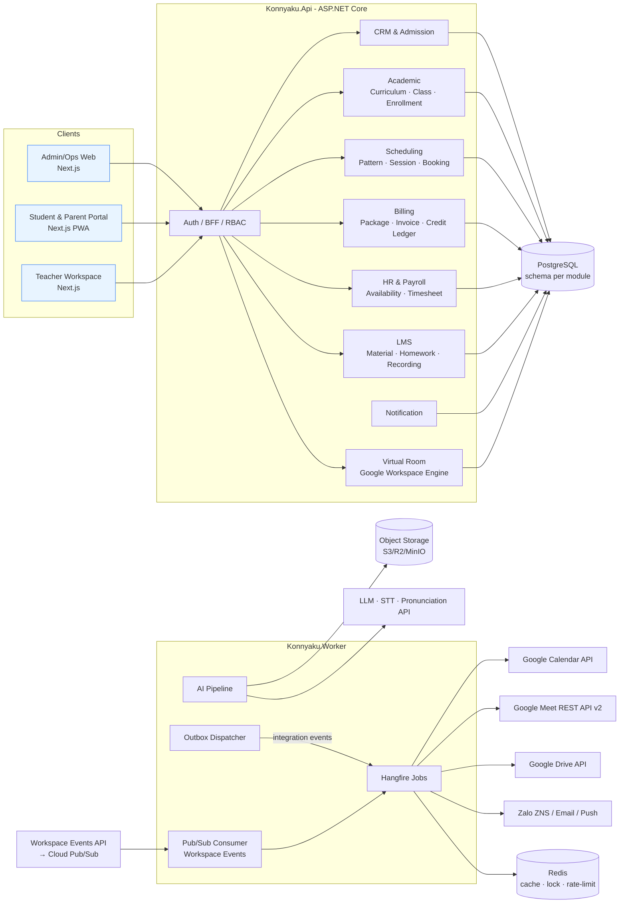
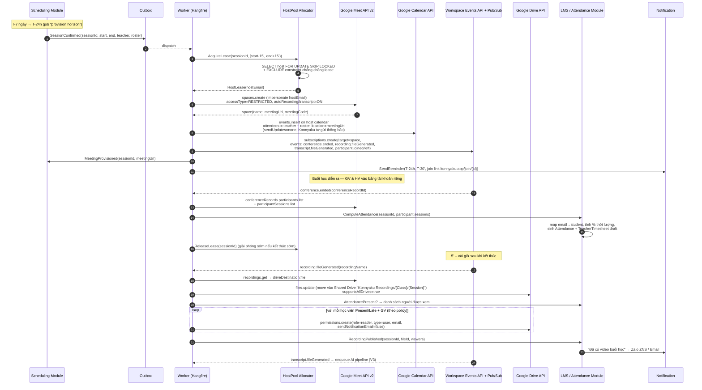

# Chương 2 — Kiến trúc Hệ thống & Tích hợp Chuyên sâu

## 2.1 Quyết định kiến trúc: Modular Monolith (có lối thoát sang Microservices)

| Tiêu chí | Modular Monolith | Microservices |
|---|---|---|
| Team 2–6 dev giai đoạn đầu | ✅ Một repo, một deploy, debug dễ | ❌ Chi phí vận hành (K8s, tracing, contract) lớn hơn giá trị |
| Giao dịch xuyên nghiệp vụ (ghi danh + thu tiền + cấp credit) | ✅ Một transaction DB | ❌ Phải làm saga |
| Phần chịu tải/độ trễ khác biệt (Google sync, AI xử lý video) | ⚠️ Tách thành **worker process** riêng, cùng codebase | ✅ |
| Lộ trình tách sau này | ✅ Nếu ranh giới module + giao tiếp qua event được giữ kỷ luật | — |

**Kết luận**: Modular Monolith, **2 loại process** từ cùng một solution:
- `Konnyaku.Api` — HTTP API cho web/portal (scale ngang, stateless).
- `Konnyaku.Worker` — background jobs (Google sync, notification, AI pipeline). Tách process để job nặng không làm chậm API, và có thể scale riêng.
- `Konnyaku.AI` (V3) — service Python riêng *chỉ khi* cần model tự host; trước đó gọi API ngoài từ Worker.

Luật ranh giới module (kiểm tra tự động bằng architecture test):
1. Mỗi module sở hữu **schema DB riêng** (`crm.*`, `academic.*`, `scheduling.*`…). Không JOIN chéo schema trong code ghi.
2. Module giao tiếp với nhau qua **public contract** (interface trong `*.Contracts`) hoặc **integration event** qua Outbox — không reference vào `Domain`/`Infrastructure` của module khác.
3. Đọc báo cáo xuyên module được phép qua **read model / view** riêng (module `Reporting`).

## 2.2 Sơ đồ tổng thể

## 2.3 Google Workspace Engine

### 2.3.1 Khái niệm
| Khái niệm | Ý nghĩa |
|---|---|
| **HostAccount** | 1 user Google Workspace (Business Standard trở lên — có recording) thuộc pool, do hệ thống vận hành qua **Service Account + Domain-Wide Delegation** (impersonate). Không ai đăng nhập thủ công. |
| **HostLease** | Hợp đồng thuê HostAccount cho một khoảng `[start − 15', end + 15')` của một Session. Ràng buộc: một HostAccount không có 2 lease chồng nhau. |
| **MeetingSpace** | Meet space (Meet API `spaces.create`) hoặc event Calendar có `conferenceData`. Có `meetingCode`, `meetingUri`, cấu hình `accessType` (RESTRICTED/TRUSTED), auto-recording/transcript nếu tenant hỗ trợ. |
| **ConferenceRecord** | Một lần phòng thực sự diễn ra — nguồn của participants, recordings, transcripts. |

### 2.3.2 Hai chiến lược phòng — chọn theo loại lớp
- **Phòng cố định theo lớp** (*fixed room*): 1 space/lớp, link không đổi suốt khóa → UX tốt cho học viên nhỏ tuổi/phụ huynh. Nhưng gắn chặt với 1 HostAccount → giảm hiệu quả pooling.
- **Phòng theo buổi** (*per-session room*): mỗi buổi 1 space, lease host linh hoạt → tối ưu license. Portal hiển thị nút "Vào lớp" động, học viên không cần nhớ link.
- **Khuyến nghị**: mặc định *per-session*, nút "Vào lớp" trên portal/Zalo là điểm truy cập duy nhất (link redirect `konnyaku.app/join/{sessionId}` → kiểm tra quyền → redirect tới `meetingUri`). Như vậy đổi host/đổi phòng phút chót không ảnh hưởng học viên.

### 2.3.3 Sequence: cấp host → tạo Meet → kết thúc → lấy record → phân quyền

### 2.3.4 Điểm then chốt trong luồng
1. **Idempotency mọi bước**: mỗi job có khóa idempotency (`provision:{sessionId}:{version}`). Pub/Sub giao *at-least-once* → consumer phải chịu được event trùng.
2. **Event là tín hiệu, không phải nguồn sự thật**: Workspace Events có thể mất/trễ, subscription có TTL phải gia hạn. Luôn có **job đối soát (reconciliation)** chạy mỗi 30': với mỗi Session đã kết thúc > 1h mà chưa có attendance/recording → chủ động gọi `conferenceRecords.list(filter=space.name)`.
3. **Hủy/đổi giờ**: `SessionRescheduled` → hủy lease cũ, tìm host mới nếu host cũ bận; nếu dùng link redirect thì học viên không bị ảnh hưởng.
4. **Phân quyền xem**: chỉ học viên *đã tham dự* được xem có thể là chính sách gây tranh cãi — học viên vắng mới là người *cần* xem lại nhất. Đây là **policy cấu hình theo lớp/gói**: `RecordingAccessPolicy = AttendeesOnly | AllEnrolled | AllEnrolledAndMakeup`.
5. **Phương án không phụ thuộc Google account của học viên**: copy file sang object storage → transcode HLS → phát qua player Konnyaku với signed URL ngắn hạn + watermark email. Chi phí storage/băng thông cao hơn nhưng kiểm soát hoàn toàn (chống tải về, đo thời lượng xem cho churn model). Khuyến nghị: **V1 dùng Drive permission, V2 chuyển sang HLS** cho gói cao cấp.

### 2.3.5 Thuật toán cấp phát Host (Allocator)
- Bài toán = **tô màu đồ thị khoảng (interval graph coloring)**; greedy theo thời điểm bắt đầu là tối ưu về số màu (số host).
- Online (cấp từng buổi): chọn host rảnh trong khoảng, ưu tiên **best-fit** (host có lease kết thúc gần nhất trước `start`) để gom lịch, chừa host trống cho lớp đột xuất.
- Offline (đêm, cho 14 ngày tới): chạy lại tối ưu toàn cục, chỉ hoán đổi host cho Session **chưa provision** (đã gửi link thì giữ nguyên trừ khi dùng link redirect).
- Cảnh báo năng lực: nếu peak concurrency 14 ngày tới > `pool_size − buffer` → alert mua thêm license *trước* khi thiếu.

## 2.4 Xử lý bất đồng bộ, Rate Limit & độ tin cậy

### 2.4.1 Các mẫu (pattern) bắt buộc
| Mẫu | Áp dụng | Lý do |
|---|---|---|
| **Transactional Outbox** | Mọi integration event (`SessionConfirmed`, `EnrollmentActivated`…) ghi chung transaction với dữ liệu nghiệp vụ | Không bao giờ có "đã lưu DB nhưng không gửi event" hoặc ngược lại |
| **Inbox / dedup** | Consumer Pub/Sub, webhook Zalo/thanh toán | At-least-once delivery |
| **Background jobs (Hangfire)** | Gọi Google API, gửi thông báo, AI | Không gọi API ngoài trong request HTTP của người dùng |
| **Token bucket per-user + per-project** (Redis) | Mọi lệnh gọi Google | Quota Google tính theo *project* và theo *user được impersonate*; pool account nên phân tải đều |
| **Retry exponential backoff + jitter** | Lỗi 429, 403 `rateLimitExceeded`/`userRateLimitExceeded`, 5xx | Chuẩn khuyến nghị của Google |
| **Circuit breaker** | Khi Google API lỗi liên tục | Dừng đẩy job, tránh đốt quota và cascade failure |
| **Batch & horizon provisioning** | Tạo meet T-7 ngày → T-24h theo lô, rải đều trong ngày | Tránh "bão request" lúc 18h khi cả trăm lớp sắp bắt đầu |
| **Reconciliation jobs** | Lease mồ côi, session thiếu recording, subscription sắp hết hạn | Event có thể mất; hệ thống tự lành |

### 2.4.2 Phân hàng đợi (queue) theo mức ưu tiên
| Queue | Ví dụ job | SLA |
|---|---|---|
| `critical` | Provision phòng cho buổi bắt đầu < 2h, đổi GV đột xuất | < 1' |
| `default` | Attendance, publish recording, nhắc lịch | < 15' |
| `bulk` | Provision horizon 7 ngày, đồng bộ lịch hàng loạt | trong ngày |
| `ai` | Tóm tắt, chấm speaking | < 2h, chạy worker riêng, giới hạn đồng thời |

### 2.4.3 Có cần Message Broker (RabbitMQ/Kafka) không?
- **V1–V2: không.** Outbox + Hangfire (storage PostgreSQL) đủ cho hàng chục nghìn job/ngày, ít thành phần vận hành.
- Pub/Sub của Google là bắt buộc *chỉ* cho Workspace Events (pull subscription từ Worker — không cần public endpoint).
- Thêm broker khi: tách module thành service riêng, hoặc có nhiều consumer độc lập cho cùng một event.

### 2.4.4 Quan sát (Observability)
- OpenTelemetry trace xuyên API → Outbox → Job → Google API; mỗi Session có `correlationId` để tra cứu "vì sao lớp 19h hôm qua không có record".
- Dashboard vận hành: số lease đang hoạt động / pool size, job thất bại theo loại, quota Google đã dùng, session thiếu artifact.
