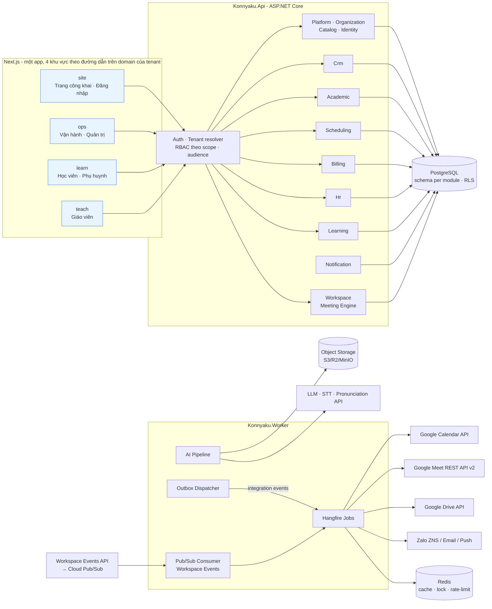
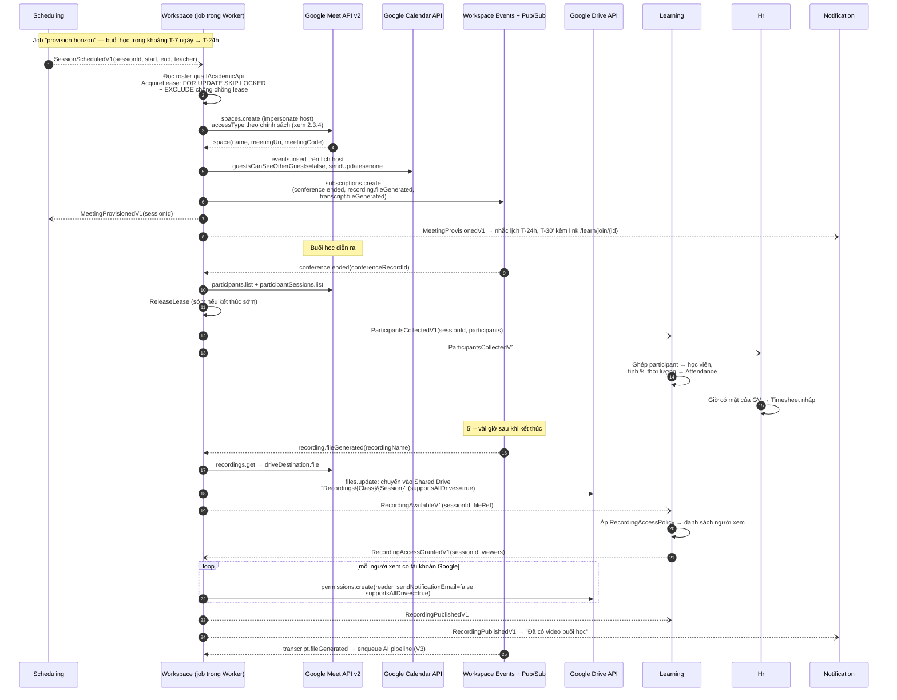

# Chương 2 — Kiến trúc Hệ thống & Tích hợp Chuyên sâu

## 2.1 Quyết định kiến trúc: Modular Monolith (có lối thoát sang Microservices)

| Tiêu chí | Modular Monolith | Microservices |
|---|---|---|
| Team 2–6 dev giai đoạn đầu | ✅ Một repo, một deploy, debug dễ | ❌ Chi phí vận hành (K8s, tracing, contract) lớn hơn giá trị |
| Giao dịch xuyên nghiệp vụ (ghi danh + thu tiền + cấp credit) | ✅ Chung DB, event qua Outbox chạy gần như tức thời, dễ debug | ❌ Saga qua mạng, khó debug |
| Phần chịu tải/độ trễ khác biệt (Google sync, AI xử lý video) | ⚠️ Tách thành **worker process** riêng, cùng codebase | ✅ |
| Lộ trình tách sau này | ✅ Nếu ranh giới module + giao tiếp qua event được giữ kỷ luật | — |

**Kết luận**: Modular Monolith, **2 loại process** từ cùng một solution:
- `Konnyaku.Api` — HTTP API cho web/portal (scale ngang, stateless).
- `Konnyaku.Worker` — background jobs (Google sync, notification, AI pipeline). Tách process để job nặng không làm chậm API, và có thể scale riêng.
- `Konnyaku.AI` (V3) — service Python riêng *chỉ khi* cần model tự host; trước đó gọi API ngoài từ Worker.

Luật ranh giới module (kiểm tra tự động bằng architecture test):
1. Mỗi module sở hữu **schema DB riêng**. **Không JOIN, không FK, không transaction chéo module** — kể cả để đọc (ngoại lệ duy nhất: `Reporting` chỉ đọc).
2. Module giao tiếp qua **Contracts** (interface trong `*.Contracts`, chỉ để đọc) hoặc **integration event** qua Outbox — không reference vào `Domain`/`Infrastructure` của module khác.

Danh sách module chuẩn, danh mục event, các đường cắt và playbook tách service: [Chương 6](06-evolution-strategy.md#62-bản-đồ-module-bounded-context--nguồn-chuẩn-duy-nhất).

**Đa tenant là mối quan tâm xuyên suốt, không phải một module**: mọi request, job, event và lệnh gọi tích hợp đều mang `tenant_id`; DB cô lập bằng Row-Level Security; tích hợp Google/Zalo/thanh toán dùng credential của từng tenant. Chi tiết: [Chương 7](07-multi-tenant-multi-language.md#74-cô-lập-dữ-liệu-giữa-các-tenant).

## 2.2 Sơ đồ tổng thể

## 2.3 Meeting Engine (module `Workspace`)

### 2.3.1 Khái niệm
| Khái niệm | Ý nghĩa |
|---|---|
| **WorkspaceConnection** | Kết nối giữa một tenant và domain Google Workspace **của chính tenant đó** (cách ủy quyền, scope, trạng thái). Pool, Shared Drive, recording đều thuộc kết nối này — không dùng chung giữa các trung tâm. |
| **HostAccount** | 1 user Google Workspace (gói có tính năng ghi hình, vd Business Standard trở lên) thuộc pool của tenant, do hệ thống vận hành qua ủy quyền domain-wide (impersonate). Không ai đăng nhập thủ công. |
| **HostLease** | Thuê HostAccount cho khoảng `[start − 15', end + 15')` của một buổi học. Ràng buộc chống chồng lease nằm **trong schema `workspace`** ([3.3.4](03-core-database.md#334-workspacehost_account--workspacehost_lease)). |
| **MeetingSpace** | Phòng Meet (`spaces.create` của Meet API, hoặc event Calendar có `conferenceData`). Có `meetingCode`, `meetingUri`, `accessType`, cấu hình ghi hình/transcript tự động (nếu API hỗ trợ — xem 2.3.4). |
| **ConferenceRecord** | Một lần phòng thực sự diễn ra — nguồn của participants, recordings, transcripts. |

### 2.3.2 Hai chiến lược phòng — chọn theo loại lớp
- **Phòng cố định theo lớp** (*fixed room*): 1 space/lớp, link không đổi suốt khóa → UX tốt cho học viên nhỏ tuổi/phụ huynh. Nhưng gắn chặt với 1 HostAccount → giảm hiệu quả pooling.
- **Phòng theo buổi** (*per-session room*): mỗi buổi 1 space, lease host linh hoạt → tối ưu license.
- **Khuyến nghị**: mặc định *per-session*; điểm truy cập duy nhất là nút "Vào lớp" trên portal/Zalo trỏ tới link của Konnyaku:
  - Học viên: `https://{tenant-host}/learn/join/{sessionId}`
  - Giáo viên: `https://{tenant-host}/teach/join/{sessionId}`

  Link kiểm tra quyền rồi redirect tới `meetingUri`. Đổi host/đổi phòng phút chót không ảnh hưởng người học.

### 2.3.3 Sequence: cấp host → tạo Meet → kết thúc → lấy record → phân quyền

Mũi tên `--)` là **integration event** (bất đồng bộ qua Outbox); module khác không bao giờ được gọi trực tiếp để ghi.

### 2.3.4 Điểm then chốt trong luồng
1. **Idempotency mọi bước**: mỗi job có khóa idempotency (`provision:{sessionId}:{version}`). Pub/Sub giao *at-least-once* → consumer phải chịu được event trùng.
2. **Event là tín hiệu, không phải nguồn sự thật**: Workspace Events có thể mất/trễ, subscription có TTL phải gia hạn. Luôn có **job đối soát** chạy mỗi 30': buổi học đã kết thúc > 1h mà chưa có participants/recording → chủ động gọi `conferenceRecords.list(filter=space.name)`.
3. **Hủy/đổi giờ**: `SessionRescheduledV1` → hủy lease cũ, tìm host mới nếu host cũ bận; link redirect giữ nguyên.
4. **Phân quyền xem** do `Learning` quyết định theo chính sách cấu hình theo lớp/gói: `RecordingAccessPolicy = AttendeesOnly | AllEnrolled | AllEnrolledAndMakeup`. Lưu ý học viên vắng mới là người *cần* xem lại nhất.
5. **Ghép participant ↔ học viên**: Meet API trả participant là `users/{id}` + tên hiển thị, **không đảm bảo có email**. Cách làm: lần đầu học viên vào lớp qua link `/learn/join` khi đã đăng nhập Google, ghi lại `google_user_id` vào hồ sơ; các lần sau ghép theo ID. Không ghép được → GV xác nhận tay.
6. **Học viên không có tài khoản Google** (tài khoản do trung tâm cấp, xem [7.9.3](07-multi-tenant-multi-language.md#793-tài-khoản-do-trung-tâm-cấp-học-viên)): vào Meet với tư cách khách. Chính sách phòng:
   - Lớp có học viên dạng này → `accessType` cho phép khách xin vào + **GV là co-host** để duyệt (host account không có người trực).
   - Điểm danh của họ do GV xác nhận tay; xem lại recording qua player HLS của Konnyaku (mục 8) thay vì quyền Drive.
7. **Quyền riêng tư**: không đưa toàn bộ roster vào attendee của event Calendar (lộ email của trẻ vị thành niên/phụ huynh cho nhau); link Konnyaku là cách vào lớp.
8. **Phương án recording không phụ thuộc Google account**: copy file sang object storage → transcode HLS → phát qua player Konnyaku với signed URL ngắn hạn + watermark. Khuyến nghị: **V1 dùng quyền Drive, V2 thêm HLS** (bắt buộc cho học viên không có Google).
9. **Cần xác minh trong spike kỹ thuật tuần đầu** (tính năng có thể còn preview/beta hoặc đã đổi):
   - Bật ghi hình/transcript tự động qua cấu hình space; gán co-host qua API.
   - `accessType` của space tạo bằng Meet API có nhận người được mời qua Calendar hay không; cách tốt nhất có thể là tạo event với `conferenceData.createRequest` rồi chỉnh space bằng `spaces.patch`.
   - Subscription theo **user host** (một subscription/host) có thay thế được subscription theo từng space hay không — giảm mạnh số subscription phải gia hạn.
   - Quyền Drive cho người ngoài domain trên Shared Drive (cấu hình chia sẻ ra ngoài của tenant).
10. **An ninh ủy quyền**: một credential của Konnyaku được ủy quyền domain-wide trên domain của mọi tenant → lộ key là lộ tất cả. Bắt buộc: **không dùng key file** (ký JWT bằng IAM `signJwt`/Workload Identity), scope tối thiểu, kiểm tra kỹ phương án phát hành dạng **Google Workspace Marketplace app** để admin tenant cài đặt. Ghi thành ADR (Chương 5).

### 2.3.5 Môi trường dev & test của Meeting Engine

Dev và CI **không cần Google Workspace thật**. Module `Workspace` làm việc với Google qua một lớp provider (`IVirtualRoomProvider` + adapter cho Calendar/Meet/Drive/Events), nên mỗi môi trường chọn một provider bằng cấu hình `Modules:Workspace:Provider`:

| Provider | Dùng ở | Hành vi |
|---|---|---|
| `Fake` *(mặc định dev & CI)* | Máy dev, test tích hợp, demo | Lưu "phòng" trong DB, trả `meetingUri` giả (trang mô phỏng của Konnyaku). Một endpoint chỉ bật ở Development (`POST /api/workspace/dev/sessions/{id}/simulate`) phát ra đủ chuỗi sự kiện: kết thúc buổi học, danh sách người tham gia (có/không Google, vào trễ, rời sớm), recording sẵn sàng — để chạy trọn luồng điểm danh → trừ buổi → xem lại video mà không cần ai mở Meet. |
| `Google` + WireMock | Test hợp đồng (contract test) | Gọi đúng client Google thật nhưng tới WireMock: giả lập 429/403 rate limit, 5xx, event trùng/mất — kiểm tra retry, idempotency, đối soát. |
| `Google` | Spike tuần đầu, môi trường staging | Workspace **test domain** riêng (không dùng domain production), Pub/Sub thật. Là nơi duy nhất kiểm chứng các điểm ở mục 9 phía trên. |
| `LiveKit`/`Jitsi` *(tùy chọn)* | Demo có video thật tại máy dev | Chạy bằng docker; cũng là phương án dự phòng nếu mô hình host pool của Google không dùng được. |

Hệ quả: Phase phát triển Meeting Engine làm provider `Fake` trước, toàn bộ luồng nghiệp vụ chạy được end-to-end; provider `Google` cắm vào sau khi có test domain.

### 2.3.6 Thuật toán cấp phát Host (Allocator)
- Bài toán = **tô màu đồ thị khoảng (interval graph coloring)**; greedy theo thời điểm bắt đầu là tối ưu về số màu (số host).
- Online (cấp từng buổi): chọn host rảnh trong khoảng, ưu tiên **best-fit** (host có lease kết thúc gần nhất trước `start`) để gom lịch, chừa host trống cho lớp đột xuất.
- Offline (đêm, cho 14 ngày tới): chạy lại tối ưu toàn cục, chỉ hoán đổi host cho buổi **chưa provision**.
- Cảnh báo năng lực: nếu peak concurrency 14 ngày tới > `pool_size − buffer` → alert mua thêm license *trước* khi thiếu.

## 2.4 Xử lý bất đồng bộ, Rate Limit & độ tin cậy

### 2.4.1 Các mẫu (pattern) bắt buộc
| Mẫu | Áp dụng | Lý do |
|---|---|---|
| **Transactional Outbox** | Mọi integration event ([6.2.1](06-evolution-strategy.md#621-danh-mục-integration-event-chính)) ghi chung transaction với dữ liệu nghiệp vụ của module phát | Không bao giờ có "đã lưu DB nhưng không gửi event" hoặc ngược lại |
| **Inbox / dedup** | Consumer Pub/Sub, webhook Zalo/thanh toán | At-least-once delivery |
| **Background jobs (Hangfire)** | Gọi Google API, gửi thông báo, AI | Không gọi API ngoài trong request HTTP của người dùng |
| **Token bucket per-user + per-tenant + per-project** (Redis) | Mọi lệnh gọi Google | Quota Google tính theo *project* (dùng chung giữa mọi tenant) và theo *user được impersonate*; giới hạn theo tenant để một trung tâm không ăn hết quota của trung tâm khác |
| **Fair-share theo tenant** | Hàng đợi job | Hangfire chỉ có hàng đợi ưu tiên tĩnh → **tự xây**: cổng token theo tenant trước khi enqueue (job vượt hạn mức bị hoãn lại). Ước lượng ~1 tuần công |
| **Retry exponential backoff + jitter** | Lỗi 429, 403 `rateLimitExceeded`/`userRateLimitExceeded`, 5xx | Chuẩn khuyến nghị của Google |
| **Circuit breaker** | Khi Google API lỗi liên tục | Dừng đẩy job, tránh đốt quota và cascade failure |
| **Batch & horizon provisioning** | Tạo meet T-7 ngày → T-24h theo lô, rải đều trong ngày | Tránh "bão request" lúc 18h khi cả trăm lớp sắp bắt đầu |
| **Reconciliation jobs** | Lease mồ côi, buổi thiếu recording, subscription sắp hết hạn | Event có thể mất; hệ thống tự lành |

### 2.4.2 Phân hàng đợi (queue) theo mức ưu tiên
| Queue | Ví dụ job | SLA |
|---|---|---|
| `critical` | Provision phòng cho buổi bắt đầu < 2h, đổi GV đột xuất | < 1' |
| `default` | Attendance, publish recording, nhắc lịch | < 15' |
| `bulk` | Provision horizon 7 ngày, import dữ liệu | trong ngày |
| `ai` | Tóm tắt, chấm speaking | < 2h, chạy worker riêng, giới hạn đồng thời |

### 2.4.3 Có cần Message Broker (RabbitMQ/Kafka) không?
- **V1–V2: không.** Outbox + Hangfire (storage PostgreSQL) đủ cho hàng chục nghìn job/ngày, ít thành phần vận hành.
- Pub/Sub của Google là bắt buộc *chỉ* cho Workspace Events (pull subscription từ Worker — không cần public endpoint).
- Thêm broker khi: tách module thành service riêng, hoặc có nhiều consumer độc lập cho cùng một event.

### 2.4.4 Quan sát (Observability)
- OpenTelemetry trace xuyên API → Outbox → Job → Google API; mỗi buổi học có `correlationId` để tra cứu "vì sao lớp 19h hôm qua không có record".
- Mọi log/trace có `tenant_id` (không log dữ liệu cá nhân).
- Dashboard vận hành: số lease đang hoạt động / pool size theo tenant, job thất bại theo loại, quota Google đã dùng, buổi học thiếu artifact.
