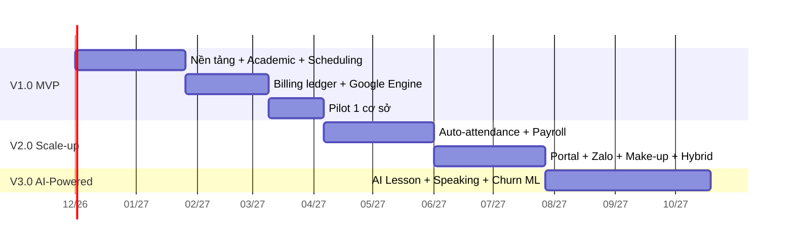

# Chương 4 — Lộ trình Triển khai Thực chiến

> Ước lượng thời gian giả định team **3–4 dev (2 BE, 1–2 FE) + 1 PO/BA kiêm QA**. Nhân đôi nếu chỉ 1–2 người.

## V1.0 — MVP "Thay Excel + tự động hóa Meet" (~4–5 tháng)

**Mục tiêu kinh doanh**: Một cơ sở vận hành 100% lớp online trên Konnyaku, bỏ Excel/Google Sheet xếp lịch; điều phối viên không còn tạo link Meet thủ công.

| Nhóm | Tính năng cốt lõi |
|---|---|
| Nền tảng | Đăng nhập (Google SSO cho nhân viên/GV, email OTP cho học viên), RBAC 5 vai trò (Admin, Điều phối, Tư vấn, GV, Học viên/Phụ huynh), audit log, outbox |
| CRM tối giản | Lead → Student, phụ huynh, ghi kết quả test đầu vào (nhập tay) |
| Academic | Program/Level/Curriculum đến cấp Lesson, Class, Enrollment (Active/Frozen/Dropped) |
| Scheduling | Pattern RRULE + materialize session, phát hiện xung đột GV (exclusion constraint), đổi giờ/hủy buổi có lý do, availability GV |
| Billing | Package, đơn hàng, ghi nhận thanh toán (thủ công/chuyển khoản), **credit ledger**, số dư buổi |
| Google Engine | Pool host + lease, tạo Meet theo buổi, link `join/{sessionId}`, đưa recording vào Shared Drive + share theo roster |
| Điểm danh | GV điểm danh tay trên Teacher Workspace (auto ở V2) → sinh `Consume` |
| Thông báo | Email nhắc lịch T-24h |

**Definition of Done**
- [ ] 2 người xếp cùng 1 GV vào giờ trùng đồng thời → đúng 1 thành công, người còn lại nhận thông báo xung đột (test tích hợp chạy song song).
- [ ] ≥ 99% session trong 4 tuần pilot có link Meet được tạo tự động trước T-24h; 0 trường hợp 2 buổi cùng lúc dùng chung host.
- [ ] ≥ 95% buổi có recording được gắn vào bài học trong ≤ 6h sau khi kết thúc; buổi thiếu recording đều có alert.
- [ ] Số dư buổi của mọi học viên khớp đối soát thủ công của kế toán cuối tháng pilot (sai lệch = 0).
- [ ] Đổi giờ 1 buổi không làm thay đổi link học viên đang dùng.
- [ ] Xem được lịch sử thay đổi của bất kỳ session/enrollment nào (ai, khi nào, vì sao).
- [ ] Không có secret (service account key) trong repo; key lưu ở secret manager, rotation có tài liệu.

**Cố ý KHÔNG làm ở V1**: lương, portal học viên đầy đủ, Zalo, offline/hybrid, AI, gamification.

## V2.0 — Scale-up "Vận hành đa cơ sở, tự động hóa end-to-end" (~4 tháng)

**Mục tiêu kinh doanh**: Mở rộng 3–5 cơ sở + hybrid; giảm 70% thời gian điều phối & tính lương; giảm số license Workspace nhờ dữ liệu peak concurrency; sẵn sàng bán SaaS cho trung tâm thứ 2 (multi-tenant).

| Nhóm | Tính năng cốt lõi |
|---|---|
| Auto-attendance (F1) | Workspace Events + participant sessions → attendance tự động, GV duyệt ngoại lệ |
| HR & Payroll | Pay rate theo GV/loại lớp/tiền tệ, timesheet tự sinh, dạy thay, kỳ lương, xuất payslip; khóa kỳ |
| Student/Parent Portal (PWA) | Lịch học, nút "Vào lớp", xem lại video, số dư buổi, đăng ký học bù, xin bảo lưu |
| Smart Make-up (F5) | Gợi ý lớp bù cùng Lesson |
| Hybrid & phòng vật lý | Room booking, buffer di chuyển giữa cơ sở, lớp hybrid (Meet + phòng) |
| Omnichannel (F6) | Zalo ZNS + template registry + fallback, kịch bản chăm sóc theo event |
| Churn v1 (F4) | Rule-based risk score + task cho tư vấn viên |
| Billing nâng cao | Hóa đơn điện tử (tích hợp nhà cung cấp HĐĐT), hoàn tiền theo policy, báo cáo doanh thu chưa thực hiện, cổng thanh toán (VietQR/VNPay/MoMo) với webhook idempotent |
| Pool optimizer | Tối ưu offline, báo cáo peak concurrency, cảnh báo thiếu license |
| Multi-tenant | `tenant_id` + RLS, cấu hình policy theo tenant |
| Recording HLS (tùy chọn) | Chuyển recording sang object storage + player có watermark |

**Definition of Done**
- [ ] ≥ 90% attendance được sinh tự động không cần sửa; thời gian GV xử lý điểm danh trung bình < 1'/buổi.
- [ ] Bảng lương tháng được chốt trong ≤ 1 ngày làm việc; chênh lệch so với cách tính cũ được giải thích đầy đủ từng dòng.
- [ ] ≥ 60% yêu cầu học bù được học viên tự xử lý trên portal, không qua điều phối viên.
- [ ] Tỷ lệ gửi ZNS thành công ≥ 95%, có fallback ghi nhận đầy đủ.
- [ ] Dữ liệu tenant A không bao giờ đọc được từ tenant B (test RLS tự động trong CI).
- [ ] Hệ thống chịu 300 buổi học đồng thời trong giờ cao điểm mà không có job `critical` trễ > 1' (load test với Google API được mock).
- [ ] Lỗi Google API kéo dài 30' không làm mất event nào; sau khi phục hồi, reconciliation tự bù đủ.

## V3.0 — AI-Powered "Từ quản lý sang nâng chất lượng học" (~3–4 tháng, chạy song song được)

**Mục tiêu kinh doanh**: Khác biệt hóa sản phẩm — phụ huynh *thấy* con tiến bộ sau mỗi buổi; tăng retention 10–15%; Academic Manager coaching GV bằng dữ liệu.

| Nhóm | Tính năng cốt lõi |
|---|---|
| AI Lesson Intelligence (F2) | Tóm tắt buổi, từ vựng/cấu trúc, homework gợi ý, báo cáo cho phụ huynh; chỉ số TTT/STT |
| Speaking Score (F3) | Chấm phát âm/lưu loát/ngữ pháp theo CEFR, Skill Profile động |
| Adaptive Placement Test (F8) | CAT + speaking tự chấm |
| Churn ML (F4 v2) | Model dự đoán (gradient boosting) huấn luyện trên dữ liệu V1–V2, giải thích được (top lý do) |
| Gamification (F7) | XP/streak/badge gắn với hành vi thật |
| AI Copilot nội bộ | Hỏi đáp dữ liệu vận hành bằng ngôn ngữ tự nhiên (read-only, có phân quyền) cho quản lý; trợ lý xếp lịch đề xuất phương án khi GV nghỉ |

**Definition of Done**
- [ ] ≥ 85% tóm tắt buổi học được GV đánh giá "dùng được không cần sửa nhiều" (khảo sát mẫu 200 buổi).
- [ ] Điểm speaking tự động tương quan ≥ 0.75 với điểm của 2 giám khảo người trên tập kiểm định.
- [ ] Churn model: precision ≥ 0.6 ở top 10% rủi ro; A/B test chứng minh nhóm được chăm sóc có retention cao hơn có ý nghĩa thống kê.
- [ ] Mọi xử lý AI chỉ chạy trên học viên có consent hợp lệ cho mục đích đó; thu hồi consent → dừng xử lý và xóa dữ liệu phái sinh trong SLA cam kết.
- [ ] Chi phí AI/buổi học được đo và nằm trong ngân sách đặt trước (vd < 2% học phí/buổi).
- [ ] Không gửi dữ liệu nhận diện học viên (tên, email) sang nhà cung cấp AI khi không cần thiết; transcript được pseudonymize trước khi gửi.

## Rủi ro lớn nhất & cách giảm

| Rủi ro | Giai đoạn | Giảm thiểu |
|---|---|---|
| Mô hình host pool bị Google hạn chế/không phù hợp điều khoản | V1 | Xác nhận với reseller sớm; `IVirtualRoomProvider` để đổi provider |
| Meet API (auto-recording, members/co-host) thay đổi hoặc còn preview | V1–V2 | Spike kỹ thuật 1 tuần **trước khi** chốt V1; fallback: GV bấm record + nhắc trong Teacher Workspace |
| Dữ liệu cũ (Excel) bẩn khi migrate | V1 | Công cụ import có bước validate + báo cáo lỗi, import số dư buổi bằng bút toán `Adjust` có ghi chú |
| GV không chấp nhận quy trình mới | V1–V2 | Teacher Workspace tối giản, mobile-first; đo thời gian thao tác của GV như một KPI |
| Phạm vi phình to | Mọi giai đoạn | Mỗi tính năng phải gắn 1 trong 3 chỉ số: lấp đầy lớp, retention, chi phí/giờ dạy |
