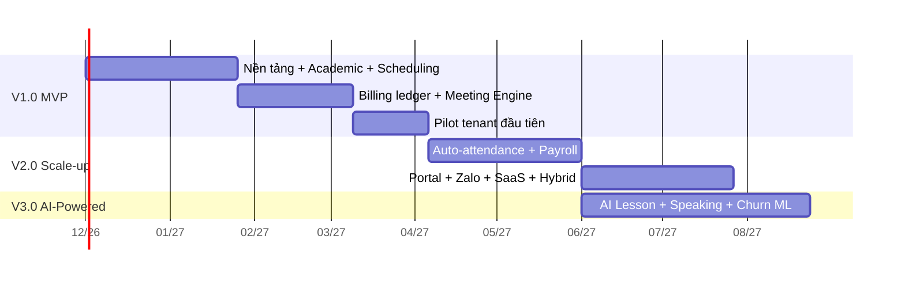

# Chương 4 — Lộ trình Triển khai Thực chiến

> Đây là **nguồn duy nhất** về việc tính năng nào thuộc giai đoạn nào; các chương khác chỉ tham chiếu. V3 có thể chạy song song với nửa sau của V2.
>
> Ước lượng thời gian giả định team **3–4 dev (2 BE, 1–2 FE) + 1 PO/BA kiêm QA**. Nhân đôi nếu chỉ 1–2 người.

## V1.0 — MVP "Thay Excel + tự động hóa Meet" (~4–5 tháng)

**Mục tiêu kinh doanh**: Trung tâm pilot (tenant đầu tiên) vận hành 100% lớp online trên Konnyaku, bỏ Excel/Google Sheet xếp lịch; điều phối viên không còn tạo link Meet thủ công. Một tenant thứ hai được tạo trên cùng hệ thống để chứng minh cô lập dữ liệu.

| Nhóm | Tính năng cốt lõi |
|---|---|
| Nền tảng | Identity toàn nền tảng + membership theo tenant, RBAC theo phạm vi tenant/nhóm cơ sở/cơ sở với 7 vai trò mặc định (Admin trung tâm, Quản lý cơ sở, Điều phối, Tư vấn, Kế toán, GV, Học viên/Phụ huynh), audit log, outbox, đủ 10 đường cắt module ([6.3](06-evolution-strategy.md#63-mười-đường-cắt-bắt-buộc)) |
| Đa tenant & đa cơ sở (nền móng) | `tenant_id` + RLS mọi bảng, tenant context trong job/event, subdomain theo tenant, cơ sở (gồm cơ sở ảo Online), cấu hình kế thừa Platform → Tenant → Nhóm cơ sở → Cơ sở, lịch nghỉ lễ; tenant do nhân viên Konnyaku khởi tạo |
| Đa ngôn ngữ (nền móng) | Giao diện `vi` + `en` đầy đủ, không chuỗi cứng, người dùng tự chọn ngôn ngữ; danh mục ngôn ngữ giảng dạy + khung năng lực (seed CEFR, IELTS, Cambridge YLE, JLPT, HSK, TOPIK); năng lực GV theo ngôn ngữ |
| Cổng truy cập | Xác thực tập trung `auth.konnyaku.app`; trang đăng nhập 2 tab tách realm (Học viên·Phụ huynh / Giáo viên·Nhân viên); học viên đăng nhập bằng Google hoặc tài khoản do trung tâm cấp (bắt buộc đổi mật khẩu lần đầu); nhân viên/GV bằng Google, 2FA cho Admin/Kế toán; trang công khai tối giản (locale trong URL) + form đăng ký có captcha & consent |
| CRM tối giản | Lead (từ form đăng ký hoặc nhập tay, gán tư vấn viên theo cơ sở) → hồ sơ học viên + tài khoản, phụ huynh, ghi kết quả test đầu vào (nhập tay) |
| Academic | Program (ngôn ngữ + khung năng lực), Course Level, Curriculum đến cấp Lesson, Class, Enrollment (đủ trạng thái ở [3.3.5](03-core-database.md#335-academicenrollment)), sĩ số theo buổi |
| Scheduling | Pattern RRULE + materialize session, phát hiện xung đột GV (exclusion constraint), đổi giờ/hủy buổi có lý do, availability GV |
| Billing | Package, đơn hàng, ghi nhận thanh toán (thủ công/chuyển khoản), **credit ledger**, số dư buổi |
| Meeting Engine (`Workspace`) | Kết nối Google Workspace của tenant, pool host + lease, tạo Meet theo buổi, link `/learn/join/{sessionId}` và `/teach/join/{sessionId}`, đưa recording vào Shared Drive + cấp quyền theo `RecordingAccessPolicy`. Trung tâm chưa có Google Workspace dùng **phòng học có sẵn** (provider `Konnyaku`: WebRTC P2P mesh, tối đa 6 người/phòng, signaling Rust `services/signaling`, TURN coturn), cùng luồng vào lớp và cùng `ParticipantsCollectedV1`; ghi hình của phòng này để sau |
| Điểm danh | GV điểm danh tay trên app `teach` (tự động ở V2) → `AttendanceConfirmedV1` → Billing ghi `Consume` |
| Thông báo | Email nhắc lịch T-24h; template theo `(key, kênh, locale)` với bản `vi`/`en` |

**Definition of Done**
- [ ] 2 người xếp cùng 1 GV vào giờ trùng đồng thời → đúng 1 thành công, người còn lại nhận thông báo xung đột (test tích hợp chạy song song).
- [ ] ≥ 99% session trong 4 tuần pilot có link Meet được tạo tự động trước T-24h; 0 trường hợp 2 buổi cùng lúc dùng chung host.
- [ ] ≥ 95% buổi có recording được gắn vào bài học trong ≤ 6h sau khi kết thúc; buổi thiếu recording đều có alert.
- [ ] Số dư buổi của mọi học viên khớp đối soát thủ công của kế toán cuối tháng pilot (sai lệch = 0).
- [ ] Đổi giờ 1 buổi không làm thay đổi link học viên đang dùng.
- [ ] Xem được lịch sử thay đổi của bất kỳ session/enrollment nào (ai, khi nào, vì sao).
- [ ] Không có secret (service account key) trong repo; key lưu ở secret manager, rotation có tài liệu.
- [ ] Dữ liệu tenant A không bao giờ đọc được từ tenant B: CI kiểm tra mọi bảng có `tenant_id` đều bật RLS; test chạy cùng câu truy vấn dưới 2 tenant.
- [ ] Đổi ngôn ngữ giao diện `vi` ↔ `en` không còn chuỗi chưa dịch trên mọi màn hình V1 (kiểm tra bằng pseudo-localization + CI thiếu key).
- [ ] Tạo được lớp tiếng Nhật (JLPT) bên cạnh lớp tiếng Anh (CEFR) mà không sửa code.
- [ ] Một người vừa là GV vừa là phụ huynh đăng nhập đồng thời cả hai tab trên cùng trình duyệt không xung đột; token `aud=learn` gọi endpoint chỉ dành cho `staff` bị từ chối (test tự động).
- [ ] Form đăng ký tạo Lead và giao tư vấn viên trong < 1'; gửi form trùng không tạo Lead trùng.

**Cố ý KHÔNG làm ở V1**: lương, portal học viên đầy đủ, Zalo, offline/hybrid, AI, gamification, self-service onboarding tenant, gói dịch vụ/thu phí SaaS, locale giao diện ngoài `vi`/`en`.

## V2.0 — Scale-up "Vận hành đa cơ sở, tự động hóa end-to-end" (~4 tháng)

**Mục tiêu kinh doanh**: Mở rộng 3–5 cơ sở + hybrid; giảm 70% thời gian điều phối & tính lương; giảm số license Workspace nhờ dữ liệu peak concurrency; mở bán SaaS cho các trung tâm khác, kể cả trung tâm dạy ngôn ngữ ngoài tiếng Anh.

| Nhóm | Tính năng cốt lõi |
|---|---|
| Auto-attendance (F1) | Workspace Events + participant sessions → attendance tự động, GV duyệt ngoại lệ |
| HR & Payroll | Pay rate theo GV/loại lớp/tiền tệ, timesheet tự sinh, dạy thay, kỳ lương, xuất payslip; khóa kỳ |
| Trang công khai đầy đủ | Danh mục khóa học theo ngôn ngữ/level/độ tuổi, lịch khai giảng còn chỗ, hồ sơ GV (opt-in), đặt lịch test/học thử, quản lý nội dung trong `ops`, UTM & báo cáo kênh; OTP SĐT/Zalo cho học viên |
| Student/Parent Portal (PWA) | Lịch học, nút "Vào lớp", xem lại video, số dư buổi, đăng ký học bù, xin bảo lưu |
| Smart Make-up (F5) | Gợi ý lớp bù cùng Lesson |
| Hybrid & phòng vật lý | Room booking, buffer di chuyển giữa cơ sở (dùng `org.branch_travel_time` đã có từ V1), lớp hybrid (Meet + phòng) |
| Omnichannel (F6) | Zalo ZNS + template registry + fallback, kịch bản chăm sóc theo event |
| Churn v1 (F4) | Rule-based risk score + task cho tư vấn viên |
| Billing nâng cao | Hóa đơn điện tử (tích hợp nhà cung cấp HĐĐT), hoàn tiền theo policy, báo cáo doanh thu chưa thực hiện, cổng thanh toán (VietQR/VNPay/MoMo) với webhook idempotent |
| Pool optimizer | Tối ưu offline, báo cáo peak concurrency, cảnh báo thiếu license |
| SaaS self-service | Wizard onboarding tenant (cơ sở, chương trình, kết nối Google Workspace có kiểm tra scope tự động, import Excel), gói dịch vụ + feature flag, metering, custom domain, xuất dữ liệu tenant |
| Đa cơ sở nâng cao | Bảng giá theo cơ sở, doanh thu theo cơ sở lớp vs cơ sở thu, đơn vị xuất HĐĐT theo cơ sở, báo cáo hợp nhất |
| Đa ngôn ngữ mở rộng | Giao diện thêm `ja`, `ko`, `zh-Hans`; nền tảng quản lý bản dịch; tenant ghi đè thuật ngữ; template thông báo theo locale người nhận; ngân hàng placement theo ngôn ngữ; ruby text (furigana/pinyin) |
| Recording HLS | Chuyển recording sang object storage + player có watermark; **bắt buộc** cho trung tâm có học viên không dùng Google |

**Definition of Done**
- [ ] ≥ 90% attendance được sinh tự động không cần sửa; thời gian GV xử lý điểm danh trung bình < 1'/buổi.
- [ ] Bảng lương tháng được chốt trong ≤ 1 ngày làm việc; chênh lệch so với cách tính cũ được giải thích đầy đủ từng dòng.
- [ ] ≥ 60% yêu cầu học bù được học viên tự xử lý trên portal, không qua điều phối viên.
- [ ] Tỷ lệ gửi ZNS thành công ≥ 95%, có fallback ghi nhận đầy đủ.
- [ ] Một trung tâm mới tự onboarding đến buổi học đầu tiên trong ≤ 1 ngày, không cần nhân viên Konnyaku can thiệp.
- [ ] Một tenant chạy import 50.000 học viên không làm job `critical` của tenant khác trễ quá SLA.
- [ ] Hệ thống chịu 300 buổi học đồng thời trong giờ cao điểm mà không có job `critical` trễ > 1' (load test với Google API được mock).
- [ ] Lỗi Google API kéo dài 30' không làm mất event nào; sau khi phục hồi, reconciliation tự bù đủ.

## V3.0 — AI-Powered "Từ quản lý sang nâng chất lượng học" (~3–4 tháng, chạy song song được)

**Mục tiêu kinh doanh**: Khác biệt hóa sản phẩm — phụ huynh *thấy* con tiến bộ sau mỗi buổi; tăng retention 10–15%; Academic Manager coaching GV bằng dữ liệu.

| Nhóm | Tính năng cốt lõi |
|---|---|
| AI Lesson Intelligence (F2) | Tóm tắt buổi, từ vựng/cấu trúc, homework gợi ý, báo cáo cho phụ huynh; chỉ số TTT/STT |
| Speaking Score (F3) | Chấm phát âm/lưu loát/ngữ pháp theo khung năng lực của từng ngôn ngữ, Skill Profile động; ma trận khả năng AI theo ngôn ngữ (bắt đầu với tiếng Anh, mở dần ja/zh/ko) |
| Adaptive Placement Test (F8) | CAT + speaking tự chấm, theo ngôn ngữ |
| AI đa ngôn ngữ cho phụ huynh | Tóm tắt/nhận xét dịch sang ngôn ngữ liên lạc của phụ huynh |
| Network nhượng quyền (tùy nhu cầu) | HQ xuất bản giáo trình cho tenant thành viên, báo cáo hợp nhất có đồng ý |
| Silo cho tenant enterprise (khi có khách) | Công cụ chuyển dữ liệu một tenant sang DB riêng + Tenant Placement Registry |
| Churn ML (F4 v2) | Model dự đoán (gradient boosting) huấn luyện trên dữ liệu V1–V2, giải thích được (top lý do) |
| Gamification (F7) | XP/streak/badge gắn với hành vi thật |
| AI Copilot nội bộ | Hỏi đáp dữ liệu vận hành bằng ngôn ngữ tự nhiên (read-only, có phân quyền) cho quản lý; trợ lý xếp lịch đề xuất phương án khi GV nghỉ |

**Definition of Done**
- [ ] ≥ 85% tóm tắt buổi học được GV đánh giá "dùng được không cần sửa nhiều" (khảo sát mẫu 200 buổi).
- [ ] Điểm speaking tự động tương quan ≥ 0.75 với điểm của 2 giám khảo người trên tập kiểm định.
- [ ] Churn model: precision ≥ 0.6 ở top 10% rủi ro; A/B test chứng minh nhóm được chăm sóc có retention cao hơn có ý nghĩa thống kê.
- [ ] Mọi xử lý AI chỉ chạy trên học viên có consent hợp lệ cho mục đích đó; thu hồi consent → dừng xử lý và xóa dữ liệu phái sinh trong SLA cam kết.
- [ ] Chi phí AI/buổi học được đo và nằm trong ngân sách đặt trước (vd < 2% học phí/buổi).
- [ ] Không gửi dữ liệu nhận diện học viên (tên, email) sang nhà cung cấp AI khi không cần thiết; transcript được pseudonymize trước khi gửi.

## Rủi ro lớn nhất & cách giảm

| Rủi ro | Giai đoạn | Giảm thiểu |
|---|---|---|
| Mô hình host pool bị Google hạn chế/không phù hợp điều khoản | V1 | Xác nhận với reseller sớm; `IVirtualRoomProvider` để đổi provider |
| Meet API (ghi hình tự động, co-host, `accessType`, subscription) thay đổi hoặc còn preview | V1–V2 | Spike kỹ thuật 1 tuần **trước khi** chốt V1 (danh sách ở [2.3.4](02-architecture.md#234-điểm-then-chốt-trong-luồng) mục 9); fallback: GV bấm record + nhắc trong app `teach` |
| Một credential của Konnyaku được ủy quyền trên domain của mọi tenant | V1+ | Không dùng key file, scope tối thiểu, cân nhắc Marketplace app — ADR trước khi onboard tenant thứ hai |
| Dữ liệu cũ (Excel) bẩn khi migrate | V1 | Công cụ import có bước validate + báo cáo lỗi, import số dư buổi bằng bút toán `Adjust` có ghi chú |
| GV không chấp nhận quy trình mới | V1–V2 | App `teach` tối giản, mobile-first; đo thời gian thao tác của GV như một KPI |
| Rò rỉ dữ liệu giữa các trung tâm | Mọi giai đoạn | RLS + query filter hai lớp, fail-closed khi thiếu tenant context, test RLS bắt buộc trong CI, pentest trước khi mở bán SaaS |
| Mỗi tenant đòi tùy biến riêng | V2+ | Tùy biến qua cấu hình, feature flag, ghi đè thuật ngữ — **không** rẽ nhánh code theo tenant |
| Phạm vi phình to | Mọi giai đoạn | Mỗi tính năng phải gắn 1 trong 3 chỉ số: lấp đầy lớp, retention, chi phí/giờ dạy |
