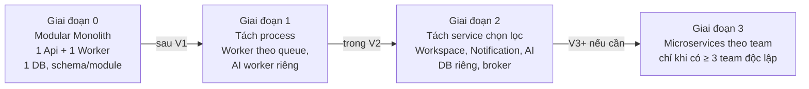
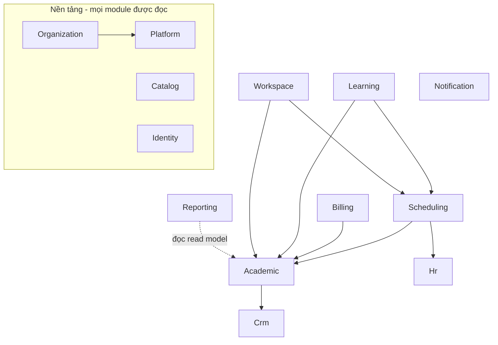
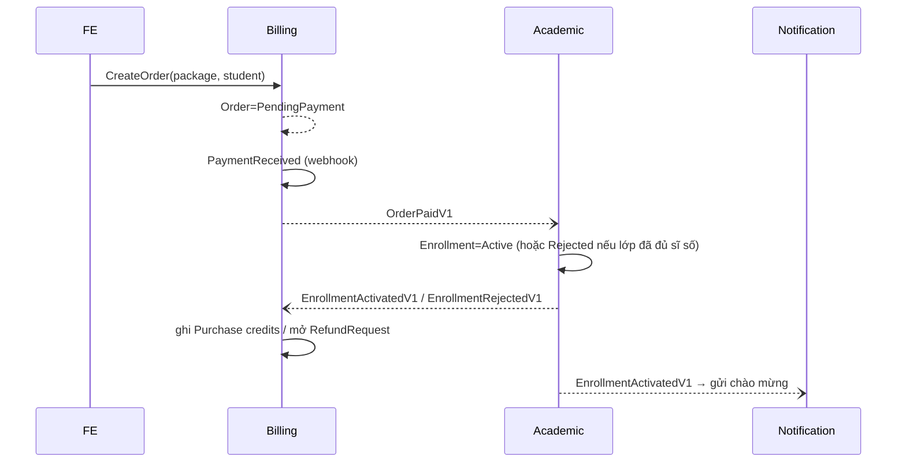

# Chương 6 — Chiến lược Tiến hóa Kiến trúc: Monolith → Module → Microservices

> Mục tiêu: **tách một module thành service riêng chỉ cần đổi cấu hình và hạ tầng, không phải viết lại nghiệp vụ.** Muốn vậy, các "đường cắt" (seams) phải có từ commit đầu tiên, vì đường cắt bổ sung về sau luôn đắt hơn nhiều lần.

## 6.1 Nguyên tắc nền: bỏ qua bước "monolith thường"

Không bao giờ có giai đoạn "monolith rối rồi mới tách module". Konnyaku **khởi đầu là Modular Monolith**, nghĩa là ngay từ ngày đầu mỗi module đã hành xử *như thể* nó là một service — chỉ khác là đang chạy chung process.



| Giai đoạn | Khi nào | Thay đổi | Code nghiệp vụ bị sửa |
|---|---|---|---|
| 0 → 1 | Job nặng làm chậm API | Thêm host process đăng ký một tập module/queue | Không |
| 1 → 2 | Module đạt tiêu chí tách ([6.6](#66-khi-nào-tách-một-module--tiêu-chí-định-lượng)) | DB riêng + transport HTTP/broker cho Contracts/Event | Không (chỉ đổi adapter) |
| 2 → 3 | Nhiều team, nhịp release khác nhau | Repo/pipeline riêng | Không |

## 6.2 Bản đồ module (Bounded Context) — nguồn chuẩn duy nhất

Bảng dưới là **danh sách module chuẩn** của Konnyaku; các chương khác chỉ tham chiếu tới đây.

| Module | Schema | Sở hữu (tóm tắt) | Contracts đồng bộ |
|---|---|---|---|
| `Platform` | `platform` | Tenant, domain, Tenant Placement Registry, gói dịch vụ, feature flag, setting kế thừa | `IPlatformApi` (setting, feature flag) |
| `Organization` | `org` | Cơ sở, nhóm cơ sở, phòng, lịch nghỉ của tenant/cơ sở, thời gian di chuyển | `IOrganizationApi` |
| `Catalog` | `catalog` | Dữ liệu chuẩn nền tảng: ngôn ngữ, khung năng lực, level, kỹ năng, quốc gia, lễ quốc gia | `ICatalogApi` |
| `Identity` | `identity` | User toàn nền tảng, credential, membership, role, phân quyền theo phạm vi | `IIdentityApi` |
| `Crm` | `crm` | Lead, hồ sơ học viên, phụ huynh, placement test, consent | `ICrmApi` |
| `Academic` | `academic` | Chương trình, giáo trình, lớp, ghi danh, sĩ số & chỗ học bù | `IAcademicApi` (roster, enrollment) |
| `Scheduling` | `scheduling` | Pattern, buổi học, đặt chỗ GV/phòng (`resource_booking`) | `ISchedulingApi` |
| `Workspace` | `workspace` | **Meeting Engine**: kết nối Google Workspace của tenant, host pool & lease, meeting space, recording, participant log | — (chỉ phát event) |
| `Learning` | `learning` | Điểm danh, feedback, homework, skill score, chính sách quyền xem recording | `ILearningApi` |
| `Billing` | `billing` | Bảng giá, gói học, đơn hàng, hóa đơn, thanh toán, **credit ledger & số dư buổi** | `IBillingApi` (số dư) |
| `Hr` | `hr` | Hồ sơ GV, năng lực, availability, đơn giá, timesheet, kỳ lương | `IHrApi` (năng lực, availability) |
| `Notification` | `notify` | Template theo kênh + locale, gửi & theo dõi | — (chỉ nghe event) |
| `Reporting` | `reporting` | Read model báo cáo, đọc replica | — |
| `Ai` *(V3)* | `ai` | Pipeline tóm tắt, chấm điểm | — (chỉ qua event) |

Thuật ngữ: module **`Workspace`** (Meeting Engine) ≠ *Google Workspace* (sản phẩm của Google) ≠ app **`teach`** (giao diện cho giáo viên).



Luật phụ thuộc:
1. **Đồ thị gọi đồng bộ (Contracts) không có chu trình** và chỉ dùng để **đọc** dữ liệu cần ngay. Mọi thay đổi trạng thái sang module khác đi bằng **event**. Ví dụ `Billing` không gọi `Learning`; `Learning` phát `AttendanceConfirmedV1` → `Billing` ghi bút toán `Consume`.
2. `Notification` **không phụ thuộc ai** — chỉ nghe event. Đây là ứng viên tách dễ nhất.
3. `Workspace` chỉ **đọc** `ISchedulingApi` (buổi học) và `IAcademicApi` (roster); mọi kết quả trả về bằng event (bảng 6.2.1). Quyết định *ai được xem recording* thuộc `Learning`, `Workspace` chỉ thực thi cấp quyền.
4. `Reporting` là ngoại lệ có kiểm soát: chỉ đọc, qua view/read replica, không bao giờ ghi (đọc nhiều schema, không chỉ Academic như sơ đồ rút gọn).
5. Các module nền tảng (`Platform`, `Organization`, `Catalog`, `Identity`) thay đổi chậm → module khác đọc qua Contracts có cache, hoặc giữ **bản sao cục bộ cập nhật bằng event** (`BranchCreatedV1`, `SettingChangedV1`) để khi tách service không phải gọi mạng cho mỗi request.

### 6.2.1 Danh mục integration event chính

| Event | Phát bởi | Nghe bởi |
|---|---|---|
| `SessionScheduledV1` / `SessionRescheduledV1` / `SessionCancelledV1` | Scheduling | Workspace, Learning, Hr, Notification, Academic (chỗ học bù) |
| `MeetingProvisionedV1` | Workspace | Scheduling (trạng thái `Provisioned`), Notification |
| `ParticipantsCollectedV1` | Workspace | Learning (điểm danh), Hr (giờ có mặt của GV) |
| `RecordingAvailableV1` | Workspace | Learning (áp chính sách quyền xem) |
| `RecordingAccessGrantedV1` | Learning | Workspace (cấp quyền Drive/HLS) |
| `RecordingPublishedV1` | Workspace | Learning (gắn vào bài học), Notification |
| `AttendanceConfirmedV1` | Learning | Billing (`Consume`), Hr (timesheet), Ai |
| `OrderPaidV1` | Billing | Academic |
| `EnrollmentActivatedV1` / `EnrollmentRejectedV1` | Academic | Billing, Notification, Crm |
| `ClassDeliveryModeChangedV1` / `ClassClosedV1` | Academic | Scheduling (đổi hình thức / huỷ các buổi còn lại → `SessionRescheduledV1` / `SessionCancelledV1` cho Workspace) |
| `CreditBalanceChangedV1` / `CreditLowV1` | Billing | Academic (hiển thị), Notification, Crm (churn) |
| `LeadCreatedV1` | Crm | Notification |
| `BranchCreatedV1`, `SettingChangedV1` | Organization, Platform | Mọi module giữ bản sao cục bộ |

Mọi event có envelope chung: `event_id`, `tenant_id`, `occurred_at`, `correlation_id`, `actor_id`, `schema_version`.

## 6.3 Mười đường cắt bắt buộc

| # | Đường cắt | Làm ngay ở Giai đoạn 0 | Lợi ích khi tách |
|---|---|---|---|
| 1 | **Module tự đăng ký** | Mỗi module có `IModule` (`AddServices`, `MapEndpoints`, `ConfigureJobs`); host chỉ liệt kê module | Host mới = chọn danh sách module khác |
| 2 | **Dữ liệu riêng** | Schema riêng + `DbContext` riêng + **DB role riêng chỉ có quyền trên schema của mình** | Chuyển schema sang DB khác bằng dump/replication, không sửa query |
| 3 | **Không FK, không JOIN chéo module** | Tham chiếu module khác bằng ID dạng value (`StudentId`), không navigation property | Không có gì "đứt" khi DB tách |
| 4 | **Contracts đồng bộ là interface** | `IAcademicApi` trong `*.Contracts`, implementation in-process | Thay bằng HTTP/gRPC client cùng interface |
| 5 | **Event qua Outbox + `IEventBus`** | Transport ban đầu: bảng outbox PostgreSQL + dispatcher | Đổi transport sang RabbitMQ/Kafka/Azure Service Bus |
| 6 | **Không transaction xuyên module** | Luồng nhiều module = command + event (saga/process manager) ngay cả khi chung DB | Không phải viết lại thành saga lúc tách |
| 7 | **DTO riêng ở biên** | Contracts chỉ chứa DTO/event có version, không lộ entity domain | Thay đổi nội bộ không phá consumer |
| 8 | **Route prefix theo module** | `/api/academic/...`, `/api/billing/...` | Gateway (YARP) chuyển prefix sang service mới, FE không đổi |
| 9 | **Cấu hình & secret theo module** | Section `Modules:Workspace:*`, không đọc config module khác | Service mới mang theo đúng phần cấu hình của nó |
| 10 | **Correlation & identity lan truyền** | `correlationId`, `tenantId`, `userId` trong header/event metadata; mỗi module tự authorize | Trace và phân quyền vẫn đúng khi qua mạng |

### 6.3.1 Đa tenant: trục tách thứ hai, độc lập với trục module

Konnyaku có **hai cách tách** không phụ thuộc nhau:

| Trục | Tách cái gì | Cơ chế | Khi nào |
|---|---|---|---|
| **Theo module** (dọc) | Một bounded context thành service riêng | Đường cắt 1–10 ở trên | Module đạt tiêu chí 6.6 |
| **Theo tenant** (ngang) | Dữ liệu một tenant sang DB riêng (Silo), hoặc một nhóm tenant sang cụm hạ tầng riêng (cell) | Tenant Placement Registry (`platform.tenant_placement`) ánh xạ `tenant_id → database/cell`; UUIDv7 toàn cục nên không trùng khóa | Khách enterprise, yêu cầu cô lập/vị trí dữ liệu, hoặc một tenant quá lớn |

Để hai trục không phá nhau, thêm 4 quy tắc vào 10 đường cắt:
1. **Tenant context là một phần của mọi hợp đồng**: mọi Contracts method nhận tenant từ `ITenantContext` (không truyền tay), mọi event envelope có `tenant_id`; adapter HTTP tự gắn header `X-Tenant-Id` từ context và service nhận tự thiết lập lại context + RLS.
2. **Connection string được phân giải theo `(module, tenant)`**, không theo module đơn thuần: `IConnectionResolver.Resolve("academic", tenantId)`. Hôm nay mọi cặp trỏ về cùng DB; sau này module tách ra hay tenant chuyển Silo đều chỉ đổi registry.
3. **Job và event nghiệp vụ không bao giờ xử lý nhiều tenant trong một transaction** — job "toàn hệ thống" thực chất là fan-out thành từng job theo tenant. Ngoại lệ duy nhất: job của nền tảng (metering, migration) chạy bằng DB role riêng có `BYPASSRLS`, có audit ([7.4.2](07-multi-tenant-multi-language.md#742-hai-lớp-bảo-vệ)).
4. **Không có dữ liệu nghiệp vụ dùng chung giữa tenant**. Dữ liệu toàn nền tảng gồm: `Catalog` (chỉ đọc, sao chép được sang mọi DB/cell), `Identity` (user, credential) và `Platform` (tenant, gói, registry). Hai module sau **luôn ở DB trung tâm** kể cả khi tenant chuyển Silo — `IConnectionResolver` bỏ qua tenant với chúng. Khung năng lực do tenant tự thêm lưu ở bảng có `tenant_id`, không ghi vào `catalog`.

## 6.4 Mẫu code cho các đường cắt

### 6.4.1 Module tự đăng ký
```csharp
public interface IModule
{
    string Name { get; }
    void AddServices(IServiceCollection services, IConfiguration config);
    void MapEndpoints(IEndpointRouteBuilder app);   // dưới prefix /api/{name}; mỗi nhóm endpoint khai báo audience được phép (learn | staff)
    void ConfigureJobs(IJobRegistry jobs) { }
    void ConfigureConsumers(IConsumerRegistry consumers) { }
}

// Konnyaku.Api/Program.cs — host chỉ là danh sách module
builder.AddModules(
    new PlatformModule(), new OrganizationModule(), new CatalogModule(),
    new IdentityModule(), new CrmModule(), new AcademicModule(),
    new SchedulingModule(), new BillingModule(), new LearningModule(),
    new HrModule(), new WorkspaceModule(), new NotificationModule(),
    new ReportingModule());

// Sau khi tách: Konnyaku.Workspace.Host/Program.cs
builder.AddModules(new WorkspaceModule());
```

### 6.4.2 Dữ liệu riêng
```csharp
public sealed class AcademicDbContext(DbContextOptions<AcademicDbContext> o) : DbContext(o)
{
    protected override void OnModelCreating(ModelBuilder b)
    {
        b.HasDefaultSchema("academic");
        b.ApplyConfigurationsFromAssembly(typeof(AcademicDbContext).Assembly);
    }
}
// Connection string riêng: "Modules:Academic:Db" → hôm nay trỏ cùng DB, user "konnyaku_academic"
// chỉ được GRANT trên schema academic. Truy vấn lén sang schema khác sẽ lỗi permission ngay ở dev.
// Migrations riêng theo module; bảng lịch sử migration nằm trong schema của module
// (role của module không có quyền trên schema public):
//   options.UseNpgsql(cs, x => x.MigrationsHistoryTable("__EFMigrationsHistory", "academic"));
//   dotnet ef migrations add X --context AcademicDbContext
```

### 6.4.3 Contracts đồng bộ — đổi transport không đổi caller
```csharp
// Konnyaku.Academic.Contracts
public interface IAcademicApi
{
    Task<EnrollmentSummaryDto?> GetEnrollment(Guid enrollmentId, CancellationToken ct);
    Task<IReadOnlyList<RosterEntryDto>> GetRoster(Guid classId, CancellationToken ct);
}

// Giai đoạn 0: Konnyaku.Academic.Infrastructure
internal sealed class InProcessAcademicApi(AcademicDbContext db) : IAcademicApi { ... }

// Giai đoạn 2: Konnyaku.Academic.Contracts.Http (gói client)
internal sealed class HttpAcademicApi(HttpClient http) : IAcademicApi { ... }

// Module consumer (Scheduling, Workspace) chỉ biết IAcademicApi — đăng ký implementation theo cấu hình:
// Modules:Academic:Transport = "InProcess" | "Http"
```
Quy tắc: **chỉ gọi đồng bộ để đọc dữ liệu cần ngay** (vd `Workspace` đọc roster khi tạo meeting). Mọi thay đổi trạng thái sang module khác đi bằng event.

### 6.4.4 Event qua Outbox
```csharp
// Konnyaku.Learning.Contracts/Events
public sealed record AttendanceConfirmedV1(
    Guid AttendanceId, Guid SessionId, Guid EnrollmentId,
    string Status, bool Billable, Instant ConfirmedAt) : IIntegrationEvent;

// Trong handler của Learning — cùng transaction với dữ liệu nghiệp vụ
db.Attendances.Update(attendance);
outbox.Add(new AttendanceConfirmedV1(...));     // ghi vào learning.outbox_message
await db.SaveChangesAsync(ct);

// Billing consumer — idempotent qua inbox (message_id PK)
public sealed class ConsumeCreditOnAttendance : IEventHandler<AttendanceConfirmedV1> { ... }
```
- Mỗi module có **bảng outbox/inbox trong schema của mình** — khi tách, bảng đi theo module.
- Tên event có hậu tố version (`V1`); đổi phá vỡ → phát song song `V2` một thời gian.
- `IEventBus` transport: `PostgresOutbox` (giai đoạn 0–1) → `RabbitMq`/`Kafka` (giai đoạn 2). Consumer không đổi.

### 6.4.5 Luồng nhiều module = process manager, không transaction lớn
Ví dụ **Ghi danh có thanh toán**:

Trong monolith các bước này chạy cách nhau vài trăm ms — người dùng không cảm nhận khác biệt, nhưng code đã sẵn sàng cho mạng.

## 6.5 Cưỡng chế bằng công cụ (không dựa vào kỷ luật cá nhân)

| Cơ chế | Bắt lỗi gì |
|---|---|
| **NetArchTest** trong CI | Module A tham chiếu `Domain`/`Infrastructure`/`Application` của module B; `Contracts` tham chiếu `Domain` |
| **Project reference rule** | `*.Contracts` chỉ được phụ thuộc `SharedKernel` tối thiểu; kiểm tra bằng `Directory.Build.targets` |
| **DB role theo schema** | JOIN/INSERT chéo schema → lỗi permission ngay ở môi trường dev |
| **Kiểm tra đồ thị phụ thuộc** | Test dựng đồ thị từ project references, fail nếu có chu trình |
| **Contract tests** | Snapshot JSON schema của event và DTO Contracts; đổi phá vỡ phải tăng version |
| **`internal` mặc định** | Mọi class trong Domain/Application/Infrastructure là `internal`; chỉ Contracts là `public` |

## 6.6 Khi nào tách một module — tiêu chí định lượng

Chỉ tách khi thỏa **ít nhất 2** tiêu chí:

| Tiêu chí | Tín hiệu đo được |
|---|---|
| Tải khác biệt | CPU/RAM của module chiếm > 40% process hoặc cần scale khác API |
| Cô lập lỗi | Sự cố của module (vd Google API treo) đã từng ảnh hưởng chức năng khác |
| Công nghệ khác | Cần Python/GPU (AI) |
| Nhịp release khác | Module cần deploy nhiều lần/ngày trong khi phần còn lại tuần/lần |
| Sở hữu team | Có team riêng ≥ 3 người chịu trách nhiệm module |
| Bảo mật/tuân thủ | Cần cô lập dữ liệu (vd payment, dữ liệu giọng nói trẻ em) |

**Thứ tự tách dự kiến**

| Ưu tiên | Module | Lý do | Độ khó |
|---|---|---|---|
| 1 | **AI Pipeline** | Python/GPU, chi phí riêng | Thấp — chỉ nghe event, ghi kết quả qua event |
| 2 | **Notification** | Không phụ thuộc ai, tải theo đợt | Thấp |
| 3 | **Workspace (Meeting Engine)** | Cô lập rate-limit & lỗi Google, scale theo giờ cao điểm | Trung bình — cần `ISchedulingApi`/`IAcademicApi` qua HTTP |
| 4 | Reporting | Đọc nặng, nên chạy trên read replica / data warehouse | Trung bình |
| Giữ lâu nhất | Academic + Scheduling + Billing + Learning | Liên kết nghiệp vụ chặt, tách sớm = "distributed monolith" | Cao |

## 6.7 Playbook tách một module (Strangler Fig)

Ví dụ tách **Workspace**:

| Bước | Việc làm | Kiểm tra trước khi đi tiếp |
|---|---|---|
| 1. Kiểm toán | Chạy architecture tests; liệt kê mọi Contracts/event Workspace dùng và cung cấp | 0 vi phạm, danh sách phụ thuộc rõ |
| 2. Tách process | Host `Konnyaku.Workspace.Host` chỉ đăng ký `WorkspaceModule`, vẫn dùng chung DB & outbox PostgreSQL; gỡ module khỏi Worker chính | Chạy song song 1 tuần, không job trùng (feature flag chọn nơi chạy) |
| 3. Tách transport | Bật broker; module Workspace và các consumer chuyển `IEventBus` sang broker; `IAcademicApi`/`ISchedulingApi` chuyển sang `Http` | Trace end-to-end đủ hop, độ trễ chấp nhận được |
| 4. Tách dữ liệu | Logical replication schema `workspace` sang DB mới → cutover connection string trong cửa sổ bảo trì ngắn | Đối soát số dòng, checksum |
| 5. Tách route | YARP gateway chuyển `/api/workspace/*` sang service mới | FE không đổi gì, smoke test pass |
| 6. Dọn dẹp | Gỡ project Workspace khỏi solution monolith (giữ gói `Contracts` publish NuGet nội bộ) | Build monolith không còn tham chiếu |

Mỗi bước **đảo ngược được** bằng cấu hình — không có "big bang".

## 6.8 Phản mẫu cần tránh

| Phản mẫu | Vì sao nguy hiểm | Thay bằng |
|---|---|---|
| Project `Common`/`Shared` chứa entity nghiệp vụ (`Student` dùng chung) | Mọi module dính vào nhau qua một thư viện | Mỗi module có mô hình riêng; chỉ chia sẻ value object kỹ thuật (`Money`, `TenantId`) |
| View DB JOIN nhiều schema dùng cho logic ghi | Khóa chặt dữ liệu, không tách được | Read model cục bộ cập nhật bằng event |
| Chuỗi gọi đồng bộ A→B→C | Khi tách thành chuỗi lỗi mạng, latency cộng dồn | Event + dữ liệu sao chép cục bộ |
| Generic repository dùng chung mọi module | Che giấu ranh giới, khuyến khích query chéo | Repository/handler trong từng module |
| Tách microservice theo tầng (UserService, EmailService) thay vì theo nghiệp vụ | Distributed monolith | Tách theo bounded context |
| Tách sớm "cho đẹp" | Chi phí vận hành tăng, không có lợi ích đo được | Chỉ tách khi đạt tiêu chí [6.6](#66-khi-nào-tách-một-module--tiêu-chí-định-lượng) |

## 6.9 Chi phí của kỷ luật này (và chỗ được nới)

- **Tốn thêm**: ~15–20% boilerplate (DTO Contracts, event, handler idempotent), luồng nhiều module eventual consistency khó debug hơn transaction.
- **Được nới**:
  - Trong **một** module: dùng transaction, JOIN, navigation tự do.
  - `Reporting` đọc trực tiếp nhiều schema (read-only) cho đến khi cần warehouse.
  - Query UI cần dữ liệu nhiều module: ghép ở **BFF/endpoint tổng hợp** gọi nhiều Contracts, hoặc read model, không phá ranh giới domain.

## 6.10 Kế hoạch thực hiện gắn với roadmap

| Mốc | Việc kiến trúc | Definition of Done |
|---|---|---|
| **Tuần 1–2 (trước tính năng)** | `IModule`, `SharedKernel`, outbox/inbox per module, `IEventBus` (PostgreSQL), DB role per schema, NetArchTest + contract snapshot trong CI, YARP-ready route prefix | Template module mới tạo bằng `dotnet new konnyaku-module`; CI fail khi cố tình vi phạm ranh giới (có test chứng minh) |
| **V1.0** | Mọi module tuân 10 đường cắt; luồng ghi danh/điểm danh→ledger chạy bằng event | 0 vi phạm architecture test; không có `DbContext` nào truy cập 2 schema |
| **V1→V2 (Giai đoạn 1)** | Worker tách theo queue; Workspace chạy host riêng chung DB | Có thể tắt/bật Workspace host mà API không bị ảnh hưởng |
| **V2.0** | Đánh giá tiêu chí 6.6 cho Notification, Workspace; dựng broker nếu tách; gateway YARP | Playbook 6.7 chạy thử trên staging cho 1 module, rollback được |
| **V3.0** | AI pipeline là service Python riêng, giao tiếp bằng event | AI lỗi/tắt không ảnh hưởng vận hành lớp học |

Bộ đo theo dõi định kỳ (mỗi sprint): số vi phạm ranh giới (phải = 0), số Contracts đồng bộ giữa module (nên giảm dần), số event đã version, thời gian để tạo module mới từ template.
