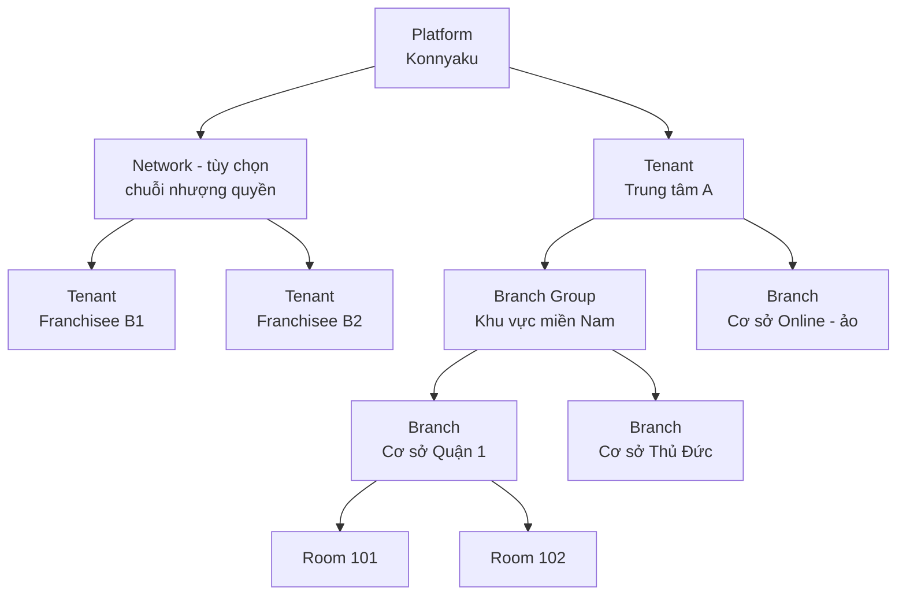
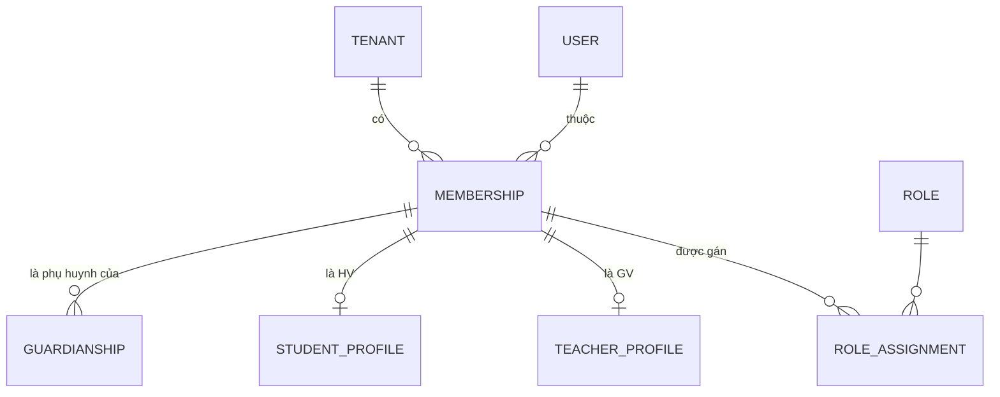
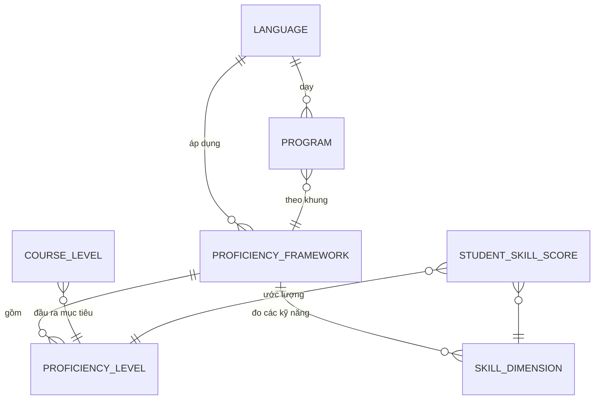
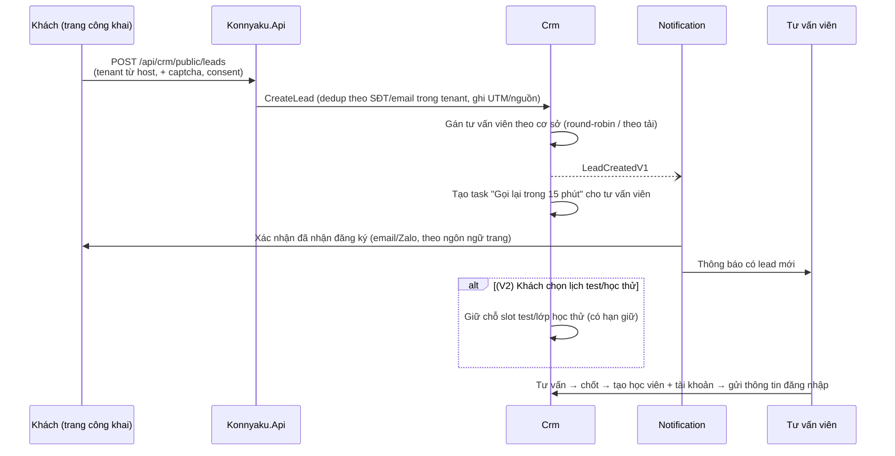

# Chương 7 — Đa trung tâm, Đa cơ sở, Đa ngôn ngữ

> Konnyaku là **nền tảng SaaS cho trung tâm ngoại ngữ**: nhiều trung tâm (tenant), mỗi trung tâm nhiều cơ sở, dạy nhiều ngôn ngữ, và người dùng tự chọn ngôn ngữ giao diện.
> Các trục này phải có trong **mô hình dữ liệu từ commit đầu tiên**. Thêm `tenant_id` hay tách "ngôn ngữ giảng dạy" khỏi "ngôn ngữ giao diện" vào một hệ thống đang chạy là một trong những cuộc di chuyển dữ liệu tốn kém nhất.

## 7.1 Bốn trục mở rộng và tác động

| Trục | Câu hỏi thiết kế cốt lõi | Đụng tới |
|---|---|---|
| **Đa trung tâm (multi-tenant)** | Dữ liệu trung tâm A có tuyệt đối không lọt sang B? Một người có thể thuộc nhiều trung tâm? | Mọi bảng, identity, job, event, tích hợp Google/Zalo/thanh toán, billing của nền tảng |
| **Đa cơ sở (multi-branch)** | Cái gì thuộc trung tâm, cái gì thuộc cơ sở? Ai được thấy cơ sở nào? Doanh thu tính cho cơ sở nào? | Phân quyền, giá, hóa đơn, phòng học, lịch nghỉ, báo cáo |
| **Đa ngôn ngữ giảng dạy** | "Level" nghĩa là gì khi khung năng lực mỗi ngôn ngữ khác nhau? GV dạy được những gì? | Curriculum, placement test, skill profile, AI chấm điểm, nội dung học |
| **Đa ngôn ngữ giao diện** | Ai thấy ngôn ngữ nào? Dữ liệu do trung tâm nhập (tên khóa học) có dịch được không? | Toàn bộ FE, thông báo, PDF, email, định dạng ngày/tiền, sắp xếp tên |

## 7.2 Mô hình tổ chức



| Cấp | Định nghĩa | Sở hữu |
|---|---|---|
| **Platform** | Konnyaku với vai trò nhà cung cấp SaaS | Gói dịch vụ, feature flag, danh mục chuẩn (ngôn ngữ, khung năng lực, múi giờ), bản dịch giao diện gốc |
| **Network** *(V3, tùy chọn)* | Chuỗi nhượng quyền: HQ ban hành giáo trình, chuẩn thương hiệu cho nhiều tenant độc lập về tài chính | Giáo trình được *xuất bản* cho tenant thành viên, báo cáo hợp nhất (khi tenant đồng ý) |
| **Tenant** | Một trung tâm = **một pháp nhân/đơn vị tài chính** trả tiền cho Konnyaku | Học viên, GV, chương trình, gói học, chính sách, tích hợp (Google Workspace, Zalo OA, cổng thanh toán, HĐĐT), thương hiệu |
| **Branch Group** | Nhóm cơ sở theo khu vực, chỉ để phân quyền và báo cáo | Không sở hữu dữ liệu nghiệp vụ |
| **Branch** | Cơ sở vật lý **hoặc cơ sở ảo "Online"** | Phòng học, lớp, bảng giá riêng (tùy chọn), lịch nghỉ, múi giờ, đơn vị xuất hóa đơn (nếu hạch toán độc lập) |
| **Room** | Phòng học vật lý | Sức chứa, thiết bị |

Quyết định quan trọng:
1. **Học viên thuộc tenant, không thuộc cơ sở.** Học viên có `home_branch_id` (cơ sở chăm sóc, tính KPI tư vấn) nhưng được ghi danh lớp ở bất kỳ cơ sở nào của tenant.
2. **Giáo viên thuộc tenant**, được gán dạy ở nhiều cơ sở; availability có thêm *địa điểm* để tính thời gian di chuyển giữa cơ sở.
3. **Lớp online cũng thuộc một cơ sở** (cơ sở ảo "Online" hoặc cơ sở quản lý lớp) — để doanh thu, chi phí GV, KPI luôn quy về được một đơn vị.
4. **Tenant = ranh giới bảo mật cứng**. Branch = ranh giới phân quyền mềm (cấu hình được).

## 7.3 Định danh xuyên tenant

Thực tế ngành: GV bản ngữ freelance dạy cho 2–3 trung tâm; phụ huynh có con học tiếng Anh ở trung tâm này và tiếng Nhật ở trung tâm khác. Nếu mỗi tenant tạo tài khoản riêng, họ phải nhớ nhiều mật khẩu và Konnyaku mất cơ hội làm marketplace GV sau này.



| Thực thể | Cấp | Ghi chú |
|---|---|---|
| `identity.user` | **Platform** | Một con người: email/SĐT (tùy chọn — trẻ em có thể không có), `preferred_locale`, `timezone`. Không chứa credential hay dữ liệu nghiệp vụ. |
| `identity.external_login` | Platform | `(provider, subject, user_id)` — Google, (V2) Zalo |
| `identity.password_credential` | Platform | `(user_id, password_hash, totp_secret?)` — đăng nhập bằng email + mật khẩu, 2FA cho nhân viên |
| `identity.local_credential` | **Tenant** | `(tenant_id, user_id, username, password_hash, must_change_password, locked_until)` — tài khoản do trung tâm cấp, chỉ dùng trên domain của tenant đó ([7.9.3](#793-tài-khoản-do-trung-tâm-cấp-học-viên)) |
| `identity.membership` | Tenant | Quan hệ user ↔ tenant; trạng thái mời/kích hoạt/khóa |
| `identity.role_assignment` | Tenant | `(membership, role, scope_type ∈ {tenant, branch_group, branch}, scope_id)` — một người có thể là Quản lý cơ sở Q1 và GV ở cơ sở Thủ Đức |
| `hr.teacher_profile`, `crm.student_profile` | Tenant | Hồ sơ nghiệp vụ **riêng từng tenant** — trung tâm A không thấy GV đó dạy ở đâu khác, lương bao nhiêu |

Quy tắc:
- Đăng nhập đi qua **domain xác thực trung tâm** `auth.konnyaku.app`, rồi redirect về host của tenant với phiên riêng của host đó (cookie gắn theo host). Người có nhiều membership chọn trung tâm ở trang chọn của `auth.konnyaku.app`; **đổi trung tâm = chuyển sang host của trung tâm kia**, không đổi tenant trong cùng một phiên.
- Mọi đăng nhập đều quy về một `identity.user`. Học viên nhỏ tuổi có user **không email**, đăng nhập bằng `local_credential`; phụ huynh có thể thao tác thay qua `guardianship`.
- Tenant **không** tra cứu được user của tenant khác. Mời người dùng bằng email: nếu email đã có user → tạo membership chờ người đó chấp nhận, không tự gắn.
- Xung đột lịch GV giữa các tenant **không** được phát hiện (bảo mật dữ liệu). V3 có thể thêm tùy chọn GV tự chia sẻ "khung bận" ẩn danh giữa các trung tâm.

## 7.4 Cô lập dữ liệu giữa các tenant

### 7.4.1 Chọn mô hình

| Mô hình | Ưu | Nhược | Dùng cho |
|---|---|---|---|
| **Pool**: chung DB, cột `tenant_id` + Row-Level Security | Rẻ, migration một lần, onboarding tức thì | Rủi ro rò rỉ nếu RLS sai; noisy neighbor | **Mặc định** — đa số trung tâm nhỏ/vừa |
| Schema-per-tenant | Cô lập tốt hơn | Migration N lần, hàng nghìn schema khó vận hành; xung đột với schema-per-module | Không dùng |
| **Silo**: DB riêng cho tenant | Cô lập tuyệt đối, đáp ứng yêu cầu hợp đồng/dữ liệu | Chi phí, vận hành nhiều DB | Tenant lớn/enterprise, yêu cầu riêng |

**Khuyến nghị: Pool mặc định + khả năng chuyển tenant sang Silo.** Hai mô hình dùng **cùng một bộ schema** (`academic`, `billing`…), chỉ khác connection string. Một **Tenant Placement Registry** (`platform.tenant_placement`) ánh xạ `tenant_id → database`. `Identity`, `Platform`, `Catalog` luôn ở DB trung tâm ([6.3.1](06-evolution-strategy.md#631-đa-tenant-trục-tách-thứ-hai-độc-lập-với-trục-module)). Vì mọi khóa chính là UUIDv7 toàn cục, chuyển dữ liệu một tenant sang DB riêng không bao giờ bị trùng khóa.

### 7.4.2 Hai lớp bảo vệ
1. **Lớp ứng dụng**: EF Core global query filter `e.TenantId == currentTenant.Id` cho mọi entity implement `ITenantOwned`; interceptor tự gán `TenantId` khi insert và **chặn** update làm đổi `TenantId`.
2. **Lớp DB (chốt chặn cuối)**: PostgreSQL RLS.

```sql
ALTER TABLE academic.class ENABLE ROW LEVEL SECURITY;
ALTER TABLE academic.class FORCE ROW LEVEL SECURITY;

CREATE POLICY tenant_isolation ON academic.class
  USING      (tenant_id = NULLIF(current_setting('app.tenant_id', true), '')::uuid)
  WITH CHECK (tenant_id = NULLIF(current_setting('app.tenant_id', true), '')::uuid);
```
- Ứng dụng kết nối bằng role **không phải owner, không có `BYPASSRLS`**.
- Gán tenant: mỗi request/job chạy trong **một transaction tường minh** và gọi `SELECT set_config('app.tenant_id', $1, true)` (tương đương `SET LOCAL`) ở đầu transaction — giá trị tự mất khi transaction kết thúc nên không rò sang request khác dùng lại connection. Lưu ý `SET LOCAL` ngoài transaction **không có tác dụng**, mà EF Core mặc định không bọc lệnh đọc trong transaction → phải dùng transaction tường minh (hoặc `set_config(..., false)` khi mở connection kèm reset khi trả về pool).
- Thiếu `app.tenant_id` → `current_setting(..., true)` trả NULL, hoặc chuỗi rỗng nếu connection từng được gán rồi reset → `NULLIF(..., '')` đưa cả hai về NULL → không thấy dòng nào (fail-closed) thay vì lỗi ép kiểu.
- Job của nền tảng cần xuyên tenant (metering, migrate) chạy bằng role riêng có `BYPASSRLS`, tách khỏi code nghiệp vụ, mọi lần dùng đều ghi audit.
- Test tự động trong CI: với mỗi bảng có `tenant_id`, kiểm tra RLS đã bật và policy tồn tại — bảng mới quên RLS là CI đỏ.

### 7.4.3 Ngữ cảnh tenant đi theo mọi luồng

| Điểm vào | Xác định tenant bằng |
|---|---|
| Web (site/learn/teach/ops) | Host: `{tenant}.konnyaku.app` hoặc custom domain → tra `platform.tenant_domain`. Token phải mang đúng tenant của host; **lệch → từ chối** (401), không bao giờ để token ghi đè host |
| Mobile/API client | Claim `tenant_id` trong token |
| Background job | `tenant_id` là tham số bắt buộc của mọi job; job runner thiết lập `ITenantContext` trước khi gọi handler |
| Integration event / Outbox | `tenant_id` trong metadata envelope; consumer thiết lập context từ đó |
| Webhook bên ngoài (thanh toán, Zalo) | URL `/hooks/{provider}/{tenantKey}` (ngoại lệ có chủ đích của quy tắc `/api/{module}`, vì nhà cung cấp gọi từ ngoài, không qua host của tenant) + xác minh chữ ký bằng secret **của tenant đó** |
| Google Workspace Events | Subscription/Pub/Sub message → tra `MeetingSpace` → tenant |
| Bảng điều khiển nền tảng (`/platform`) | **Không có tenant**: chỉ phục vụ trên host quản trị `admin.{base domain}` (`Platform:AdminHost`), token realm `platform` không mang `tid`. Thao tác trên một trung tâm (đếm học viên, tạo quản trị viên) chạy trong scope riêng đặt tenant đó (`ITenantScope`), nên vẫn qua RLS; mọi thao tác ghi `platform.audit_entry` |

Tenant bị nền tảng **tạm khóa** (`platform.tenant.status = Suspended`): middleware của API trả 403 `platform.tenant_suspended` cho mọi request của tenant đó (theo host hoặc theo `tid` của token), trừ `GET /api/platform/tenant` để trang công khai hiện thông báo; dữ liệu giữ nguyên.

Không có "tenant mặc định". Code chạy mà không có tenant context (ngoài phạm vi platform) phải **ném lỗi**, không âm thầm chạy.

### 7.4.4 Những thứ hay quên khi đa tenant
- **Unique constraint trên mã nghiệp vụ phải có `tenant_id`**: mã học viên, mã lớp, email học viên… là duy nhất *trong tenant*, không toàn hệ thống.
- **Mã hiển thị** (HV-000123, số phiếu thu) dùng bộ đếm theo tenant/cơ sở trong schema của module sở hữu mã đó: `<module>.sequence(tenant_id, scope, key, next_value)` + `UPDATE … RETURNING`, không dùng sequence PostgreSQL chung.
- **Cache key** có tiền tố tenant: `t:{tenantId}:...`. Cache thiếu tiền tố = rò dữ liệu.
- **File storage**: prefix `tenants/{tenantId}/...` + signed URL; bucket policy không cho liệt kê chéo.
- **Rate limit & quota theo tenant** (noisy neighbor): số request API, số job Google, phút AI, dung lượng — giới hạn theo gói dịch vụ.
- **Fair-share job theo tenant**: Hangfire không có sẵn → tự xây cổng hạn mức theo tenant trước khi enqueue ([2.4.1](02-architecture.md#241-các-mẫu-pattern-bắt-buộc)), để một tenant import 50.000 học viên không làm trễ lịch nhắc học của tenant khác.
- **Log & trace** có `tenant_id` để hỗ trợ, nhưng **không** log dữ liệu cá nhân.
- **Search index** (nếu dùng Meilisearch/Elastic): filter `tenant_id` bắt buộc ở tầng truy vấn, hoặc index riêng cho tenant silo.

### 7.4.5 Tích hợp bên ngoài là của tenant
| Tích hợp | Mô hình |
|---|---|
| **Google Workspace** | Mỗi tenant kết nối **domain Workspace của chính họ** (`WorkspaceConnection`): admin của tenant cấp quyền cho ứng dụng Konnyaku với scope tối thiểu — ưu tiên dạng **Google Workspace Marketplace app**, không dùng key file; xem rủi ro ở [2.3.4](02-architecture.md#234-điểm-then-chốt-trong-luồng) mục 10. Host pool, Shared Drive, recording **thuộc tenant**. Không bao giờ dùng chung pool giữa các tenant. |
| Gói "Konnyaku Managed Meeting" *(cân nhắc)* | Cho trung tâm nhỏ không có Workspace: Konnyaku cung cấp phòng họp từ pool của nền tảng. Rủi ro điều khoản license nặng hơn nhiều so với pool nội bộ một tenant (xem [1.4](01-product-expansion.md#14-lưu-ý-chiến-lược-về-host-account-pooling)) → chỉ làm sau khi có xác nhận pháp lý, hoặc dùng provider khác (Zoom/Jitsi tự host/LiveKit) qua `IVirtualRoomProvider`. |
| Zalo OA / ZNS | OA và template của từng tenant (có thể theo cơ sở) |
| Cổng thanh toán, HĐĐT | Credential theo tenant (và theo cơ sở nếu cơ sở hạch toán độc lập) |
| Email | Tên miền gửi của tenant (SPF/DKIM) hoặc mặc định `no-reply@konnyaku.app` với display name của tenant |

Secret của tenant lưu ở secret store/mã hóa bằng khóa riêng (envelope encryption), không bao giờ trả về FE sau khi lưu.

## 7.5 Đa cơ sở

### 7.5.1 Phân quyền theo phạm vi
- Mỗi permission được kiểm tra cùng **phạm vi**: `CanManageClass(classId)` = có role chứa permission đó với scope bao trùm `class.branch_id` (tenant ⊃ branch_group ⊃ branch).
- Lọc dữ liệu theo cơ sở làm ở **tầng ứng dụng** (danh sách `allowed_branch_ids` tính một lần mỗi request), **không** dùng RLS cho cơ sở — vì phạm vi người dùng linh hoạt và báo cáo cần cộng dồn nhiều cơ sở. RLS chỉ dành cho ranh giới tenant.
- Học viên/GV dùng chung toàn tenant: nhân viên cơ sở Q1 có thể *tìm* học viên của cơ sở khác (để ghi danh chéo) nhưng chỉ thấy trường tối thiểu, trừ khi có quyền rộng hơn.

### 7.5.2 Cấu hình kế thừa
`Platform default → Tenant → Branch Group → Branch` (cấp dưới ghi đè cấp trên):

| Cấu hình | Có thể đặt ở |
|---|---|
| Múi giờ, ngôn ngữ mặc định, tiền tệ | Tenant, Branch |
| Chính sách học bù/bảo lưu/hoàn tiền | Tenant, Branch |
| Bảng giá gói học | Tenant (mặc định), Branch (giá riêng — HCM khác tỉnh) |
| Lịch nghỉ lễ | Catalog (lễ quốc gia theo nước), Tenant, Branch (module `Organization`) |
| Đơn vị xuất hóa đơn, mẫu số/ký hiệu HĐĐT | Tenant hoặc Branch (cơ sở hạch toán độc lập có MST riêng) |
| Zalo OA, thông tin liên hệ in trên biên lai | Tenant, Branch |

Lưu dạng `platform.setting(scope_type, scope_id, key, value jsonb, version)`, đọc qua `ISettingProvider.Get<T>(key, branchId)` có cache. Đổi cấu hình phải có audit.

### 7.5.3 Các bài toán đa cơ sở riêng
| Bài toán | Hướng giải |
|---|---|
| **Thu ở cơ sở A, học ở cơ sở B** | Doanh thu thực hiện ghi theo *cơ sở của lớp* tại thời điểm `Consume`; tiền thu ghi theo *cơ sở thu*. Chênh lệch cuối kỳ ra báo cáo điều chuyển nội bộ. Quy tắc là cấu hình của tenant. |
| **GV dạy nhiều cơ sở trong ngày** | `resource_booking` của GV cộng *buffer di chuyển* theo cặp cơ sở (`org.branch_travel_time`); online ↔ offline cũng cần buffer |
| **Lịch nghỉ lễ** | Tết âm lịch mỗi năm một ngày khác → lịch nghỉ là **dữ liệu**, không phải quy tắc tính. Materialize session sẽ bỏ qua ngày nghỉ và tự kéo dài khóa học (cấu hình: kéo dài hay dạy bù). Cơ sở ở nước khác dùng lịch lễ nước đó. |
| **Chuyển cơ sở** | Như chuyển lớp: đóng enrollment cũ, mở enrollment mới, credit chuyển bằng bút toán; đổi `home_branch_id` có lịch sử |
| **Báo cáo** | Mọi bảng giao dịch có `branch_id` *snapshot tại thời điểm phát sinh* — đổi cơ sở của lớp sau này không làm sai báo cáo quá khứ |
| **Cơ sở ở nước khác** | Branch có `country_code`, `timezone`, `currency` riêng; tenant có `reporting_currency` và bảng tỷ giá để hợp nhất |

## 7.6 Đa ngôn ngữ giảng dạy

### 7.6.1 Tách "ngôn ngữ" khỏi "level"
"B1", "N3", "HSK 4", "TOPIK 3", "IELTS 6.5" là các **khung năng lực khác nhau**. Không được hard-code CEFR.



| Bảng | Ví dụ dữ liệu |
|---|---|
| `catalog.language` (platform) | Mã **BCP 47**: `en`, `ja`, `zh-Hans`, `ko`, `fr`, `de`, `vi` (dạy tiếng Việt cho người nước ngoài) |
| `catalog.proficiency_framework` (platform; khung riêng của tenant lưu ở bảng có `tenant_id` trong `academic`) | `CEFR`, `JLPT`, `HSK`, `TOPIK`, `IELTS`, `TOEIC`, `TOEFL_IBT`, `CAMBRIDGE_YLE` (Starters/Movers/Flyers cho trẻ em) |
| `catalog.proficiency_level` | `(framework, code, ordinal, cefr_approx)` — `JLPT N3`, ordinal 3, ≈ B1. Ánh xạ CEFR **chỉ mang tính tham khảo** để so sánh xuyên ngôn ngữ, không dùng để chấm |
| `catalog.skill_dimension` | Theo khung: CEFR có Listening/Reading/Speaking/Writing; JLPT có *Vocabulary & Kanji*, Grammar, Reading, Listening; HSK có thêm Hán tự |
| `academic.program` | `language_code`, `framework_id`, nhóm tuổi, mục tiêu (giao tiếp / luyện thi) |

Hệ quả:
- **Skill Profile** của học viên là `(student, language, framework, skill_dimension) → level + score`. Một học viên có thể có hồ sơ tiếng Anh và tiếng Nhật song song.
- **Placement test** là ngân hàng câu hỏi theo `(language, framework)`; thuật toán thích ứng dùng chung.
- **Smart make-up** chỉ ghép lớp cùng `language + curriculum lesson`.

### 7.6.2 Năng lực giáo viên
`hr.teacher_capability(teacher_profile_id, language_code, role ∈ {lead, assistant}, is_native_speaker, min_level, max_level, age_groups, certifications)`.
- Chứng chỉ (TESOL/CELTA, JLPT N1, HSK 6, TOPIK 6, DELF…) là tài liệu có hạn dùng, có đính kèm và người xác minh.
- Xếp lịch / tìm GV dạy thay lọc theo capability phù hợp lớp (`language`, `level`, `age_group`), sau đó mới đến availability.

### 7.6.3 AI theo từng ngôn ngữ
Năng lực AI không đồng đều giữa các ngôn ngữ → mỗi tính năng có **ma trận khả năng** và fallback:

| Tính năng | Phụ thuộc | Ví dụ khác biệt |
|---|---|---|
| Transcript buổi học | Meet transcript hoặc STT riêng | Ngôn ngữ hỗ trợ của Meet transcript có giới hạn; lớp **song ngữ** (GV giảng tiếng Việt xen ngoại ngữ) làm STT giảm chất lượng → cần STT đa ngôn ngữ |
| Chấm phát âm | Pronunciation assessment provider | Tiếng Trung có **thanh điệu**, tiếng Nhật có **cao độ** — không phải provider nào cũng chấm |
| Chấm viết | LLM | Viết Hán tự/Kanji cần nhận dạng nét viết tay — tính năng riêng |
| Tóm tắt cho phụ huynh | LLM | Bài học tiếng Nhật, tóm tắt gửi phụ huynh **bằng ngôn ngữ của phụ huynh** |

Thiết kế: `IAiCapabilityRegistry.Supports(feature, languageCode)` + provider cấu hình theo ngôn ngữ (`Ai:Providers:Pronunciation:ja = ...`). UI ẩn tính năng không hỗ trợ thay vì báo lỗi.

### 7.6.4 Nội dung học đa ngôn ngữ
- **Ruby text** (furigana cho tiếng Nhật, pinyin cho tiếng Trung) trong trình soạn và hiển thị bài học (`<ruby>`).
- **Font**: Noto Sans/Serif (VN có dấu, CJK, Hangul) tải theo nhu cầu (subset) — font CJK rất nặng.
- **Tìm kiếm**: full-text mặc định của PostgreSQL yếu với CJK (không tách từ bằng khoảng trắng) → dùng `pg_trgm` cho tìm kiếm ngắn, hoặc Meilisearch (hỗ trợ CJK tốt) khi cần tìm trong học liệu.
- **Nhập liệu**: homework hỗ trợ IME; không cắt chuỗi theo byte; độ dài tối đa tính theo ký tự (grapheme).
- **Ngôn ngữ RTL** (tiếng Ả Rập) cho nội dung bài học: trình hiển thị hỗ trợ `dir="auto"` ở cấp đoạn.

## 7.7 Giao diện đa ngôn ngữ (i18n)

### 7.7.1 Ba khái niệm "ngôn ngữ" — không được lẫn
| Khái niệm | Thuộc về | Ví dụ |
|---|---|---|
| **UI locale** | User (có thể ghi đè theo phiên) | GV người Nhật dùng giao diện tiếng Anh hoặc tiếng Nhật |
| **Target language** (ngôn ngữ giảng dạy) | Program/Class | Lớp tiếng Hàn |
| **Communication locale** (ngôn ngữ liên lạc) | Người nhận (phụ huynh/học viên) | Thông báo Zalo gửi phụ huynh bằng tiếng Việt dù con học tiếng Đức |

### 7.7.2 Chọn locale
Thứ tự ưu tiên: **lựa chọn của user** → mặc định của tenant (hoặc cơ sở) → `Accept-Language` của trình duyệt (khớp bằng thuật toán locale matching) → `en`.
- Bộ locale giao diện hỗ trợ là **danh sách của platform** (vd V1: `vi`, `en`; V2: `ja`, `ko`, `zh-Hans`); tenant chọn bật tập con nào cho người dùng của mình.
- App nội bộ (`ops`, `teach`, `learn` sau đăng nhập): locale lưu ở hồ sơ user + cookie, **không** đưa vào URL.
- Trang công khai (đăng ký học thử, placement test, trang giới thiệu của tenant): locale **có trong URL** (`/vi/...`, `/ja/...`) để SEO và chia sẻ link đúng ngôn ngữ.

### 7.7.3 Danh mục bản dịch (message catalog)
- **Không có chuỗi hiển thị cứng trong code** từ ngày đầu (lint rule chặn literal trong JSX).
- Định dạng **ICU MessageFormat** (số nhiều, giới tính, select): `"{count, plural, =0 {Chưa có buổi nào} other {# buổi}}"`.
- Nguồn sự thật: `frontend/packages/i18n/messages/{locale}/{namespace}.json`, chia namespace theo module (`academic`, `billing`…) để tải theo trang.
- Quy trình: dev chỉ thêm key `vi` + `en` → nền tảng quản lý bản dịch (Tolgee tự host / Crowdin / Lokalise) → AI dịch nháp → người duyệt → đồng bộ về repo qua PR. CI fail khi thiếu key ở locale bắt buộc; locale tùy chọn thì fallback.
- **Pseudo-localization** (`[!!Ḻéáŕñ ḿöŕé!!]`, dài thêm 40%) trong môi trường test để bắt lỗi tràn layout và chuỗi chưa dịch.

### 7.7.4 Tenant tùy biến thuật ngữ
Trung tâm A gọi "Học viên", trung tâm B gọi "Học sinh"; "Cơ sở" vs "Chi nhánh"; "Buổi" vs "Tiết". Cho phép **ghi đè message theo tenant**: `base catalog → tenant override` (chỉ một tập key cho phép ghi đè, lưu trong DB, cache). Chi phí nhỏ, giá trị bán hàng lớn.

### 7.7.5 Dữ liệu do tenant nhập cần dịch
Tên chương trình, mô tả gói học, tên khóa học hiển thị trên portal của học viên nước ngoài/phụ huynh.
- Kiểu `LocalizedString` trong domain, lưu `jsonb` `{"vi": "Tiếng Nhật giao tiếp", "en": "Conversational Japanese"}` + EF value converter; đọc theo locale với fallback về **ngôn ngữ mặc định của tenant**.
- Chỉ áp dụng cho trường *hiển thị cho người ngoài* (danh mục, gói học, thông báo mẫu). Dữ liệu vận hành (ghi chú, feedback GV) giữ nguyên ngôn ngữ người viết; có thể thêm nút "Dịch" bằng AI khi xem.
- Cần sắp xếp/tìm kiếm theo trường dịch → generated column cho locale mặc định của tenant + index.

### 7.7.6 Nội dung sinh ra phía server
- Email, ZNS, SMS, PDF (biên lai, phiếu lương, chứng nhận): template theo `(template_key, channel, locale, version)`, chọn theo **communication locale của người nhận**.
- ZNS bị ràng buộc bởi template đã duyệt của Zalo → thường chỉ tiếng Việt; người nhận dùng ngôn ngữ khác thì fallback sang email.
- Lỗi từ API trả **mã lỗi + tham số** (`{ "code": "schedule.teacher_conflict", "params": {...} }`), FE dịch. Chỉ text phía server (email/PDF) mới dịch ở BE.

### 7.7.7 Định dạng & văn hóa
| Vấn đề | Cách làm |
|---|---|
| Ngày/giờ/số/tiền | `Intl` (FE) và `CultureInfo`/NodaTime pattern (BE) theo **locale**; múi giờ theo **user/lớp**; tiền tệ theo **tenant/cơ sở** — ba thứ độc lập |
| Ngày đầu tuần trong lịch | Theo locale (Thứ Hai ở VN) |
| Lịch âm | Hiển thị kèm ngày âm (tùy chọn) cho tenant VN — có ích khi xếp lịch quanh Tết |
| Tên người | Lưu `full_name` + tùy chọn `family_name`/`given_name` + thứ tự hiển thị; người Việt hay sắp xếp theo **tên** (từ cuối) — cột sắp xếp riêng |
| Sắp xếp chuỗi | Collation ICU theo locale (`COLLATE "vi-x-icu"`) cho danh sách tiếng Việt, thay vì sắp theo byte |
| RTL | Dùng CSS logical properties (`ms-*`, `me-*`, `ps-*` trong Tailwind) **ngay từ đầu** dù chưa có locale RTL — gần như không tốn thêm, tránh viết lại sau |
| Độ dài chuỗi | Tiếng Đức dài hơn ~30%, tiếng Nhật ngắn hơn nhưng cao hơn — layout không fix chiều rộng nút |

## 7.8 Năng lực SaaS của nền tảng (module `Platform`)

| Năng lực | Mô tả | Giai đoạn |
|---|---|---|
| Onboarding tenant | Wizard: tạo tenant → cơ sở → ngôn ngữ/chương trình → kết nối Google Workspace (admin tenant cài/cấp quyền ứng dụng Konnyaku, kiểm tra scope tự động) → import dữ liệu Excel | Bán tự động V1 (nhân viên Konnyaku làm), self-service V2 |
| Gói dịch vụ & feature flag | Starter/Pro/Enterprise; flag theo gói và theo tenant (bật thử tính năng AI) | V2 |
| Đo lường sử dụng (metering) | Học viên active/tháng, số buổi, phút AI, dung lượng recording | V2 |
| Thương hiệu | Logo, màu, subdomain, custom domain (TLS tự động), tên người gửi email | V1: logo + subdomain; V2: custom domain |
| Truy cập hỗ trợ | Nhân viên Konnyaku chỉ vào tenant khi tenant **cấp quyền có thời hạn**; mọi thao tác ghi audit, tenant xem được | V1 |
| Xuất dữ liệu & rời nền tảng | Tenant tự xuất toàn bộ dữ liệu (CSV/JSON + file); xóa tenant theo quy trình có thời gian chờ | V2 |
| Chuyển tenant sang Silo | Công cụ copy dữ liệu theo `tenant_id` sang DB riêng + cập nhật Tenant Placement Registry | V3, khi có khách enterprise |

## 7.9 Cổng truy cập: Đăng nhập & Trang công khai của trung tâm

### 7.9.1 Bản đồ cổng theo tenant
```
{tenant}.konnyaku.app  (hoặc custom domain của trung tâm)        app
├── /{locale}/                 Trang công khai: giới thiệu, khóa học,  site
│                              lịch khai giảng, giáo viên
├── /{locale}/register         Form đăng ký tư vấn / học thử / test    site
├── /login                     Trang đăng nhập 2 tab                   site
├── /learn/...                 Portal học viên & phụ huynh             learn
│   └── /learn/join/{sessionId}   Vào lớp (kiểm tra quyền → Meet)
├── /teach/...                 App giáo viên                           teach
│   └── /teach/join/{sessionId}
└── /ops/...                   Vận hành & quản trị                     ops

auth.konnyaku.app              Xác thực trung tâm (Google, mật khẩu, 2FA), chọn trung tâm,
                               redirect về host của tenant
```
Đường dẫn trang công khai dùng slug tiếng Anh trong code và được **dịch theo locale** khi hiển thị (localized pathnames của `next-intl`, vd `/vi/dang-ky` ↔ `/en/register`).

### 7.9.2 Trang đăng nhập hai tab — tách hẳn hai "cõi" (realm)

| | Tab **Học viên · Phụ huynh** | Tab **Giáo viên · Nhân viên** |
|---|---|---|
| Cách đăng nhập | ① Google (email đã đăng ký với trung tâm) ② **Tài khoản + mật khẩu do trung tâm cấp** (học viên nhỏ tuổi không có email) ③ (V2) OTP qua SĐT/Zalo | ① Google — ưu tiên Google Workspace của trung tâm ② Email + mật khẩu **bắt buộc 2FA (TOTP)** cho Admin/Kế toán/Quản lý |
| Ai tạo tài khoản | Trung tâm cấp khi ghi danh, hoặc tạo từ form đăng ký sau khi tư vấn chốt; **không tự đăng ký** để vào dữ liệu học | Admin trung tâm mời qua email; GV freelance chấp nhận lời mời bằng tài khoản Google sẵn có |
| Sau đăng nhập | `/learn` | `/teach` (GV) hoặc `/ops` (nhân viên); người có cả hai vai trò có nút chuyển |
| Phiên | Cookie `kk_learn` trên host của tenant, token `aud=learn` | Cookie `kk_staff` trên host của tenant, token `aud=staff` |
| Hết hạn phiên | Dài (30 ngày, thiết bị gia đình) | Ngắn (8–12h), đăng xuất khi đổi quyền |

**Vì sao tách realm thay vì một trang đăng nhập chung có phân quyền**:
1. **Không xung đột phiên**: một người vừa là GV vừa là phụ huynh (rất phổ biến) mở được cả hai trên cùng trình duyệt; hai cookie/token độc lập, đăng xuất bên này không ảnh hưởng bên kia.
2. **Bảo mật**: API chia theo module (`/api/{module}`), nên mỗi **nhóm endpoint khai báo audience được phép** khi đăng ký trong `IModule.MapEndpoints` — vd `/api/learning/portal/*` nhận `learn`, `/api/billing/*` (trừ nhóm `portal`) chỉ nhận `staff`. Token học viên **không bao giờ** gọi được endpoint dành cho nhân viên, kể cả khi role bị cấu hình sai.
3. **Chính sách khác nhau**: 2FA, thời hạn phiên, khóa tài khoản, nhật ký truy cập nghiêm ngặt hơn cho nhân viên mà không làm phiền phụ huynh.
4. **Giao diện khác nhau**: học viên/phụ huynh thấy giao diện đơn giản, thương hiệu trung tâm; nhân viên thấy giao diện dày dữ liệu.

### 7.9.3 Tài khoản do trung tâm cấp (học viên)
- **Tên đăng nhập duy nhất trong tenant** (vd mã học viên `HV000123` hoặc tên tùy chọn); tenant xác định qua host nên `HV000123` ở trung tâm A và B không xung đột. Lưu ở `identity.local_credential` (**thuộc tenant**, trỏ về một `identity.user` không email) — xem bảng thực thể ở [7.3](#73-định-danh-xuyên-tenant).
- Học viên dùng tài khoản này **không có Google** → vào Meet với tư cách khách, điểm danh do GV xác nhận, xem lại video qua player của Konnyaku ([2.3.4](02-architecture.md#234-điểm-then-chốt-trong-luồng) mục 6).
- Cấp lần đầu: mật khẩu tạm in trên phiếu ghi danh / gửi phụ huynh qua Zalo/email → **bắt buộc đổi** ở lần đăng nhập đầu.
- Quên mật khẩu: phụ huynh tự đặt lại (nếu có email/SĐT) hoặc nhân viên trung tâm đặt lại — có audit.
- Liên kết sau: học viên lớn lên có email → gắn thêm Google vào cùng hồ sơ, giữ nguyên lịch sử học.
- Một phụ huynh nhiều con: đăng nhập một lần, chọn con ở header (qua `guardianship`).
- Bảo vệ: băm mật khẩu bằng thuật toán chuẩn (ASP.NET Core Identity hasher / Argon2id), giới hạn số lần thử theo tài khoản + IP, khóa tạm, thông báo lỗi không tiết lộ tài khoản có tồn tại hay không.
- (Tùy chọn cho mầm non/tiểu học) **Đăng nhập bằng thẻ QR** do trung tâm in — quét bằng điện thoại phụ huynh, QR chứa token có thể thu hồi.

### 7.9.4 Trang công khai & form đăng ký
| Thành phần | Nội dung | Dữ liệu từ |
|---|---|---|
| Trang chủ trung tâm | Logo, giới thiệu, cơ sở (bản đồ), liên hệ | Platform/Organization (LocalizedString) |
| Danh mục khóa học | Lọc theo **ngôn ngữ, khung năng lực/level, độ tuổi, hình thức (online/offline), cơ sở** | Academic.Program/CourseLevel — trung tâm chọn chương trình nào được công khai |
| Lịch khai giảng | Lớp sắp mở, khung giờ, chỗ còn trống, học phí (nếu trung tâm cho phép hiện) | Scheduling + Billing.PriceList |
| Giáo viên | Hồ sơ GV đã **đồng ý công khai** (ảnh, ngôn ngữ dạy, chứng chỉ) | Hr — opt-in từng GV |
| **Form đăng ký** | Họ tên học viên, năm sinh, thông tin phụ huynh (bắt buộc nếu < 18), SĐT/email, ngôn ngữ muốn học, mục tiêu, cơ sở/online, khung giờ mong muốn; tùy chọn đặt lịch **test đầu vào** hoặc **học thử** | Tạo `crm.lead` |

Luồng sau khi gửi form:

- **Chống spam**: captcha (Cloudflare Turnstile/hCaptcha), giới hạn tần suất theo IP, honeypot field.
- **Pháp lý**: checkbox đồng ý xử lý dữ liệu cá nhân (có version văn bản). Hai ngưỡng tuổi có chủ đích: **< 18** bắt buộc thông tin phụ huynh (liên hệ, hợp đồng); **< 16** bắt buộc **đồng ý của phụ huynh** cho việc xử lý dữ liệu (trẻ em theo quy định bảo vệ dữ liệu cá nhân).
- **Marketing**: lưu UTM/nguồn (Facebook, Google, giới thiệu) → báo cáo hiệu quả kênh và chi phí trên mỗi học viên.
- **SEO**: render phía server/tĩnh, locale trong URL, `sitemap.xml`, dữ liệu có cấu trúc schema.org `Course`/`EducationalOrganization`; trung tâm dùng custom domain thì SEO thuộc về họ.
- Trung tâm quản lý nội dung trang công khai ngay trong `ops` (mục *Website*): bật/tắt mục, chọn khóa học hiển thị, sửa nội dung đa ngôn ngữ — không cần CMS riêng ở V1/V2.

## 7.10 Phải có trong mô hình dữ liệu từ V1

Lịch **tính năng** theo giai đoạn nằm duy nhất ở [Chương 4](04-roadmap.md). Bảng dưới chỉ liệt kê những gì phải có trong **dữ liệu và hợp đồng API ngay từ V1**, kể cả khi tính năng dùng chúng ra mắt sau — vì thêm vào sau rất đắt.

| Hạng mục | Phải có trong schema / hợp đồng từ V1 |
|---|---|
| Đa tenant | `tenant_id` mọi bảng nghiệp vụ + RLS, tenant trong envelope event và tham số job, prefix cache/file, `platform.tenant_placement`, `<module>.sequence` theo tenant |
| Đa cơ sở | `branch_id` (snapshot) trên lớp, buổi học, ledger, timesheet, hóa đơn; role theo scope; `platform.setting` có `scope_type`; bảng lịch nghỉ và `org.branch_travel_time` (có thể để trống) |
| Đa ngôn ngữ giảng dạy | `catalog.language/proficiency_framework/proficiency_level/skill_dimension`; `program.language_code` + `framework_id`; `hr.teacher_capability` |
| Giao diện đa ngôn ngữ | `user.preferred_locale`, locale liên lạc trên hồ sơ người nhận, `LocalizedString` cho trường hiển thị, template thông báo có khóa `(template_key, channel, locale, version)`, API trả mã lỗi + tham số |
| Đăng nhập | `identity.user` không bắt buộc email, `external_login`, `password_credential`, `local_credential` (theo tenant), audience `learn`/`staff` trong token |

Nguyên tắc chọn: **thứ gì nằm trong dữ liệu hoặc hợp đồng API thì làm ngay** (đổi sau rất đắt); **thứ gì chỉ là tính năng thêm vào thì làm theo roadmap**.
