# Konnyaku — Hướng dẫn sử dụng

Cập nhật: 15/11/2026

## Giới thiệu

Konnyaku chia thành 4 khu vực trên cùng một địa chỉ. Mỗi người dùng chỉ vào khu vực đúng với vai trò của mình. Mỗi trung tâm có tên miền riêng; ví dụ dưới đây dùng trung tâm demo chạy trên máy (`demo.localhost:4000`).

| Khu vực | Ai dùng | Địa chỉ (bản chạy local) | Dùng để |
| --- | --- | --- | --- |
| Trang công khai (`site`) | Khách, phụ huynh | `http://demo.localhost:4000/vi` | Xem khoá học, đăng ký tư vấn, đăng nhập |
| Học viên (`learn`) | Học viên, phụ huynh | `http://demo.localhost:4000/learn` | Xem số buổi còn lại, lịch học, vào lớp, xem lại buổi học |
| Giáo viên (`teach`) | Giáo viên | `http://demo.localhost:4000/teach` | Xem lịch dạy, vào lớp, điểm danh, xem công tháng này |
| Vận hành (`ops`) | Quản trị trung tâm, giáo vụ, tư vấn viên, kế toán | `http://demo.localhost:4000/ops` | Quản lý lead, học viên, thu phí, lớp, chương trình, nhân sự, cơ sở, kỳ lương |

Học viên và nhân viên đăng nhập bằng hai phiên tách biệt. Vì vậy cùng một trình duyệt có thể vừa đăng nhập học viên vừa đăng nhập nhân viên mà không ảnh hưởng nhau.

## Bắt đầu

Mọi người đăng nhập ở cùng một trang `/login`, chọn đúng tab theo vai trò. Trung tâm cấp tài khoản; hiện chưa có tự đăng ký hay đăng nhập bằng Google.

### Đăng nhập

1. Mở trang của trung tâm và bấm **Đăng nhập** ở góc trên bên phải.
2. Chọn tab:
    - **Học viên · Phụ huynh**: nhập **Tên đăng nhập** (dạng `hv000001`) và mật khẩu trung tâm gửi.
    - **Giáo viên · Nhân viên**: nhập **Email** công việc và mật khẩu.
3. Bấm **Đăng nhập**. Hệ thống tự chuyển vào đúng khu vực: học viên vào `learn`, giáo viên vào `teach`, nhân viên vận hành vào `ops`.

Học viên đăng nhập lần đầu bằng mật khẩu tạm sẽ phải đổi mật khẩu ngay (ít nhất 8 ký tự) trước khi dùng tiếp.

Nhập sai mật khẩu 5 lần liên tiếp thì tài khoản bị khoá 15 phút. Quên mật khẩu: liên hệ trung tâm để được cấp lại.

### Thao tác chung

| Việc | Cách làm |
| --- | --- |
| Đổi giao diện sáng / tối | Bấm biểu tượng mặt trời / mặt trăng trên thanh trên cùng. Mỗi lần bấm chuyển sang chế độ kế tiếp trong ba chế độ Sáng, Tối, Theo máy. Lựa chọn được nhớ cho lần sau. |
| Đổi ngôn ngữ (Việt / Anh) | Trên trang công khai, bấm nút **VI / EN** ở thanh trên cùng. |
| Đăng xuất | Bấm tên của bạn ở góc trên bên phải (trong `ops`: cuối thanh bên trái) → **Đăng xuất**. Chỉ phiên của khu vực đang mở bị đăng xuất. |
| Dùng trên điện thoại | Menu thu vào nút ba gạch; bấm để mở, bấm **Đóng** hoặc ra ngoài để đóng. |

## Khách và phụ huynh: trang công khai

Trang chủ của trung tâm liệt kê các chương trình đang tuyển sinh. Khách để lại thông tin qua form đăng ký tư vấn; thông tin này chuyển thẳng thành lead trong `ops`.

1. Mở trang chủ, kéo xuống mục **Chương trình đang tuyển sinh** để xem các khoá học và số cấp độ của mỗi khoá.
2. Bấm **Tư vấn khoá này** trên khoá muốn học (ngôn ngữ được chọn sẵn), hoặc bấm **Đăng ký tư vấn** trên thanh trên cùng.
3. Điền form:
    - **Họ tên học viên** và **Ngôn ngữ muốn học**: bắt buộc.
    - **Số điện thoại** hoặc **Email**: cần ít nhất một.
    - **Năm sinh**: nếu học viên dưới 18 tuổi thì phải điền **Họ tên phụ huynh**.
    - **Mục tiêu**, **Khung giờ mong muốn**: không bắt buộc, giúp tư vấn viên xếp lớp.
4. Đánh dấu ô đồng ý cho trung tâm xử lý thông tin, rồi bấm **Gửi đăng ký**.
5. Màn hình **Cảm ơn bạn!** xác nhận đã gửi. Tư vấn viên gọi lại trong giờ làm việc.

## Học viên và phụ huynh (`learn`)

Trang **Tổng quan** của học viên cho biết còn bao nhiêu buổi, buổi kế tiếp là khi nào, và có nút vào lớp.

| Phần trên màn hình | Ý nghĩa |
| --- | --- |
| **Số buổi học** | Tổng số buổi còn lại trong các gói đã mua (gồm cả buổi tặng). |
| **Buổi tặng** | Số buổi tặng còn lại. Buổi trả phí được trừ trước, buổi tặng trừ sau. |
| **Buổi học kế tiếp** | Ngày giờ và số thứ tự của buổi sắp tới. |
| **Lịch học sắp tới** | 8 buổi gần nhất, mỗi buổi ghi ngày, giờ, hình thức (Trực tuyến / Tại cơ sở). Buổi bị huỷ có nhãn **Đã huỷ**. |
| **Xem lại buổi học** | Danh sách các buổi đã có video ghi lại. |

Nếu số buổi âm, trang hiện dòng cảnh báo màu đỏ **Đang nợ … buổi**. Khi đó học viên vẫn học được, nhưng cần liên hệ trung tâm để gia hạn gói.

### Vào lớp

Nút **Vào lớp** hiện bên cạnh buổi học trực tuyến khi phòng học đã được tạo. Bấm nút để mở phòng học. Chỉ học viên có chỗ trong lớp mới vào được.

Không cần tự điểm danh: hệ thống ghi nhận thời gian có mặt trong phòng, giáo viên xác nhận sau buổi học, rồi số buổi mới được trừ. Vắng có phép không bị trừ buổi.

### Phòng học trực tuyến của Konnyaku

Nếu trung tâm dùng phòng học có sẵn của Konnyaku (không cần Google Meet), **Vào lớp** mở phòng học ngay trong trang của trung tâm. Cần trình duyệt Chrome, Edge, Firefox hoặc Safari bản mới, trên máy tính hoặc điện thoại.

1. **Kiểm tra thiết bị.** Trang đầu tiên hiện hình từ camera và thanh **Âm lượng micro**. Lần đầu, trình duyệt hỏi quyền dùng camera và micro: chọn **Cho phép**. Có nhiều camera/micro thì chọn trong ô **Micro**, **Camera**. Bấm nút micro, camera dưới khung hình để vào phòng với micro hoặc camera đang tắt.
2. Bấm **Vào phòng**. Mỗi người là một ô hình, có tên; giáo viên có nhãn **Giáo viên**, người tắt micro có biểu tượng micro gạch chéo.
3. Thanh nút dưới cùng:

   | Nút | Tác dụng |
   | --- | --- |
   | Micro | Bật/tắt micro. Nút đỏ là đang tắt. |
   | Camera | Bật/tắt camera. Tắt camera thì người khác thấy chữ cái đầu tên bạn. |
   | Chia sẻ màn hình | Chọn cửa sổ hoặc toàn màn hình để mọi người xem; màn hình được chia sẻ hiện to. Bấm lần nữa (hoặc **Dừng chia sẻ** của trình duyệt) để thôi. Chỉ có trên máy tính. |
   | Trò chuyện | Mở khung chat. Số đỏ là tin chưa đọc. Tin nhắn chỉ tới người đang trong phòng và không được lưu sau buổi học. |
   | **Rời phòng** | Ra khỏi phòng. Buổi học chưa kết thúc thì bấm **Vào lớp** để vào lại. |

4. **Rớt mạng**: phòng hiện **Mất kết nối, đang kết nối lại…** và tự vào lại khi có mạng, không cần bấm gì. Thời gian có mặt vẫn được tính tiếp.
5. Khi giáo viên kết thúc buổi học, mọi người thấy **Buổi học đã kết thúc**; phòng đóng hẳn, không vào lại được.

**Giới hạn số người.** Phòng kết nối trực tiếp giữa các máy (mỗi người gửi hình tới từng người khác), nên mỗi phòng tối đa **6 người, gồm giáo viên** (trung tâm có thể đổi con số này). Một chỗ luôn được giữ cho giáo viên. Phòng đầy thì người vào sau thấy **Phòng đã đủ người**. Từ 4 người trở lên, hình được tự giảm chất lượng để mạng yếu vẫn theo kịp. Một người chỉ vào phòng ở một nơi: mở phòng ở tab hay máy khác thì nơi cũ bị ngắt.

Phòng học có sẵn **chưa ghi hình**: buổi học trong phòng này không có video xem lại.

### Đổi mật khẩu

Lần đăng nhập đầu tiên, hệ thống mở trang **Đổi mật khẩu**. Nhập **Mật khẩu hiện tại** (mật khẩu tạm), **Mật khẩu mới** từ 8 ký tự, rồi bấm **Lưu mật khẩu**.

## Giáo viên (`teach`)

Trang **Tổng quan** của giáo viên gồm lịch dạy, nút điểm danh từng buổi và công của tháng này.

| Thẻ thống kê | Ý nghĩa |
| --- | --- |
| **Buổi đã dạy** | Số buổi đã có công trong tháng. |
| **Phút được tính công** | Lớp online: số phút thực dạy, tối đa bằng thời lượng kế hoạch. Lớp tại cơ sở: tính theo kế hoạch khi đã xác nhận điểm danh. |
| **Thu nhập tạm tính** | Phút × đơn giá hiện hành. Số tiền chỉ cố định khi kỳ lương được chốt. |
| **Buổi vào muộn** | Số buổi giáo viên vào phòng muộn, theo dữ liệu phòng học. |

Bảng **Công tháng này** bên phải liệt kê từng buổi: ngày, số phút, số phút muộn và trạng thái (Nháp / Đã duyệt / Đã chốt). Chưa có đơn giá thì liên hệ quản trị để được đặt.

### Vào lớp

Trong **Lịch dạy sắp tới**, bấm **Vào lớp** cạnh buổi học trực tuyến. Nút chỉ hiện khi phòng đã được tạo, và chỉ giáo viên của buổi đó vào được.

Với phòng học có sẵn của Konnyaku, cách dùng giống phần [Phòng học trực tuyến của Konnyaku](#phòng-học-trực-tuyến-của-konnyaku) của học viên, thêm nút **Kết thúc buổi học** (chỉ giáo viên và giáo vụ thấy):

1. Hết giờ, bấm **Kết thúc buổi học** rồi xác nhận. Mọi người bị đưa ra khỏi phòng, phòng đóng hẳn.
2. Hệ thống gửi thời gian vào/ra của từng người sang điểm danh và bảng công. Bấm **Xem điểm danh nháp** để kiểm tra rồi xác nhận như mục [Điểm danh](#điểm-danh).

Quên bấm kết thúc: phòng tự đóng khi không còn ai sau giờ kết thúc buổi học, hoặc 30 phút sau giờ kết thúc nếu vẫn còn người. Rời phòng (**Rời phòng**) không kết thúc buổi học cho người khác.

### Điểm danh

1. Sau buổi học, bấm **Điểm danh** cạnh buổi đó.
2. Với lớp online, hệ thống đã đề xuất sẵn trạng thái từ thời gian có mặt trong phòng:
    - có mặt từ 70% thời lượng trở lên → **Có mặt**; vào muộn hơn 10 phút → **Đi muộn**;
    - dưới 30% → **Vắng**; học viên đang bảo lưu → **Vắng có phép**.
3. Chỉnh lại nếu cần bằng nhóm nút cạnh tên mỗi học viên: Có mặt, Đi muộn, Về sớm, Vắng, Vắng có phép, Học bù. Dòng tóm tắt “… học viên có mặt” cập nhật ngay.
4. Bấm **Xác nhận điểm danh**.

Lớp tại cơ sở không có dữ liệu phòng học, nên mặc định mọi học viên là Vắng; giáo viên chọn tay từng người rồi xác nhận.

**Xác nhận chỉ làm được một lần.** Ngay sau đó hệ thống trừ buổi của học viên (trừ Vắng có phép) và ghi công cho giáo viên. Kiểm tra kỹ trước khi bấm.

## Vận hành trung tâm (`ops`)

Thanh bên trái có 9 mục: Tổng quan, Lead, Học viên, Thu phí, Lớp học, Chương trình, Nhân sự, Cơ sở, Kỳ lương. Mọi form thêm mới mở trong ngăn kéo bên phải: điền, bấm **Lưu**, ngăn tự đóng và bảng cập nhật. Lỗi (trùng mã, thiếu quyền…) hiện ngay trong ngăn kéo.

**Tổng quan** hiện 4 số: Lead đang mở, Học viên, Lớp đang chạy, Đơn chờ thanh toán, kèm lối tắt tới từng mục.

Mọi bản ghi đều sửa được bằng nút **Sửa** (biểu tượng bút) ngay trên dòng hoặc thẻ của nó. Bản ghi đã được dùng ở nơi khác (lớp, phòng, gói học, học viên, nhân sự…) không bị xoá mà **Ngừng dùng**: giữ nguyên lịch sử, chỉ không chọn được cho việc mới; bấm **Dùng lại** để mở lại. Riêng ngày nghỉ và đơn giá nhập nhầm thì xoá được.

Ngăn kéo sửa có mục **Lịch sử thay đổi**: ai sửa, lúc nào, trường nào, giá trị cũ → mới. Trang chi tiết lớp và chi tiết cơ sở hiện lịch sử ở cuối trang.

**Ai sửa được gì.** Bạn chỉ thấy nút cho việc mình được làm; hệ thống cũng kiểm tra lại mỗi lần lưu (thiếu quyền sẽ báo "Bạn không có quyền…" hoặc "Bạn không phụ trách cơ sở này").

| Vai trò | Được sửa | Được xem thêm |
| --- | --- | --- |
| Quản trị | Mọi thứ, kể cả nhân sự, cơ sở, chương trình | Mọi thứ |
| Quản lý cơ sở | Lớp, lịch học, phòng, ngày nghỉ, ghi danh của các cơ sở mình phụ trách (không chọn cơ sở nào = toàn trung tâm); lead của các cơ sở đó; hồ sơ học viên | Mọi lớp, danh sách học viên |
| Điều phối | Lớp, lịch học, phòng, ngày nghỉ, ghi danh của các cơ sở mình phụ trách; hồ sơ học viên | Mọi lớp, danh sách học viên |
| Kế toán | Gói học, đơn hàng, thanh toán, đơn giá giáo viên | Mọi lớp, danh sách học viên (không có số điện thoại, email) |
| Tư vấn | Lead, hồ sơ học viên | Mọi lớp |
| Giáo viên | Không sửa gì trong `ops` | Chỉ các lớp mình dạy; không xem danh sách học viên, lead hay nhân sự (điểm danh trong `teach` vẫn có tên học viên của buổi) |

### Lead

Danh sách khách đăng ký từ trang công khai, kèm liên hệ, ngôn ngữ, mục tiêu và hạn gọi lại. Cột **Xử lý** có 3 nút chuyển trạng thái:

- **Đã gọi** → trạng thái Đã liên hệ.
- **Nhập học** → Đã nhập học (sau đó tạo hồ sơ ở mục Học viên).
- **Bỏ** → Không theo. Lead đã đóng không đổi trạng thái được nữa.

**Sửa** lead đang mở để chỉnh họ tên, liên hệ, ngôn ngữ, mục tiêu, cơ sở và lịch mong muốn, hoặc giao cho tư vấn viên khác. Lead đã đóng không sửa được.

### Học viên

Bấm **Thêm học viên**, nhập Họ tên, Năm sinh, Điện thoại, Phụ huynh, Email, Cơ sở.

Muốn học viên đăng nhập được thì đánh dấu **Cấp tài khoản đăng nhập**. Sau khi lưu, ngăn kéo giữ nguyên và hiện **Tên đăng nhập** cùng **Mật khẩu tạm**. Mật khẩu tạm chỉ hiện một lần: bấm **Sao chép** và gửi cho học viên trước khi đóng.

**Sửa** hồ sơ để chỉnh họ tên, năm sinh, liên hệ, cơ sở, ngôn ngữ liên lạc. Học viên nghỉ hẳn thì **Ngừng dùng**: không tạo được đơn hay ghi danh mới, các lớp và đơn cũ giữ nguyên.

### Thu phí

- **Thêm gói học**: Mã, Tên (Việt / Anh), Số buổi, Buổi tặng, Giá, Tiền tệ.
- **Tạo đơn hàng**: chọn Học viên, Gói học và Lớp (hoặc Chưa xếp lớp). Đơn mới ở trạng thái Chờ thanh toán.
- **Ghi nhận** thanh toán trên từng đơn: Số tiền, Hình thức (Tiền mặt / Chuyển khoản / Thẻ), Mã giao dịch. Một đơn trả được nhiều lần.

Khi đơn được trả đủ, học viên được cộng buổi và, nếu đơn gắn lớp, tự vào lớp sau vài giây. Lớp đã đầy thì đơn chuyển sang **Cần hoàn tiền**.

Sửa và điều chỉnh (Kế toán, Quản trị):

- **Sửa** gói học: giá và số buổi mới chỉ áp cho đơn tạo sau; đơn đã có giữ giá cũ. **Ngừng dùng** để thôi bán gói.
- **Chi tiết** đơn hàng: khi đơn còn Chờ thanh toán, sửa số tiền (giảm giá; phải lớn hơn số đã thu) hoặc lớp; **Huỷ đơn** khi chưa thu đồng nào. Các lần thanh toán sửa được số tiền, hình thức, mã giao dịch; khoản nhập nhầm thì **Huỷ thanh toán** (vẫn giữ dấu vết).
- Đơn đã trả đủ thì số buổi đã vào sổ buổi học: không sửa đơn nữa, chỉ sửa được hình thức và mã giao dịch của thanh toán.

### Lớp học

1. Bấm **Mở lớp**: Mã, Cấp độ, Cơ sở, Hình thức (Online / Tại lớp / Kết hợp), Sĩ số tối đa, Khai giảng.
2. Bấm vào mã lớp để mở chi tiết.
3. Ở phần **Lịch học**, chọn Ngày học trong tuần, Giờ bắt đầu, Giáo viên, rồi bấm **Xếp lịch**. Hệ thống sinh đủ số buổi của cấp độ, bỏ ngày lễ, và báo lỗi nếu giáo viên bị trùng lịch.

Trang chi tiết còn có danh sách buổi học và **Danh sách lớp**. Học viên không được thêm tay vào lớp: họ vào lớp khi đơn hàng gắn lớp được thanh toán.

Sửa lớp trên trang chi tiết:

- **Sửa**: mã, hình thức và sĩ số đổi lúc nào cũng được (sĩ số không nhỏ hơn số học viên đang giữ chỗ). Cấp độ, cơ sở và ngày khai giảng chỉ đổi được trước khi xếp lịch; cấp độ còn cần lớp chưa có học viên. Đổi hình thức (ví dụ Online → Tại lớp) áp cho mọi buổi chưa diễn ra.
- **Sửa lịch tuần**: chọn lại ngày, giờ, giáo viên, phòng và ngày áp dụng (để trống = hôm nay). Các buổi chưa diễn ra từ ngày đó được xếp lại theo đúng thứ tự bài học, bỏ ngày nghỉ; buổi đã học hoặc đã huỷ giữ nguyên. Nếu giáo viên hoặc phòng bị trùng với lớp khác, không buổi nào bị đổi và hệ thống báo trùng lịch.
- **Kết thúc lớp** hoặc **Huỷ lớp**: các buổi còn lại bị huỷ, giáo viên và phòng được trả. **Mở lại lớp** cho phép ghi danh và sửa tiếp (buổi đã huỷ không tự khôi phục: dùng Sửa lịch tuần).

### Chương trình

- **Thêm chương trình**: Mã, Tên (Việt / Anh), Ngôn ngữ, Khung trình độ (CEFR, JLPT…). Đánh dấu **Hiện trên trang công khai** để khách thấy khoá này.
- **Thêm cấp độ** trong từng chương trình: Mã, Tên, Trình độ đầu ra, Số buổi, Phút/buổi.
- **Sửa** chương trình: ngôn ngữ và khung trình độ cố định khi đã có cấp độ. **Ngừng dùng** để ẩn khỏi trang công khai và không mở lớp mới; lớp đang có vẫn chạy.
- **Sửa** cấp độ: số buổi không đổi được khi đã có lớp dùng cấp độ; phút/buổi mới áp cho lịch xếp sau.

### Nhân sự

- **Thêm nhân sự**: Họ tên, Email, Mật khẩu ban đầu (bỏ trống nếu người này đã có tài khoản), và một hoặc nhiều vai trò: Quản trị, Quản lý cơ sở, Điều phối, Tư vấn, Kế toán, Giáo viên.
- **Đặt đơn giá** cho giáo viên: Đơn giá mỗi giờ, Tiền tệ, Áp dụng từ. Đơn giá mới chỉ áp cho công còn nháp; công đã duyệt hoặc đã chốt không đổi. Trong cùng ngăn kéo, đơn giá nhập nhầm sửa hoặc xoá được khi chưa có công đã duyệt/chốt dùng nó.
- **Sửa** nhân sự: họ tên và vai trò. Với Quản lý cơ sở và Điều phối, đánh dấu các cơ sở người đó phụ trách (không chọn = toàn trung tâm). Trung tâm luôn phải còn ít nhất một Quản trị.
- **Ngừng dùng** khoá tài khoản ngay (kể cả phiên đang mở không lưu được gì); **Dùng lại** để mở. Không tự khoá tài khoản của mình.

### Cơ sở

**Thêm cơ sở**: Mã, Tên (Việt / Anh), Múi giờ theo chuẩn IANA (ví dụ `Asia/Ho_Chi_Minh`). Đánh dấu **Cơ sở online** cho cơ sở ảo dành cho lớp trực tuyến. Lịch học hiển thị theo múi giờ của cơ sở.

- **Sửa** cơ sở (Quản trị): múi giờ mới chỉ áp cho lớp mở sau. **Ngừng dùng**: lớp đang có vẫn chạy, không mở được lớp hay phòng mới.
- **Phòng & ngày nghỉ** mở trang chi tiết cơ sở: thêm, sửa, ngừng dùng phòng (phòng ngừng dùng không chọn được khi xếp lịch); thêm, sửa, xoá ngày nghỉ của cơ sở.
- **Ngày nghỉ toàn trung tâm** ở cuối trang Cơ sở (cần quyền toàn trung tâm). Ngày nghỉ được dùng khi xếp hoặc xếp lại lịch; buổi đã xếp không tự dời.

### Kỳ lương

1. Bấm **Tạo kỳ lương**, chọn Từ ngày và Đến ngày. Mọi công nháp đến ngày kết thúc, kể cả công đến muộn của kỳ trước, được gom vào kỳ này. Hai kỳ không được chồng ngày.
2. Kiểm tra bảng theo giáo viên: Buổi, Phút, Thành tiền. Dòng **Thiếu đơn giá** cần đặt đơn giá trước khi chốt.
3. Bấm **Chốt kỳ**. Số tiền được đóng băng và không sửa được nữa. Giáo viên nhận email báo kỳ lương đã chốt.

### Thông báo

Hệ thống tự gửi email, mỗi người theo ngôn ngữ của mình (học viên: ngôn ngữ liên lạc trong hồ sơ; nhân viên: ngôn ngữ của tài khoản):

| Khi nào | Ai nhận |
| --- | --- |
| Có lead mới | Tư vấn viên được giao; chưa giao ai thì các quản trị |
| Cấp tài khoản học viên | Học viên (email liên lạc trong hồ sơ) |
| Học viên vào lớp | Học viên |
| Còn ít buổi | Học viên |
| Đổi giờ hoặc hủy một buổi | Học viên đang học của lớp và giáo viên của buổi |
| 24 giờ trước mỗi buổi | Học viên đang học của lớp và giáo viên của buổi |
| Chốt kỳ lương | Giáo viên |

Học viên không có email trong hồ sơ thì không nhận email. Mục **Thông báo** (chỉ quản trị thấy) liệt kê thư đã gửi, đang chờ và lỗi; lọc theo trạng thái. Thư lỗi tạm thời được thử lại tự động; thư lỗi vĩnh viễn (ví dụ địa chỉ không tồn tại) hiện lý do. **Gửi lại** gửi lần nữa tới đúng địa chỉ cũ (dùng khi lỗi đã được khắc phục, ví dụ máy chủ thư hết lỗi hoặc người nhận đã mở lại hộp thư).

## Quy trình mẫu từ đầu đến cuối

Trước khi nhận học viên đầu tiên, quản trị thiết lập một lần theo thứ tự này, vì mỗi bước cần dữ liệu của bước trước:

1. **Cơ sở**: tạo ít nhất một cơ sở (kể cả cơ sở online).
2. **Nhân sự**: tạo giáo viên và đặt đơn giá.
3. **Chương trình**: tạo chương trình và các cấp độ.
4. **Lớp học**: mở lớp theo cấp độ, rồi xếp lịch với giáo viên.
5. **Thu phí**: tạo gói học.

Sau đó mỗi học viên đi qua 8 bước dưới đây, chuyển qua tay nhiều vai trò:

```mermaid
flowchart LR
    A["Đăng ký tư vấn<br/><small>Khách · trang chủ</small>"] --> B["Gọi lại, nhập học<br/><small>Tư vấn · mục Lead</small>"]
    B --> C["Tạo hồ sơ học viên<br/><small>Giáo vụ · Học viên</small>"]
    C --> D["Tạo đơn, thu tiền<br/><small>Kế toán · Thu phí</small>"]
    D -- trả đủ --> E["Tự vào lớp<br/><small>Hệ thống · tự động</small>"]
    E --> F["Dạy và điểm danh<br/><small>Giáo viên · teach</small>"]
    F --> G["Trừ buổi, ghi công<br/><small>Hệ thống · tự động</small>"]
    G --> H["Chốt kỳ lương<br/><small>Kế toán · Kỳ lương</small>"]
    style F stroke-width:3px
```

Bước tô đậm là bước không hoàn tác được: sau khi giáo viên xác nhận điểm danh, buổi của học viên bị trừ và công được ghi ngay.

## Câu hỏi thường gặp

| Tình huống | Cách xử lý |
| --- | --- |
| “Tài khoản tạm khóa do nhập sai nhiều lần” | Chờ 15 phút rồi đăng nhập lại. |
| “Không xác định được trung tâm của địa chỉ này” | Kiểm tra lại địa chỉ trang: mỗi trung tâm có tên miền riêng. |
| Đăng nhập đúng nhưng bị đưa về trang đăng nhập | Kiểm tra đã chọn đúng tab chưa: học viên dùng tab Học viên · Phụ huynh, giáo viên và nhân viên dùng tab còn lại. |
| Quên mật khẩu tạm của học viên | Mật khẩu tạm chỉ hiện một lần và chưa cấp lại được trên giao diện; liên hệ quản trị kỹ thuật. |
| Không thấy nút **Vào lớp** | Phòng học chưa được tạo, hoặc buổi học ở cơ sở. Nếu đã gần giờ học, báo giáo vụ. |
| Phòng học không có hình/tiếng của mình | Trình duyệt đang chặn camera/micro: bấm biểu tượng ổ khoá cạnh địa chỉ trang → cho phép Camera và Micro → tải lại trang. Kiểm tra máy không có ứng dụng khác đang giữ camera. |
| “Phòng đã đủ người” | Phòng học có sẵn giới hạn số người (mặc định 6, gồm giáo viên). Báo giáo viên hoặc trung tâm. |
| Thấy người khác nhưng ô của họ cứ “Đang kết nối…” | Mạng của một trong hai bên chặn kết nối trực tiếp. Thử mạng khác (4G); nếu cả lớp bị, báo quản trị kỹ thuật kiểm tra máy chủ TURN. |
| Đã thanh toán nhưng học viên chưa vào lớp | Tải lại trang sau vài giây. Nếu đơn chuyển sang **Cần hoàn tiền**, lớp đã đầy: tạo đơn mới cho lớp khác. |
| “Giáo viên hoặc phòng bị trùng lịch” khi xếp lịch | Giáo viên đã có buổi khác cùng giờ. Đổi giờ bắt đầu, ngày học hoặc giáo viên. |
| Xác nhận điểm danh nhầm | Không sửa được trên giao diện; liên hệ quản trị để điều chỉnh số buổi. |
| “Bạn không có quyền thực hiện thao tác này” | Vai trò của bạn không được làm việc đó; nhờ người có vai trò Quản trị. |
| “Phiên đăng nhập đã hết” | Đăng nhập lại rồi làm lại thao tác. |

Chưa có trên giao diện ở bản này: sửa/xoá bản ghi, đổi lịch từng buổi, bảo lưu, học bù, thanh toán online, đăng nhập bằng Google.
