# Konnyaku — Hướng dẫn sử dụng

Cập nhật: 15/11/2026

## Giới thiệu

Konnyaku chia thành 4 khu vực trên cùng một địa chỉ. Mỗi người dùng chỉ vào khu vực đúng với vai trò của mình. Mỗi trung tâm có tên miền riêng; ví dụ dưới đây dùng trung tâm demo chạy trên máy (`demo.localhost:4000`).

| Khu vực | Ai dùng | Địa chỉ (bản chạy local) | Dùng để |
| --- | --- | --- | --- |
| Trang công khai (`site`) | Khách, phụ huynh | `http://demo.localhost:4000/vi` | Xem khoá học, đăng ký tư vấn, đăng nhập |
| Học viên (`learn`) | Học viên, phụ huynh | `http://demo.localhost:4000/learn` | Xem số buổi còn lại, lịch học, vào lớp, xem lại buổi học |
| Giáo viên (`teach`) | Giáo viên | `http://demo.localhost:4000/teach` | Xem lịch dạy, vào lớp, điểm danh, xem công tháng này |
| Vận hành (`ops`) | Quản trị trung tâm, giáo vụ, tư vấn viên, kế toán | `http://demo.localhost:4000/ops` | Quản lý lead, học viên, thu phí, lớp, chương trình, nhân sự, cơ sở, kỳ lương |

Học viên và nhân viên đăng nhập bằng hai phiên tách biệt. Vì vậy cùng một trình duyệt có thể vừa đăng nhập học viên vừa đăng nhập nhân viên mà không ảnh hưởng nhau.

## Bắt đầu

Mọi người đăng nhập ở cùng một trang `/login`, chọn đúng tab theo vai trò. Trung tâm cấp tài khoản; hiện chưa có tự đăng ký hay đăng nhập bằng Google.

### Đăng nhập

1. Mở trang của trung tâm và bấm **Đăng nhập** ở góc trên bên phải.
2. Chọn tab:
    - **Học viên · Phụ huynh**: nhập **Tên đăng nhập** (dạng `hv000001`) và mật khẩu trung tâm gửi.
    - **Giáo viên · Nhân viên**: nhập **Email** công việc và mật khẩu.
3. Bấm **Đăng nhập**. Hệ thống tự chuyển vào đúng khu vực: học viên vào `learn`, giáo viên vào `teach`, nhân viên vận hành vào `ops`.

Học viên đăng nhập lần đầu bằng mật khẩu tạm sẽ phải đổi mật khẩu ngay (ít nhất 8 ký tự) trước khi dùng tiếp.

Nhập sai mật khẩu 5 lần liên tiếp thì tài khoản bị khoá 15 phút. Quên mật khẩu: liên hệ trung tâm để được cấp lại.

### Thao tác chung

| Việc | Cách làm |
| --- | --- |
| Đổi giao diện sáng / tối | Bấm biểu tượng mặt trời / mặt trăng trên thanh trên cùng. Mỗi lần bấm chuyển sang chế độ kế tiếp trong ba chế độ Sáng, Tối, Theo máy. Lựa chọn được nhớ cho lần sau. |
| Đổi ngôn ngữ (Việt / Anh) | Trên trang công khai, bấm nút **VI / EN** ở thanh trên cùng. |
| Đăng xuất | Bấm tên của bạn ở góc trên bên phải (trong `ops`: cuối thanh bên trái) → **Đăng xuất**. Chỉ phiên của khu vực đang mở bị đăng xuất. |
| Dùng trên điện thoại | Menu thu vào nút ba gạch; bấm để mở, bấm **Đóng** hoặc ra ngoài để đóng. |

## Khách và phụ huynh: trang công khai

Trang chủ của trung tâm liệt kê các chương trình đang tuyển sinh. Khách để lại thông tin qua form đăng ký tư vấn; thông tin này chuyển thẳng thành lead trong `ops`.

1. Mở trang chủ, kéo xuống mục **Chương trình đang tuyển sinh** để xem các khoá học và số cấp độ của mỗi khoá.
2. Bấm **Tư vấn khoá này** trên khoá muốn học (ngôn ngữ được chọn sẵn), hoặc bấm **Đăng ký tư vấn** trên thanh trên cùng.
3. Điền form:
    - **Họ tên học viên** và **Ngôn ngữ muốn học**: bắt buộc.
    - **Số điện thoại** hoặc **Email**: cần ít nhất một.
    - **Năm sinh**: nếu học viên dưới 18 tuổi thì phải điền **Họ tên phụ huynh**.
    - **Mục tiêu**, **Khung giờ mong muốn**: không bắt buộc, giúp tư vấn viên xếp lớp.
4. Đánh dấu ô đồng ý cho trung tâm xử lý thông tin. Liên kết **Chính sách quyền riêng tư** trong câu đồng ý mở chính sách ở tab mới; phiên bản ghi trong câu là phiên bản được lưu cùng đăng ký.
5. Bấm **Gửi đăng ký**. Ngay khi bạn bắt đầu điền, trình duyệt tự giải một bài kiểm tra chống spam (vài phần mười giây, không cần bấm chọn hình); dòng nhỏ phía trên nút cho biết **Đã xác minh**. Bài kiểm tra chạy trên máy bạn, không gửi dữ liệu cho dịch vụ bên ngoài.
6. Màn hình **Cảm ơn bạn!** xác nhận đã gửi. Tư vấn viên gọi lại trong giờ làm việc.

Nếu thấy báo lỗi xác minh (ví dụ để form mở quá 30 phút), bấm **Gửi đăng ký** lại: trang đã tự chuẩn bị lượt xác minh mới. Gửi quá nhiều lần trong một phút sẽ bị chặn tạm thời.

### Chính sách quyền riêng tư và điều khoản

Chân trang có liên kết **Chính sách quyền riêng tư** và **Điều khoản sử dụng** (tiếng Việt: `/vi/chinh-sach-quyen-rieng-tu`, `/vi/dieu-khoan-su-dung`; tiếng Anh: `/en/privacy`, `/en/terms`). Chính sách nêu dữ liệu thu thập, mục đích, thời gian lưu, quyền xem / sửa / xóa / rút đồng ý, quy định riêng cho dữ liệu trẻ em và cách liên hệ, kèm phiên bản và ngày hiệu lực.

> Đây là **bản mẫu** do nền tảng soạn, đã điền sẵn tên trung tâm. Trung tâm cần nhờ pháp chế rà lại và bổ sung tên pháp nhân, địa chỉ, email và người phụ trách bảo vệ dữ liệu trước khi dùng chính thức. Khi đổi nội dung, đội kỹ thuật tăng phiên bản trong `frontend/apps/site/app/[locale]/legal.ts` để các đăng ký mới ghi đúng phiên bản.

### Trang lỗi

- Đường dẫn sai: trang **Không tìm thấy trang** (mã 404) theo ngôn ngữ đang xem, có nút về trang chủ và đăng ký tư vấn. Trong `learn` / `teach` / `ops` trang này nằm trong khung của khu vực, có nút về trang chính.
- Sự cố hệ thống: trang **Đã có lỗi xảy ra** với nút **Thử lại** và **mã tham chiếu**; gửi mã này cho bộ phận kỹ thuật để tra log.
- Địa chỉ trung tâm sai (tên miền không thuộc trung tâm nào): trang **Không tìm thấy trung tâm**.

## Học viên và phụ huynh (`learn`)

Trang **Tổng quan** của học viên cho biết còn bao nhiêu buổi, buổi kế tiếp là khi nào, và có nút vào lớp.

| Phần trên màn hình | Ý nghĩa |
| --- | --- |
| **Số buổi học** | Tổng số buổi còn lại trong các gói đã mua (gồm cả buổi tặng). |
| **Buổi tặng** | Số buổi tặng còn lại. Buổi trả phí được trừ trước, buổi tặng trừ sau. |
| **Buổi học kế tiếp** | Ngày giờ và số thứ tự của buổi sắp tới. |
| **Lịch học sắp tới** | 8 buổi gần nhất, mỗi buổi ghi ngày, giờ, hình thức (Trực tuyến / Tại cơ sở). Buổi bị huỷ có nhãn **Đã huỷ**. |
| **Xem lại buổi học** | Danh sách các buổi đã có video ghi lại. |

Nếu số buổi âm, trang hiện dòng cảnh báo màu đỏ **Đang nợ … buổi**. Khi đó học viên vẫn học được, nhưng cần liên hệ trung tâm để gia hạn gói.

### Vào lớp

Nút **Vào lớp** hiện bên cạnh buổi học trực tuyến khi phòng học đã được tạo. Bấm nút để mở phòng học. Chỉ học viên có chỗ trong lớp mới vào được.

Không cần tự điểm danh: hệ thống ghi nhận thời gian có mặt trong phòng, giáo viên xác nhận sau buổi học, rồi số buổi mới được trừ. Vắng có phép không bị trừ buổi.

### Đổi mật khẩu

Lần đăng nhập đầu tiên, hệ thống mở trang **Đổi mật khẩu**. Nhập **Mật khẩu hiện tại** (mật khẩu tạm), **Mật khẩu mới** từ 8 ký tự, rồi bấm **Lưu mật khẩu**.

## Giáo viên (`teach`)

Trang **Tổng quan** của giáo viên gồm lịch dạy, nút điểm danh từng buổi và công của tháng này.

| Thẻ thống kê | Ý nghĩa |
| --- | --- |
| **Buổi đã dạy** | Số buổi đã có công trong tháng. |
| **Phút được tính công** | Lớp online: số phút thực dạy, tối đa bằng thời lượng kế hoạch. Lớp tại cơ sở: tính theo kế hoạch khi đã xác nhận điểm danh. |
| **Thu nhập tạm tính** | Phút × đơn giá hiện hành. Số tiền chỉ cố định khi kỳ lương được chốt. |
| **Buổi vào muộn** | Số buổi giáo viên vào phòng muộn, theo dữ liệu phòng học. |

Bảng **Công tháng này** bên phải liệt kê từng buổi: ngày, số phút, số phút muộn và trạng thái (Nháp / Đã duyệt / Đã chốt). Chưa có đơn giá thì liên hệ quản trị để được đặt.

### Vào lớp

Trong **Lịch dạy sắp tới**, bấm **Vào lớp** cạnh buổi học trực tuyến. Nút chỉ hiện khi phòng đã được tạo, và chỉ giáo viên của buổi đó vào được.

### Điểm danh

1. Sau buổi học, bấm **Điểm danh** cạnh buổi đó.
2. Với lớp online, hệ thống đã đề xuất sẵn trạng thái từ thời gian có mặt trong phòng:
    - có mặt từ 70% thời lượng trở lên → **Có mặt**; vào muộn hơn 10 phút → **Đi muộn**;
    - dưới 30% → **Vắng**; học viên đang bảo lưu → **Vắng có phép**.
3. Chỉnh lại nếu cần bằng nhóm nút cạnh tên mỗi học viên: Có mặt, Đi muộn, Về sớm, Vắng, Vắng có phép, Học bù. Dòng tóm tắt “… học viên có mặt” cập nhật ngay.
4. Bấm **Xác nhận điểm danh**.

Lớp tại cơ sở không có dữ liệu phòng học, nên mặc định mọi học viên là Vắng; giáo viên chọn tay từng người rồi xác nhận.

**Xác nhận chỉ làm được một lần.** Ngay sau đó hệ thống trừ buổi của học viên (trừ Vắng có phép) và ghi công cho giáo viên. Kiểm tra kỹ trước khi bấm.

## Vận hành trung tâm (`ops`)

Thanh bên trái có 9 mục: Tổng quan, Lead, Học viên, Thu phí, Lớp học, Chương trình, Nhân sự, Cơ sở, Kỳ lương. Mọi form thêm mới mở trong ngăn kéo bên phải: điền, bấm **Lưu**, ngăn tự đóng và bảng cập nhật. Lỗi (trùng mã, thiếu quyền…) hiện ngay trong ngăn kéo.

**Tổng quan** hiện 4 số: Lead đang mở, Học viên, Lớp đang chạy, Đơn chờ thanh toán, kèm lối tắt tới từng mục.

Hiện chưa sửa hay xoá được bản ghi trên giao diện; nhập sai thì liên hệ quản trị kỹ thuật.

### Lead

Danh sách khách đăng ký từ trang công khai, kèm liên hệ, ngôn ngữ, mục tiêu và hạn gọi lại. Cột **Xử lý** có 3 nút chuyển trạng thái:

- **Đã gọi** → trạng thái Đã liên hệ.
- **Nhập học** → Đã nhập học (sau đó tạo hồ sơ ở mục Học viên).
- **Bỏ** → Không theo. Lead đã đóng không đổi trạng thái được nữa.

### Học viên

Bấm **Thêm học viên**, nhập Họ tên, Năm sinh, Điện thoại, Phụ huynh, Email, Cơ sở.

Muốn học viên đăng nhập được thì đánh dấu **Cấp tài khoản đăng nhập**. Sau khi lưu, ngăn kéo giữ nguyên và hiện **Tên đăng nhập** cùng **Mật khẩu tạm**. Mật khẩu tạm chỉ hiện một lần: bấm **Sao chép** và gửi cho học viên trước khi đóng.

### Thu phí

- **Thêm gói học**: Mã, Tên (Việt / Anh), Số buổi, Buổi tặng, Giá, Tiền tệ.
- **Tạo đơn hàng**: chọn Học viên, Gói học và Lớp (hoặc Chưa xếp lớp). Đơn mới ở trạng thái Chờ thanh toán.
- **Ghi nhận** thanh toán trên từng đơn: Số tiền, Hình thức (Tiền mặt / Chuyển khoản / Thẻ), Mã giao dịch. Một đơn trả được nhiều lần.

Khi đơn được trả đủ, học viên được cộng buổi và, nếu đơn gắn lớp, tự vào lớp sau vài giây. Lớp đã đầy thì đơn chuyển sang **Cần hoàn tiền**.

### Lớp học

1. Bấm **Mở lớp**: Mã, Cấp độ, Cơ sở, Hình thức (Online / Tại lớp / Kết hợp), Sĩ số tối đa, Khai giảng.
2. Bấm vào mã lớp để mở chi tiết.
3. Ở phần **Lịch học**, chọn Ngày học trong tuần, Giờ bắt đầu, Giáo viên, rồi bấm **Xếp lịch**. Hệ thống sinh đủ số buổi của cấp độ, bỏ ngày lễ, và báo lỗi nếu giáo viên bị trùng lịch.

Trang chi tiết còn có danh sách buổi học và **Danh sách lớp**. Học viên không được thêm tay vào lớp: họ vào lớp khi đơn hàng gắn lớp được thanh toán.

### Chương trình

- **Thêm chương trình**: Mã, Tên (Việt / Anh), Ngôn ngữ, Khung trình độ (CEFR, JLPT…). Đánh dấu **Hiện trên trang công khai** để khách thấy khoá này.
- **Thêm cấp độ** trong từng chương trình: Mã, Tên, Trình độ đầu ra, Số buổi, Phút/buổi.

### Nhân sự

- **Thêm nhân sự**: Họ tên, Email, Mật khẩu ban đầu (bỏ trống nếu người này đã có tài khoản), và một hoặc nhiều vai trò: Quản trị, Quản lý cơ sở, Điều phối, Tư vấn, Kế toán, Giáo viên.
- **Đặt đơn giá** cho giáo viên: Đơn giá mỗi giờ, Tiền tệ, Áp dụng từ. Đơn giá mới chỉ áp cho công còn nháp; công đã duyệt hoặc đã chốt không đổi.

### Cơ sở

**Thêm cơ sở**: Mã, Tên (Việt / Anh), Múi giờ theo chuẩn IANA (ví dụ `Asia/Ho_Chi_Minh`). Đánh dấu **Cơ sở online** cho cơ sở ảo dành cho lớp trực tuyến. Lịch học hiển thị theo múi giờ của cơ sở.

### Kỳ lương

1. Bấm **Tạo kỳ lương**, chọn Từ ngày và Đến ngày. Mọi công nháp đến ngày kết thúc, kể cả công đến muộn của kỳ trước, được gom vào kỳ này. Hai kỳ không được chồng ngày.
2. Kiểm tra bảng theo giáo viên: Buổi, Phút, Thành tiền. Dòng **Thiếu đơn giá** cần đặt đơn giá trước khi chốt.
3. Bấm **Chốt kỳ**. Số tiền được đóng băng và không sửa được nữa.

## Quy trình mẫu từ đầu đến cuối

Trước khi nhận học viên đầu tiên, quản trị thiết lập một lần theo thứ tự này, vì mỗi bước cần dữ liệu của bước trước:

1. **Cơ sở**: tạo ít nhất một cơ sở (kể cả cơ sở online).
2. **Nhân sự**: tạo giáo viên và đặt đơn giá.
3. **Chương trình**: tạo chương trình và các cấp độ.
4. **Lớp học**: mở lớp theo cấp độ, rồi xếp lịch với giáo viên.
5. **Thu phí**: tạo gói học.

Sau đó mỗi học viên đi qua 8 bước dưới đây, chuyển qua tay nhiều vai trò:

```mermaid
flowchart LR
    A["Đăng ký tư vấn<br/><small>Khách · trang chủ</small>"] --> B["Gọi lại, nhập học<br/><small>Tư vấn · mục Lead</small>"]
    B --> C["Tạo hồ sơ học viên<br/><small>Giáo vụ · Học viên</small>"]
    C --> D["Tạo đơn, thu tiền<br/><small>Kế toán · Thu phí</small>"]
    D -- trả đủ --> E["Tự vào lớp<br/><small>Hệ thống · tự động</small>"]
    E --> F["Dạy và điểm danh<br/><small>Giáo viên · teach</small>"]
    F --> G["Trừ buổi, ghi công<br/><small>Hệ thống · tự động</small>"]
    G --> H["Chốt kỳ lương<br/><small>Kế toán · Kỳ lương</small>"]
    style F stroke-width:3px
```

Bước tô đậm là bước không hoàn tác được: sau khi giáo viên xác nhận điểm danh, buổi của học viên bị trừ và công được ghi ngay.

## Câu hỏi thường gặp

| Tình huống | Cách xử lý |
| --- | --- |
| “Tài khoản tạm khóa do nhập sai nhiều lần” | Chờ 15 phút rồi đăng nhập lại. |
| “Không xác định được trung tâm của địa chỉ này” | Kiểm tra lại địa chỉ trang: mỗi trung tâm có tên miền riêng. |
| Đăng nhập đúng nhưng bị đưa về trang đăng nhập | Kiểm tra đã chọn đúng tab chưa: học viên dùng tab Học viên · Phụ huynh, giáo viên và nhân viên dùng tab còn lại. |
| Quên mật khẩu tạm của học viên | Mật khẩu tạm chỉ hiện một lần và chưa cấp lại được trên giao diện; liên hệ quản trị kỹ thuật. |
| Không thấy nút **Vào lớp** | Phòng học chưa được tạo, hoặc buổi học ở cơ sở. Nếu đã gần giờ học, báo giáo vụ. |
| Đã thanh toán nhưng học viên chưa vào lớp | Tải lại trang sau vài giây. Nếu đơn chuyển sang **Cần hoàn tiền**, lớp đã đầy: tạo đơn mới cho lớp khác. |
| “Giáo viên hoặc phòng bị trùng lịch” khi xếp lịch | Giáo viên đã có buổi khác cùng giờ. Đổi giờ bắt đầu, ngày học hoặc giáo viên. |
| Xác nhận điểm danh nhầm | Không sửa được trên giao diện; liên hệ quản trị để điều chỉnh số buổi. |
| “Bạn không có quyền thực hiện thao tác này” | Vai trò của bạn không được làm việc đó; nhờ người có vai trò Quản trị. |
| “Phiên đăng nhập đã hết” | Đăng nhập lại rồi làm lại thao tác. |

Chưa có trên giao diện ở bản này: sửa/xoá bản ghi, đổi lịch từng buổi, bảo lưu, học bù, thanh toán online, đăng nhập bằng Google.
