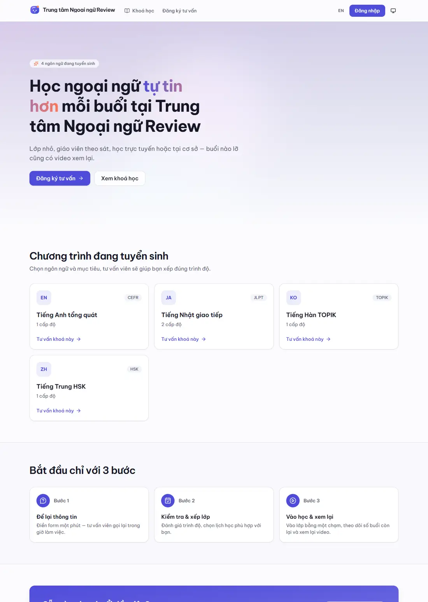

# Hướng dẫn sử dụng Konnyaku

Bộ tài liệu cho nhân viên trung tâm, giáo viên, học viên và người vận hành nền tảng. Mọi tên nút, nhãn và ảnh chụp lấy từ giao diện tiếng Việt của phiên bản hiện tại (11/2026), với dữ liệu giả.

Cập nhật: 25/11/2026

## Bắt đầu từ đâu

| Bạn là | Đọc trước | Rồi đọc |
| --- | --- | --- |
| Trung tâm mới dùng Konnyaku | [Bắt đầu nhanh](bat-dau-nhanh.md) | [Quản trị trung tâm](quan-tri-trung-tam.md) |
| Quản trị trung tâm | [Quản trị trung tâm](quan-tri-trung-tam.md) | [Quy trình nghiệp vụ](quy-trinh.md), [Quy tắc cần biết](quy-tac-nghiep-vu.md) |
| Quản lý cơ sở | [Quản lý cơ sở](quan-ly-co-so.md) | [Điều phối](dieu-phoi.md) |
| Điều phối (giáo vụ) | [Điều phối](dieu-phoi.md) | [Quy trình nghiệp vụ](quy-trinh.md) |
| Tư vấn | [Tư vấn](tu-van.md) | [Quy trình: khách đăng ký → vào lớp](quy-trinh.md#1-khách-đăng-ký--học-viên-vào-lớp) |
| Kế toán | [Kế toán](ke-toan.md) | [Quy tắc hoàn tiền](quy-tac-nghiep-vu.md#hoàn-tiền) |
| Giáo viên | [Giáo viên](giao-vien.md) | [Phòng học trực tuyến](phong-hoc-truc-tuyen.md) |
| Học viên | [Học viên](hoc-vien.md) | [Phòng học trực tuyến](phong-hoc-truc-tuyen.md) |
| Phụ huynh | [Phụ huynh và khách](phu-huynh-va-khach.md) | [Học viên](hoc-vien.md) |
| Khách muốn đăng ký học | [Phụ huynh và khách](phu-huynh-va-khach.md) | |
| Người vận hành nền tảng Konnyaku (super-admin) | [Quản trị nền tảng](quan-tri-nen-tang.md) | |

Dùng chung cho mọi người: [Đăng nhập, mật khẩu và bảo mật tài khoản](dang-nhap-va-bao-mat.md), [Câu hỏi thường gặp và xử lý sự cố](cau-hoi-thuong-gap.md), [Thuật ngữ](thuat-ngu.md).

## Mục lục

1. [Bắt đầu nhanh cho trung tâm mới](bat-dau-nhanh.md): thứ tự cài đặt cơ sở → nhân sự → chương trình → lớp → học viên → thu phí.
2. [Đăng nhập, mật khẩu và bảo mật tài khoản](dang-nhap-va-bao-mat.md): hai tab đăng nhập, quên mật khẩu, khoá tài khoản, xác thực 2 bước, thiết bị đang đăng nhập.
3. [Khu vực Vận hành: thao tác chung](van-hanh-chung.md): thanh bên, ngăn kéo, tìm / lọc, che dữ liệu cá nhân, xuất CSV, sửa / ngừng dùng, lịch sử thay đổi, hồ sơ học viên.
4. Hướng dẫn theo vai trò:
    - [Quản trị nền tảng (super-admin)](quan-tri-nen-tang.md)
    - [Quản trị trung tâm](quan-tri-trung-tam.md)
    - [Quản lý cơ sở](quan-ly-co-so.md)
    - [Điều phối](dieu-phoi.md)
    - [Tư vấn](tu-van.md)
    - [Kế toán](ke-toan.md)
    - [Giáo viên](giao-vien.md)
    - [Học viên](hoc-vien.md)
    - [Phụ huynh và khách](phu-huynh-va-khach.md)
5. [Phòng học trực tuyến](phong-hoc-truc-tuyen.md): kiểm tra thiết bị, vào phòng, chia sẻ màn hình, kết thúc buổi.
6. [Quy trình nghiệp vụ trọn vẹn](quy-trinh.md): khách đăng ký → vào lớp; buổi học → điểm danh → trừ buổi → công → lương; hoàn tiền; đổi lịch / đổi giáo viên; bảo lưu, nghỉ học; quên mật khẩu, khoá tài khoản, 2FA; yêu cầu xem / xoá dữ liệu cá nhân.
7. [Quy tắc nghiệp vụ cần biết](quy-tac-nghiep-vu.md): ngưỡng điểm danh, thứ tự trừ buổi, nợ buổi, hoàn tiền, phân quyền theo cơ sở, giới hạn phòng học, email tự động.
8. [Câu hỏi thường gặp và xử lý sự cố](cau-hoi-thuong-gap.md)
9. [Thuật ngữ](thuat-ngu.md)

## Các khu vực của Konnyaku

Mỗi trung tâm có một địa chỉ riêng (ví dụ `https://tentrungtam.konnyaku.app` hoặc tên miền riêng của trung tâm). Trên cùng địa chỉ đó có 4 khu vực; mỗi người chỉ vào khu vực đúng với vai trò của mình, hệ thống tự chuyển sau khi đăng nhập.

| Khu vực | Đường dẫn | Ai dùng | Dùng để |
| --- | --- | --- | --- |
| Trang công khai | `/vi` (tiếng Việt), `/en` (tiếng Anh) | Khách, phụ huynh | Xem khoá học, đăng ký tư vấn, đọc chính sách, đăng nhập |
| Học viên | `/learn` | Học viên, phụ huynh | Số buổi còn lại, lịch học, xin nghỉ, học bù, đặt buổi lớp linh hoạt, vào lớp, xem lại video, lịch sử thanh toán |
| Giáo viên | `/teach` | Giáo viên | Lịch dạy, vào lớp, điểm danh, công tháng này |
| Vận hành | `/ops` | Quản trị, quản lý cơ sở, điều phối, tư vấn, kế toán | Lead, học viên, thu phí, lớp, chương trình, nhân sự, cơ sở, kỳ lương, bảo mật, quyền riêng tư |

Người vận hành nền tảng Konnyaku dùng một địa chỉ riêng (`https://admin.<tên miền Konnyaku>/platform`), không nằm trên địa chỉ của trung tâm.

## Những gì chưa có ở phiên bản này

Để khỏi mất công tìm, đây là các việc **chưa làm được trên giao diện**:

- Liên kết tài khoản phụ huynh với học viên (phụ huynh chưa xem được thông tin của con).
- Đổi giờ, đổi giáo viên hay huỷ **từng buổi** (chỉ đổi được cả lịch tuần từ một ngày, xem [Đổi lịch, đổi giáo viên](quy-trinh.md#4-đổi-lịch-đổi-giáo-viên)).
- Bảo lưu, chuyển lớp (chỉ có cho nghỉ hẳn bằng hoàn tiền, xem [Bảo lưu và nghỉ học](quy-trinh.md#5-bảo-lưu-và-nghỉ-học)). Xin nghỉ từng buổi và học bù đã có (xem [Học viên → Lịch học](hoc-vien.md#lịch-học-xin-nghỉ-học-bù-đổi-hình-thức)).
- Email hay thông báo khi được mời từ hàng chờ (học viên thấy chỗ đang giữ trên trang **Lịch học**).
- Thêm học viên vào lớp bằng tay (học viên chỉ vào lớp khi đơn hàng gắn lớp được trả đủ).
- Sửa điểm danh sau khi đã xác nhận.
- Thanh toán online, đăng nhập bằng Google, tự đăng ký tài khoản.
- Tài liệu, bài tập, kiểm tra, điểm số, nhận xét; báo cáo doanh thu, công nợ, chuyên cần.
- Chọn phòng học Google Meet / phòng có sẵn trên giao diện (đội kỹ thuật cấu hình).
- Ghi hình buổi học trong phòng học có sẵn của Konnyaku.

## Dành cho người phát triển: cập nhật hướng dẫn trong mỗi PR

**Quy tắc:** PR nào thêm hoặc đổi điều người dùng nhìn thấy (màn hình, nút, nhãn, luồng, quyền, email, quy tắc tính buổi / tiền) phải sửa hướng dẫn **ngay trong PR đó**. Mục "Tài liệu" trong mẫu PR (`.github/pull_request_template.md`) phải được đánh dấu.

### Sửa trang nào

| Thay đổi | Trang cần sửa |
| --- | --- |
| Màn hình / nút trong `/ops` của một vai trò | Trang của vai trò **làm việc đó**: [tu-van](tu-van.md) (lead), [dieu-phoi](dieu-phoi.md) (lớp, lịch, phòng, ngày nghỉ), [ke-toan](ke-toan.md) (thu phí, hoàn tiền, phiếu, kỳ lương, đơn giá), [quan-tri-trung-tam](quan-tri-trung-tam.md) (cơ sở, nhân sự, chương trình, bảo mật, quyền riêng tư, thông báo). Vai trò khác chỉ cần link tới đó |
| Thao tác dùng chung trong `/ops` (danh sách, bộ lọc, ngăn kéo, che dữ liệu, xuất CSV, hồ sơ học viên) | [van-hanh-chung](van-hanh-chung.md) |
| `/teach` | [giao-vien](giao-vien.md); phòng học: [phong-hoc-truc-tuyen](phong-hoc-truc-tuyen.md) |
| `/learn` | [hoc-vien](hoc-vien.md); phụ huynh: [phu-huynh-va-khach](phu-huynh-va-khach.md) |
| Trang công khai, form đăng ký, chính sách | [phu-huynh-va-khach](phu-huynh-va-khach.md) |
| Đăng nhập, mật khẩu, 2FA, phiên | [dang-nhap-va-bao-mat](dang-nhap-va-bao-mat.md) |
| `/platform` | [quan-tri-nen-tang](quan-tri-nen-tang.md) |
| Quyền của vai trò | Bảng [Phân quyền](quy-tac-nghiep-vu.md#phân-quyền-theo-vai-trò-và-cơ-sở) **và** bảng "Được làm / Chỉ xem / Không có" đầu trang vai trò đó |
| Quy tắc (ngưỡng, cách trừ buổi, hoàn tiền, email tự động) | [quy-tac-nghiep-vu](quy-tac-nghiep-vu.md) |
| Luồng đi qua nhiều vai trò | Bảng bước trong [quy-trinh](quy-trinh.md) |
| Bước cài đặt trung tâm mới | [bat-dau-nhanh](bat-dau-nhanh.md) và thẻ hướng dẫn nhanh (`messages/*/onboarding.json`) |
| Thông báo lỗi người dùng hay gặp | [cau-hoi-thuong-gap](cau-hoi-thuong-gap.md) |
| Từ mới | [thuat-ngu](thuat-ngu.md) |
| Tính năng trước đây "chưa có" nay đã có | Xoá dòng ở [Những gì chưa có](#những-gì-chưa-có-ở-phiên-bản-này) và các ghi chú "Chưa có" / cách xử lý tạm trong trang vai trò, quy trình, FAQ |

Tính năng lớn mới (một khu vực hay nhóm màn hình mới) thì thêm mục `##` trong trang vai trò; chỉ tạo trang mới khi có vai trò mới hoặc chủ đề dùng chung cho nhiều vai trò, và thêm trang đó vào **Mục lục** và bảng **Bắt đầu từ đâu** ở trên.

Cách viết: tiếng Việt đơn giản, câu ngắn; tên nút, nhãn **in đậm, đúng chữ trên giao diện tiếng Việt** (lấy từ `frontend/packages/i18n/messages/vi`); các bước đánh số; chỉ mô tả cái đã chạy được trên `main`, phần chưa có ghi rõ "Chưa có".

### Ảnh chụp màn hình

- Lưu trong [`images/`](images/), dạng **WebP**, rộng tối đa 1100 px, chất lượng khoảng 70 (mỗi ảnh nên dưới 80 KB).
- Tên file: chữ thường không dấu, nối bằng gạch ngang, bắt đầu bằng màn hình rồi đến thao tác: `thu-phi.webp`, `hoan-tien-nghi-giua-khoa.webp`, `lop-hoc-sua-lich-tuan.webp`. Đổi giao diện thì **chụp lại cùng tên** để mọi trang dùng ảnh đó tự cập nhật; xoá ảnh không còn trang nào dùng.
- Chụp ở khổ trình duyệt 1280 × 800, **giao diện sáng**, tiếng Việt, với dữ liệu giả của trung tâm mẫu `review` (`infra/scripts/seed_review.py`, email `*@example.com`). Không chụp dữ liệu thật, mật khẩu thật, token thật; ẩn biểu tượng công cụ dev của Next.js.
- Ảnh ngăn kéo: chụp cả trang với ngăn kéo đang mở. Ảnh trang dài: chụp cả trang, cao tối đa khoảng 1.800 px.
- Chèn ảnh ngay sau bước nó minh hoạ, chú thích bằng alt text ngắn: ``.
- Đổi PNG sang WebP: dùng `sharp` có sẵn trong `frontend/node_modules` (`sharp(in).resize({ width: 1100, withoutEnlargement: true }).webp({ quality: 70 })`) hoặc `cwebp -q 70`.

Cách chạy hệ thống trên máy để chụp: [docs/chay-local.md](../chay-local.md).

### Link từ trong app

Thẻ **Hướng dẫn nhanh** trong app có link **Xem hướng dẫn đầy đủ** trỏ tới thư mục này trên GitHub (`main`): quản trị → [Bắt đầu nhanh](bat-dau-nhanh.md), nhân viên khác → mục lục, giáo viên → [Giáo viên](giao-vien.md), học viên → [Học viên](hoc-vien.md). Bản triển khai muốn trỏ tới bản sao riêng thì đặt biến môi trường `KONNYAKU_GUIDE_URL` (thư mục chứa các trang, không có `/` cuối) cho container web.
