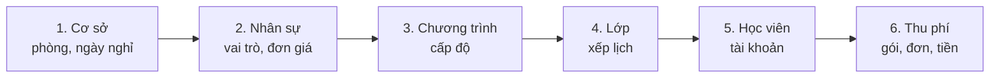
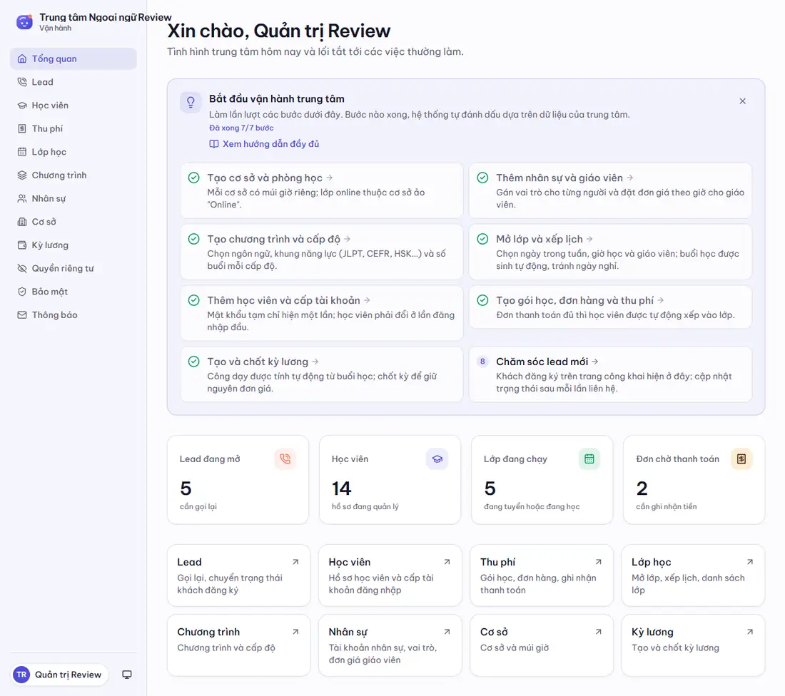
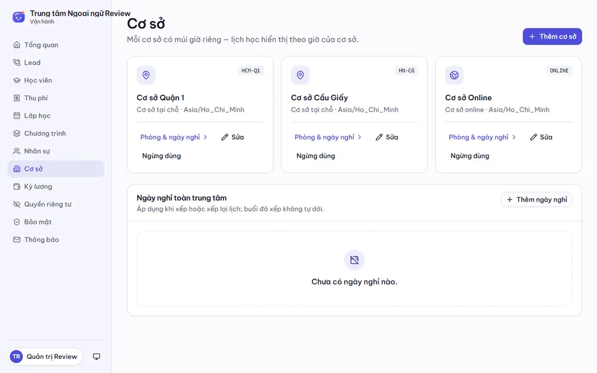
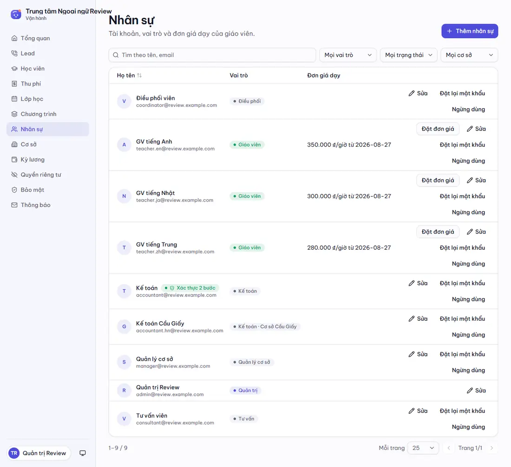
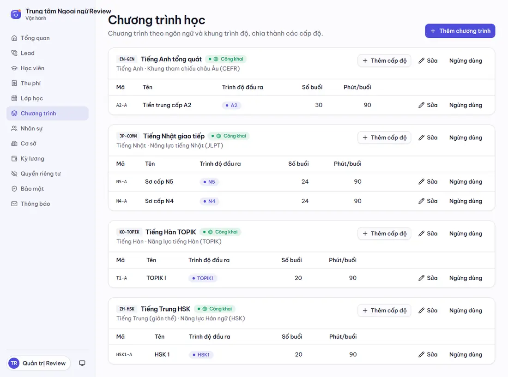
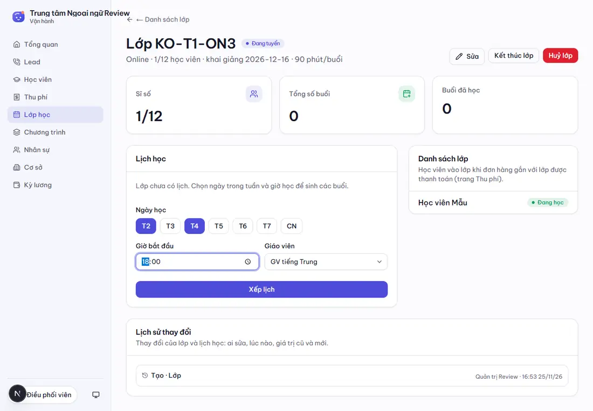
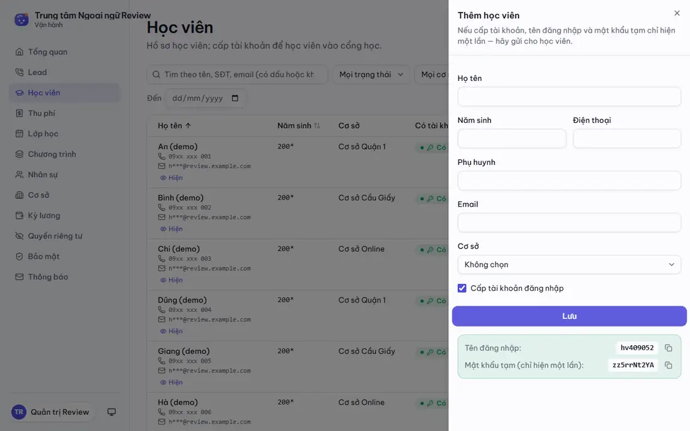
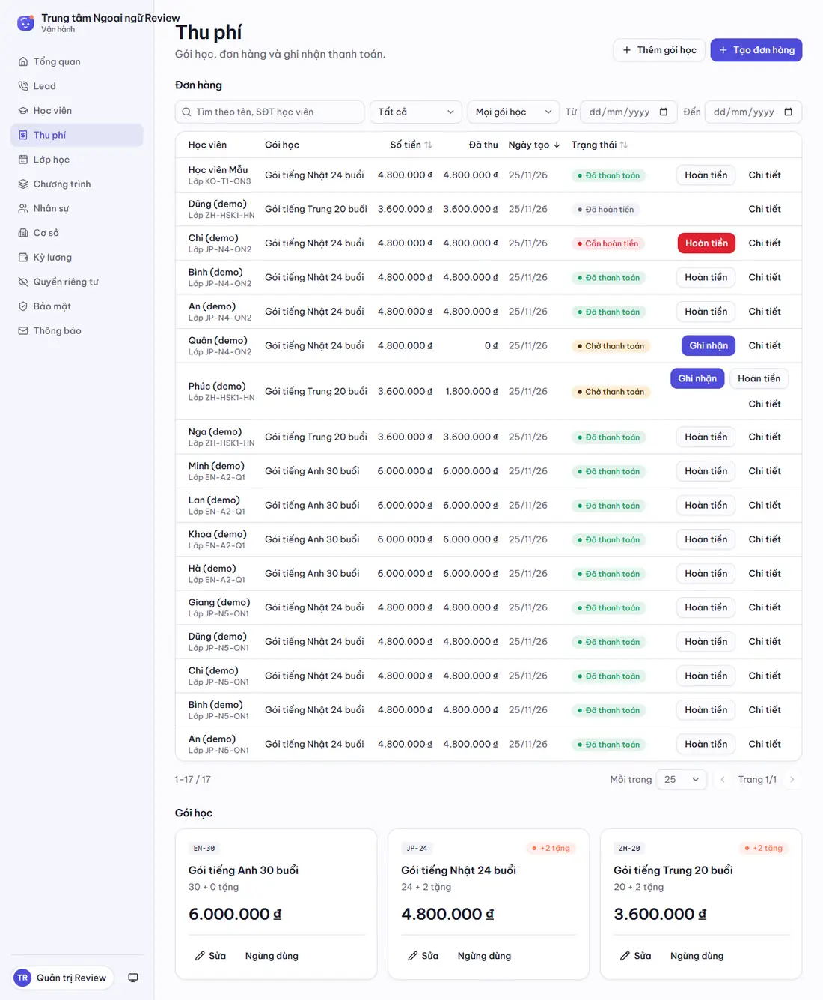

# Bắt đầu nhanh cho trung tâm mới

[← Mục lục](README.md)

Trang này dành cho **quản trị trung tâm** trong tuần đầu dùng Konnyaku. Làm đúng thứ tự dưới đây, vì mỗi bước cần dữ liệu của bước trước: lớp cần cấp độ và cơ sở, đơn hàng cần gói học và lớp, kỳ lương cần đơn giá giáo viên.

## Bước 0. Nhận tài khoản quản trị

Konnyaku tạo trung tâm và gửi cho bạn:

- **Địa chỉ của trung tâm**, ví dụ `https://tentrungtam.konnyaku.app` (hoặc tên miền riêng nếu đã đăng ký).
- **Email** và **mật khẩu tạm** của quản trị viên đầu tiên.

1. Mở địa chỉ trung tâm, bấm **Đăng nhập** ở góc trên bên phải, chọn tab **Giáo viên · Nhân viên**.
2. Nhập email, mật khẩu tạm, bấm **Đăng nhập**.
3. Hệ thống mở trang **Tài khoản & bảo mật** với dòng "Bạn đang dùng mật khẩu tạm. Hãy đặt mật khẩu mới để tiếp tục." Nhập **Mật khẩu hiện tại** (mật khẩu tạm), **Mật khẩu mới** hai lần (ít nhất 8 ký tự, có cả chữ và số), bấm **Lưu mật khẩu**.
4. Vai trò Quản trị bắt buộc **xác thực 2 bước**: làm theo màn hình "Vai trò của bạn cần xác thực 2 bước" (quét mã QR bằng ứng dụng xác thực trên điện thoại, nhập mã 6 số, lưu 10 mã khôi phục). Chi tiết: [Xác thực 2 bước](dang-nhap-va-bao-mat.md#xác-thực-2-bước).

Sau khi đăng nhập, trang **Tổng quan** của khu vực Vận hành có thẻ **Bắt đầu vận hành trung tâm**. Thẻ liệt kê đúng các bước dưới đây và tự đánh dấu ✓ khi trung tâm đã có dữ liệu cho bước đó (ví dụ đã có ít nhất một cơ sở). Bấm vào một bước để mở trang tương ứng. Bấm **×** để ẩn thẻ, bấm **Hướng dẫn nhanh** để hiện lại.

## Bước 1. Cơ sở, phòng học, ngày nghỉ

Vào **Cơ sở** ở thanh bên trái.

1. Bấm **Thêm cơ sở**, điền:
    - **Mã**: ngắn, không dấu, ví dụ `HCM-Q1`.
    - **Tên (tiếng Việt)**, **Tên (tiếng Anh)**.
    - **Múi giờ**: theo chuẩn IANA, ở Việt Nam là `Asia/Ho_Chi_Minh`. Lịch học hiển thị theo giờ của cơ sở.
    - Đánh dấu **Cơ sở online** nếu đây là cơ sở ảo dành cho lớp trực tuyến. Nên tạo một cơ sở "Online" riêng cho mọi lớp học online.
2. Bấm **Lưu**.
3. Bấm **Phòng & ngày nghỉ** trên thẻ cơ sở → **Thêm phòng** (Mã, Sức chứa) cho từng phòng học thật. Cơ sở online không cần phòng.
4. Thêm ngày nghỉ (Tết, ngày lễ, ngày bảo trì): **Thêm ngày nghỉ** trong trang cơ sở (chỉ cơ sở đó nghỉ) hoặc ở cuối trang **Cơ sở** (mục **Ngày nghỉ toàn trung tâm**). Khi xếp lịch, hệ thống tự bỏ qua các ngày này, nên hãy nhập ngày nghỉ **trước khi xếp lịch**.

Chi tiết: [Quản trị trung tâm → Cơ sở](quan-tri-trung-tam.md#cơ-sở-phòng-học-ngày-nghỉ).

## Bước 2. Nhân sự và đơn giá giáo viên

Vào **Nhân sự**.

1. Bấm **Thêm nhân sự**: **Họ tên**, **Email** công việc, **Mật khẩu ban đầu** (để trống nếu người này đã có tài khoản nhân viên ở trung tâm khác trên Konnyaku), chọn một hoặc nhiều **Vai trò**: Quản trị, Quản lý cơ sở, Điều phối, Tư vấn, Kế toán, Giáo viên. Bấm **Lưu**.
2. Gửi email và mật khẩu ban đầu cho người đó qua kênh riêng (Zalo, gặp trực tiếp). Hệ thống chưa tự gửi email mời nhân viên.
3. Với giáo viên: bấm **Đặt đơn giá** trên dòng của người đó → **Đơn giá mỗi giờ**, **Tiền tệ**, **Áp dụng từ** → **Thêm đơn giá**. Giáo viên chưa có đơn giá thì kỳ lương báo **Thiếu đơn giá**.
4. Với Quản lý cơ sở, Điều phối, Kế toán chỉ phụ trách một vài cơ sở: bấm **Sửa** → đánh dấu các cơ sở dưới vai trò → **Lưu**. Không chọn cơ sở nào nghĩa là phụ trách toàn trung tâm.

Mỗi vai trò làm được gì: [Phân quyền theo vai trò và cơ sở](quy-tac-nghiep-vu.md#phân-quyền-theo-vai-trò-và-cơ-sở).

## Bước 3. Chương trình và cấp độ

Vào **Chương trình**.

1. Bấm **Thêm chương trình**: **Mã** (ví dụ `JP-COMM`), **Tên (tiếng Việt)**, **Tên (tiếng Anh)**, **Ngôn ngữ**, **Khung trình độ** (JLPT, CEFR, HSK, TOPIK, IELTS…). Đánh dấu **Hiện trên trang công khai** để khách thấy khoá này ở trang chủ và chọn được ở form đăng ký. Bấm **Lưu**.
2. Trên thẻ chương trình, bấm **Thêm cấp độ**: **Mã**, tên, **Trình độ đầu ra** (theo khung đã chọn), **Số buổi**, **Phút/buổi**. Bấm **Lưu**.

Số buổi của cấp độ quyết định số buổi được sinh khi xếp lịch lớp; số buổi không đổi được sau khi đã có lớp dùng cấp độ, nên kiểm tra kỹ.

## Bước 4. Mở lớp và xếp lịch

Vào **Lớp học**.

1. Bấm **Mở lớp**: **Mã** lớp (ví dụ `JP-N5-ON1`), **Cấp độ**, **Cơ sở**, **Hình thức** (Online / Tại lớp / Kết hợp), **Sĩ số tối đa**, **Khai giảng**. Bấm **Lưu**.
2. Bấm mã lớp để mở trang chi tiết. Ở phần **Lịch học**: bấm chọn các **Ngày học** (T2…CN), **Giờ bắt đầu**, **Giáo viên**, **Phòng** (lớp tại cơ sở), rồi bấm **Xếp lịch**.
3. Hệ thống sinh đủ số buổi của cấp độ từ ngày khai giảng, bỏ ngày nghỉ. Nếu giáo viên hoặc phòng đã có lớp khác cùng giờ, hệ thống báo "Giáo viên hoặc phòng bị trùng lịch" và không tạo buổi nào: đổi giờ, ngày hoặc giáo viên rồi xếp lại.

Chi tiết: [Điều phối → Lớp học](dieu-phoi.md#lớp-học).

## Bước 5. Học viên và tài khoản đăng nhập

Vào **Học viên** → **Thêm học viên**: **Họ tên**, **Năm sinh**, **Điện thoại**, **Phụ huynh**, **Email**, **Cơ sở**. Đánh dấu **Cấp tài khoản đăng nhập** nếu học viên cần vào cổng học viên (xem lịch, vào lớp online). Bấm **Lưu**.

Ngăn kéo giữ nguyên và hiện **Tên đăng nhập** (dạng `hv123456`) cùng **Mật khẩu tạm (chỉ hiện một lần)**. Bấm **Sao chép** và gửi cho học viên ngay, trước khi đóng ngăn kéo. Học viên có email thì cũng nhận email chào mừng (không chứa mật khẩu).

## Bước 6. Gói học, đơn hàng, thu tiền

Vào **Thu phí**.

1. **Thêm gói học**: **Mã**, tên tiếng Việt và tiếng Anh, **Số buổi** (buổi trả phí), **Buổi tặng**, **Giá**, **Tiền tệ**. Một gói dùng được cho nhiều lớp.
2. **Tạo đơn hàng**: gõ tên hoặc số điện thoại để chọn **Học viên**, chọn **Gói học** và **Lớp** (hoặc **Chưa xếp lớp**). Bấm **Lưu**. Đơn mới ở trạng thái **Chờ thanh toán**.
3. Khi học viên đóng tiền: bấm **Ghi nhận** trên dòng đơn → **Số tiền**, **Hình thức** (Tiền mặt / Chuyển khoản / Thẻ), **Mã giao dịch** → **Ghi nhận**. Đơn trả được nhiều lần.
4. Khi đơn được trả đủ, vài giây sau học viên được cộng buổi và, nếu đơn gắn lớp, **tự vào lớp**. Mỗi lần ghi nhận tạo một phiếu thu `PT-…` để in hoặc tải PDF.

Chi tiết: [Kế toán](ke-toan.md).

## Sau khi đã chạy

| Việc | Ai làm | Khi nào | Xem |
| --- | --- | --- | --- |
| Gọi lại khách đăng ký trên trang công khai | Tư vấn | Hằng ngày | [Tư vấn](tu-van.md) |
| Dạy, xác nhận điểm danh | Giáo viên | Sau mỗi buổi | [Giáo viên](giao-vien.md) |
| Thu tiền, hoàn tiền, in phiếu | Kế toán | Khi phát sinh | [Kế toán](ke-toan.md) |
| Tạo và chốt kỳ lương | Kế toán hoặc quản trị | Cuối tháng | [Kế toán → Kỳ lương](ke-toan.md#kỳ-lương) |
| Xem email lỗi, nhật ký bảo mật, yêu cầu dữ liệu cá nhân | Quản trị | Hằng tuần | [Quản trị trung tâm](quan-tri-trung-tam.md) |

Trước khi mở trang công khai cho khách: nhờ pháp chế rà lại **Chính sách quyền riêng tư** và **Điều khoản sử dụng** (bản mẫu do Konnyaku soạn, đã điền tên trung tâm), xem [Phụ huynh và khách → Chính sách](phu-huynh-va-khach.md#chính-sách-quyền-riêng-tư-và-điều-khoản).
