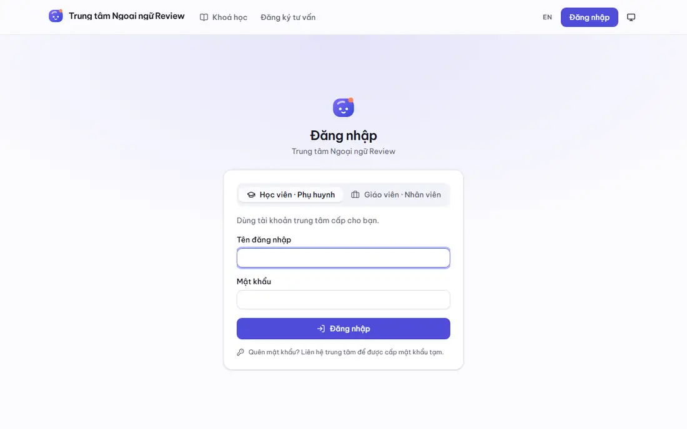
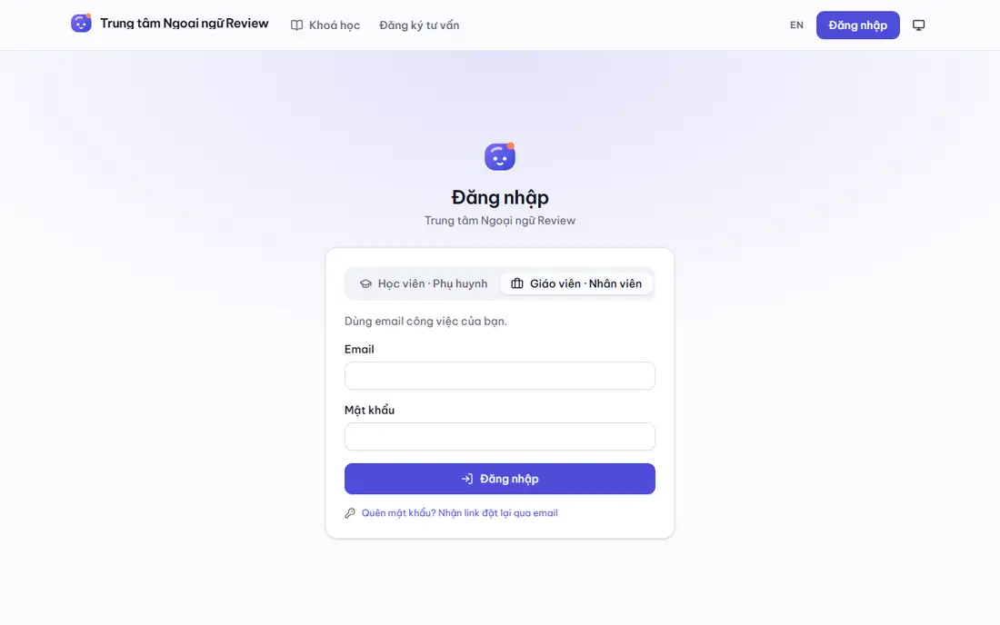
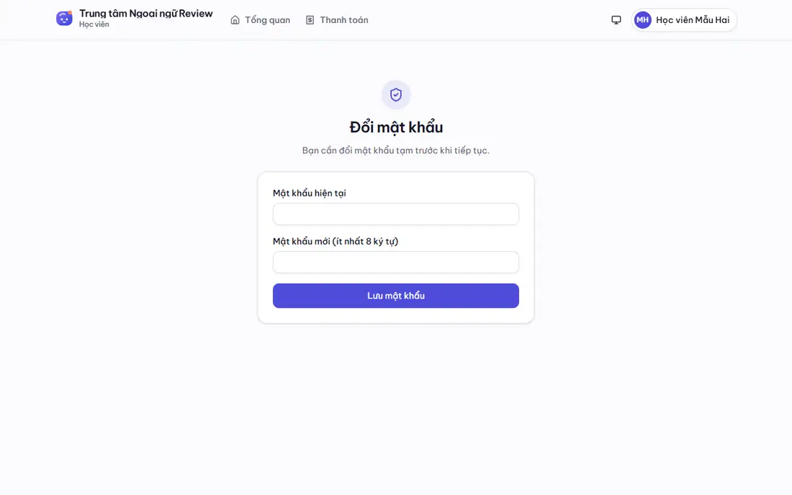
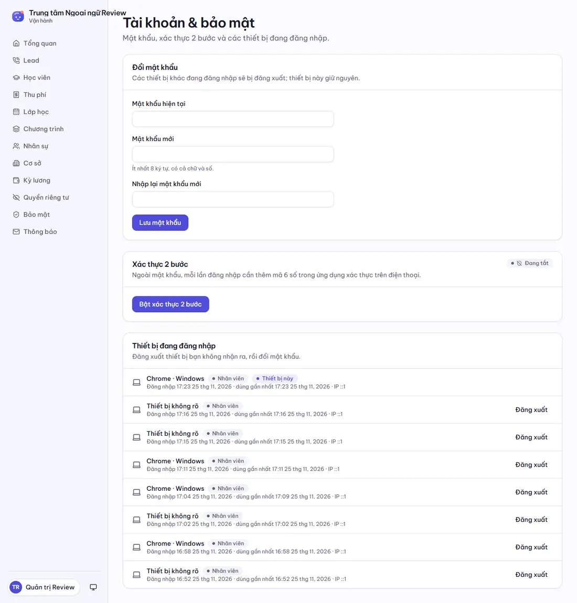
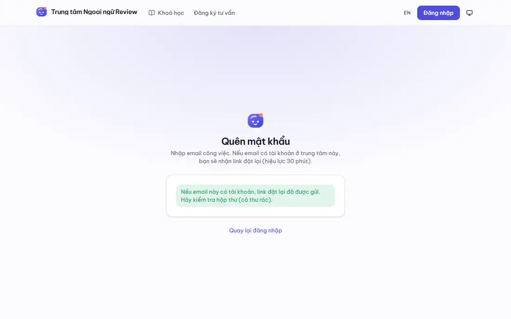
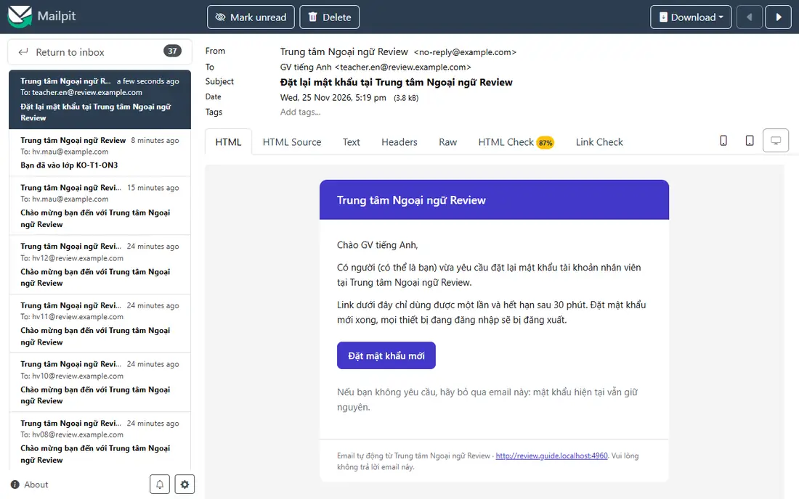
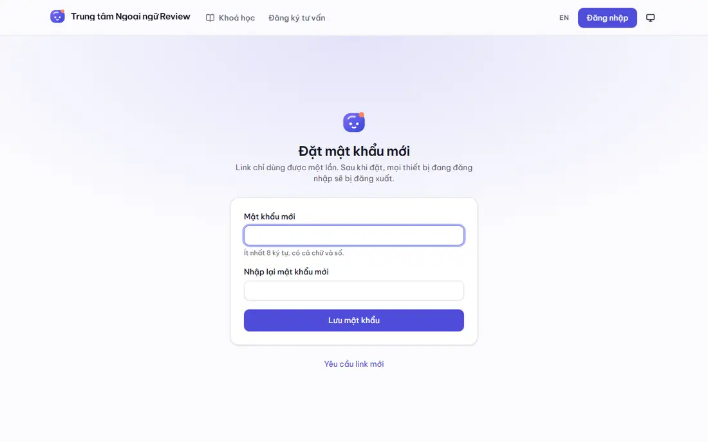
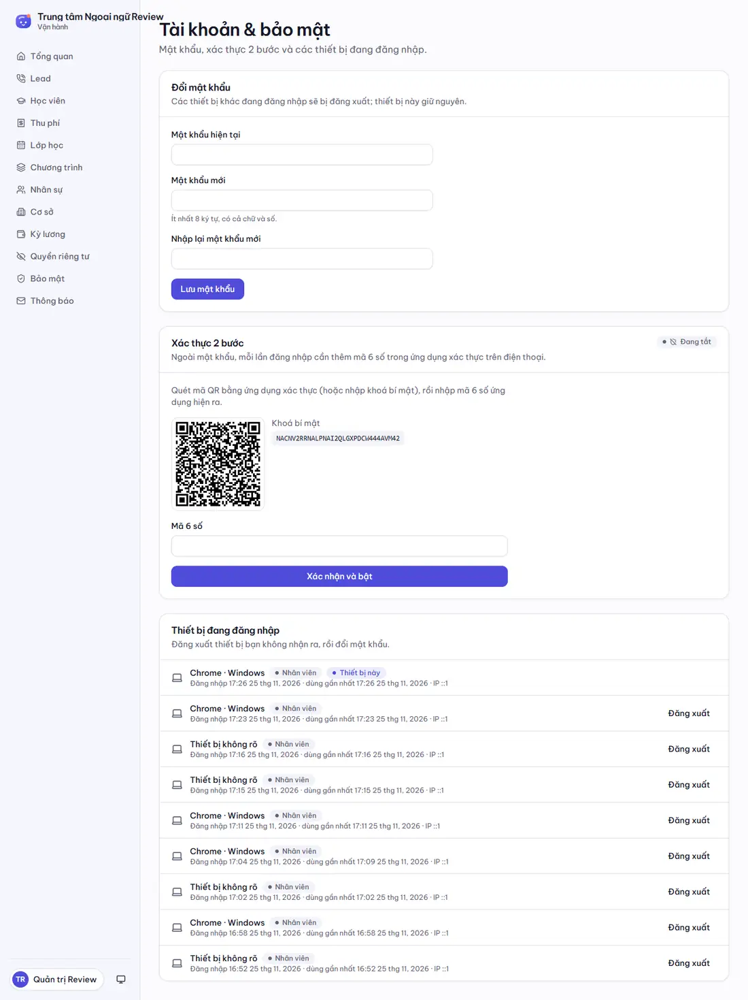
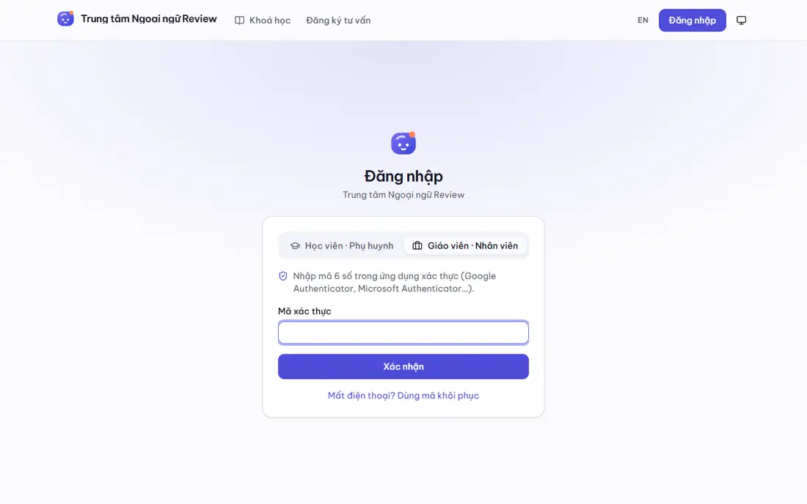

# Đăng nhập, mật khẩu và bảo mật tài khoản

[← Mục lục](README.md)

Dùng cho mọi người: học viên, phụ huynh, giáo viên, nhân viên. Người vận hành nền tảng xem [Quản trị nền tảng](quan-tri-nen-tang.md#đăng-nhập).

## Đăng nhập

Trung tâm cấp tài khoản; hiện **chưa có** tự đăng ký tài khoản hay đăng nhập bằng Google.

1. Mở trang của trung tâm, bấm **Đăng nhập** ở góc trên bên phải (hoặc mở thẳng `/login`).
2. Chọn đúng tab:
    - **Học viên · Phụ huynh**: nhập **Tên đăng nhập** (dạng `hv123456`, trung tâm gửi) và **Mật khẩu**.
    - **Giáo viên · Nhân viên**: nhập **Email** công việc và **Mật khẩu**.
3. Bấm **Đăng nhập**. Hệ thống tự chuyển: học viên vào `/learn`, giáo viên vào `/teach`, nhân viên vận hành vào `/ops`.

| Học viên · Phụ huynh | Giáo viên · Nhân viên |
| --- | --- |
|  |  |

Hai tab là hai phiên tách biệt: trên cùng một trình duyệt có thể vừa đăng nhập học viên vừa đăng nhập nhân viên mà không ảnh hưởng nhau. Đăng xuất ở khu vực nào thì chỉ phiên của khu vực đó kết thúc.

Người vừa là giáo viên vừa là nhân viên vận hành (ví dụ Quản trị kiêm Giáo viên) được đưa vào `/ops`; mở `/teach` để dạy.

### Mật khẩu tạm và đổi mật khẩu lần đầu

Ai đăng nhập bằng **mật khẩu tạm** (học viên mới, nhân viên mới, hoặc sau khi quản trị đặt lại mật khẩu) được đưa thẳng tới trang đổi mật khẩu:

- Học viên: trang **Đổi mật khẩu** với dòng "Bạn cần đổi mật khẩu tạm trước khi tiếp tục." Nhập **Mật khẩu hiện tại** (mật khẩu tạm), **Mật khẩu mới (ít nhất 8 ký tự)**, bấm **Lưu mật khẩu**.
- Giáo viên, nhân viên: trang **Tài khoản & bảo mật** với dòng "Bạn đang dùng mật khẩu tạm. Hãy đặt mật khẩu mới để tiếp tục." Nhập mật khẩu hiện tại, mật khẩu mới hai lần, bấm **Lưu mật khẩu**.

Quy tắc mật khẩu: ít nhất 8 ký tự, tối đa 128, có cả chữ và số, không phải mật khẩu phổ biến, khác mật khẩu đang dùng. Đổi mật khẩu xong, các thiết bị khác đang đăng nhập bị đăng xuất; thiết bị đang dùng giữ nguyên.

### Đổi mật khẩu sau này

Bấm tên của bạn ở góc trên bên phải (trong `/ops`: cuối thanh bên trái) → **Tài khoản & bảo mật**.

- Học viên, phụ huynh: mở trang **Đổi mật khẩu**.
- Giáo viên, nhân viên: trang **Tài khoản & bảo mật** gồm 3 phần: **Đổi mật khẩu**, **Xác thực 2 bước**, **Thiết bị đang đăng nhập**.

## Quên mật khẩu

**Giáo viên, nhân viên** (tài khoản có email):

1. Ở tab **Giáo viên · Nhân viên**, bấm **Quên mật khẩu? Nhận link đặt lại qua email**.
2. Nhập email công việc, bấm **Gửi link đặt lại**. Trang luôn trả lời "Nếu email này có tài khoản, link đặt lại đã được gửi…", kể cả khi email không có tài khoản (để người lạ không dò được email nào có tài khoản).
3. Mở email "Đặt lại mật khẩu" (xem cả thư rác), bấm link. Link có hiệu lực **30 phút** và chỉ dùng được **một lần**.
4. Trang **Đặt mật khẩu mới**: nhập **Mật khẩu mới**, **Nhập lại mật khẩu mới**, bấm **Lưu mật khẩu**, rồi **Đăng nhập**.

| Gửi link | Email | Đặt mật khẩu mới |
| --- | --- | --- |
|  |  |  |

Đặt mật khẩu mới xong, mọi thiết bị đang đăng nhập của bạn bị đăng xuất. Mỗi tài khoản nhận tối đa **3 link mỗi giờ**; link cũ hết hạn thì bấm **Yêu cầu link mới**.

**Học viên, phụ huynh** (tài khoản không có email đăng nhập): tab Học viên ghi "Quên mật khẩu? Liên hệ trung tâm để được cấp mật khẩu tạm." Quản trị cấp mật khẩu tạm mới ở **Bảo mật** → **Đặt lại mật khẩu** (xem [Quy trình: quên mật khẩu](quy-trinh.md#6-quên-mật-khẩu-khoá-tài-khoản-xác-thực-2-bước)).

## Khoá tài khoản

Có hai kiểu khoá:

| Kiểu | Khi nào | Thông báo khi đăng nhập | Mở lại |
| --- | --- | --- | --- |
| Tạm khoá do nhập sai | Nhập sai mật khẩu (hoặc mã xác thực) **5 lần liên tiếp** | "Tài khoản tạm khóa do nhập sai nhiều lần. Thử lại sau 15 phút." | Tự mở sau **15 phút** |
| Khoá bởi quản trị | Quản trị bấm **Khoá** (học viên, ở **Bảo mật**) hoặc **Ngừng dùng** (nhân sự, ở **Nhân sự**) | "Tài khoản đã bị khoá. Liên hệ quản trị trung tâm." | Quản trị bấm **Mở khoá** / **Dùng lại** |

Khi bị khoá bởi quản trị, người đó bị đăng xuất khỏi mọi thiết bị ngay.

## Phiên đăng nhập kết thúc

Khi bạn đăng xuất ở nơi khác, đổi mật khẩu, bị khoá tài khoản, bị đổi vai trò hoặc trung tâm bị tạm khoá, các trang đang mở tự chuyển về trang đăng nhập trong khoảng một phút, kèm dòng "Phiên đăng nhập đã kết thúc (đăng xuất, đổi mật khẩu hoặc tài khoản bị khoá). Vui lòng đăng nhập lại."

## Xác thực 2 bước

Xác thực 2 bước (2FA) dành cho **giáo viên và nhân viên**: ngoài mật khẩu, mỗi lần đăng nhập cần thêm mã 6 số trong ứng dụng xác thực trên điện thoại (Google Authenticator, Microsoft Authenticator, 1Password…). Học viên và phụ huynh chưa dùng 2FA.

- Vai trò **Quản trị** và **Kế toán** **bắt buộc** dùng 2FA. Lần đăng nhập đầu, hệ thống hiện "Vai trò của bạn cần xác thực 2 bước" và hướng dẫn bật ngay.
- Các vai trò khác tự bật được trong **Tài khoản & bảo mật**.

### Bật 2FA

1. Cài một ứng dụng xác thực trên điện thoại.
2. **Tài khoản & bảo mật** → **Bật xác thực 2 bước**.
3. Mở ứng dụng, thêm tài khoản bằng cách quét **mã QR** (hoặc nhập **Khoá bí mật**).
4. Nhập **Mã 6 số** ứng dụng đang hiện, bấm **Xác nhận và bật**.
5. Trang hiện **10 mã khôi phục**. Bấm **Sao chép tất cả** và cất ở nơi an toàn (trình quản lý mật khẩu, giấy cất kỹ). Các mã chỉ hiện một lần; mỗi mã dùng thay mã 6 số được một lần khi mất điện thoại.

### Đăng nhập khi đã bật 2FA

Sau mật khẩu, nhập **Mã xác thực** 6 số rồi bấm **Xác nhận**. Mất điện thoại: bấm **Mất điện thoại? Dùng mã khôi phục** và nhập một mã khôi phục.

### Quản lý 2FA

Trong **Tài khoản & bảo mật** → **Xác thực 2 bước**:

- **Tạo mã khôi phục mới**: khi đã dùng gần hết mã hoặc nghi lộ mã; nhập mã 6 số hiện tại để xác nhận. Mã cũ hết hiệu lực.
- **Tắt xác thực 2 bước**: nhập mật khẩu và mã 6 số (hoặc mã khôi phục). Vai trò bắt buộc 2FA không tắt được.
- Mất điện thoại và hết mã khôi phục: nhờ quản trị bấm **Gỡ xác thực 2 bước** trong **Nhân sự** → **Đặt lại mật khẩu**; đăng nhập bằng mật khẩu rồi bật lại.

## Thiết bị đang đăng nhập

Mục **Thiết bị đang đăng nhập** (giáo viên, nhân viên) liệt kê từng trình duyệt đang đăng nhập: loại máy, khu vực (Nhân viên / Học viên), thời điểm đăng nhập, lần dùng gần nhất, địa chỉ IP. Thấy thiết bị lạ thì bấm **Đăng xuất** trên dòng đó, rồi đổi mật khẩu.

## Thao tác chung trên giao diện

| Việc | Cách làm |
| --- | --- |
| Đổi giao diện sáng / tối | Bấm biểu tượng màn hình / mặt trời / mặt trăng trên thanh trên cùng (trong `/ops`: cạnh tên ở cuối thanh bên trái). Mỗi lần bấm chuyển sang chế độ kế tiếp trong ba chế độ Sáng, Tối, Theo máy; lựa chọn được nhớ cho lần sau. |
| Đổi ngôn ngữ Việt / Anh | Trên trang công khai, bấm nút ngôn ngữ ở thanh trên cùng. Email tự động gửi theo ngôn ngữ của người nhận. |
| Đăng xuất | Bấm tên của bạn → **Đăng xuất**. |
| Dùng trên điện thoại | Mọi trang dùng được trên điện thoại; menu thu vào nút ba gạch, bấm để mở, bấm **Đóng** hoặc ra ngoài để đóng. |
