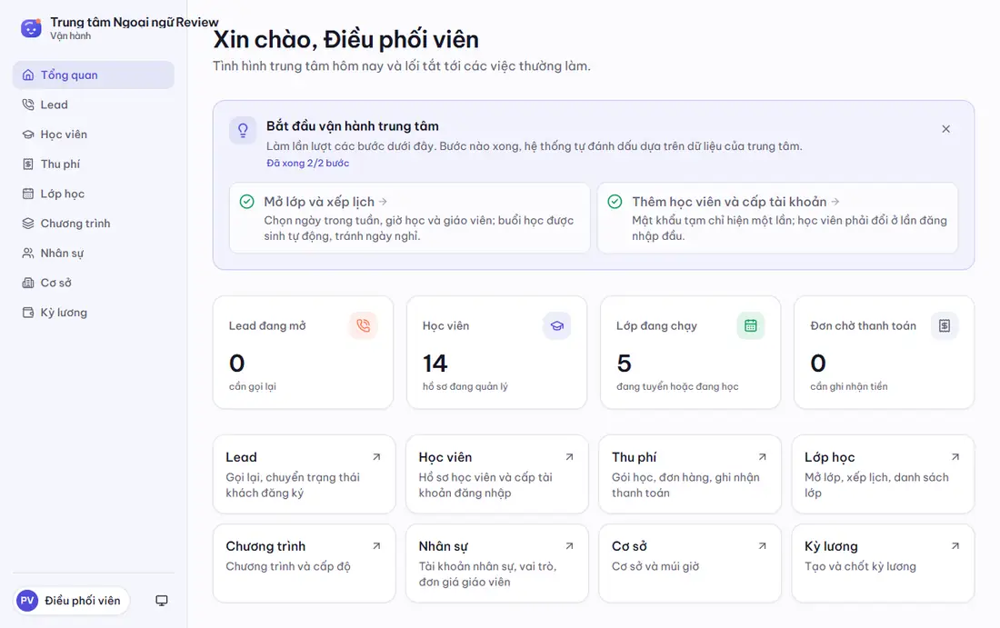
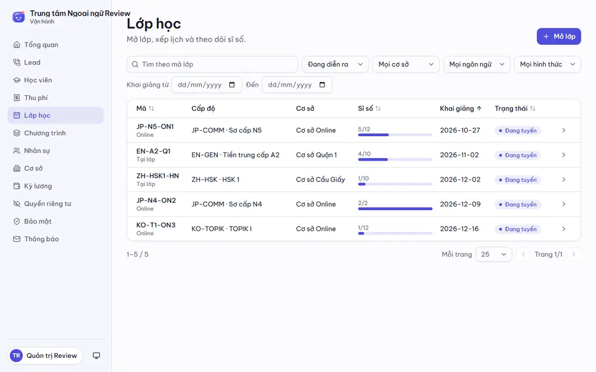
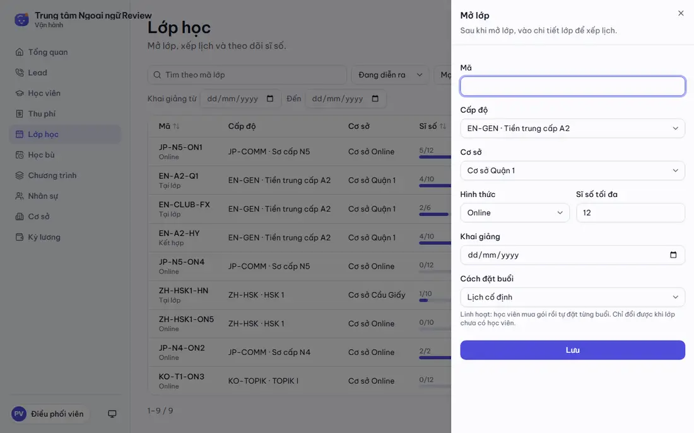
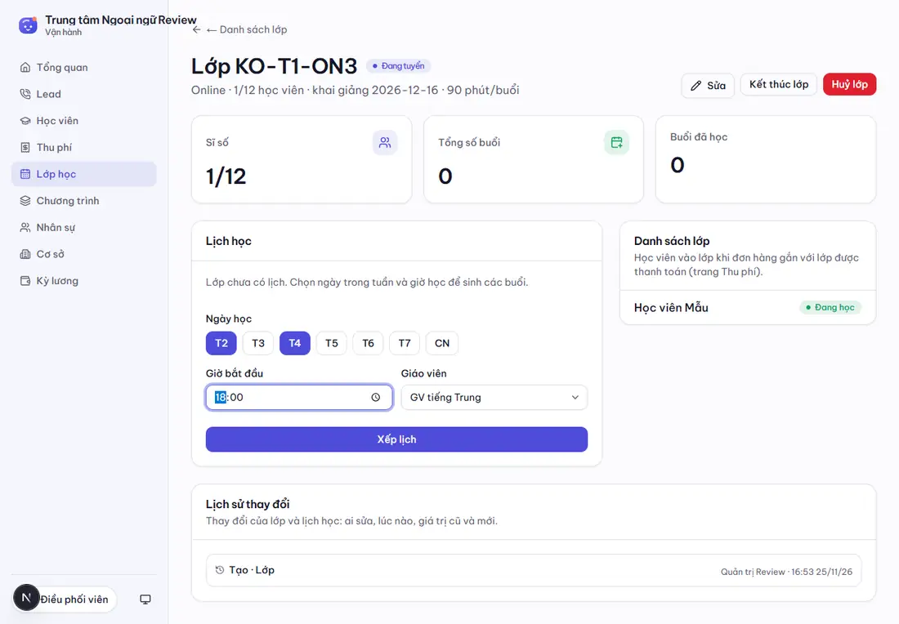
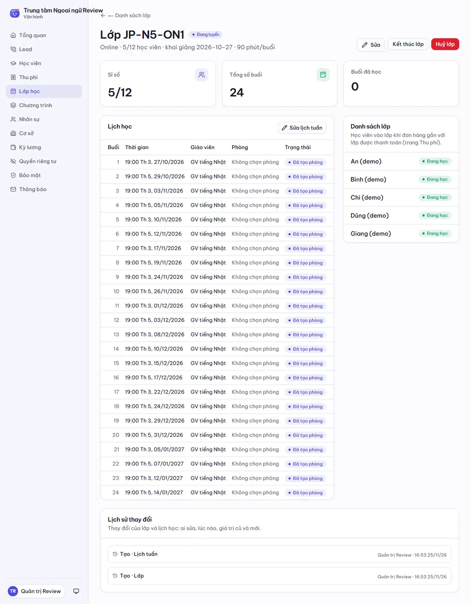
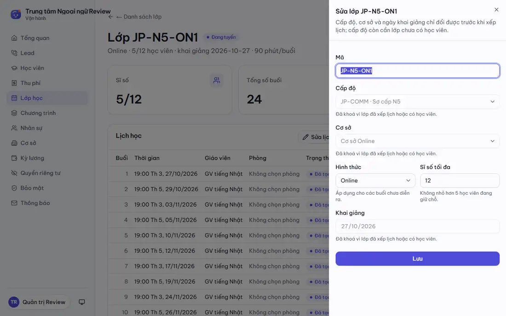
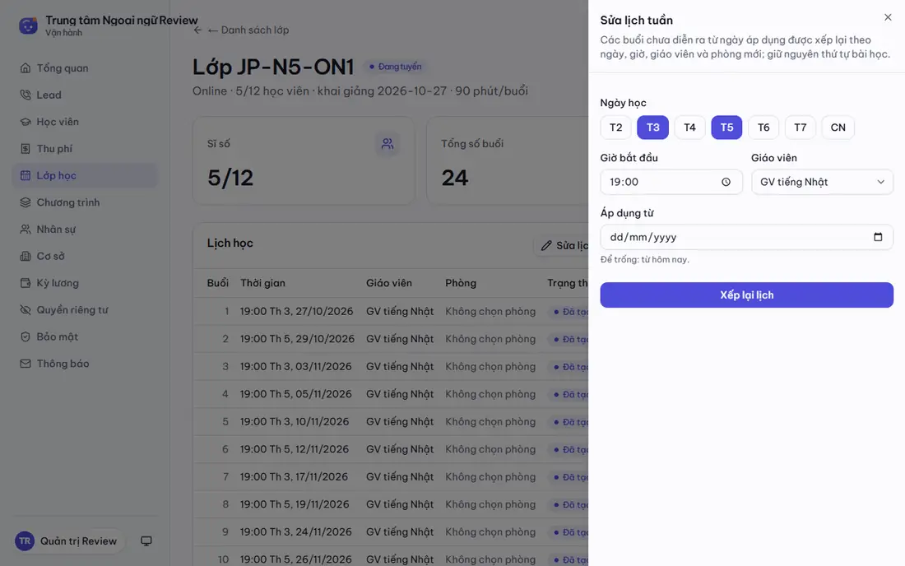
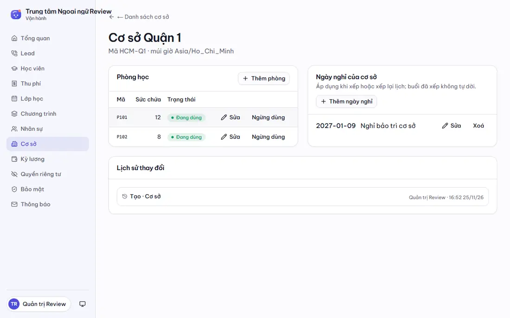
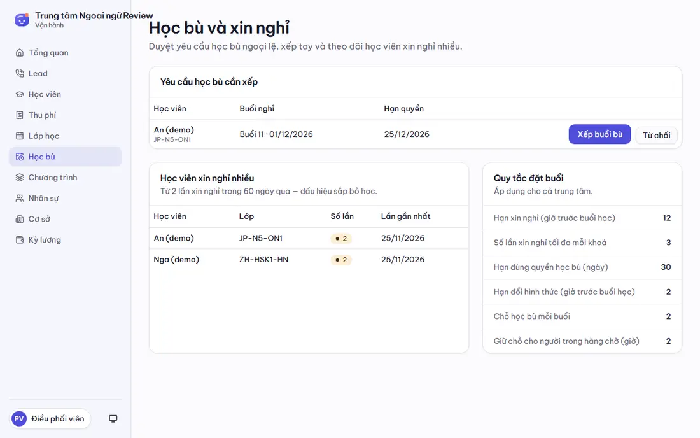
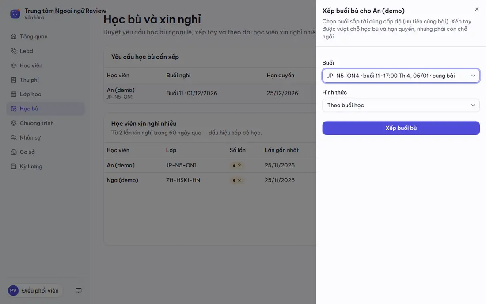

# Hướng dẫn cho điều phối (giáo vụ)

[← Mục lục](README.md) · Đọc trước: [Khu vực Vận hành: thao tác chung](van-hanh-chung.md)

Vai trò **Điều phối** lo lớp học và lịch: mở lớp, xếp lịch, đổi lịch tuần, phòng học, ngày nghỉ, hồ sơ học viên. Điều phối có thể được giao **một vài cơ sở** (quản trị chọn trong **Nhân sự** → **Sửa**); khi đó chỉ sửa được lớp, lịch, phòng, ngày nghỉ của các cơ sở đó, nhưng vẫn xem được mọi lớp.

| Được làm | Chỉ xem | Không có |
| --- | --- | --- |
| Lớp học: mở, sửa, xếp lịch, sửa lịch tuần, kết thúc, huỷ, mở lại. Phòng học, ngày nghỉ của cơ sở. Học bù: xếp tay, từ chối. Học viên: thêm, sửa, ngừng dùng, cấp tài khoản | Mọi lớp, chương trình, danh sách cơ sở, quy tắc đặt buổi, học viên xin nghỉ nhiều | Lead, thu phí, nhân sự, kỳ lương, xuất CSV / in, bảo mật, sửa quy tắc đặt buổi |

## Lớp học

**Lớp học** liệt kê các lớp, mặc định những lớp **Đang diễn ra** (Dự kiến, Đang tuyển, Đang học). Lọc theo trạng thái, cơ sở, ngôn ngữ, hình thức, ngày khai giảng; tìm theo mã lớp. Cột **Sĩ số** dạng `5/12` (đang giữ chỗ / tối đa).

### Mở lớp

1. Bấm **Mở lớp**.
2. Điền **Mã** (duy nhất trong trung tâm), **Cấp độ** (theo chương trình), **Cơ sở** (lớp online chọn cơ sở Online), **Hình thức** (Online / Tại lớp / Kết hợp), **Sĩ số tối đa**, **Khai giảng**, **Cách đặt buổi**: **Lịch cố định** (học viên của lớp học mọi buổi) hoặc **Linh hoạt (tự đặt buổi)** (học viên mua gói rồi tự đặt từng buổi, hợp với câu lạc bộ nói).
3. Bấm **Lưu**. Lớp mới ở trạng thái **Đang tuyển** và chưa có lịch.

### Xếp lịch lần đầu

1. Bấm mã lớp để mở trang chi tiết. Lớp chưa có lịch hiện "Lớp chưa có lịch. Chọn ngày trong tuần và giờ học để sinh các buổi."
2. Bấm chọn các **Ngày học** (T2, T3… CN; chọn được nhiều ngày), nhập **Giờ bắt đầu**, chọn **Giáo viên**, và **Phòng** nếu lớp học tại cơ sở.
3. Bấm **Xếp lịch**.

Hệ thống sinh **đủ số buổi của cấp độ**, bắt đầu từ ngày khai giảng, theo giờ của cơ sở, mỗi buổi dài bằng **Phút/buổi** của cấp độ, bỏ qua ngày nghỉ của cơ sở và của toàn trung tâm. Mỗi buổi gắn với một bài theo thứ tự.

Nếu giáo viên hoặc phòng đã có buổi khác trùng giờ (ở bất kỳ lớp nào), hệ thống báo **"Giáo viên hoặc phòng bị trùng lịch."** và không tạo buổi nào. Đổi giờ, ngày học, giáo viên hoặc phòng rồi bấm lại.

Với lớp online, mỗi buổi được tạo phòng học sẵn (trạng thái buổi **Đã tạo phòng**); giáo viên và học viên thấy nút **Vào lớp**. Học viên và giáo viên nhận email nhắc 24 giờ trước mỗi buổi.

### Trang chi tiết lớp

- Dòng tóm tắt: hình thức, sĩ số, ngày khai giảng, phút/buổi; 3 thẻ **Sĩ số**, **Tổng số buổi**, **Buổi đã học**.
- **Lịch học**: bảng mọi buổi (số buổi, thời gian, giáo viên, phòng, trạng thái **Đã xếp** / **Đã tạo phòng** / **Đang học** / **Đã học** / **Đã huỷ**).
- **Danh sách lớp**: học viên đang giữ chỗ và trạng thái (Đang học, Bảo lưu, Nghỉ học…).
- **Lịch sử thay đổi**: ai sửa lớp hay lịch, lúc nào, giá trị cũ và mới.

Học viên **không** thêm tay vào lớp được. Học viên vào lớp khi đơn hàng gắn với lớp được thanh toán đủ (trang **Thu phí**).

### Sửa lớp

Bấm **Sửa** trên trang chi tiết.

- **Mã**, **Hình thức** và **Sĩ số tối đa** đổi lúc nào cũng được. Sĩ số không nhỏ hơn số học viên đang giữ chỗ. Đổi hình thức (ví dụ Online → Tại lớp) áp cho mọi buổi chưa diễn ra; chỗ của học viên trong các buổi đó chuyển theo.
- **Cách đặt buổi** chỉ đổi được khi lớp chưa có học viên.
- **Cấp độ**, **Cơ sở**, **Khai giảng** chỉ đổi được **trước khi xếp lịch** (cấp độ còn cần lớp chưa có học viên); sau đó hiện "Đã khoá vì lớp đã xếp lịch hoặc có học viên". Muốn dời ngày bắt đầu khi đã có lịch: dùng **Sửa lịch tuần**.

### Sửa lịch tuần (đổi giờ, đổi ngày, đổi giáo viên, đổi phòng)

Dùng khi cả lớp chuyển sang lịch mới từ một ngày nào đó: đổi ngày học, giờ học, giáo viên dạy thay lâu dài, hoặc phòng.

1. Trang chi tiết lớp → **Sửa lịch tuần**.
2. Chọn lại **Ngày học**, **Giờ bắt đầu**, **Giáo viên**, **Phòng** (lớp tại cơ sở).
3. **Áp dụng từ**: ngày bắt đầu lịch mới. Để trống là từ hôm nay; không chọn được ngày đã qua.
4. Bấm **Xếp lại lịch**.

Các buổi **chưa diễn ra** từ ngày áp dụng được xếp lại theo lịch mới, giữ đúng thứ tự bài học, bỏ ngày nghỉ. Buổi đã học hoặc đã huỷ giữ nguyên. Nếu giáo viên hoặc phòng mới bị trùng với lớp khác, **không buổi nào bị đổi** và hệ thống báo trùng lịch. Học viên và giáo viên của các buổi bị đổi giờ nhận email "Đổi giờ buổi học".

> Chưa có trên giao diện: đổi giờ, đổi giáo viên hay huỷ **một buổi lẻ** (ví dụ giáo viên ốm một hôm). Cách tạm thời: báo học viên và giáo viên, để giáo viên điểm danh **Vắng có phép** cho cả lớp nếu buổi không diễn ra (học viên không bị trừ buổi); hoặc dùng **Sửa lịch tuần** nếu thay đổi kéo dài.

### Kết thúc, huỷ, mở lại lớp

Trên trang chi tiết lớp:

- **Kết thúc lớp**: khi khoá học xong sớm hơn lịch. Các buổi chưa diễn ra bị huỷ.
- **Huỷ lớp**: lớp không mở được. Các buổi chưa diễn ra bị huỷ, giáo viên và phòng được trả lại cho lớp khác.
- **Mở lại lớp**: lớp đã kết thúc / huỷ được ghi danh và sửa tiếp. Buổi đã huỷ không tự khôi phục: dùng **Sửa lịch tuần** để xếp lại.

Học viên đã đóng tiền của lớp bị huỷ cần được hoàn tiền: báo kế toán (xem [Hoàn tiền](ke-toan.md#hoàn-tiền)).

## Phòng học và ngày nghỉ

Mở **Cơ sở** → **Phòng & ngày nghỉ** trên thẻ cơ sở bạn phụ trách.

- **Thêm phòng**: **Mã** (ví dụ `P101`) và **Sức chứa**. **Sửa** để đổi; **Ngừng dùng** khi phòng không dùng nữa (lịch đã xếp giữ nguyên, lịch mới không chọn được phòng này).
- **Thêm ngày nghỉ** (mục **Ngày nghỉ của cơ sở**): ngày và tên (ví dụ "Nghỉ bảo trì cơ sở"). Sửa hoặc **Xoá** được.
- **Ngày nghỉ toàn trung tâm** ở cuối trang **Cơ sở**: cần quyền toàn trung tâm (không bị giới hạn theo cơ sở).

Ngày nghỉ chỉ được dùng khi **xếp** hoặc **xếp lại** lịch. Buổi đã xếp trùng ngày nghỉ mới thêm **không tự dời**: dùng **Sửa lịch tuần** (áp dụng từ trước ngày nghỉ) để xếp lại các buổi còn lại.

## Học viên

Điều phối thêm, sửa, ngừng dùng hồ sơ học viên và cấp tài khoản như mô tả ở [Khu vực Vận hành → Học viên](van-hanh-chung.md#học-viên).

## Học bù và xin nghỉ

Học viên tự xin nghỉ và tự đặt buổi bù trên cổng học viên (xem [Học viên → Lịch học](hoc-vien.md#lịch-học-xin-nghỉ-học-bù-đổi-hình-thức)). Mục **Học bù** ở thanh bên (ngay dưới **Lớp học**) dành cho các việc giáo vụ cần làm tay:

### Xếp học bù ngoại lệ

Khung **Yêu cầu học bù cần xếp** liệt kê học viên không tìm được buổi cùng bài và đã bấm **Nhờ giáo vụ xếp**: học viên, lớp, buổi nghỉ, hạn quyền, ghi chú.

1. Bấm **Xếp buổi bù**.
2. Chọn **Buổi**: các buổi sắp tới cùng cấp độ ở lớp khác; buổi cùng bài ghi "cùng bài" và đứng đầu.
3. Chọn **Hình thức** (để **Theo buổi học** nếu buổi chỉ có một hình thức), bấm **Xếp buổi bù**.

Xếp tay được vượt số chỗ học bù của buổi và hạn của quyền học bù, nhưng buổi phải còn chỗ ngồi (báo "Buổi này đã hết chỗ." nếu đầy). Không xếp được thì bấm **Từ chối**: học viên không dùng quyền đó nữa.

### Học viên xin nghỉ nhiều

Khung **Học viên xin nghỉ nhiều** liệt kê học viên xin nghỉ **từ 2 lần trong 60 ngày** qua, kèm lớp, số lần và lần gần nhất: dấu hiệu sắp bỏ học, nên gọi hỏi thăm.

### Quy tắc đặt buổi

Khung **Quy tắc đặt buổi** cho xem các mốc đang áp dụng: hạn xin nghỉ, số lần xin nghỉ mỗi khoá, hạn quyền học bù, hạn đổi hình thức, số chỗ học bù mỗi buổi, thời gian giữ chỗ cho hàng chờ. Chỉ quản trị sửa được (xem [Quản trị → Quy tắc đặt buổi](quan-tri-trung-tam.md#quy-tắc-đặt-buổi)).

## Bảo lưu, chuyển lớp

Chưa có trên giao diện. Xem cách xử lý tạm thời ở [Quy trình: bảo lưu và nghỉ học](quy-trinh.md#5-bảo-lưu-và-nghỉ-học).
