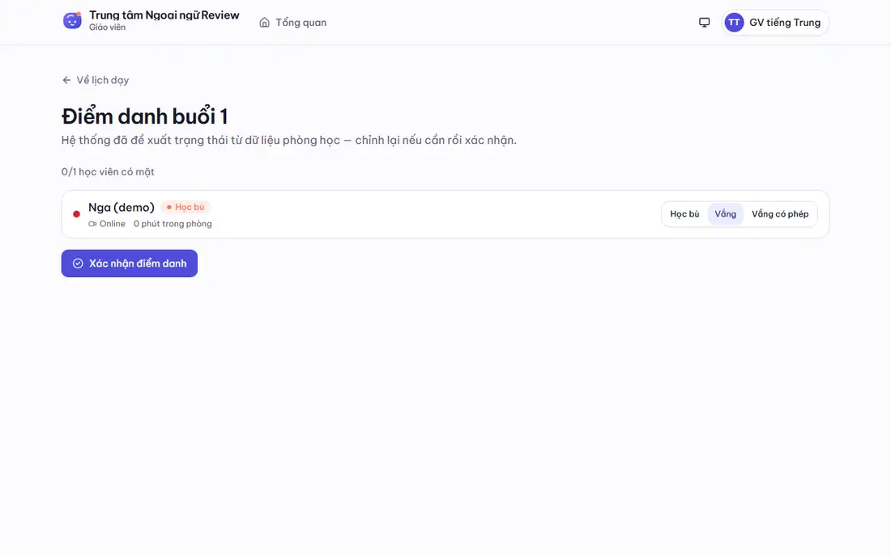
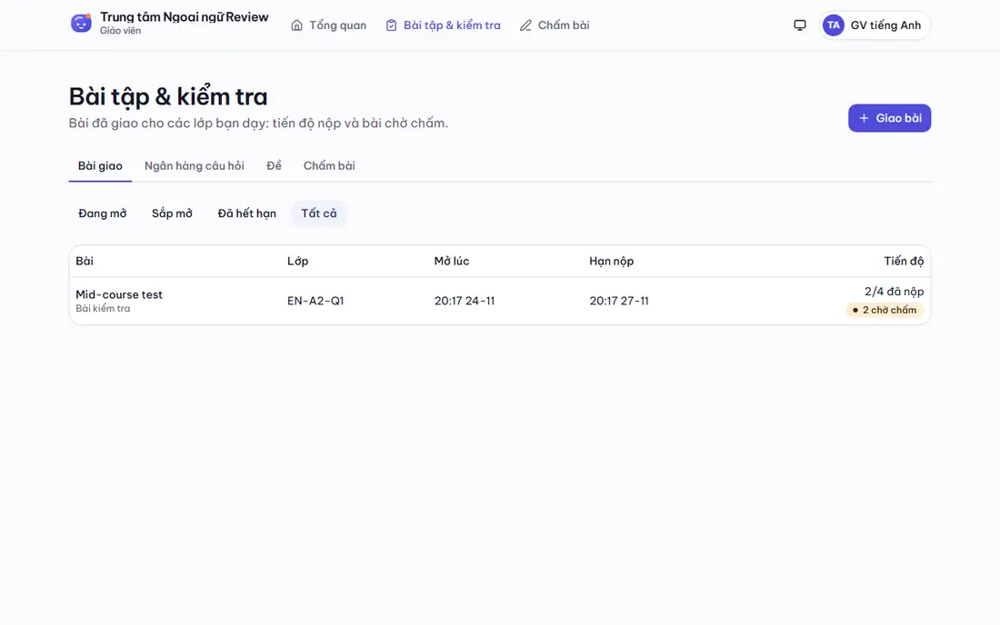
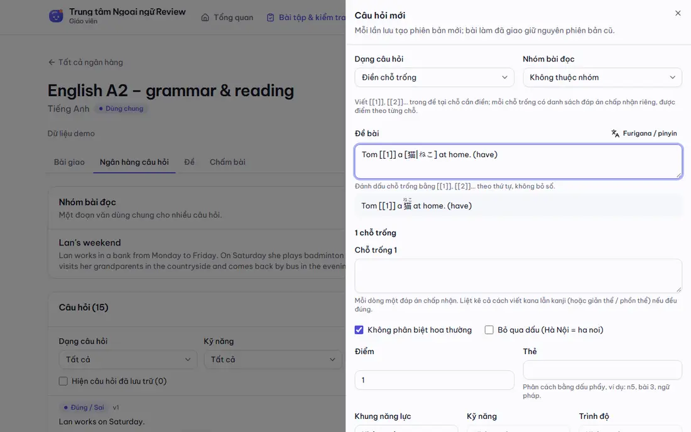
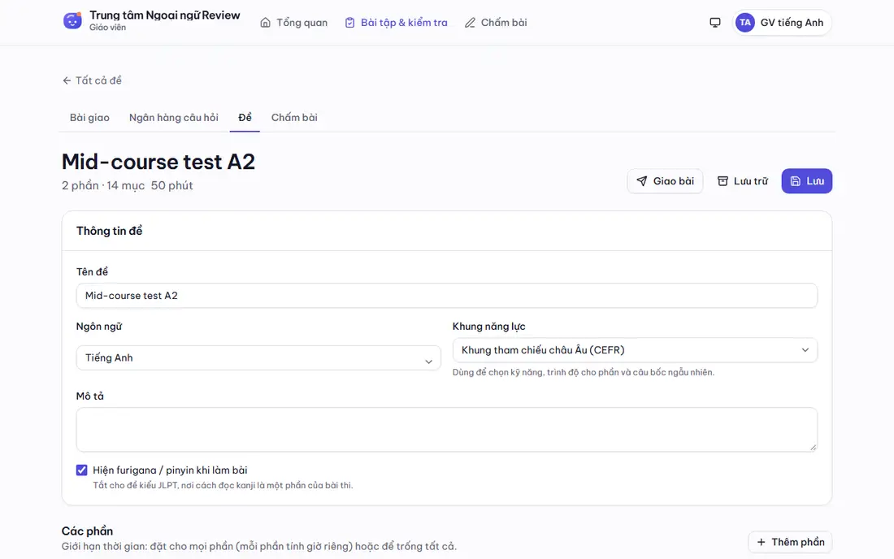
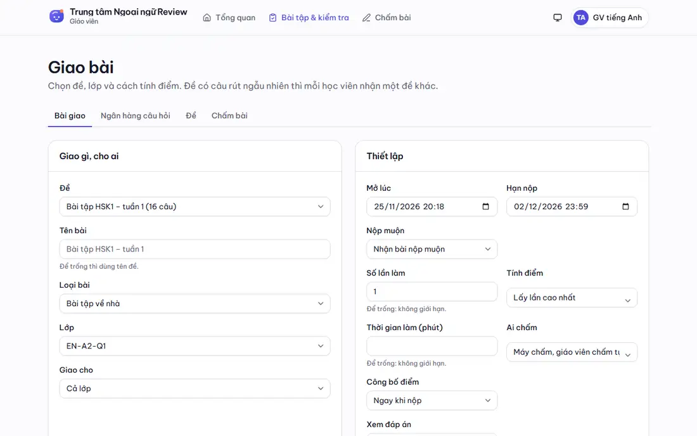
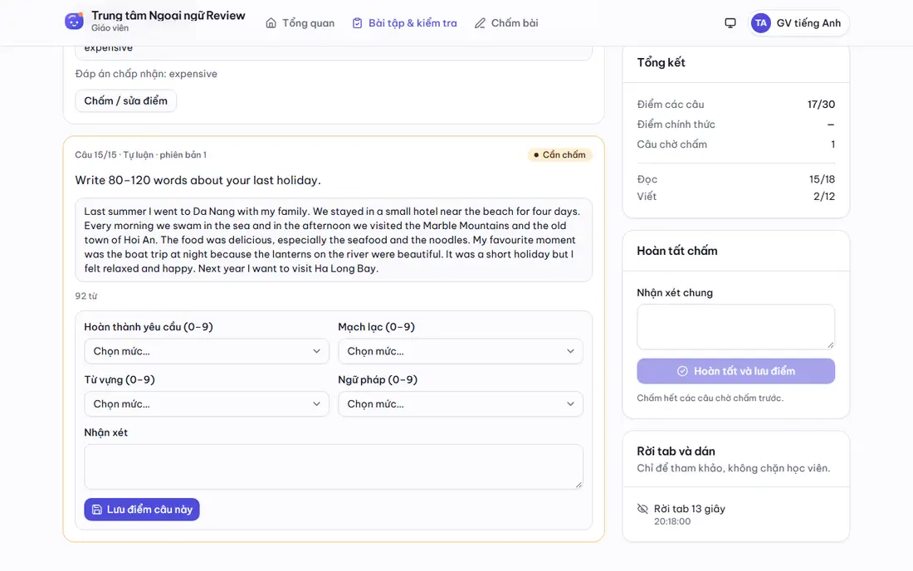

# Hướng dẫn cho giáo viên

[← Mục lục](README.md)

Giáo viên dùng khu vực **Giáo viên** (`/teach`): xem lịch dạy, vào lớp online, điểm danh sau mỗi buổi, giao bài tập và bài kiểm tra, chấm bài, xem công tháng này. Giáo viên không vào khu vực Vận hành: mở địa chỉ `/ops/...` sẽ được chuyển về `/teach`.

Đăng nhập ở tab **Giáo viên · Nhân viên** bằng email công việc (xem [Đăng nhập](dang-nhap-va-bao-mat.md#đăng-nhập)).

## Trang Tổng quan

Từ trên xuống:

1. Thẻ **Cách dùng trang giáo viên** (bấm **×** để ẩn, **Hướng dẫn nhanh** để hiện lại).
2. Bốn số của **tháng này**:

    | Thẻ | Ý nghĩa |
    | --- | --- |
    | **Buổi đã dạy** | Số buổi đã có công trong tháng |
    | **Phút được tính công** | Lớp online: số phút thực dạy, tối đa bằng thời lượng kế hoạch. Lớp tại cơ sở: theo kế hoạch, tính khi đã xác nhận điểm danh |
    | **Thu nhập tạm tính** | Phút × đơn giá hiện hành; chỉ cố định khi kỳ lương được chốt |
    | **Buổi vào muộn** | Số buổi bạn vào phòng muộn, theo dữ liệu phòng học |

3. **Lịch dạy sắp tới**: các buổi theo giờ của trung tâm, mỗi buổi ghi ngày, giờ, số buổi, hình thức (**Trực tuyến** / **Tại cơ sở**), nút **Vào lớp** (buổi online đã có phòng) và **Điểm danh**. Dòng cuối "+… buổi nữa trong khoá" cho biết còn bao nhiêu buổi.
4. **Công tháng này**: từng buổi đã có công, số phút (kèm "muộn … phút" nếu có), số tiền và trạng thái **Nháp** / **Đã duyệt** / **Đã chốt**. Dòng "chưa có đơn giá" nghĩa là trung tâm chưa đặt đơn giá cho bạn: báo quản trị hoặc kế toán.

## Vào lớp online

Bấm **Vào lớp** cạnh buổi online. Nút chỉ hiện khi phòng học đã được tạo, và chỉ giáo viên của buổi đó vào được.

- Trung tâm dùng **phòng học có sẵn của Konnyaku**: phòng mở ngay trong trình duyệt. Cách dùng, gồm nút **Kết thúc buổi học** dành cho giáo viên: [Phòng học trực tuyến](phong-hoc-truc-tuyen.md).
- Trung tâm dùng **Google Meet**: nút mở phòng Meet của buổi.

Lớp **Tại cơ sở** không có nút **Vào lớp**: dạy tại phòng ghi trong lịch.

## Điểm danh

Mỗi buổi phải được giáo viên **xác nhận điểm danh**. Chỉ khi xác nhận, học viên mới bị trừ buổi và bạn mới có công (lớp tại cơ sở).

1. Sau buổi học, bấm **Điểm danh** cạnh buổi đó trong **Lịch dạy sắp tới**.
2. Trang **Điểm danh buổi …** liệt kê học viên **có chỗ trong buổi**, mỗi người một nhóm nút: **Có mặt**, **Đi muộn**, **Về sớm**, **Vắng**, **Vắng có phép**. Dòng trên cùng "… / … học viên có mặt" cập nhật ngay khi bạn chọn.
3. Kiểm tra và chỉnh lại từng người nếu cần.
4. Bấm **Xác nhận điểm danh**.

**Lớp online**: hệ thống đã đề xuất sẵn trạng thái từ thời gian có mặt trong phòng (dòng "… phút trong phòng" dưới tên). Quy tắc: [Ngưỡng điểm danh](quy-tac-nghiep-vu.md#điểm-danh-và-trừ-buổi).

**Lớp tại cơ sở**: không có dữ liệu phòng học, nên mọi học viên mặc định **Vắng**. Chọn **Có mặt** (hoặc trạng thái khác) cho từng người rồi bấm **Xác nhận điểm danh**.

**Danh sách lấy từ chỗ đã đặt của buổi**:

- học viên đã **xin nghỉ** đúng hạn hoặc đang **bảo lưu** không có trong danh sách (không bị trừ buổi);
- học viên lớp khác đến **học bù** có nhãn **Học bù**; nhóm nút của họ là **Học bù** (có mặt), **Vắng**, **Vắng có phép**. Học bù có mặt trừ một buổi trong gói lớp gốc của học viên;
- dưới tên mỗi người có biểu tượng hình thức học của buổi đó: **Online** hoặc **Tại lớp** (lớp kết hợp).

**Xác nhận chỉ làm được một lần, không sửa trên giao diện.** Ngay sau đó:

- học viên bị trừ một buổi, trừ người **Vắng có phép** (người **Vắng** không phép **vẫn bị trừ**);
- bạn có công cho buổi đó (lớp tại cơ sở; lớp online đã có công từ dữ liệu phòng học);
- trang chỉ còn dòng "Đã xác nhận — buổi học đã được trừ theo điểm danh."

Xác nhận nhầm: báo kế toán hoặc quản trị để **điều chỉnh buổi** trong sổ buổi học của học viên (xem [Kế toán → Sổ buổi học](ke-toan.md#sổ-buổi-học)).

Buổi không dạy được (giáo viên ốm, mất điện…) mà trung tâm chưa đổi lịch: hỏi giáo vụ; nếu được đồng ý, chọn **Vắng có phép** cho mọi học viên và xác nhận để học viên không bị trừ buổi.

## Bài tập và kiểm tra

Mục **Bài tập & kiểm tra** trên thanh trên cùng có 4 thẻ: **Bài giao**, **Ngân hàng câu hỏi**, **Đề**, **Chấm bài**. Một bộ công cụ dùng cho bài tập về nhà, kiểm tra nhanh, bài kiểm tra, thi thử và kiểm tra xếp lớp; chúng chỉ khác nhau ở thiết lập khi giao bài.

Bạn soạn ngân hàng và đề của mình, dùng được ngân hàng **Dùng chung** của giáo viên khác, và giao bài, chấm bài cho **lớp mình dạy**. Quản lý cơ sở và điều phối làm được các việc này cho mọi lớp của cơ sở họ.

### Ngân hàng câu hỏi

1. Thẻ **Ngân hàng câu hỏi** → **Ngân hàng mới**: **Tên ngân hàng**, ngôn ngữ, **Phạm vi** (**Riêng tư**: chỉ bạn và quản lý; **Dùng chung**: mọi giáo viên dùng được) → **Lưu**. Trang ngân hàng mở ra.
2. **Câu hỏi mới**: chọn dạng câu, nhập **Đề bài**, phương án, đánh dấu **Đúng**, điểm, kỹ năng và trình độ (theo khung của chương trình: JLPT, CEFR, HSK…), thẻ (ví dụ `n5, bài 3, ngữ pháp`), giải thích → **Lưu**.
3. Câu đọc hiểu: **Nhóm mới** (tiêu đề + đoạn văn), rồi **Thêm câu hỏi** trong nhóm.

| Dạng câu | Cách chấm |
| --- | --- |
| Một đáp án, nhiều đáp án, đúng / sai, sắp xếp | Máy chấm, đúng cả câu mới có điểm |
| Điền vào chỗ trống | Máy chấm, điểm chia theo từng chỗ trống |
| Nối cặp | Máy chấm, điểm chia theo từng cặp |
| Trả lời ngắn | Khớp đáp án chấp nhận thì máy cho điểm; không khớp thì vào **Chấm bài** |
| Tự luận | Giáo viên chấm (đếm số từ, hoặc số ký tự với tiếng Nhật, tiếng Trung) |

Mẹo soạn:

- **Furigana, pinyin**: bôi đen chữ trong ô, bấm **Furigana / pinyin**, gõ cách đọc, bấm **Gắn cách đọc**. Ô hiện dạng `[漢字|かんじ]`; khung **Xem trước** hiện chữ nhỏ phía trên.
- **Điền vào chỗ trống**: viết `[[1]]`, `[[2]]` vào đề bài ở chỗ cần điền, rồi nhập **Đáp án chấp nhận** cho từng chỗ trống. Liệt kê đủ cách viết (ví dụ `学校` và `がっこう`). Có tuỳ chọn bỏ qua chữ hoa / thường và bỏ qua dấu tiếng Việt.
- Mỗi lần sửa câu hỏi tạo **phiên bản** mới; bài học viên đã làm giữ nguyên phiên bản lúc làm. Câu không dùng nữa thì **Lưu trữ**.

### Tạo đề

1. Thẻ **Đề** → **Đề mới**: tên đề, ngôn ngữ, khung trình độ.
2. Mỗi **phần** (thường là một kỹ năng) thêm mục bằng ô **Thêm**:
    - **Câu hỏi**: một câu cố định từ ngân hàng;
    - **Nhóm bài đọc**: cả đoạn văn và các câu của nó;
    - **Bốc ngẫu nhiên**: N câu theo ngân hàng, thẻ, kỹ năng, trình độ; mỗi học viên nhận bộ câu khác nhau.
3. **Thêm phần** nếu đề có nhiều phần. Đặt **Thời gian (phút)** cho từng phần nếu muốn chạy giờ riêng như JLPT, IELTS: hoặc mọi phần đều có giờ, hoặc không phần nào có.
4. Câu tự luận chấm theo tiêu chí: thêm **Mẫu IELTS Writing** (4 tiêu chí, band 0–9) hoặc **Thang trống**, rồi chọn thang ở câu đó.
5. Bỏ **Hiện furigana / pinyin khi làm bài** nếu đề kiểm tra cách đọc chữ Hán. Bấm **Lưu**.

### Giao bài

Bấm **Giao bài** (trên trang đề hoặc thẻ **Bài giao**):

1. Chọn đề, **Loại bài** (Bài tập về nhà, Kiểm tra nhanh, Bài kiểm tra, Thi thử, Kiểm tra xếp lớp) và **Lớp**.
2. **Giao cho**: **Cả lớp**, **Một buổi học** hoặc **Một số học viên** (đánh dấu tên).
3. Thiết lập:

    | Ô | Ý nghĩa |
    | --- | --- |
    | **Mở lúc**, **Hạn nộp** | Học viên làm được từ lúc mở |
    | **Nộp muộn** | **Nhận bài nộp muộn**, **Trừ điểm khi nộp muộn** (nhập %), hoặc **Khoá khi hết hạn** (bài đang làm tự nộp đúng hạn) |
    | **Số lần làm**, **Tính điểm** | Để trống là không giới hạn; tính **lần cao nhất**, **lần cuối** hoặc **trung bình** |
    | **Thời gian làm (phút)** | Đề chia phần có giờ thì lấy theo đề |
    | **Ai chấm** | **Máy chấm, giáo viên chấm tự luận**, hoặc **Giáo viên duyệt mọi bài** |
    | **Công bố điểm** | **Ngay khi nộp**, **Khi chấm xong**, hoặc **Vào thời điểm định sẵn** (cả lớp cùng thấy, tránh lộ đáp án) |
    | **Xem đáp án** | Không, sau khi nộp, hoặc sau hạn nộp |

4. Bấm **Giao bài**. Trang chi tiết mở ra: từng học viên đã làm chưa, nộp lúc nào, có muộn không, điểm, số lần rời tab / dán văn bản. **Công bố điểm ngay** khi đã chấm xong; bài chưa ai làm thì **Xoá** được.

### Chấm bài

Câu máy chấm có điểm ngay khi học viên nộp. Thẻ **Chấm bài** liệt kê bài đang chờ: câu tự luận, câu trả lời ngắn không khớp đáp án, và mọi bài giao với **Giáo viên duyệt mọi bài**. Lọc theo lớp và hạn nộp.

1. Bấm tên học viên. Mỗi câu hiện câu trả lời cạnh đáp án; câu cần chấm có nhãn **Cần chấm**.
2. Chọn mức cho từng tiêu chí (hoặc nhập điểm), viết **Nhận xét** → **Lưu điểm câu này**. Câu máy chấm cũng sửa được bằng **Chấm / sửa điểm**.
3. Viết **Nhận xét chung** → **Hoàn tất và lưu điểm**. Điểm thành chính thức và hiện cho học viên theo thiết lập **Công bố điểm**.

Khung **Rời tab và dán** cho biết học viên rời trang hay dán văn bản lúc nào, ở câu nào. Chỉ để tham khảo; hệ thống không chặn học viên.

## Công và lương

- Lớp online: công được ghi tự động từ dữ liệu phòng học sau buổi học (số phút thực dạy, tối đa bằng thời lượng kế hoạch; vào muộn được ghi lại).
- Lớp tại cơ sở: công được ghi khi bạn xác nhận điểm danh, theo thời lượng kế hoạch.
- Cuối kỳ, kế toán tạo và **chốt kỳ lương**; bạn nhận email "Chốt kỳ lương". Trạng thái công đổi từ **Nháp** sang **Đã duyệt** / **Đã chốt**.

Thắc mắc về số phút hay đơn giá: liên hệ kế toán trước khi kỳ lương được chốt.

## Thông báo

Chuông ở thanh trên báo khi buổi dạy đổi giờ, bị hủy, 24 giờ trước mỗi buổi và khi kỳ lương được chốt. Cài đặt email và thông báo đẩy: xem [Thông báo](thong-bao.md).

## Tài khoản

Bấm tên của bạn → **Tài khoản & bảo mật**: đổi mật khẩu, bật xác thực 2 bước, xem thiết bị đang đăng nhập (xem [Đăng nhập và bảo mật](dang-nhap-va-bao-mat.md)).

> Chưa có: lịch rảnh, xin nghỉ, dạy thay, nhận xét học viên, xem danh sách lớp trong `/teach` (danh sách học viên chỉ hiện trong trang điểm danh của buổi).
