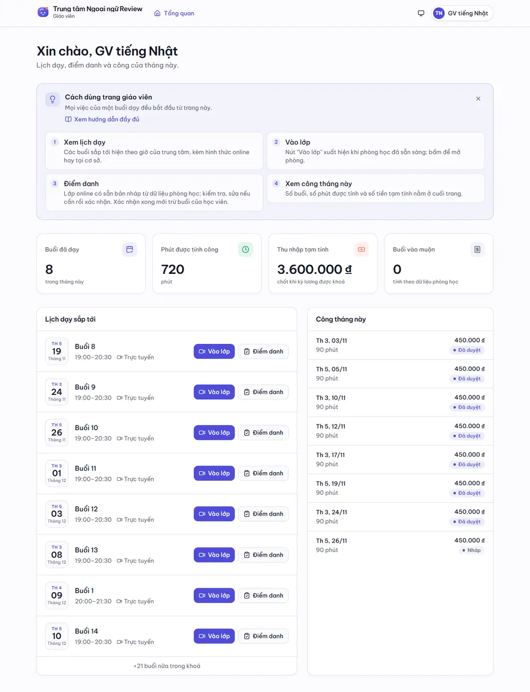
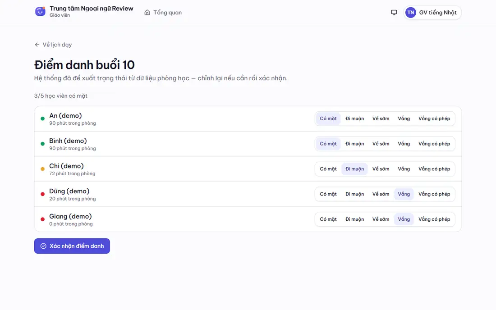
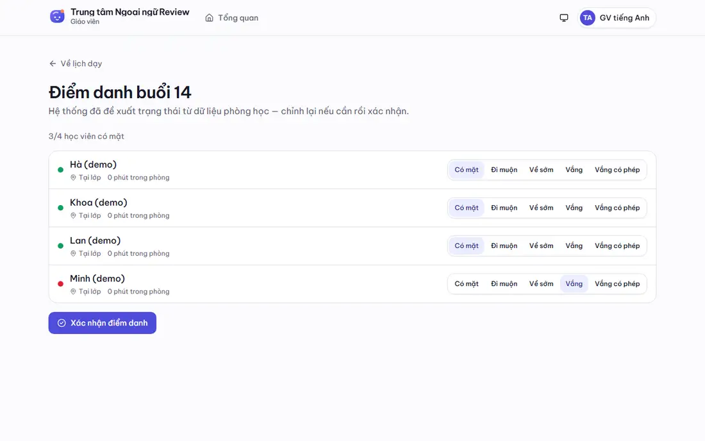
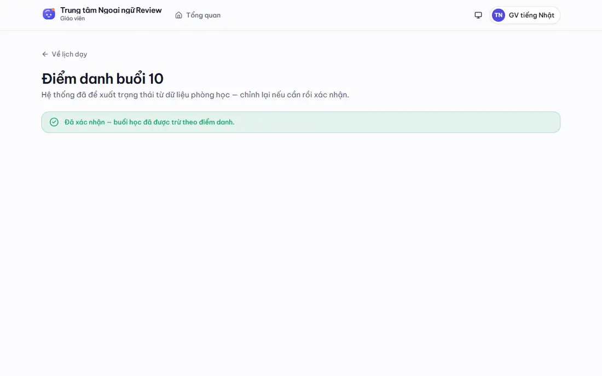

# Hướng dẫn cho giáo viên

[← Mục lục](README.md)

Giáo viên dùng khu vực **Giáo viên** (`/teach`): xem lịch dạy, vào lớp online, điểm danh sau mỗi buổi, xem công tháng này. Giáo viên không vào khu vực Vận hành: mở địa chỉ `/ops/...` sẽ được chuyển về `/teach`.

Đăng nhập ở tab **Giáo viên · Nhân viên** bằng email công việc (xem [Đăng nhập](dang-nhap-va-bao-mat.md#đăng-nhập)).

## Trang Tổng quan

Từ trên xuống:

1. Thẻ **Cách dùng trang giáo viên** (bấm **×** để ẩn, **Hướng dẫn nhanh** để hiện lại).
2. Bốn số của **tháng này**:

    | Thẻ | Ý nghĩa |
    | --- | --- |
    | **Buổi đã dạy** | Số buổi đã có công trong tháng |
    | **Phút được tính công** | Lớp online: số phút thực dạy, tối đa bằng thời lượng kế hoạch. Lớp tại cơ sở: theo kế hoạch, tính khi đã xác nhận điểm danh |
    | **Thu nhập tạm tính** | Phút × đơn giá hiện hành; chỉ cố định khi kỳ lương được chốt |
    | **Buổi vào muộn** | Số buổi bạn vào phòng muộn, theo dữ liệu phòng học |

3. **Lịch dạy sắp tới**: các buổi theo giờ của trung tâm, mỗi buổi ghi ngày, giờ, số buổi, hình thức (**Trực tuyến** / **Tại cơ sở**), nút **Vào lớp** (buổi online đã có phòng) và **Điểm danh**. Dòng cuối "+… buổi nữa trong khoá" cho biết còn bao nhiêu buổi.
4. **Công tháng này**: từng buổi đã có công, số phút (kèm "muộn … phút" nếu có), số tiền và trạng thái **Nháp** / **Đã duyệt** / **Đã chốt**. Dòng "chưa có đơn giá" nghĩa là trung tâm chưa đặt đơn giá cho bạn: báo quản trị hoặc kế toán.

## Vào lớp online

Bấm **Vào lớp** cạnh buổi online. Nút chỉ hiện khi phòng học đã được tạo, và chỉ giáo viên của buổi đó vào được.

- Trung tâm dùng **phòng học có sẵn của Konnyaku**: phòng mở ngay trong trình duyệt. Cách dùng, gồm nút **Kết thúc buổi học** dành cho giáo viên: [Phòng học trực tuyến](phong-hoc-truc-tuyen.md).
- Trung tâm dùng **Google Meet**: nút mở phòng Meet của buổi.

Lớp **Tại cơ sở** không có nút **Vào lớp**: dạy tại phòng ghi trong lịch.

## Điểm danh

Mỗi buổi phải được giáo viên **xác nhận điểm danh**. Chỉ khi xác nhận, học viên mới bị trừ buổi và bạn mới có công (lớp tại cơ sở).

1. Sau buổi học, bấm **Điểm danh** cạnh buổi đó trong **Lịch dạy sắp tới**.
2. Trang **Điểm danh buổi …** liệt kê học viên của buổi, mỗi người một nhóm nút: **Có mặt**, **Đi muộn**, **Về sớm**, **Vắng**, **Vắng có phép**. Dòng trên cùng "… / … học viên có mặt" cập nhật ngay khi bạn chọn.
3. Kiểm tra và chỉnh lại từng người nếu cần.
4. Bấm **Xác nhận điểm danh**.

**Lớp online**: hệ thống đã đề xuất sẵn trạng thái từ thời gian có mặt trong phòng (dòng "… phút trong phòng" dưới tên). Quy tắc: [Ngưỡng điểm danh](quy-tac-nghiep-vu.md#điểm-danh-và-trừ-buổi).

**Lớp tại cơ sở**: không có dữ liệu phòng học, trang chỉ ghi "Chưa có dữ liệu từ phòng học. Bạn có thể xác nhận để điểm danh thủ công (mặc định vắng)." và nút **Xác nhận điểm danh**.

> **Hạn chế của phiên bản này:** với lớp tại cơ sở, trang **chưa hiện danh sách học viên** để chọn từng người (lỗi đã ghi nhận). Bấm **Xác nhận điểm danh** sẽ ghi **mọi học viên là Vắng** (trừ người đang bảo lưu được ghi Vắng có phép) và trừ mỗi người một buổi; bạn được ghi công đủ buổi. Vì vắng không phép cũng bị trừ buổi, số buổi của học viên vẫn đúng với người có mặt; chỉ có trạng thái có mặt / vắng là chưa đúng. Trong lúc chờ sửa:
>
> 1. Ghi giấy (hoặc nhắn giáo vụ) tên học viên vắng **có phép** của buổi.
> 2. Bấm **Xác nhận điểm danh** sau buổi học.
> 3. Gửi danh sách vắng có phép cho kế toán để **cộng lại 1 buổi** cho từng người (**Điều chỉnh buổi**, cùng loại buổi với dòng **Học** của buổi đó trong sổ, lý do "Vắng có phép buổi …").

**Xác nhận chỉ làm được một lần, không sửa trên giao diện.** Ngay sau đó:

- học viên bị trừ một buổi, trừ người **Vắng có phép** (người **Vắng** không phép **vẫn bị trừ**);
- bạn có công cho buổi đó (lớp tại cơ sở; lớp online đã có công từ dữ liệu phòng học);
- trang chỉ còn dòng "Đã xác nhận — buổi học đã được trừ theo điểm danh."

Xác nhận nhầm: báo kế toán hoặc quản trị để **điều chỉnh buổi** trong sổ buổi học của học viên (xem [Kế toán → Sổ buổi học](ke-toan.md#sổ-buổi-học)).

Buổi không dạy được (giáo viên ốm, mất điện…) mà trung tâm chưa đổi lịch: hỏi giáo vụ; nếu được đồng ý, chọn **Vắng có phép** cho mọi học viên và xác nhận để học viên không bị trừ buổi.

## Công và lương

- Lớp online: công được ghi tự động từ dữ liệu phòng học sau buổi học (số phút thực dạy, tối đa bằng thời lượng kế hoạch; vào muộn được ghi lại).
- Lớp tại cơ sở: công được ghi khi bạn xác nhận điểm danh, theo thời lượng kế hoạch.
- Cuối kỳ, kế toán tạo và **chốt kỳ lương**; bạn nhận email "Chốt kỳ lương". Trạng thái công đổi từ **Nháp** sang **Đã duyệt** / **Đã chốt**.

Thắc mắc về số phút hay đơn giá: liên hệ kế toán trước khi kỳ lương được chốt.

## Tài khoản

Bấm tên của bạn → **Tài khoản & bảo mật**: đổi mật khẩu, bật xác thực 2 bước, xem thiết bị đang đăng nhập (xem [Đăng nhập và bảo mật](dang-nhap-va-bao-mat.md)).

> Chưa có: lịch rảnh, xin nghỉ, dạy thay, giao bài tập, nhận xét học viên, xem danh sách lớp trong `/teach` (danh sách học viên chỉ hiện trong trang điểm danh của buổi).
