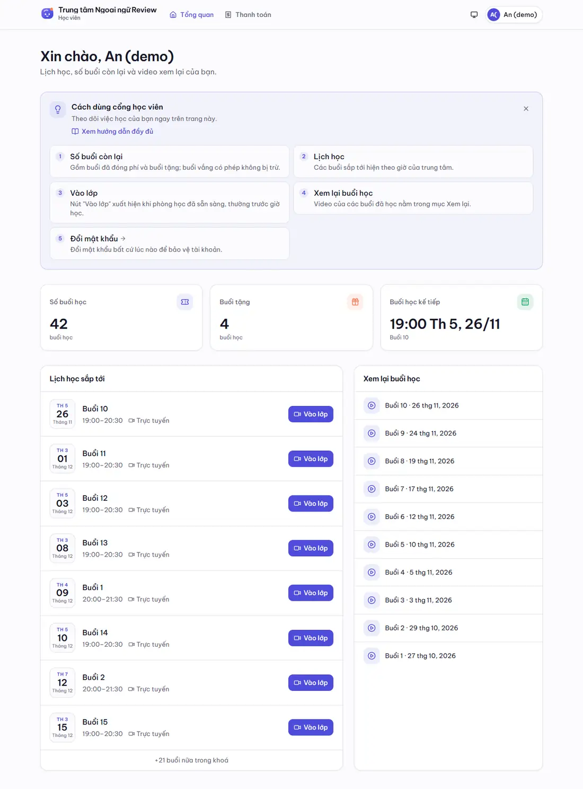
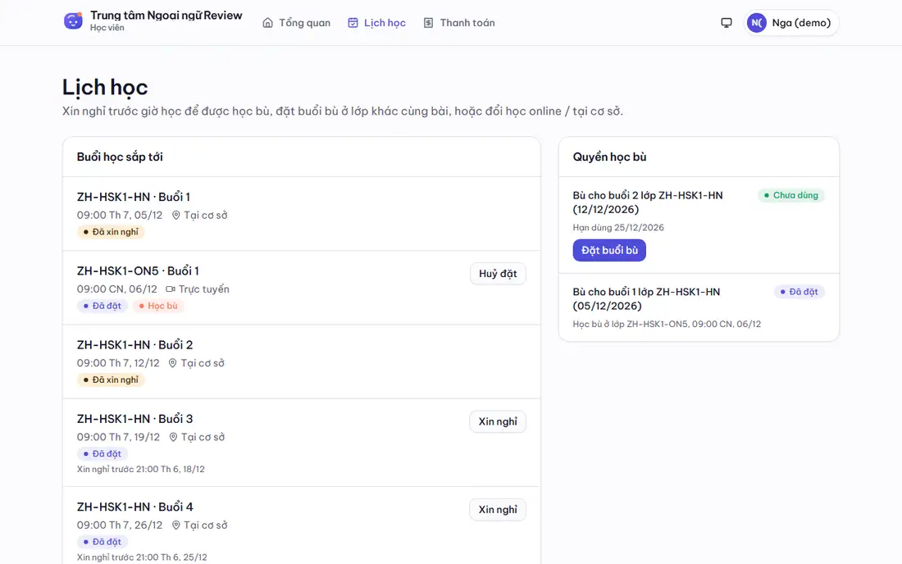
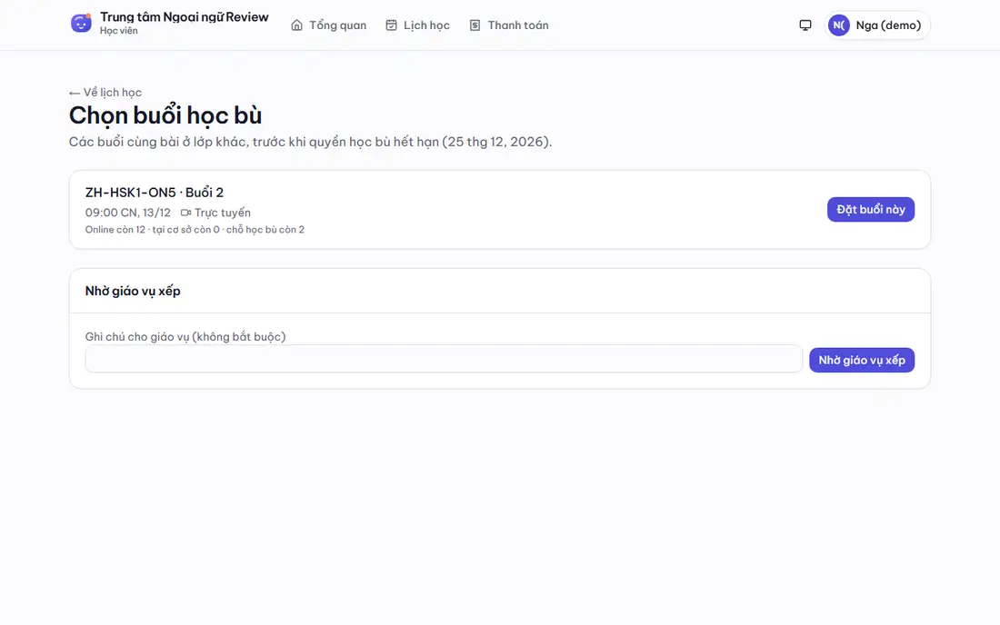
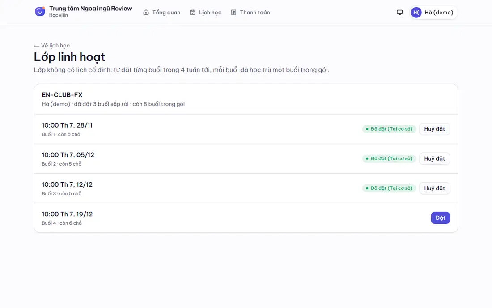
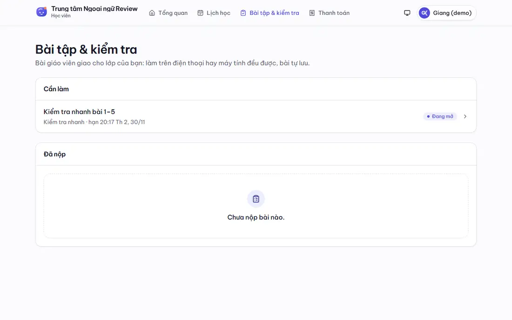
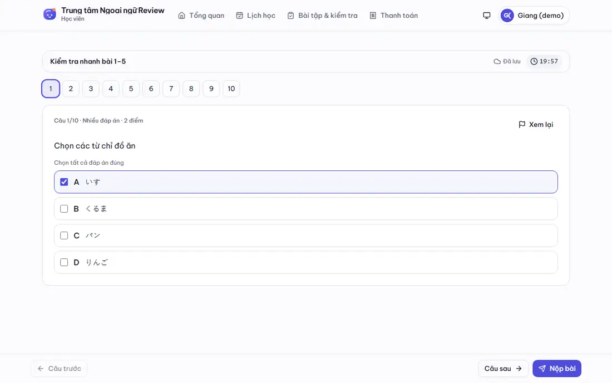
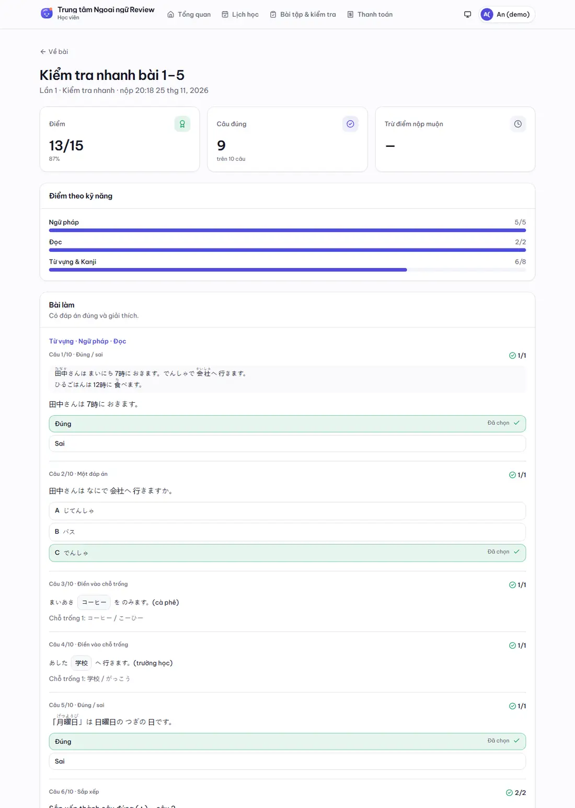
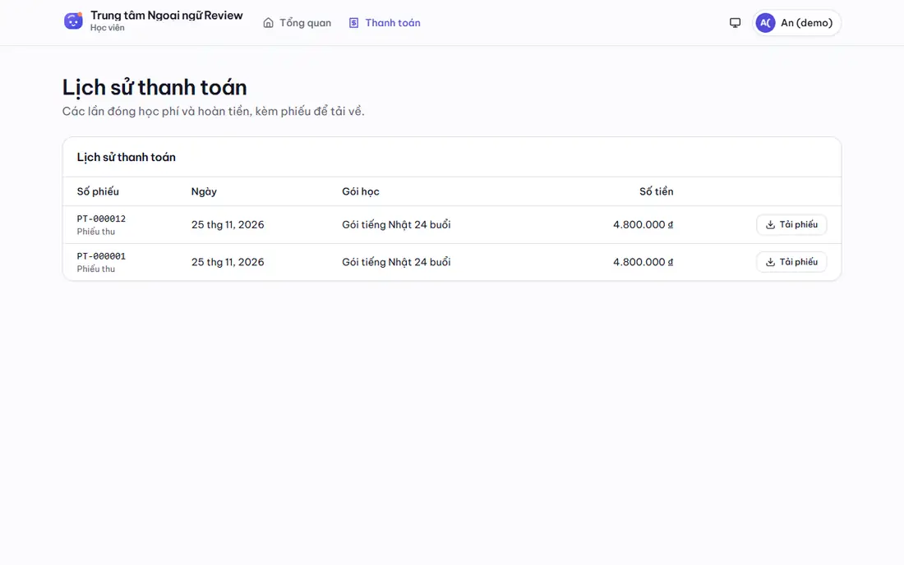
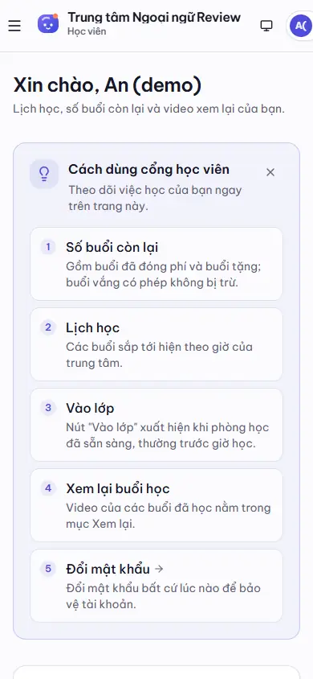

# Hướng dẫn cho học viên

[← Mục lục](README.md)

Cổng học viên (`/learn`) cho bạn biết còn bao nhiêu buổi, buổi kế tiếp lúc nào, có nút vào lớp online, video xem lại, bài tập và bài kiểm tra, lịch sử đóng học phí. Mục **Lịch học** để xin nghỉ, đặt buổi bù, đổi học online / tại cơ sở và đặt buổi lớp linh hoạt.

## Đăng nhập lần đầu

1. Trung tâm gửi bạn **Tên đăng nhập** (dạng `hv123456`) và **mật khẩu tạm**. Nếu hồ sơ có email, bạn cũng nhận email "Chào mừng" kèm tên đăng nhập.
2. Mở trang của trung tâm → **Đăng nhập** → tab **Học viên · Phụ huynh**. Nhập tên đăng nhập, mật khẩu tạm, bấm **Đăng nhập**.
3. Trang **Đổi mật khẩu** mở ra: nhập **Mật khẩu hiện tại** (mật khẩu tạm), **Mật khẩu mới (ít nhất 8 ký tự)** có cả chữ và số, bấm **Lưu mật khẩu**.

Quên mật khẩu: liên hệ trung tâm để được cấp mật khẩu tạm mới (tài khoản học viên không tự đặt lại qua email). Nhập sai 5 lần liên tiếp thì tài khoản tạm khoá 15 phút.

## Trang Tổng quan

| Phần | Ý nghĩa |
| --- | --- |
| **Số buổi học** | Tổng số buổi còn lại trong các gói đã mua, gồm cả buổi tặng |
| **Buổi tặng** | Số buổi tặng còn lại. Buổi trả phí được trừ trước, buổi tặng trừ sau |
| **Buổi học kế tiếp** | Ngày giờ và số thứ tự của buổi sắp tới |
| **Lịch học sắp tới** | 8 buổi gần nhất: ngày, giờ, số buổi, hình thức (**Trực tuyến** / **Tại cơ sở**), nút **Vào lớp** với buổi online. Buổi bị huỷ có nhãn **Đã huỷ**. Dòng cuối cho biết còn bao nhiêu buổi trong khoá |
| **Xem lại buổi học** | Các buổi đã có video ghi lại |

Giờ học hiển thị theo giờ của trung tâm (cơ sở của lớp).

Nếu số buổi âm, trang hiện dòng đỏ **Đang nợ … buổi — vui lòng gia hạn gói học.** Bạn vẫn học được, nhưng cần liên hệ trung tâm để mua gói mới. Khi chỉ còn 3 buổi trở xuống, bạn nhận email "Sắp hết buổi" (nếu hồ sơ có email).

Thẻ **Cách dùng cổng học viên** ở đầu trang tóm tắt các việc trên; bấm **×** để ẩn, **Hướng dẫn nhanh** để hiện lại.

## Lịch học: xin nghỉ, học bù, đổi hình thức

Mục **Lịch học** liệt kê các buổi trong 60 ngày tới mà bạn có chỗ: buổi của lớp mình, buổi học bù và buổi đã đặt ở lớp linh hoạt. Mỗi buổi ghi lớp, số buổi, giờ, hình thức (**Trực tuyến** / **Tại cơ sở**) và trạng thái: **Đã đặt**, **Đã xin nghỉ**, **Đã học**, **Vắng**. Buổi học bù có thêm nhãn **Học bù**, buổi lớp linh hoạt có nhãn **Lớp linh hoạt**. Phụ huynh có nhiều con thấy thêm dòng "Cho …".

### Xin nghỉ một buổi

1. Ở buổi muốn nghỉ, bấm **Xin nghỉ**, rồi bấm **OK** để xác nhận.
2. Buổi chuyển **Đã xin nghỉ**: buổi đó **không bị trừ**, và bạn nhận một **quyền học bù** trong khung **Quyền học bù**.

Dưới mỗi buổi có dòng "Xin nghỉ trước …" cho biết hạn chót. Mặc định:

- phải xin nghỉ **trước giờ học ít nhất 12 giờ**; quá hạn thì nút **Xin nghỉ** ẩn đi, dòng "Đã qua hạn xin nghỉ" hiện ra và nếu vắng, buổi vẫn bị trừ như bình thường;
- mỗi khoá xin nghỉ **tối đa 3 lần**;
- quyền học bù dùng trong **30 ngày**.

Trung tâm có thể đổi các mốc này (xem [Quy tắc: xin nghỉ và học bù](quy-tac-nghiep-vu.md#xin-nghỉ-học-bù-và-chỗ-ngồi)).

### Đặt buổi bù

1. Trong khung **Quyền học bù**, ở quyền **Chưa dùng**, bấm **Đặt buổi bù**.
2. Trang **Chọn buổi học bù** liệt kê các buổi **cùng bài** ở lớp khác (cùng chương trình, cùng cấp độ) trước khi quyền hết hạn, kèm số chỗ còn: online, tại cơ sở và chỗ học bù.
3. Bấm **Đặt buổi này**. Lớp kết hợp có hai nút **Đặt (Tại cơ sở)** / **Đặt (Trực tuyến)**.

Buổi bù hiện trong **Lịch học** với nhãn **Học bù** và có nút **Vào lớp** như buổi thường. Khi có mặt, buổi bù trừ **một buổi** trong gói của lớp mình.

- Buổi đã hết chỗ ghi **Hết chỗ** và có nút **Vào hàng chờ**: khi có người huỷ, trung tâm giữ chỗ cho người đầu hàng **2 giờ**. Chỗ giữ hiện ở đầu trang **Lịch học** (khung **Chỗ đang giữ cho bạn**): bấm **Nhận chỗ** hoặc **Bỏ qua**. Hết 2 giờ không bấm thì chỗ chuyển cho người kế.
- Không có buổi nào phù hợp: điền ghi chú (không bắt buộc) và bấm **Nhờ giáo vụ xếp**. Quyền học bù có nhãn **Đã nhờ giáo vụ xếp**; giáo vụ xếp tay rồi buổi hiện trong **Lịch học**.
- Đổi ý: bấm **Huỷ đặt** ở buổi học bù (trước hạn xin nghỉ); quyền học bù quay lại để đặt buổi khác.

### Đổi học online hoặc tại cơ sở (lớp kết hợp)

Ở buổi của lớp **Kết hợp**, bấm **Chuyển sang Tại cơ sở** hoặc **Chuyển sang Trực tuyến**. Nút chỉ hiện khi hình thức kia **còn chỗ** và còn **trước giờ học 2 giờ**; dòng "Đổi trước … · còn … chỗ" cho biết hạn và số chỗ. Chỗ tại cơ sở không vượt sức chứa phòng học.

### Lớp linh hoạt

Lớp linh hoạt (câu lạc bộ nói, lớp giao tiếp) không có lịch cố định: bạn mua gói rồi tự đặt từng buổi.

1. Trên **Lịch học**, bấm **Đặt buổi lớp linh hoạt** (chỉ hiện khi bạn đã ghi danh lớp linh hoạt).
2. Trang **Lớp linh hoạt** liệt kê các buổi trong 4 tuần tới và số chỗ còn. Bấm **Đặt** ở buổi muốn học. Buổi đã đặt có nhãn **Đã đặt (…)** và nút **Huỷ đặt**.
3. Buổi hết chỗ có nút **Vào hàng chờ**.

Số buổi đặt trước không vượt số buổi còn trong gói; mỗi buổi có mặt trừ một buổi.

## Bài tập và kiểm tra

Mục **Bài tập & kiểm tra** liệt kê bài giáo viên giao cho bạn: nhóm **Cần làm** và **Đã nộp**, mỗi bài có loại, hạn nộp, trạng thái và điểm khi đã công bố.

1. Bấm vào bài để xem số câu, thời gian, hạn nộp, số lần được làm, khi nào có điểm và đáp án.
2. Bấm **Bắt đầu làm bài**. Mỗi màn hình một câu; dải số phía trên là danh sách câu (câu đã trả lời có nền màu, câu đánh dấu **Xem lại** có chấm vàng). Dùng **Câu trước** / **Câu sau** hoặc bấm số câu.
3. Bài **tự lưu** vài giây một lần (góc trên ghi **Đã lưu**). Mất mạng, tắt máy hay đổi máy: mở lại bài, bấm **Làm tiếp**, câu trả lời vẫn còn.
4. Đồng hồ chạy theo máy chủ. Hết giờ, bài **tự nộp**, kể cả khi bạn đã đóng trình duyệt. Đề chia phần có giờ riêng: hết giờ phần nào thì phần đó khoá và chuyển sang phần sau; bấm **Phần tiếp theo** để sang sớm (không quay lại được).
5. Bấm **Nộp bài** → **Xác nhận**. Hệ thống báo nếu còn câu chưa trả lời.

Cách trả lời: chọn đáp án; gõ vào ô trống trong câu; **Nối cặp** chọn ở ô bên phải; **Sắp xếp** dùng mũi tên lên / xuống; **Tự luận** có đếm số từ (hoặc số ký tự với tiếng Nhật, tiếng Trung). Câu đọc hiểu có đoạn văn phía trên, bấm tiêu đề để thu gọn.

**Kết quả** hiện điểm, điểm theo từng kỹ năng, câu đúng / sai, nhận xét của giáo viên. Điểm và đáp án hiện theo thiết lập của bài: ngay khi nộp, khi giáo viên chấm xong, hoặc vào giờ định sẵn cho cả lớp. Câu tự luận và câu trả lời ngắn chưa khớp đáp án ghi **Chờ giáo viên chấm**.

Khi làm bài, việc rời khỏi trang và dán văn bản được ghi lại cho giáo viên xem; hệ thống không chặn.

## Vào lớp online

1. Gần giờ học, mở **Tổng quan**.
2. Bấm **Vào lớp** cạnh buổi học. Nút chỉ hiện khi phòng học đã được tạo và chỉ học viên có chỗ trong lớp mới vào được.
3. Trung tâm dùng phòng học có sẵn của Konnyaku: phòng mở ngay trong trình duyệt (xem [Phòng học trực tuyến](phong-hoc-truc-tuyen.md)). Trung tâm dùng Google Meet: nút mở phòng Meet.

Bạn **không cần tự điểm danh**: hệ thống ghi thời gian bạn có mặt trong phòng, giáo viên xác nhận sau buổi học, rồi số buổi mới được trừ. Vắng có phép không bị trừ buổi; vắng không báo trước vẫn bị trừ. Quy tắc: [Điểm danh và trừ buổi](quy-tac-nghiep-vu.md#điểm-danh-và-trừ-buổi).

## Xem lại buổi học

Mục **Xem lại buổi học** liệt kê các buổi đã có video, dạng "Buổi 3 · 3 thg 11, 2026". Bấm để xem.

Video chỉ có khi buổi học được ghi hình (Google Meet có bật ghi hình). Phòng học có sẵn của Konnyaku **chưa ghi hình**, nên các buổi học trong phòng này không có video.

## Lịch sử thanh toán

Mở **Thanh toán** ở thanh trên cùng. Bảng **Lịch sử thanh toán** liệt kê mọi lần đóng học phí (**Phiếu thu**) và hoàn tiền (**Hoàn tiền**): **Số phiếu**, **Ngày**, **Gói học**, **Số tiền**. Bấm **Tải phiếu** để tải phiếu thu / phiếu chi dạng PDF. Mỗi lần tải đều được trung tâm ghi lại.

## Đổi mật khẩu

Bấm tên của bạn ở góc trên bên phải → **Tài khoản & bảo mật** → trang **Đổi mật khẩu**. Đổi xong, các thiết bị khác đang đăng nhập bị đăng xuất.

## Dùng trên điện thoại

Cổng học viên dùng được trên điện thoại: menu thu vào nút ba gạch ở góc trên. Phòng học có sẵn của Konnyaku chạy trên trình duyệt điện thoại (Chrome, Safari bản mới), không cần cài ứng dụng.

> Chưa có: tài liệu, bảng điểm tổng hợp, nhận xét định kỳ của giáo viên, xin nghỉ / bảo lưu trực tuyến, thanh toán online. Liên hệ trung tâm cho các việc này.
