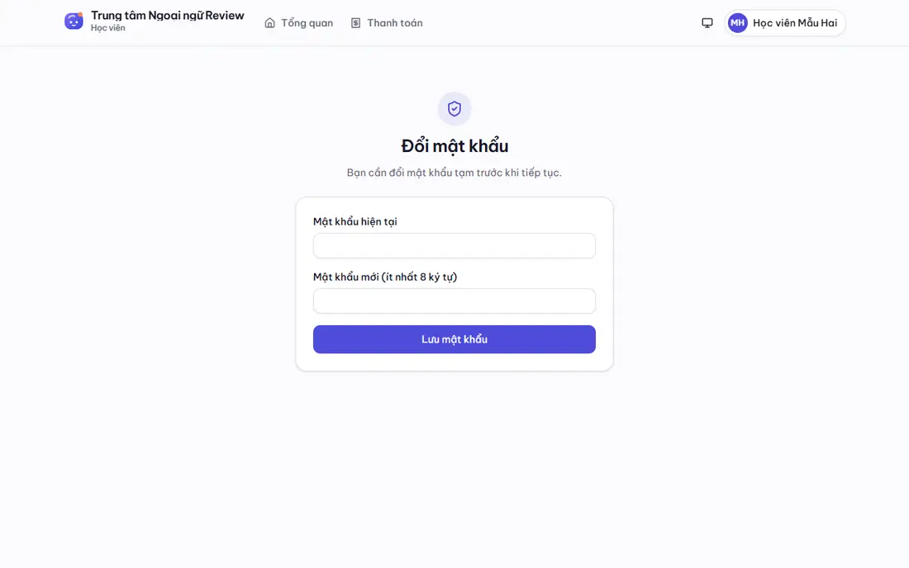

# Hướng dẫn cho học viên

[← Mục lục](README.md)

Cổng học viên (`/learn`) cho bạn biết còn bao nhiêu buổi, buổi kế tiếp lúc nào, có nút vào lớp online, video xem lại và lịch sử đóng học phí.

## Đăng nhập lần đầu

1. Trung tâm gửi bạn **Tên đăng nhập** (dạng `hv123456`) và **mật khẩu tạm**. Nếu hồ sơ có email, bạn cũng nhận email "Chào mừng" kèm tên đăng nhập.
2. Mở trang của trung tâm → **Đăng nhập** → tab **Học viên · Phụ huynh**. Nhập tên đăng nhập, mật khẩu tạm, bấm **Đăng nhập**.
3. Trang **Đổi mật khẩu** mở ra: nhập **Mật khẩu hiện tại** (mật khẩu tạm), **Mật khẩu mới (ít nhất 8 ký tự)** có cả chữ và số, bấm **Lưu mật khẩu**.

Quên mật khẩu: liên hệ trung tâm để được cấp mật khẩu tạm mới (tài khoản học viên không tự đặt lại qua email). Nhập sai 5 lần liên tiếp thì tài khoản tạm khoá 15 phút.

## Trang Tổng quan

| Phần | Ý nghĩa |
| --- | --- |
| **Số buổi học** | Tổng số buổi còn lại trong các gói đã mua, gồm cả buổi tặng |
| **Buổi tặng** | Số buổi tặng còn lại. Buổi trả phí được trừ trước, buổi tặng trừ sau |
| **Buổi học kế tiếp** | Ngày giờ và số thứ tự của buổi sắp tới |
| **Lịch học sắp tới** | 8 buổi gần nhất: ngày, giờ, số buổi, hình thức (**Trực tuyến** / **Tại cơ sở**), nút **Vào lớp** với buổi online. Buổi bị huỷ có nhãn **Đã huỷ**. Dòng cuối cho biết còn bao nhiêu buổi trong khoá |
| **Xem lại buổi học** | Các buổi đã có video ghi lại |

Giờ học hiển thị theo giờ của trung tâm (cơ sở của lớp).

Nếu số buổi âm, trang hiện dòng đỏ **Đang nợ … buổi — vui lòng gia hạn gói học.** Bạn vẫn học được, nhưng cần liên hệ trung tâm để mua gói mới. Khi chỉ còn 3 buổi trở xuống, bạn nhận email "Sắp hết buổi" (nếu hồ sơ có email).

Thẻ **Cách dùng cổng học viên** ở đầu trang tóm tắt các việc trên; bấm **×** để ẩn, **Hướng dẫn nhanh** để hiện lại.

## Vào lớp online

1. Gần giờ học, mở **Tổng quan**.
2. Bấm **Vào lớp** cạnh buổi học. Nút chỉ hiện khi phòng học đã được tạo và chỉ học viên có chỗ trong lớp mới vào được.
3. Trung tâm dùng phòng học có sẵn của Konnyaku: phòng mở ngay trong trình duyệt (xem [Phòng học trực tuyến](phong-hoc-truc-tuyen.md)). Trung tâm dùng Google Meet: nút mở phòng Meet.

Bạn **không cần tự điểm danh**: hệ thống ghi thời gian bạn có mặt trong phòng, giáo viên xác nhận sau buổi học, rồi số buổi mới được trừ. Vắng có phép không bị trừ buổi; vắng không báo trước vẫn bị trừ. Quy tắc: [Điểm danh và trừ buổi](quy-tac-nghiep-vu.md#điểm-danh-và-trừ-buổi).

## Xem lại buổi học

Mục **Xem lại buổi học** liệt kê các buổi đã có video, dạng "Buổi 3 · 3 thg 11, 2026". Bấm để xem.

Video chỉ có khi buổi học được ghi hình (Google Meet có bật ghi hình). Phòng học có sẵn của Konnyaku **chưa ghi hình**, nên các buổi học trong phòng này không có video.

## Lịch sử thanh toán

Mở **Thanh toán** ở thanh trên cùng. Bảng **Lịch sử thanh toán** liệt kê mọi lần đóng học phí (**Phiếu thu**) và hoàn tiền (**Hoàn tiền**): **Số phiếu**, **Ngày**, **Gói học**, **Số tiền**. Bấm **Tải phiếu** để tải phiếu thu / phiếu chi dạng PDF. Mỗi lần tải đều được trung tâm ghi lại.

## Đổi mật khẩu

Bấm tên của bạn ở góc trên bên phải → **Tài khoản & bảo mật** → trang **Đổi mật khẩu**. Đổi xong, các thiết bị khác đang đăng nhập bị đăng xuất.

## Dùng trên điện thoại

Cổng học viên dùng được trên điện thoại: menu thu vào nút ba gạch ở góc trên. Phòng học có sẵn của Konnyaku chạy trên trình duyệt điện thoại (Chrome, Safari bản mới), không cần cài ứng dụng.

> Chưa có: bài tập, tài liệu, điểm số, nhận xét của giáo viên, xin nghỉ / bảo lưu trực tuyến, thanh toán online. Liên hệ trung tâm cho các việc này.
