# Hướng dẫn cho kế toán

[← Mục lục](README.md) · Đọc trước: [Khu vực Vận hành: thao tác chung](van-hanh-chung.md)

Vai trò **Kế toán** lo tiền: gói học, đơn hàng, ghi nhận thanh toán, hoàn tiền, phiếu thu / phiếu chi, sổ buổi học, đơn giá giáo viên, kỳ lương.

| Được làm | Chỉ xem | Không có |
| --- | --- | --- |
| Gói học, đơn hàng, thanh toán, hoàn tiền, điều chỉnh buổi, phiếu thu / chi, đơn giá giáo viên, kỳ lương | Mọi lớp; danh sách học viên (liên hệ chỉ dạng che, không có nút **Hiện**) | Lead, sửa hồ sơ học viên, xếp lịch, nhân sự (trừ đơn giá), bảo mật |

**Xác thực 2 bước bắt buộc** với kế toán: lần đăng nhập đầu hệ thống hướng dẫn bật (xem [Xác thực 2 bước](dang-nhap-va-bao-mat.md#xác-thực-2-bước)).

**Kế toán theo cơ sở.** Quản trị có thể giao kế toán cho một vài cơ sở (**Nhân sự** → **Sửa**). Kế toán cơ sở chỉ làm việc với **đơn của cơ sở đó** (hoàn tiền, điều chỉnh buổi, in phiếu); không thêm / sửa gói học hay đơn giá (việc của kế toán toàn trung tâm). Đơn của cơ sở khác vẫn hiện trong danh sách nhưng không có nút thao tác.

> Lưu ý ở phiên bản này: trên giao diện, kế toán theo cơ sở **chưa thấy nút Ghi nhận và Tạo đơn hàng**, kể cả với đơn của cơ sở mình (lỗi đã ghi nhận). Trong lúc chờ sửa, nhờ kế toán toàn trung tâm hoặc quản trị ghi nhận thanh toán.

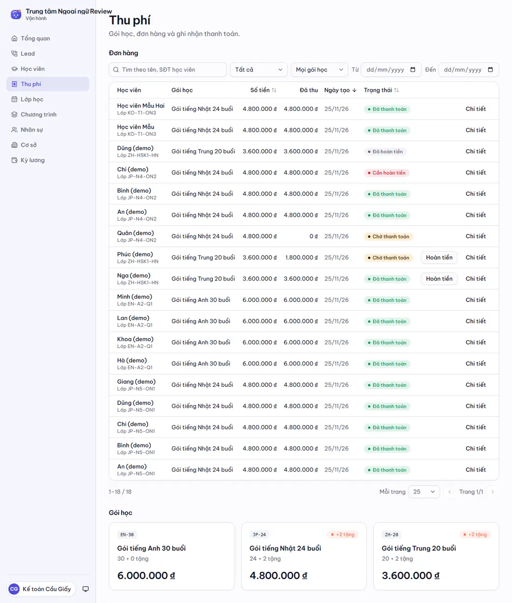

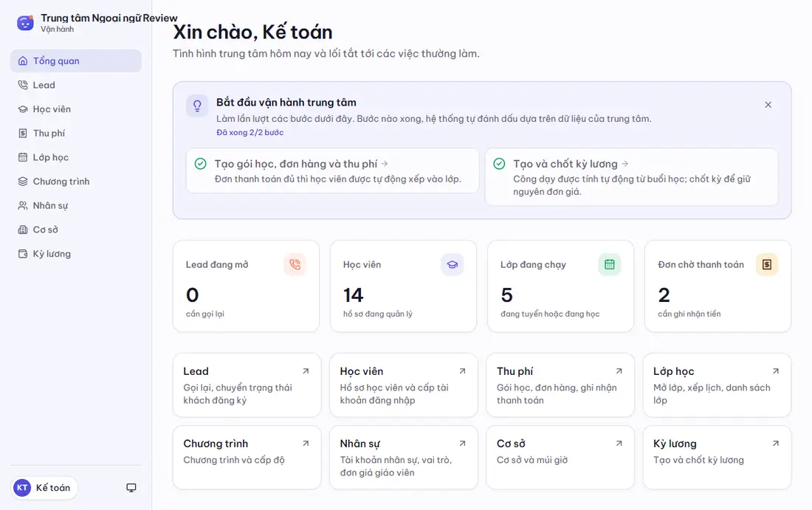

## Trang Thu phí

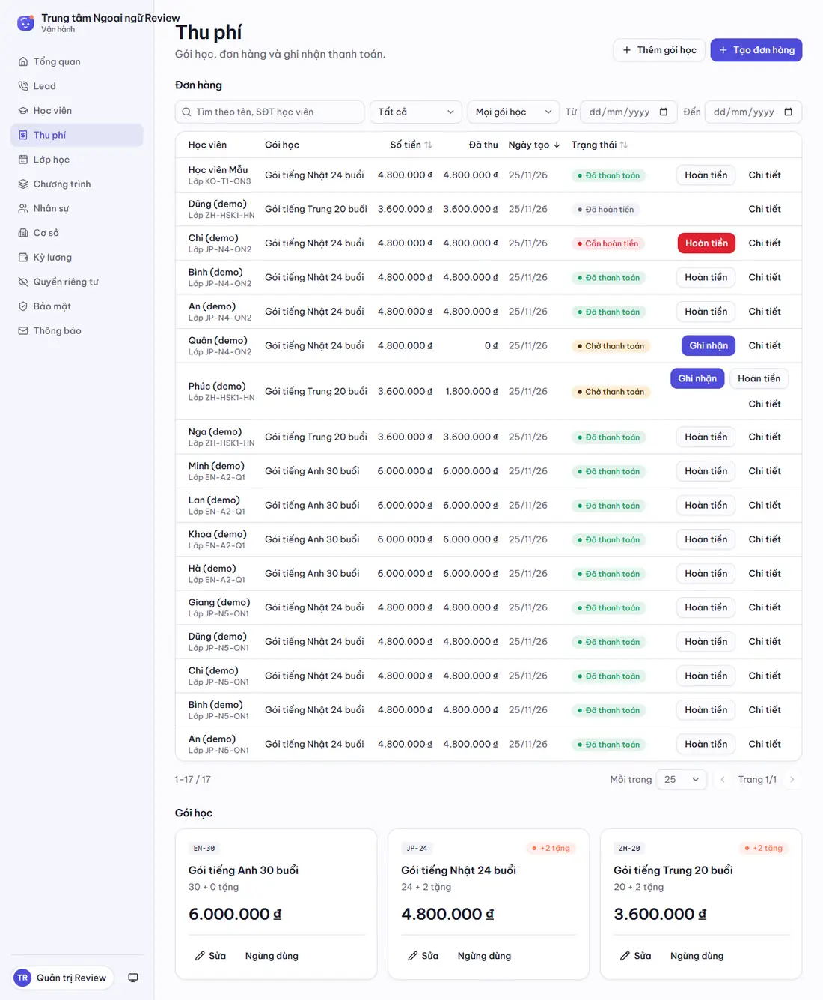

Trang gồm bảng **Đơn hàng** ở trên và các thẻ **Gói học** ở dưới.

Lọc đơn theo trạng thái thanh toán:

| Bộ lọc | Nghĩa |
| --- | --- |
| **Tất cả** | Mọi đơn |
| **Chờ thu** | Chưa thu đồng nào |
| **Trả một phần** | Đã thu một phần (trạng thái đơn vẫn ghi **Chờ thanh toán**) |
| **Đã trả** | Đã thu đủ (**Đã thanh toán**) |
| **Chờ hoàn** | **Cần hoàn tiền**: đã trả đủ nhưng lớp đã đầy |
| **Đã hoàn** | **Đã hoàn tiền** |
| **Đã huỷ** | Đơn bị huỷ trước khi thu tiền |

Lọc thêm theo gói học và ngày tạo; tìm theo tên hoặc số điện thoại học viên.

## Gói học

Gói học là thứ học viên mua: một số **buổi trả phí**, cộng thêm **buổi tặng** (không bắt buộc), với một **giá**. Một gói dùng được cho nhiều lớp.

1. Bấm **Thêm gói học**: **Mã** (ví dụ `JP-24`), tên tiếng Việt và tiếng Anh, **Số buổi** (buổi trả phí), **Buổi tặng**, **Giá**, **Tiền tệ**.
2. Bấm **Lưu**. Thẻ gói hiện `24 + 2 tặng` và giá.

- **Sửa** gói: giá và số buổi mới chỉ áp cho **đơn tạo sau**; đơn đã có giữ giá cũ.
- **Ngừng dùng** để thôi bán gói; đơn đã có giữ nguyên.

## Đơn hàng và thu tiền

### Tạo đơn

Tư vấn viên thường tạo đơn; kế toán cũng tạo được.

1. **Tạo đơn hàng** → gõ tên hoặc SĐT, chọn **Học viên** → chọn **Gói học** → chọn **Lớp** (hoặc **Chưa xếp lớp**).
2. Bấm **Lưu**. Đơn ở trạng thái **Chờ thanh toán**, số tiền bằng giá gói.

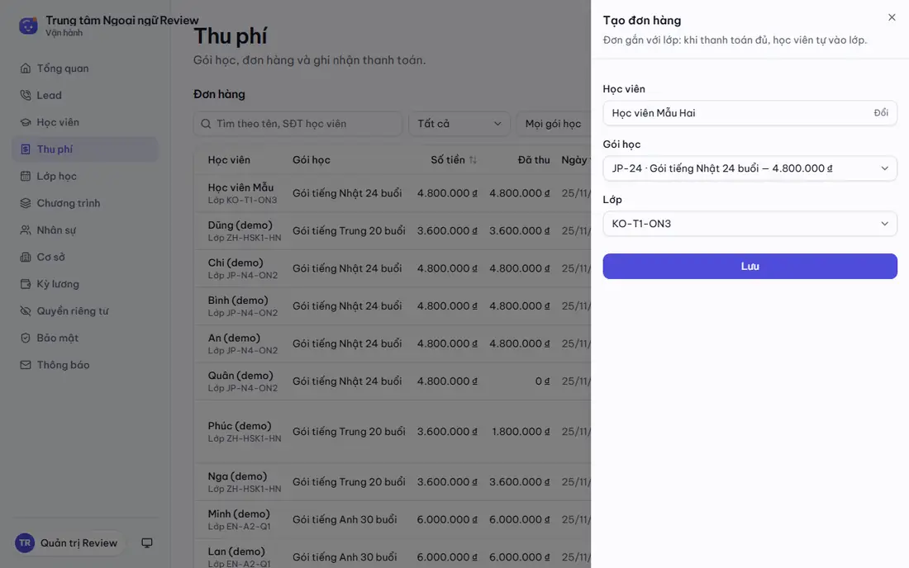

### Ghi nhận thanh toán

1. Trên dòng đơn, bấm **Ghi nhận**. Ngăn kéo ghi "Tên học viên · còn …" và điền sẵn số còn lại.
2. Sửa **Số tiền** nếu học viên trả một phần; chọn **Hình thức** (Tiền mặt / Chuyển khoản / Thẻ); nhập **Mã giao dịch** (mã chuyển khoản, số hoá đơn thẻ…).
3. Bấm **Ghi nhận**.

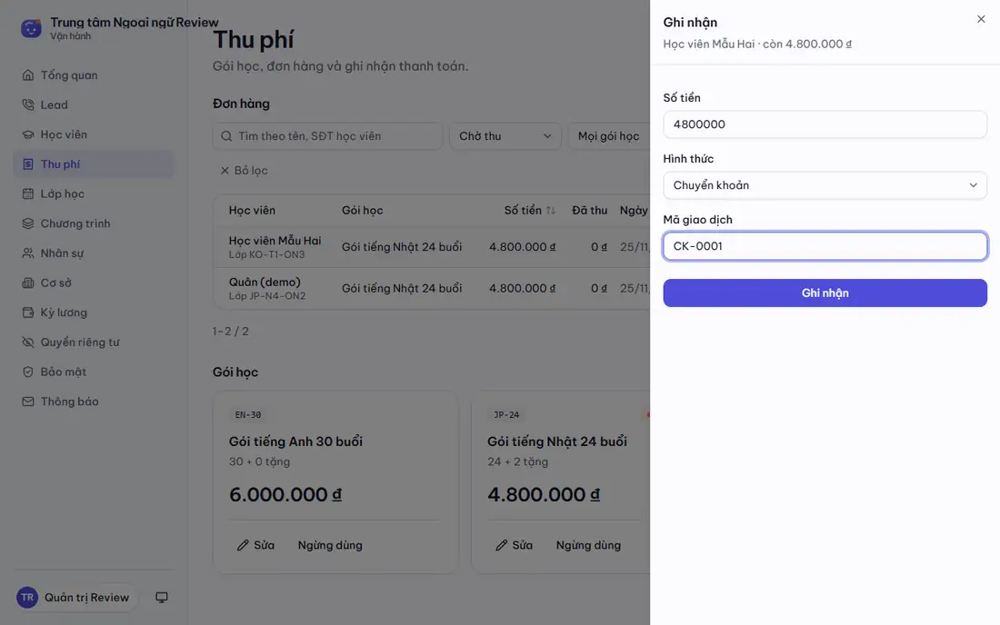

Một đơn trả được nhiều lần. Khi tổng đã thu bằng số tiền của đơn:

- đơn chuyển sang **Đã thanh toán**;
- học viên được cộng buổi (trả phí + tặng) vào **sổ buổi học**;
- nếu đơn gắn lớp, vài giây sau học viên **tự vào lớp** và nhận email "Xác nhận vào lớp";
- nếu lớp đã đầy, đơn chuyển sang **Cần hoàn tiền** (xem [Hoàn tiền](#hoàn-tiền)).

Mỗi lần ghi nhận tạo một **phiếu thu**.

### Chi tiết đơn

Bấm **Chi tiết** trên dòng đơn.

- **Các lần thanh toán**: số phiếu, số tiền, thời điểm, **Người thu**, nút **Xem phiếu**. Sửa được hình thức và mã giao dịch; khoản nhập nhầm thì **Huỷ thanh toán** (khoản vẫn còn trong lịch sử với nhãn **Đã huỷ**).
- Khi đơn còn **Chờ thanh toán**: **Sửa đơn hàng** (giảm số tiền, ví dụ giảm giá, nhưng phải lớn hơn số đã thu; đổi lớp), **Huỷ đơn** (chỉ khi chưa thu đồng nào; đã có thanh toán thì huỷ các thanh toán trước).
- Đơn đã trả đủ: số buổi đã vào sổ, không sửa đơn nữa; chỉ sửa được hình thức và mã giao dịch của thanh toán.
- **Sổ buổi học** và **Lịch sử thay đổi** (bên dưới).

### Phiếu thu

Mỗi lần ghi nhận thanh toán tạo một phiếu thu số `PT-000001`, `PT-000002`… tăng dần trong trung tâm, không trùng, không nhảy số. Mỗi lần hoàn tiền tạo một phiếu chi `PC-…` với dãy số riêng.

Trong **Chi tiết** đơn, bấm **Xem phiếu**: phiếu ghi trung tâm, cơ sở, ngày, học viên, gói học, số tiền bằng số và **Bằng chữ**, hình thức, mã giao dịch, **Người lập phiếu**.

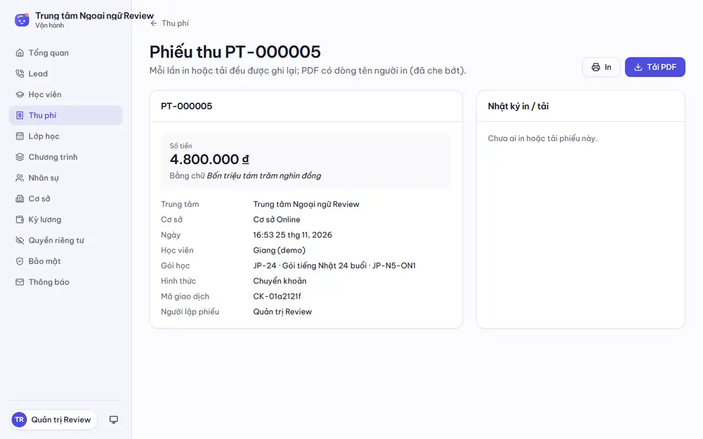

- **In** mở PDF để in; **Tải PDF** lưu file. PDF có dòng "In bởi" với tên người in đã che bớt.
- Mỗi lần in hoặc tải được ghi vào **Nhật ký in / tải** bên phải phiếu (ai, in hay tải, lúc nào), kể cả khi học viên tự tải ở cổng học viên.
- Một người in / tải một phiếu tối đa **20 lần trong 24 giờ**.
- Thanh toán đã huỷ vẫn giữ phiếu; in ra có dấu **ĐÃ HỦY** ("Phiếu đã huỷ (thanh toán nhập nhầm)").

## Sổ buổi học

Mỗi đơn đã trả đủ có một **sổ buổi học** trong **Chi tiết** đơn: mọi dòng **Mua**, **Tặng**, **Học** (trừ buổi sau điểm danh), **Hoàn**, **Điều chỉnh** theo thời gian.

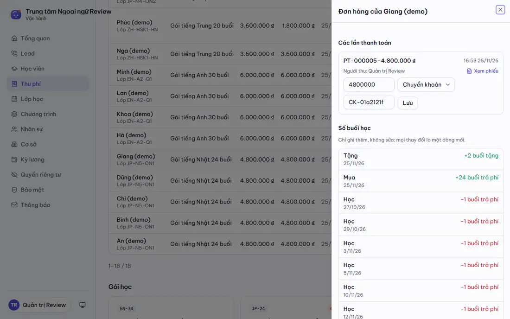

Sổ **chỉ ghi thêm, không sửa**: mọi thay đổi là một dòng mới. Muốn cộng hoặc trừ buổi (ví dụ tặng thêm buổi bù, trừ buổi điểm danh nhầm):

1. **Chi tiết** đơn → **Điều chỉnh buổi**.
2. **Số buổi (+ cộng, − trừ)**: số dương để cộng, số âm để trừ.
3. **Loại buổi**: **tặng** hoặc **trả phí**.
4. **Lý do** (bắt buộc, tối đa 300 ký tự).
5. Bấm **Ghi bút toán**.

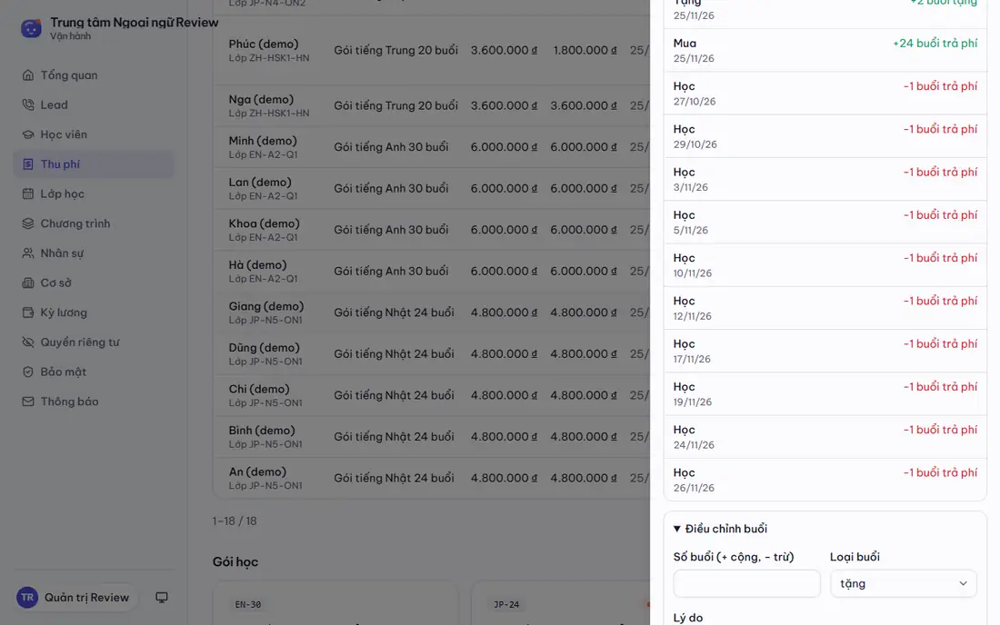

Buổi cộng thêm bằng điều chỉnh **không được hoàn tiền** khi học viên nghỉ.

## Hoàn tiền

Nút **Hoàn tiền** có trên đơn **Cần hoàn tiền** (lớp đầy), đơn **Đã thanh toán** (học viên nghỉ giữa khoá) và đơn **Chờ thanh toán** đã thu một phần (nghỉ khi chưa trả đủ). Ngăn kéo hiện trường hợp và cách tính:

| Trường hợp (nhãn trên ngăn kéo) | Số tiền đề xuất |
| --- | --- |
| **Lớp không nhận được học viên** (lớp đầy), hoặc chưa học buổi nào | Toàn bộ số đã thu |
| **Nghỉ giữa khoá** | Số **buổi trả phí chưa dùng** × **đơn giá một buổi** (giá đơn ÷ số buổi trả phí). Buổi tặng không hoàn; buổi cộng thêm bằng điều chỉnh không hoàn |
| **Nghỉ khi chưa trả đủ** | Số đã thu |

| Nghỉ giữa khoá | Lớp đầy |
| --- | --- |
| 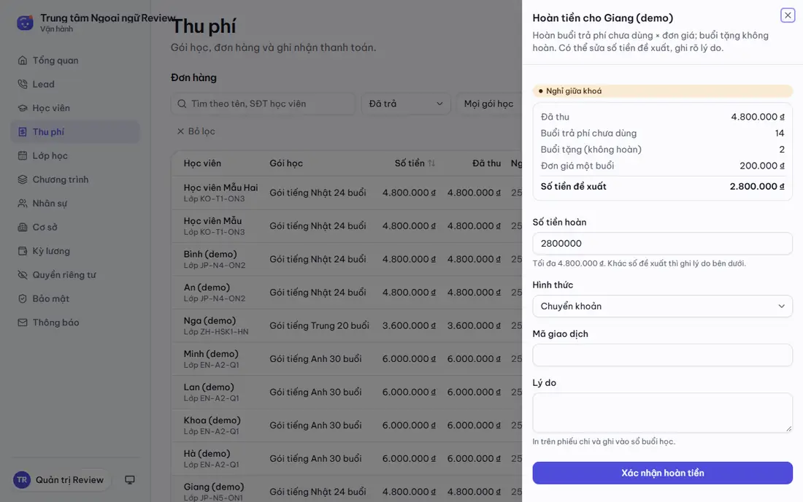 | 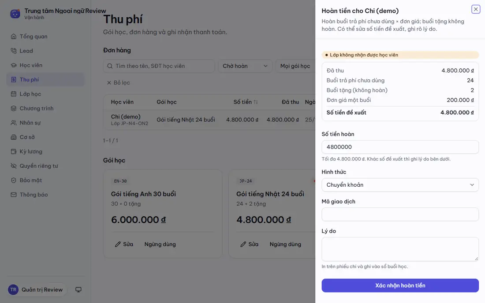 |

1. Kiểm tra **Đã thu**, **Buổi trả phí chưa dùng**, **Buổi tặng (không hoàn)**, **Đơn giá một buổi**, **Số tiền đề xuất**.
2. **Số tiền hoàn**: sửa được (ví dụ trừ phí theo chính sách trung tâm), nhưng không quá số đã thu.
3. Chọn **Hình thức**, nhập **Mã giao dịch**.
4. **Lý do**: luôn bắt buộc; được in trên phiếu chi và ghi vào sổ buổi học.
5. Bấm **Xác nhận hoàn tiền**.

**Không hoàn tác được, mỗi đơn chỉ hoàn một lần.** Sau khi xác nhận:

- đơn chuyển sang **Đã hoàn tiền**, tạo phiếu chi `PC-…`;
- số buổi còn lại bị trừ hết bằng dòng **Hoàn** trong sổ buổi học;
- học viên được cho nghỉ lớp và chỗ trong lớp được nhả cho người khác;
- phần chênh giữa giá trị buổi chưa dùng và số hoàn (phí giữ lại) được tính vào doanh thu ngày hoàn của cơ sở thu tiền.

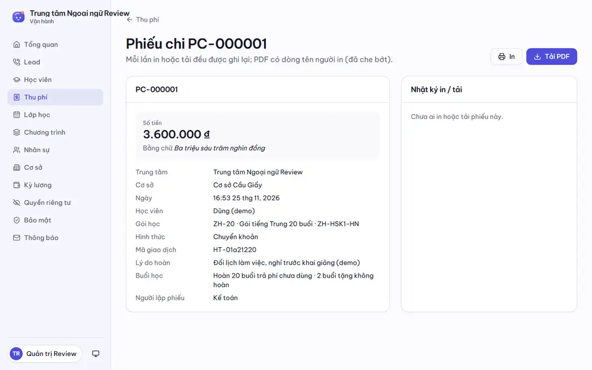

## Đơn giá giáo viên

Mở **Nhân sự** → **Đặt đơn giá** trên dòng giáo viên (kế toán toàn trung tâm hoặc quản trị).

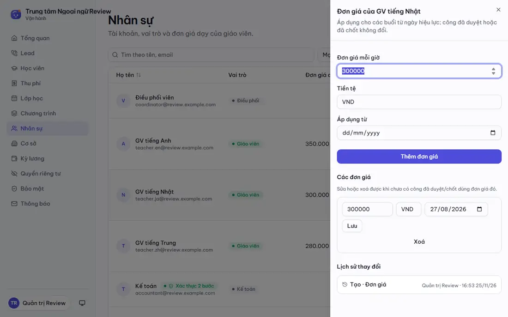

- Nhập **Đơn giá mỗi giờ**, **Tiền tệ**, **Áp dụng từ**, bấm **Thêm đơn giá**. Đơn giá mới áp cho công **còn nháp** từ ngày hiệu lực; công đã duyệt hoặc đã chốt không đổi.
- Danh sách **Các đơn giá** trong cùng ngăn kéo: sửa hoặc **Xoá** đơn giá nhập nhầm khi chưa có công đã duyệt / chốt dùng nó; nếu đã có, thêm đơn giá mới từ ngày sau.
- Tăng lương: thêm đơn giá mới với **Áp dụng từ** là ngày bắt đầu mức mới; đơn giá cũ vẫn dùng cho các buổi trước đó.

## Kỳ lương

Mở **Kỳ lương**. Công của giáo viên được tính tự động từ buổi dạy (xem [Quy trình: buổi học → lương](quy-trinh.md#2-buổi-học--điểm-danh--trừ-buổi--công--lương)); kỳ lương gom công lại để chốt.

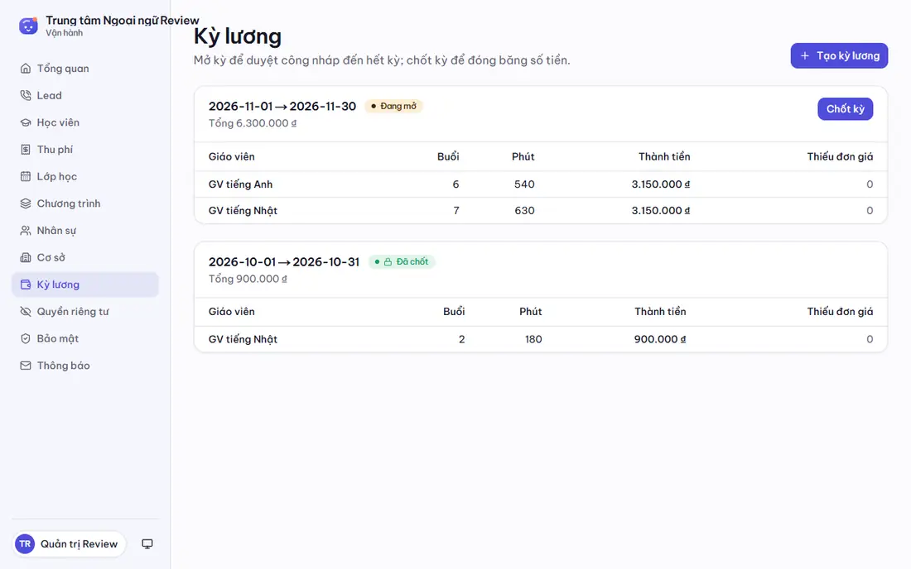

1. Bấm **Tạo kỳ lương**, chọn **Từ ngày** và **Đến ngày** (thường là một tháng), bấm **Tạo kỳ lương**. Mọi công **nháp** đến ngày kết thúc, kể cả công đến muộn của kỳ trước, được gom vào kỳ này. Hai kỳ không được chồng ngày.

    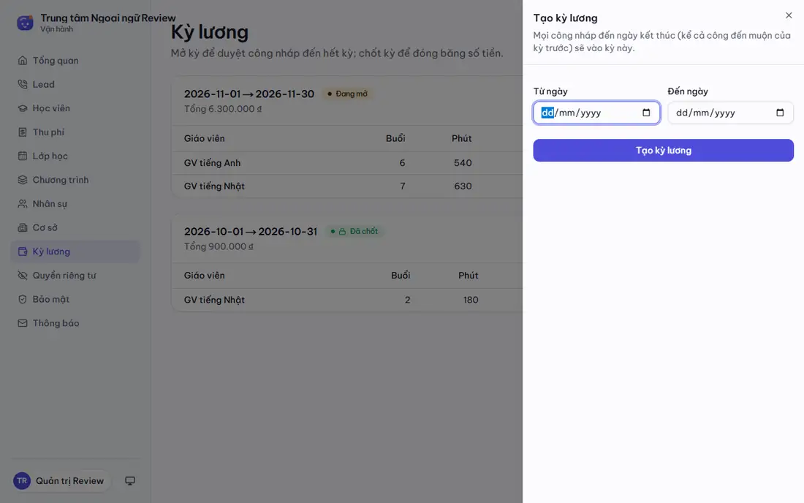

2. Kiểm tra bảng theo giáo viên: **Buổi**, **Phút**, **Thành tiền**, **Thiếu đơn giá**. Dòng có **Thiếu đơn giá** khác 0 nghĩa là có buổi chưa có đơn giá: đặt đơn giá cho giáo viên đó trước.
3. Bấm **Chốt kỳ**. Số tiền được đóng băng, không sửa được nữa. Giáo viên nhận email "Chốt kỳ lương".

Kỳ lương ở Konnyaku là **bảng công và số tiền phải trả**; việc chuyển lương, thuế, bảo hiểm làm ở phần mềm kế toán / ngân hàng của trung tâm.

> Chưa có: báo cáo doanh thu, công nợ, nhắc phí; xuất kỳ lương ra Excel; hoá đơn điện tử; thanh toán online.
