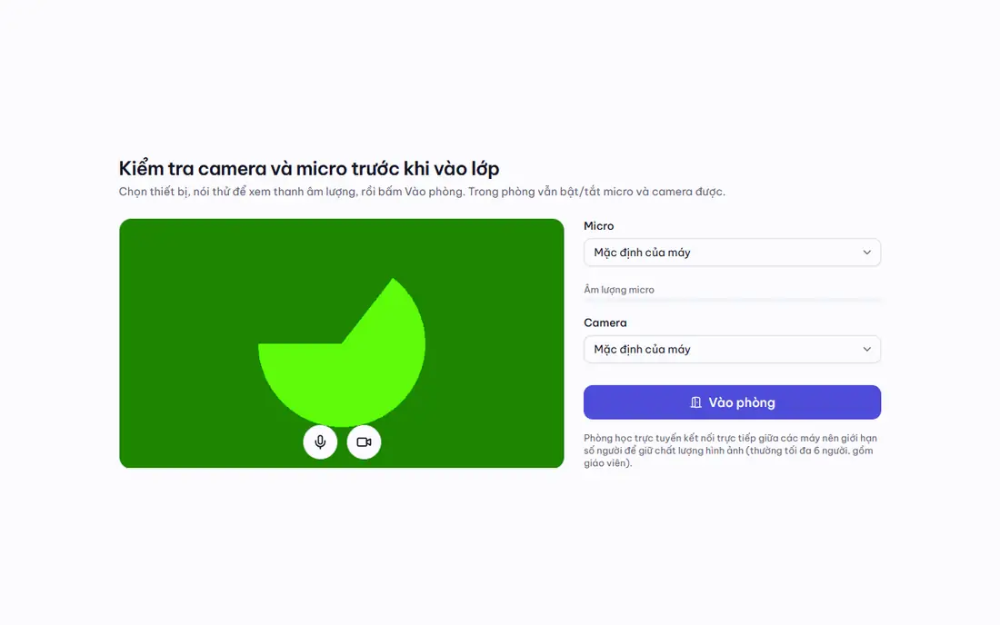
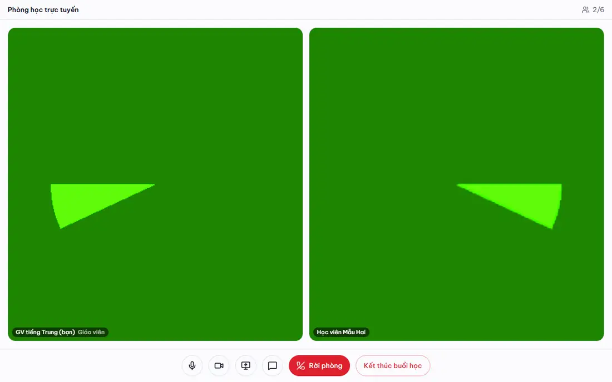
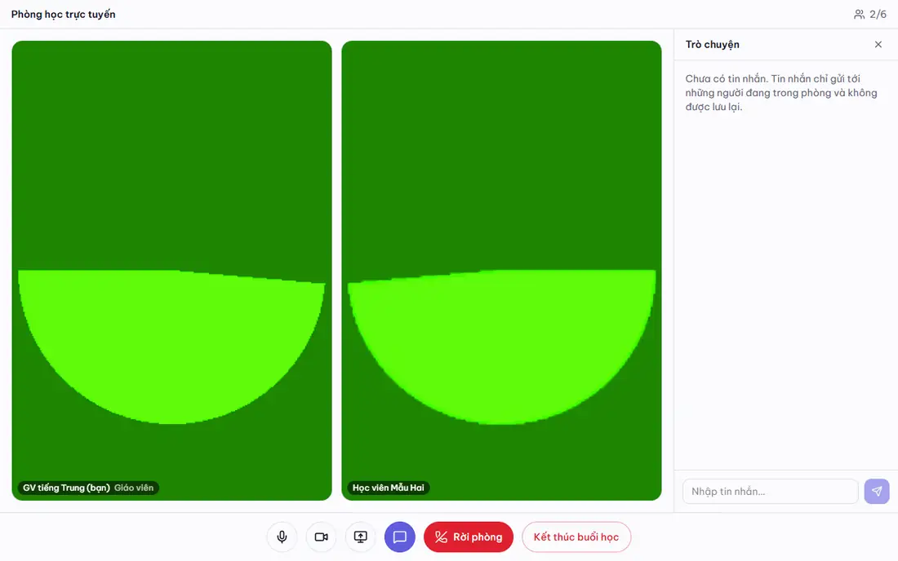

# Phòng học trực tuyến

[← Mục lục](README.md)

Dành cho học viên và giáo viên của lớp online. Trung tâm dùng một trong hai loại phòng (đội kỹ thuật cấu hình cho cả trung tâm, chưa chọn được trên giao diện):

- **Phòng học có sẵn của Konnyaku**: mở ngay trong trình duyệt, không cần tài khoản Google. Mô tả ở trang này.
- **Google Meet**: nút **Vào lớp** mở phòng Meet của buổi; dùng như Meet thông thường.

Mở phòng bằng nút **Vào lớp** trong cổng học viên hoặc trang giáo viên. Nút chỉ hiện khi phòng đã được tạo, và chỉ học viên có chỗ trong lớp cùng giáo viên của buổi mới vào được.

## Cần chuẩn bị

- Trình duyệt Chrome, Edge, Firefox hoặc Safari bản mới, trên máy tính hoặc điện thoại. Không cần cài ứng dụng.
- Camera, micro (tai nghe có micro càng tốt). Không có micro vẫn vào để xem, nghe và chat được.
- Mạng ổn định. Mỗi người gửi hình trực tiếp tới từng người khác, nên phòng càng đông càng cần mạng tốt.

## 1. Kiểm tra thiết bị

Trang đầu tiên **Kiểm tra camera và micro trước khi vào lớp** hiện hình từ camera và thanh **Âm lượng micro**.

- Lần đầu, trình duyệt hỏi quyền dùng camera và micro: chọn **Cho phép**.
- Có nhiều thiết bị thì chọn trong ô **Micro**, **Camera**. Nói thử để thấy thanh âm lượng nhảy.
- Bấm nút micro, camera dưới khung hình để vào phòng với micro hoặc camera đang tắt.
- Trình duyệt chặn camera / micro: trang báo "Trình duyệt đang chặn camera/micro…". Bấm biểu tượng ổ khoá cạnh địa chỉ trang → cho phép Camera và Micro → tải lại trang.

Bấm **Vào phòng**.

## 2. Trong phòng

Mỗi người là một ô hình có tên; ô của bạn ghi "(bạn)", giáo viên có nhãn **Giáo viên**, người tắt micro có biểu tượng micro gạch chéo. Góc trên bên phải là số người trong phòng / số chỗ tối đa (ví dụ `2/6`).

Thanh nút dưới cùng:

| Nút | Tác dụng |
| --- | --- |
| Micro | Bật / tắt micro. Nút đỏ là đang tắt |
| Camera | Bật / tắt camera. Tắt camera thì người khác thấy chữ cái đầu tên bạn |
| Chia sẻ màn hình | Chọn cửa sổ hoặc toàn màn hình để mọi người xem; màn hình được chia sẻ hiện to. Bấm lần nữa (hoặc **Dừng chia sẻ** của trình duyệt) để thôi. Chỉ có trên máy tính |
| Trò chuyện | Mở khung chat. Số đỏ là tin chưa đọc. Tin nhắn chỉ tới người đang trong phòng và **không được lưu** sau buổi học |
| **Rời phòng** | Ra khỏi phòng. Buổi học chưa kết thúc thì bấm **Vào lại phòng** (hoặc **Vào lớp**) để vào lại |
| **Kết thúc buổi học** | Chỉ giáo viên và giáo vụ thấy. Xem bên dưới |

**Rớt mạng**: phòng hiện **Mất kết nối, đang kết nối lại…** và tự vào lại khi có mạng, không cần bấm gì. Thời gian có mặt vẫn được tính tiếp.

**Một người chỉ vào phòng ở một nơi**: mở phòng ở tab hay máy khác thì nơi cũ bị ngắt, kèm thông báo "Bạn vừa mở phòng này ở một tab hoặc thiết bị khác…".

## 3. Kết thúc buổi học (giáo viên)

1. Hết giờ, bấm **Kết thúc buổi học**, xác nhận "Kết thúc buổi học cho tất cả mọi người?". Mọi người bị đưa ra khỏi phòng; phòng đóng hẳn, không ai vào lại được.
2. Mọi người thấy **Buổi học đã kết thúc** — "Thời gian tham gia của mọi người đã được ghi lại để điểm danh và chấm công."
3. Giáo viên bấm **Xem điểm danh nháp** để mở trang điểm danh, kiểm tra rồi **Xác nhận điểm danh** (xem [Giáo viên → Điểm danh](giao-vien.md#điểm-danh)).

Quên bấm kết thúc: phòng tự đóng khi không còn ai sau giờ kết thúc buổi học, hoặc 30 phút sau giờ kết thúc nếu vẫn còn người. **Rời phòng** không kết thúc buổi học cho người khác.

## Giới hạn

- **Số người**: phòng kết nối trực tiếp giữa các máy (mỗi người gửi hình tới từng người khác), nên mỗi phòng tối đa **6 người, gồm giáo viên** (đội kỹ thuật có thể đổi con số này). Một chỗ luôn được giữ cho giáo viên. Phòng đầy thì người vào sau thấy **Phòng đã đủ người**.
- **Chất lượng hình**: ổn định nhất khi khoảng **4 người bật camera**. Từ 4 người trở lên, hình được tự giảm chất lượng để mạng yếu vẫn theo kịp. Lớp đông hơn nên dùng Google Meet hoặc nhờ mọi người tắt camera khi không nói.
- **Chưa ghi hình**: buổi học trong phòng có sẵn không có video xem lại.
- Chia sẻ màn hình chỉ có trên máy tính.

## Lỗi thường gặp

| Thông báo | Cách xử lý |
| --- | --- |
| **Phòng đã đủ người** | Phòng đủ 6 người. Báo giáo viên hoặc trung tâm |
| "Không tìm thấy phòng học, hoặc bạn không có chỗ trong lớp này." | Kiểm tra đúng tài khoản; học viên chưa vào lớp (đơn chưa trả đủ) thì liên hệ trung tâm |
| "Phiên đăng nhập đã hết hạn. Hãy đăng nhập lại rồi bấm Vào lớp." | Đăng nhập lại |
| "Máy chủ chưa cấu hình phòng học trực tuyến…" | Báo quản trị trung tâm (lỗi cấu hình máy chủ) |
| Không có hình / tiếng của mình | Cho phép camera / micro (biểu tượng ổ khoá cạnh địa chỉ trang), tải lại trang; đóng ứng dụng khác đang dùng camera (Zoom, Teams…) |
| Thấy người khác nhưng ô của họ cứ **Đang kết nối…** | Mạng của một trong hai bên chặn kết nối trực tiếp (mạng công ty, wifi công cộng). Thử mạng khác (4G); nếu cả lớp bị, báo quản trị kỹ thuật kiểm tra máy chủ TURN |
