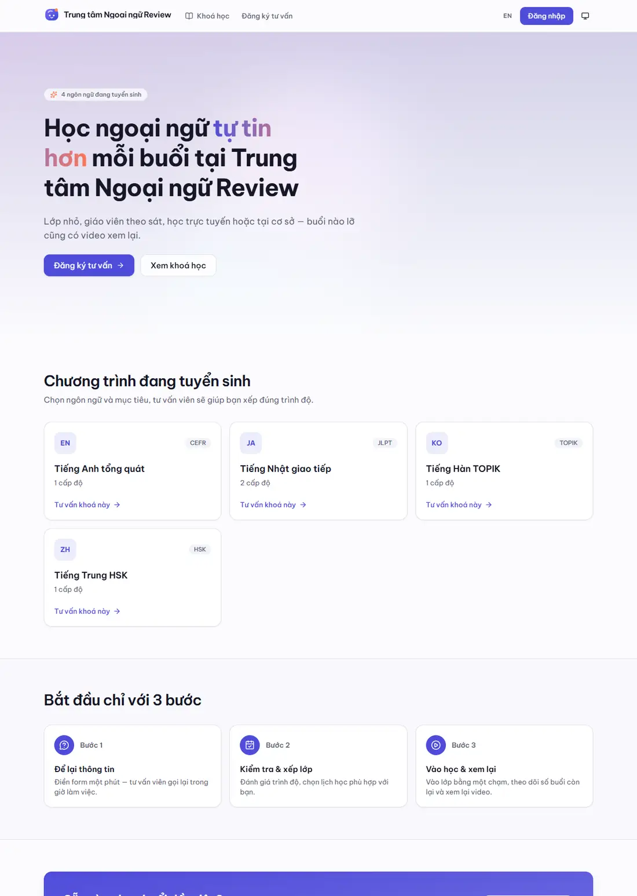
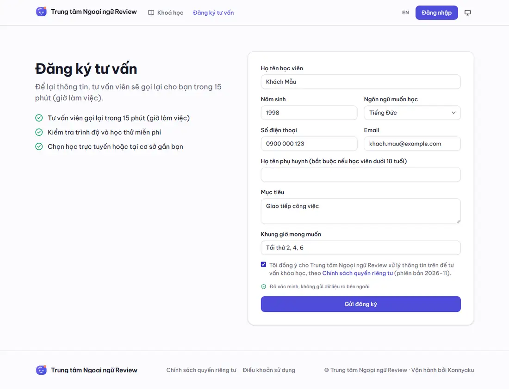
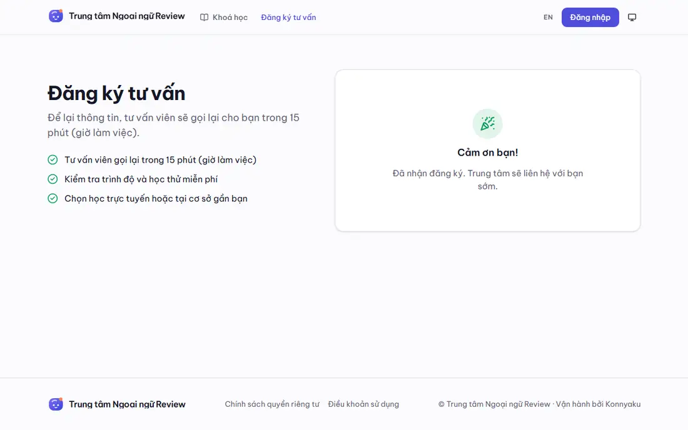
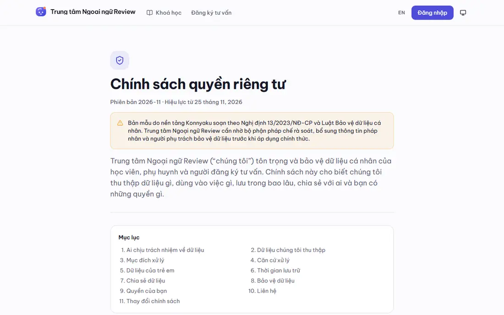
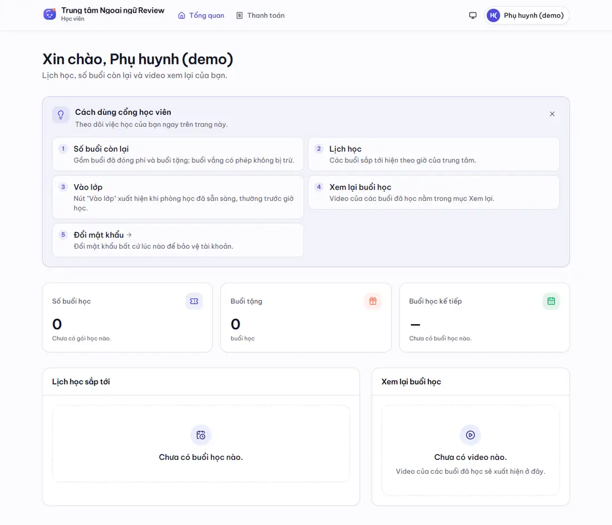
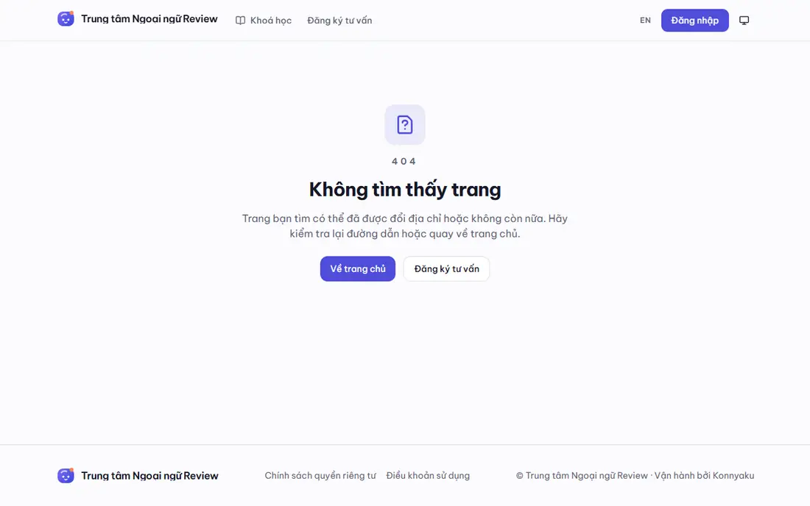
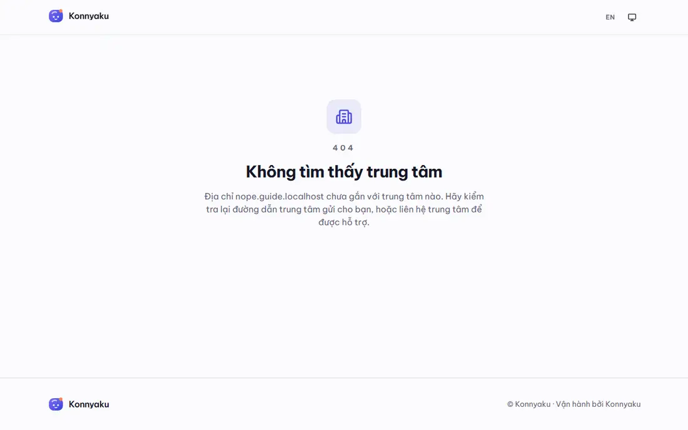

# Hướng dẫn cho phụ huynh và khách

[← Mục lục](README.md)

## Trang công khai của trung tâm

Trang chủ của trung tâm (ví dụ `https://tentrungtam.konnyaku.app/vi`) giới thiệu trung tâm và liệt kê **Chương trình đang tuyển sinh**: mỗi chương trình ghi ngôn ngữ, khung trình độ (CEFR, JLPT, HSK…), số cấp độ và nút **Tư vấn khoá này**.

Thanh trên cùng: **Khoá học** (cuộn tới danh sách chương trình), **Đăng ký tư vấn**, nút đổi ngôn ngữ (**EN** / **VI**), **Đăng nhập**. Chân trang có **Chính sách quyền riêng tư** và **Điều khoản sử dụng**.

## Đăng ký tư vấn

1. Bấm **Tư vấn khoá này** trên khoá muốn học (ngôn ngữ được chọn sẵn), hoặc **Đăng ký tư vấn** trên thanh trên cùng.
2. Điền form:
    - **Họ tên học viên** và **Ngôn ngữ muốn học**: bắt buộc.
    - **Số điện thoại** hoặc **Email**: cần ít nhất một.
    - **Năm sinh**: nếu học viên dưới 18 tuổi thì phải điền **Họ tên phụ huynh**.
    - **Mục tiêu**, **Khung giờ mong muốn**: không bắt buộc, giúp tư vấn viên xếp lớp.
3. Đánh dấu ô "Tôi đồng ý cho … xử lý thông tin trên để tư vấn khóa học, theo Chính sách quyền riêng tư (phiên bản …)". Liên kết trong câu mở chính sách ở tab mới.
4. Bấm **Gửi đăng ký**.

Ngay khi bạn bắt đầu điền, trình duyệt tự giải một bài kiểm tra chống spam trong vài giây (không cần chọn hình); dòng nhỏ phía trên nút báo **Đã xác minh, không gửi dữ liệu ra bên ngoài**. Bài kiểm tra chạy trên máy bạn, không gửi dữ liệu cho dịch vụ bên ngoài.

Màn hình **Cảm ơn bạn!** xác nhận đã gửi. Tư vấn viên gọi lại trong khoảng 15 phút (giờ làm việc).

| Thông báo lỗi | Cách xử lý |
| --- | --- |
| "Chưa hoàn tất bước chống spam…", "Phiên xác minh đã hết hạn…" | Đợi vài giây rồi bấm **Gửi đăng ký** lại; trang tự chuẩn bị lượt xác minh mới (ví dụ khi để form mở quá 30 phút) |
| "Bạn gửi quá nhiều lần. Vui lòng thử lại sau một phút." | Đợi một phút |
| "Học viên dưới 18 tuổi cần thông tin phụ huynh." | Điền **Họ tên phụ huynh** |

Gửi lại form với cùng số điện thoại hoặc email trong khi trung tâm chưa xử lý xong thì thông tin cũ được cập nhật, không tạo đăng ký trùng.

## Chính sách quyền riêng tư và điều khoản

Chân trang có liên kết **Chính sách quyền riêng tư** (`/vi/chinh-sach-quyen-rieng-tu`, tiếng Anh `/en/privacy`) và **Điều khoản sử dụng** (`/vi/dieu-khoan-su-dung`, `/en/terms`). Chính sách nêu dữ liệu thu thập, mục đích, thời gian lưu, quyền xem / sửa / xoá / rút đồng ý, quy định riêng cho dữ liệu trẻ em và cách liên hệ, kèm phiên bản và ngày hiệu lực.

Muốn xem, sửa, xoá dữ liệu của mình hoặc rút lại đồng ý: liên hệ trung tâm (điện thoại, email, tại quầy). Trung tâm ghi nhận và xử lý trong 72 giờ (xem [Quy trình: yêu cầu về dữ liệu cá nhân](quy-trinh.md#7-yêu-cầu-xem-sửa-xoá-dữ-liệu-cá-nhân)).

> Dành cho trung tâm: đây là **bản mẫu** do Konnyaku soạn, đã điền tên trung tâm. Nhờ pháp chế rà lại và bổ sung tên pháp nhân, địa chỉ, email, người phụ trách bảo vệ dữ liệu trước khi dùng chính thức; báo đội kỹ thuật khi đổi nội dung để các đăng ký mới ghi đúng phiên bản.

## Phụ huynh

Ở phiên bản này, **tài khoản phụ huynh chưa liên kết được với học viên**. Phụ huynh có tài khoản đăng nhập được ở tab **Học viên · Phụ huynh**, nhưng trang tổng quan trống ("Chưa có gói học nào", "Chưa có buổi học nào").

Trong lúc chờ tính năng này, cách theo dõi việc học của con:

- Đăng nhập bằng **tài khoản học viên của con** (tên đăng nhập `hv…`) để xem số buổi, lịch học, vào lớp, xem lại video, lịch sử thanh toán. Xem [Hướng dẫn cho học viên](hoc-vien.md).
- Khi trung tâm tạo hồ sơ học viên, đề nghị ghi **email của phụ huynh** vào ô Email của hồ sơ: phụ huynh sẽ nhận email chào mừng, xác nhận vào lớp, nhắc lịch học, đổi giờ / huỷ buổi, sắp hết buổi.

## Trang lỗi

| Trang | Khi nào | Làm gì |
| --- | --- | --- |
| **Không tìm thấy trang** (404) | Đường dẫn sai hoặc trang đã đổi | Bấm **Về trang chủ** hoặc **Đăng ký tư vấn** |
| **Đã có lỗi xảy ra** | Sự cố hệ thống | Bấm **Thử lại**; vẫn lỗi thì gửi **Mã tham chiếu** cho trung tâm |
| **Không tìm thấy trung tâm** | Địa chỉ không thuộc trung tâm nào | Kiểm tra lại đường dẫn trung tâm gửi |
| "Trung tâm tạm ngừng hoạt động" | Trung tâm đang bị tạm khoá trên Konnyaku | Liên hệ trung tâm |

| Không tìm thấy trang | Không tìm thấy trung tâm |
| --- | --- |
|  |  |
