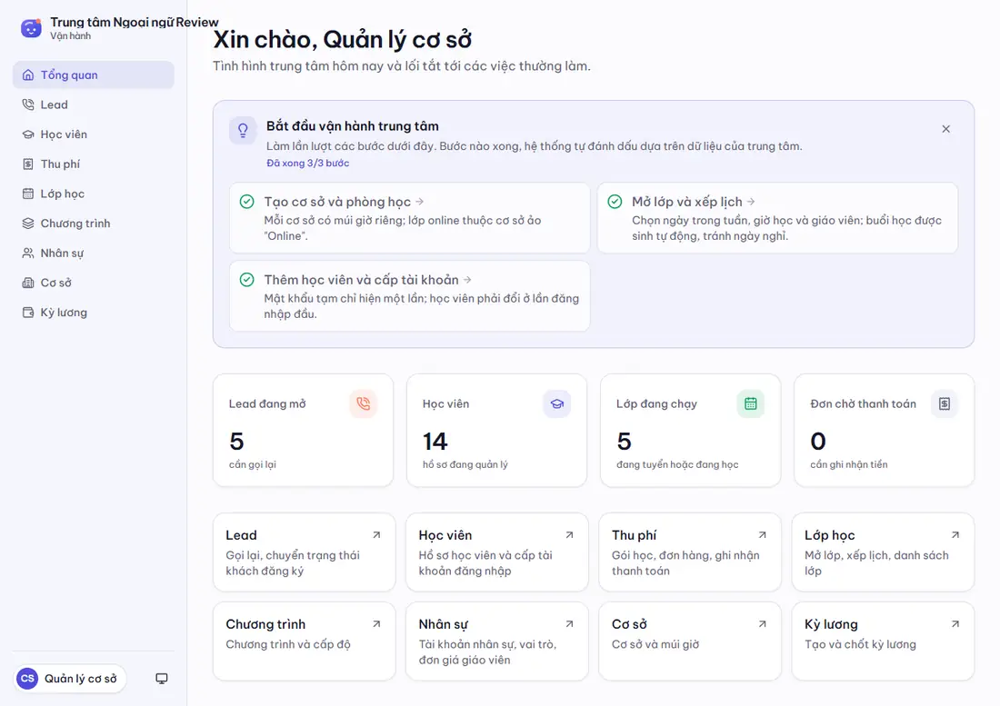
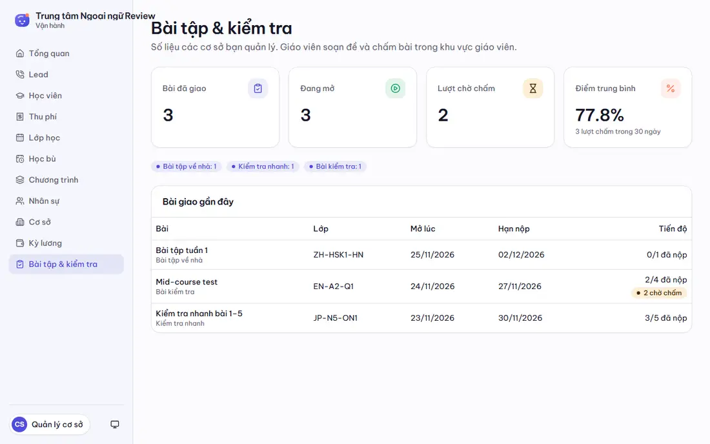

# Hướng dẫn cho quản lý cơ sở

[← Mục lục](README.md) · Đọc trước: [Khu vực Vận hành: thao tác chung](van-hanh-chung.md)

Vai trò **Quản lý cơ sở** làm mọi việc của [điều phối](dieu-phoi.md) (lớp, lịch, phòng, ngày nghỉ, hồ sơ học viên), thêm việc chăm sóc **lead** và **xuất CSV / in** danh sách học viên và lead.

Quản trị có thể giao quản lý cơ sở cho **một vài cơ sở** (**Nhân sự** → **Sửa** → đánh dấu cơ sở dưới vai trò **Quản lý cơ sở**). Khi đó bạn chỉ sửa được lớp, lịch, phòng, ngày nghỉ, lead của các cơ sở đó; thao tác ngoài phạm vi báo "Bạn không phụ trách cơ sở này". Không chọn cơ sở nào là phụ trách toàn trung tâm.

| Được làm | Chỉ xem | Không có |
| --- | --- | --- |
| Lớp học, lịch, phòng, ngày nghỉ của cơ sở mình; lead của cơ sở mình; hồ sơ học viên; **Xuất CSV**, **In** danh sách học viên và lead | Mọi lớp, chương trình, danh sách cơ sở | Thu phí, nhân sự, kỳ lương, tạo / sửa cơ sở, bảo mật, quyền riêng tư |

Thẻ hướng dẫn trên **Tổng quan** của quản lý cơ sở gồm 3 bước: **Tạo cơ sở và phòng học**, **Mở lớp và xếp lịch**, **Thêm học viên và cấp tài khoản**. Riêng việc tạo cơ sở mới là của quản trị; quản lý cơ sở thêm phòng và ngày nghỉ trong cơ sở đã có.

## Việc thường làm

| Việc | Hướng dẫn |
| --- | --- |
| Mở lớp, xếp lịch, đổi lịch tuần, kết thúc / huỷ lớp | [Điều phối → Lớp học](dieu-phoi.md#lớp-học) |
| Phòng học, ngày nghỉ của cơ sở | [Điều phối → Phòng học và ngày nghỉ](dieu-phoi.md#phòng-học-và-ngày-nghỉ) |
| Gọi lại lead, đổi trạng thái, giao tư vấn viên | [Tư vấn → Lead](tu-van.md#lead) |
| Thêm học viên, cấp tài khoản | [Khu vực Vận hành → Học viên](van-hanh-chung.md#học-viên) |
| Xuất CSV, in danh sách | [Khu vực Vận hành → Xuất CSV và In](van-hanh-chung.md#xuất-csv-và-in) |

## Bài tập và kiểm tra

Quản lý cơ sở và điều phối làm mọi việc của giáo viên với bài tập, bài kiểm tra (ngân hàng câu hỏi, đề, giao bài, chấm bài) cho **mọi lớp của cơ sở mình**, trong khu vực Giáo viên: mở `/teach/assessments` (xem [Giáo viên → Bài tập và kiểm tra](giao-vien.md#bài-tập-và-kiểm-tra)). Bạn sửa được ngân hàng và đề của mọi người.

Mục **Bài tập & kiểm tra** trong khu vực Vận hành chỉ để xem: số bài đã giao, số bài đang mở, số bài chờ chấm, điểm trung bình 30 ngày, các bài giao gần đây của cơ sở mình.

## Theo dõi cơ sở

Hiện chưa có báo cáo riêng theo cơ sở (doanh thu, chuyên cần, sĩ số). Cách xem nhanh:

- **Lớp học** → lọc **Cơ sở**: sĩ số từng lớp (`đang giữ chỗ/tối đa`) và trạng thái.
- **Học viên** → lọc **Cơ sở**: số học viên (dòng `1–25 / 120` cuối bảng), **Xuất CSV** nếu cần làm bảng tính.
- **Lead** → lọc **Cơ sở** (cơ sở mong muốn của khách) và trạng thái.
