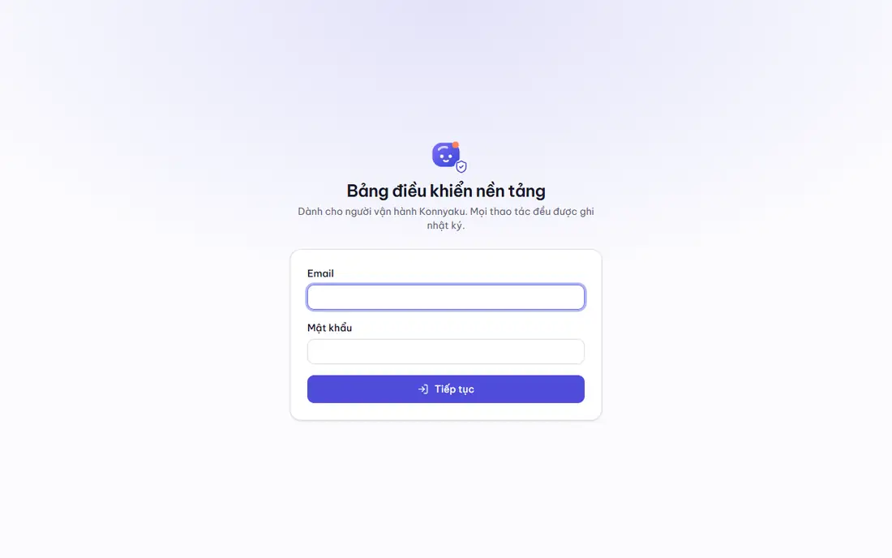
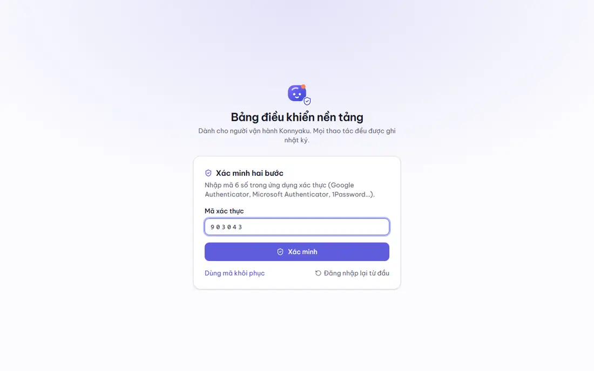
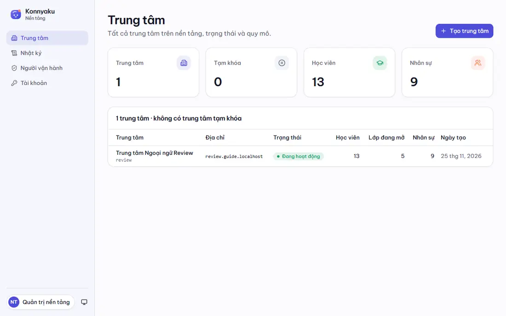
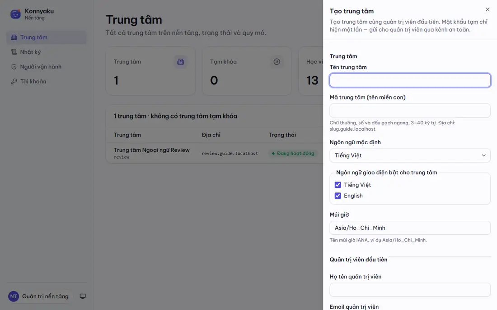
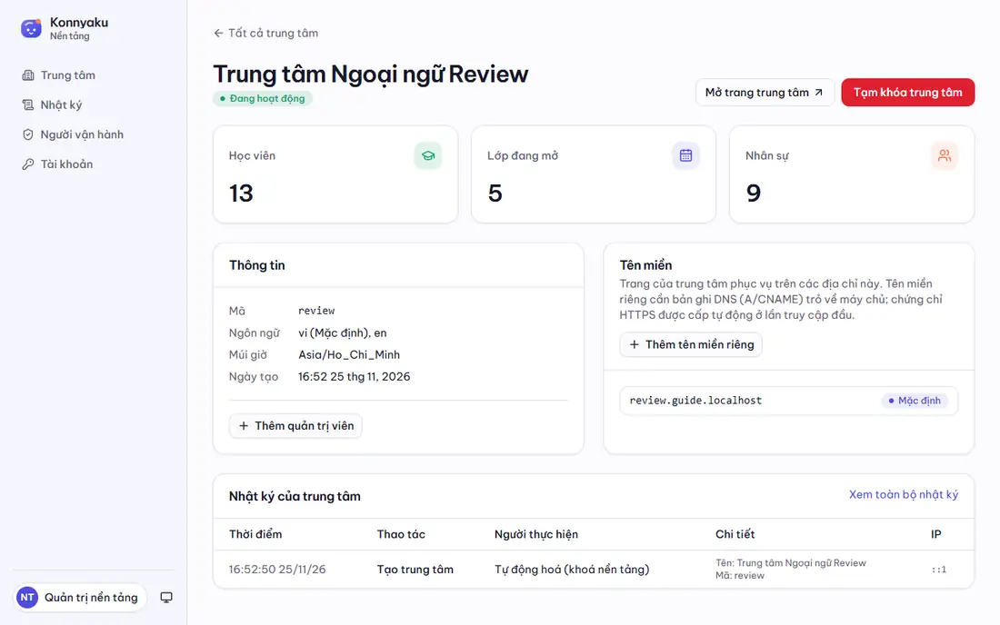
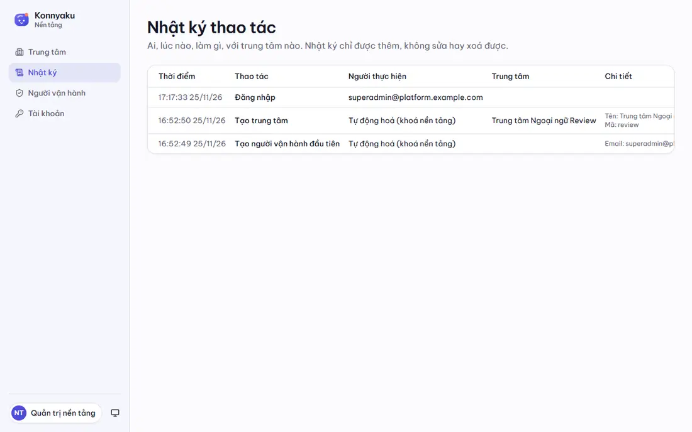
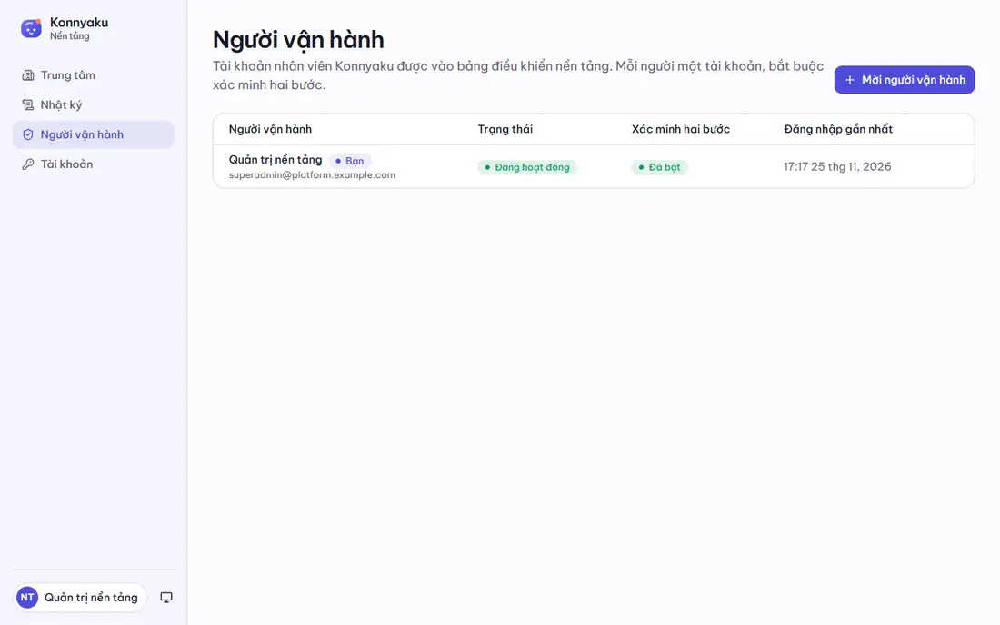
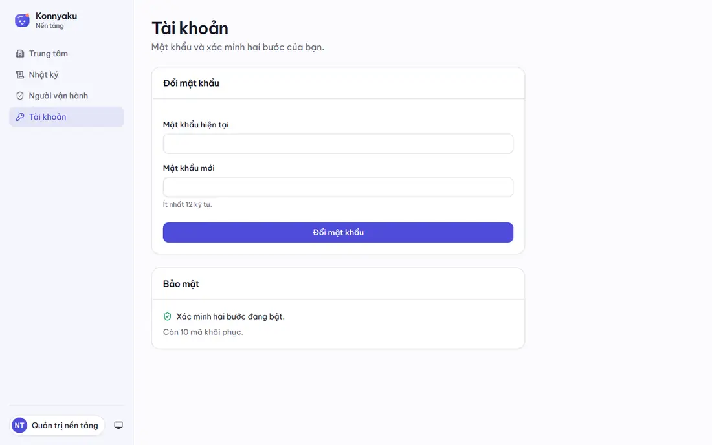

# Hướng dẫn cho người vận hành nền tảng (super-admin)

[← Mục lục](README.md)

Trang này dành cho **nhân viên Konnyaku** quản lý các trung tâm, không dành cho trung tâm. Bảng điều khiển nền tảng chỉ mở trên địa chỉ quản trị riêng `https://admin.<tên miền Konnyaku>/platform`; mở `/platform` trên địa chỉ của trung tâm sẽ ra trang 404.

## Đăng nhập

1. Mở `https://admin.<tên miền Konnyaku>/platform`.
2. Nhập **Email**, **Mật khẩu**, bấm **Tiếp tục**.
3. **Xác minh hai bước**: nhập **Mã xác thực** 6 số trong ứng dụng xác thực (Google Authenticator, Microsoft Authenticator, 1Password…), bấm **Xác minh**.

| Bước 1 | Bước 2 |
| --- | --- |
|  |  |

**Lần đăng nhập đầu tiên** (tài khoản vừa được mời):

1. Đăng nhập bằng mật khẩu tạm, đặt mật khẩu mới (**ít nhất 12 ký tự**).
2. Màn hình **Bật xác minh hai bước** hiện mã QR: mở ứng dụng xác thực, thêm tài khoản bằng cách quét mã (hoặc **Hoặc nhập khoá thủ công**), nhập mã 6 số ứng dụng hiển thị.
3. Màn hình **Lưu mã khôi phục** hiện 10 mã: lưu vào trình quản lý mật khẩu, bấm **Tôi đã lưu, tiếp tục**. Mỗi mã dùng được một lần khi mất điện thoại (**Dùng mã khôi phục** ở bước nhập mã).

Mỗi mã 6 số chỉ dùng một lần (đăng nhập lại ngay thì chờ mã mới, khoảng 30 giây). Nhập sai mật khẩu hoặc mã **5 lần liên tiếp** thì tài khoản bị khoá **15 phút**.

## Trung tâm

Trang **Trung tâm** (mặc định sau đăng nhập): số trung tâm, số đang tạm khoá, tổng học viên, tổng nhân sự, và bảng mọi trung tâm: tên, mã, **Địa chỉ**, **Trạng thái**, **Học viên**, **Lớp đang mở**, **Nhân sự**, **Ngày tạo**. Bấm tên trung tâm để mở trang chi tiết.

### Tạo trung tâm

1. Bấm **Tạo trung tâm**.
2. Phần **Trung tâm**: **Tên trung tâm**, **Mã trung tâm (tên miền con)** (chữ thường, số, dấu gạch ngang, 3–40 ký tự; thành địa chỉ `<mã>.<tên miền Konnyaku>`), **Ngôn ngữ mặc định**, **Ngôn ngữ giao diện bật cho trung tâm**, **Múi giờ** (IANA, ví dụ `Asia/Ho_Chi_Minh`).
3. Phần **Quản trị viên đầu tiên**: **Họ tên quản trị viên**, **Email quản trị viên**.
4. Bấm **Tạo trung tâm**. Màn hình hiện **mật khẩu tạm** của quản trị viên **một lần**: sao chép và gửi qua kênh an toàn, kèm địa chỉ trung tâm và link [Bắt đầu nhanh](bat-dau-nhanh.md). Nếu email đã là nhân viên ở trung tâm khác, người đó dùng mật khẩu hiện có.

### Trang chi tiết trung tâm

- **Quy mô**: học viên, lớp đang mở, nhân sự. **Thông tin**: mã, ngôn ngữ, múi giờ, ngày tạo. **Mở trang trung tâm** mở trang công khai của trung tâm.
- **Tạm khóa trung tâm**: nhập **Lý do** (không bắt buộc, ví dụ "quá hạn thanh toán") rồi xác nhận. Trong lúc khoá: không ai của trung tâm đăng nhập được, người đang đăng nhập bị đưa ra ngoài trong khoảng một phút, mọi thao tác bị từ chối, trang công khai hiện "Trung tâm tạm ngừng hoạt động". Dữ liệu giữ nguyên. **Mở lại trung tâm** để hoạt động lại ngay.
- **Tên miền**: địa chỉ mặc định và tên miền riêng. **Thêm tên miền riêng** (ví dụ `hoc.trungtam.vn`): trung tâm trỏ bản ghi DNS (A hoặc CNAME) về máy chủ Konnyaku **trước**, rồi thêm ở đây; chứng chỉ HTTPS được cấp tự động ở lần truy cập đầu. **Gỡ** được tên miền riêng, không gỡ được địa chỉ mặc định.
- **Thêm quản trị viên**: cấp quyền quản trị trung tâm cho một người (ví dụ khi quản trị viên cũ nghỉ hoặc mất quyền truy cập). Người chưa có tài khoản nhân viên nhận mật khẩu tạm.
- **Nhật ký của trung tâm**: các thao tác gần nhất với trung tâm này; **Xem toàn bộ nhật ký**.

## Nhật ký

**Nhật ký thao tác**: ai, lúc nào, làm gì, với trung tâm nào, chi tiết, IP. Ghi mọi đăng nhập, tạo / khoá / mở lại trung tâm, thêm / gỡ tên miền, thêm quản trị viên, mời / vô hiệu người vận hành… Nhật ký chỉ được thêm, không sửa hay xoá được. Dòng "Tự động hoá (khoá nền tảng)" là thao tác của script dùng khoá hệ thống.

## Người vận hành

Mỗi nhân viên Konnyaku một tài khoản riêng, bắt buộc xác minh hai bước.

- **Mời người vận hành**: họ tên, email → mật khẩu tạm hiện một lần; gửi qua kênh an toàn.
- Bảng ghi **Trạng thái**, **Xác minh hai bước** (đã bật hay chưa), **Đăng nhập gần nhất**.
- **Vô hiệu** tài khoản người nghỉ việc: mất quyền ngay, kể cả phiên đang mở.

## Tài khoản

**Tài khoản**: **Đổi mật khẩu** (ít nhất 12 ký tự) và xem số mã khôi phục còn lại.

Mất điện thoại và hết mã khôi phục: chưa tự đặt lại được trên giao diện; nhờ quản trị kỹ thuật đặt lại.

> Chưa có: gói dịch vụ, giới hạn sử dụng, thu phí trung tâm; xem với tư cách trung tâm để hỗ trợ; xoá trung tâm.
