# Hướng dẫn cho quản trị trung tâm

[← Mục lục](README.md) · Đọc trước: [Bắt đầu nhanh](bat-dau-nhanh.md), [Khu vực Vận hành: thao tác chung](van-hanh-chung.md)

Vai trò **Quản trị** làm được mọi việc trong khu vực Vận hành, kể cả những việc chỉ quản trị làm: tạo cơ sở, chương trình, nhân sự, bảo mật tài khoản, quyền riêng tư, nhật ký thông báo. **Xác thực 2 bước bắt buộc** với quản trị.

Thanh bên của quản trị có thêm 3 mục **Quyền riêng tư**, **Bảo mật**, **Thông báo**.

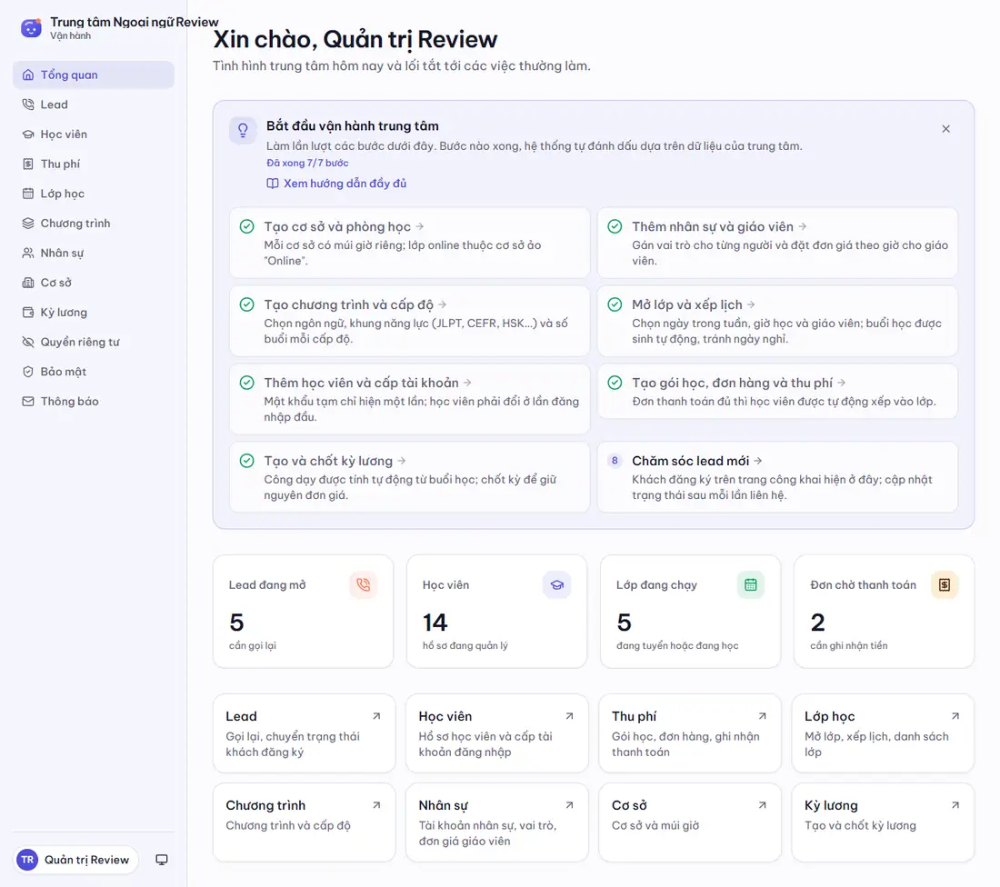

## Việc của quản trị và nơi hướng dẫn

| Việc | Hướng dẫn |
| --- | --- |
| Cài đặt trung tâm lần đầu | [Bắt đầu nhanh](bat-dau-nhanh.md) |
| Cơ sở, phòng, ngày nghỉ | [Bên dưới](#cơ-sở-phòng-học-ngày-nghỉ) |
| Nhân sự, vai trò, phân quyền theo cơ sở | [Bên dưới](#nhân-sự) |
| Chương trình, cấp độ | [Bên dưới](#chương-trình-và-cấp-độ) |
| Tài khoản học viên: khoá, đặt lại mật khẩu; nhật ký bảo mật | [Bên dưới](#bảo-mật) |
| Yêu cầu dữ liệu cá nhân, nhật ký truy cập | [Bên dưới](#quyền-riêng-tư) |
| Email tự động: xem, gửi lại | [Bên dưới](#thông-báo) |
| Lead | [Tư vấn](tu-van.md) |
| Học viên | [Khu vực Vận hành → Học viên](van-hanh-chung.md#học-viên) |
| Lớp, lịch | [Điều phối](dieu-phoi.md) |
| Học bù ngoại lệ, học viên xin nghỉ nhiều | [Điều phối → Học bù và xin nghỉ](dieu-phoi.md#học-bù-và-xin-nghỉ) |
| Quy tắc xin nghỉ, học bù, đổi hình thức | [Bên dưới](#quy-tắc-đặt-buổi) |
| Gói học, đơn, thanh toán, hoàn tiền, kỳ lương | [Kế toán](ke-toan.md) |

## Cơ sở, phòng học, ngày nghỉ

Mở **Cơ sở**. Mỗi thẻ cơ sở ghi mã, tên, loại (**Cơ sở tại chỗ** / **Cơ sở online**) và múi giờ.

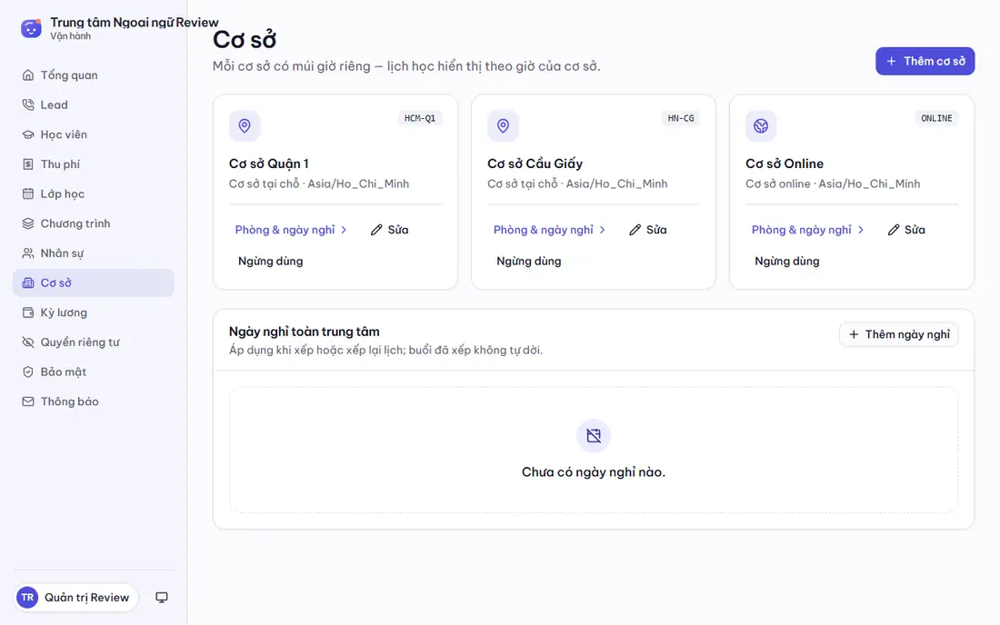

- **Thêm cơ sở**: **Mã**, **Tên (tiếng Việt)**, **Tên (tiếng Anh)**, **Múi giờ** (chuẩn IANA, ví dụ `Asia/Ho_Chi_Minh`), **Cơ sở online** (cơ sở ảo cho lớp trực tuyến). Lịch học hiển thị theo múi giờ của cơ sở.
- **Sửa**: múi giờ mới chỉ áp cho lớp mở sau; lớp đang có giữ múi giờ cũ.
- **Ngừng dùng**: lớp đang có vẫn chạy, nhưng không mở được lớp hay phòng mới ở cơ sở này.
- **Phòng & ngày nghỉ**: trang chi tiết cơ sở với **Phòng học** (thêm, sửa, ngừng dùng), **Ngày nghỉ của cơ sở** (thêm, sửa, xoá) và **Lịch sử thay đổi**. Chi tiết: [Điều phối → Phòng học và ngày nghỉ](dieu-phoi.md#phòng-học-và-ngày-nghỉ).
- **Ngày nghỉ toàn trung tâm** ở cuối trang Cơ sở: áp cho mọi cơ sở (Tết, lễ). Chỉ dùng khi xếp / xếp lại lịch; buổi đã xếp không tự dời.

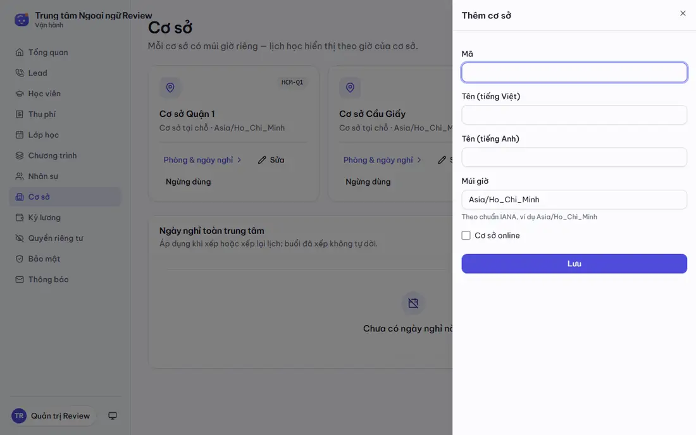

## Nhân sự

Mở **Nhân sự**. Bảng liệt kê họ tên, email, vai trò (kèm cơ sở nếu bị giới hạn, ví dụ "Kế toán · Cơ sở Cầu Giấy"), đơn giá dạy, nhãn **Xác thực 2 bước** với người đã bật. Lọc theo vai trò, trạng thái (**Đang làm** / **Đã khoá**), cơ sở; tìm theo tên, email.

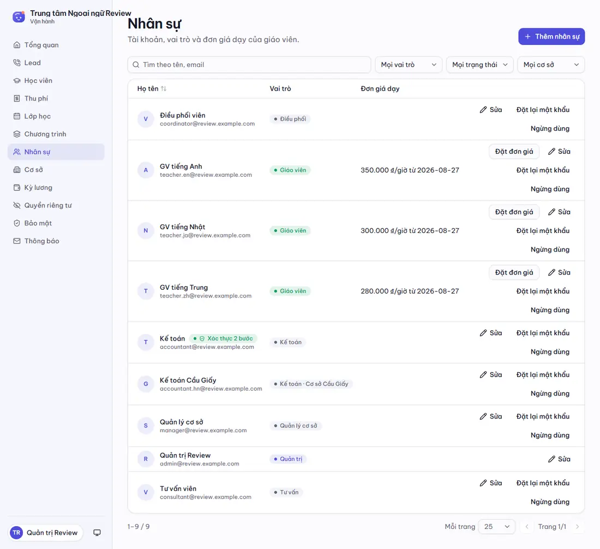

### Thêm nhân sự

**Thêm nhân sự** → **Họ tên**, **Email**, **Mật khẩu ban đầu (để trống nếu đã có tài khoản)**, chọn **Vai trò** (một hoặc nhiều) → **Lưu**.

- Gửi email và mật khẩu ban đầu cho người đó qua kênh riêng; họ đăng nhập ở tab **Giáo viên · Nhân viên** và nên đổi mật khẩu ngay.
- Người đã là nhân viên ở trung tâm khác trên Konnyaku: để trống mật khẩu; họ dùng mật khẩu hiện có.

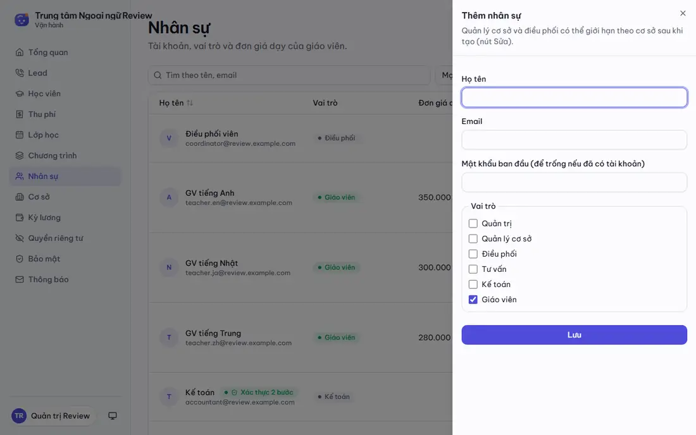

### Vai trò và phạm vi cơ sở

**Sửa** → đổi **Họ tên** và **Vai trò**. Dưới **Quản lý cơ sở**, **Điều phối**, **Kế toán** có danh sách cơ sở: đánh dấu các cơ sở người đó phụ trách. "Không chọn cơ sở nào = toàn trung tâm." Các vai trò khác luôn áp cho toàn trung tâm.

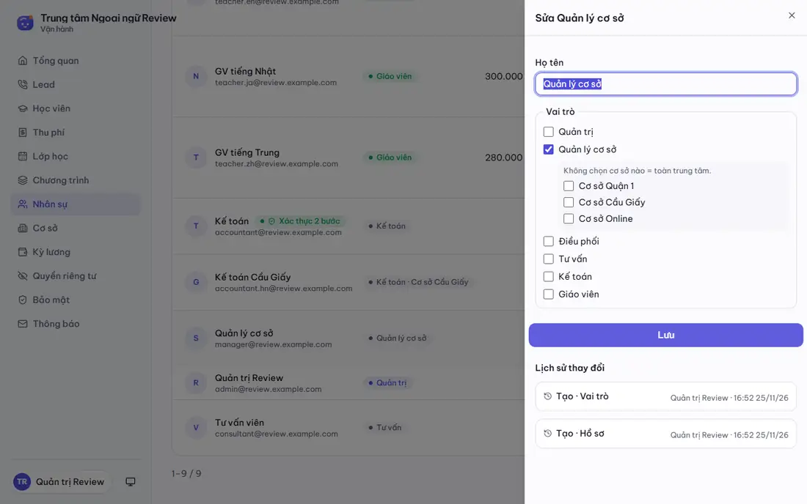

- Đổi vai trò làm người đó bị đăng xuất để đăng nhập lại với quyền mới.
- Trung tâm luôn phải còn ít nhất một **Quản trị** đang hoạt động.
- Bảng vai trò → quyền: [Phân quyền theo vai trò và cơ sở](quy-tac-nghiep-vu.md#phân-quyền-theo-vai-trò-và-cơ-sở).

### Khoá, đặt lại mật khẩu, gỡ 2FA

- **Ngừng dùng** khoá tài khoản ngay: người đó bị đăng xuất khỏi mọi thiết bị và không đăng nhập được; lịch sử và phân công giữ nguyên. **Dùng lại** để mở. Không tự khoá tài khoản của mình được.
- **Đặt lại mật khẩu** mở ngăn kéo với 3 việc:
    - **Đặt lại mật khẩu**: tạo mật khẩu tạm (chỉ hiện một lần) để đưa cho người đó; họ phải đổi khi đăng nhập và bị đăng xuất khỏi mọi thiết bị. Người có email cũng tự đặt lại được bằng "Quên mật khẩu".
    - **Gỡ xác thực 2 bước**: cho người mất điện thoại; họ đăng nhập bằng mật khẩu rồi bật lại. Có ghi nhật ký.
    - **Đăng xuất mọi thiết bị**: khi nghi tài khoản bị lộ hoặc máy dùng chung quên đăng xuất.

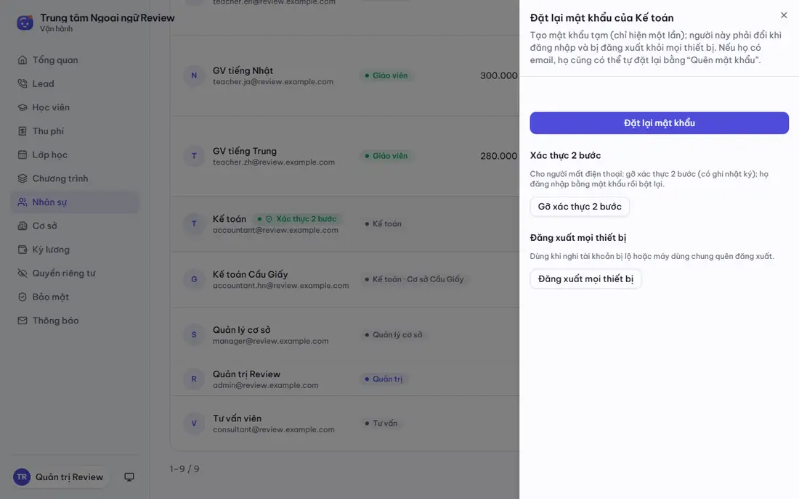

Nhân viên làm việc cho cả trung tâm khác dùng chung mật khẩu và 2FA giữa các trung tâm, nên quản trị không đặt lại được: hệ thống báo "Người này làm việc ở trung tâm khác nữa…"; người đó tự dùng **Quên mật khẩu**.

### Đơn giá giáo viên

**Đặt đơn giá** trên dòng giáo viên. Xem [Kế toán → Đơn giá giáo viên](ke-toan.md#đơn-giá-giáo-viên).

## Chương trình và cấp độ

Mở **Chương trình**. Mỗi chương trình là một thẻ: mã, tên, nhãn **Công khai** (hiện trên trang công khai), ngôn ngữ · khung trình độ, và bảng cấp độ (**Mã**, **Tên**, **Trình độ đầu ra**, **Số buổi**, **Phút/buổi**).

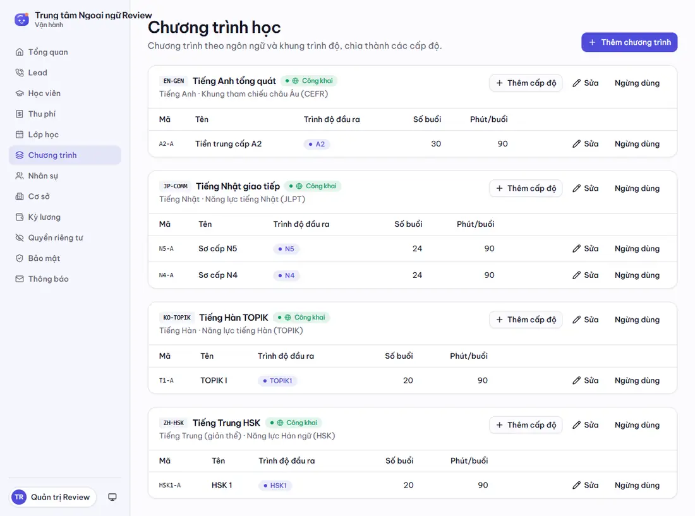

- **Thêm chương trình**: **Mã**, **Tên (tiếng Việt)**, **Tên (tiếng Anh)**, **Ngôn ngữ**, **Khung trình độ** (khung ghi "(dùng chung)" như CEFR dùng được cho mọi ngôn ngữ; khung khác chỉ dùng cho ngôn ngữ của nó), **Hiện trên trang công khai**.
- **Thêm cấp độ** (trên thẻ chương trình): **Mã**, tên tiếng Việt và tiếng Anh, **Trình độ đầu ra**, **Số buổi**, **Phút/buổi**.
- **Sửa** chương trình: thêm được **Độ tuổi**, **Mục tiêu**. Ngôn ngữ và khung trình độ cố định khi đã có cấp độ.
- **Sửa** cấp độ: số buổi không đổi được khi đã có lớp dùng cấp độ; phút/buổi mới áp cho lịch xếp sau.
- **Ngừng dùng** chương trình: ẩn khỏi trang công khai, không mở được lớp mới; lớp đang có vẫn chạy. **Ngừng dùng** cấp độ: không mở được lớp mới ở cấp độ đó.

| Thêm chương trình | Thêm cấp độ |
| --- | --- |
| 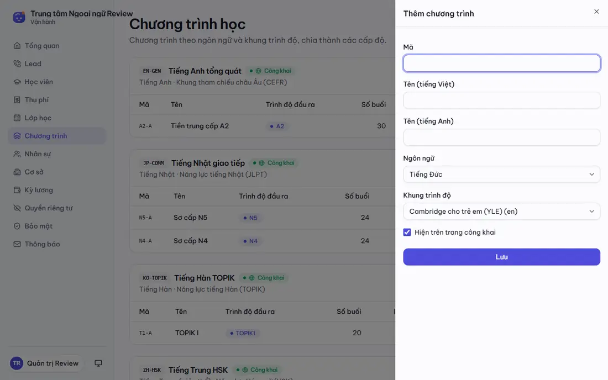 | 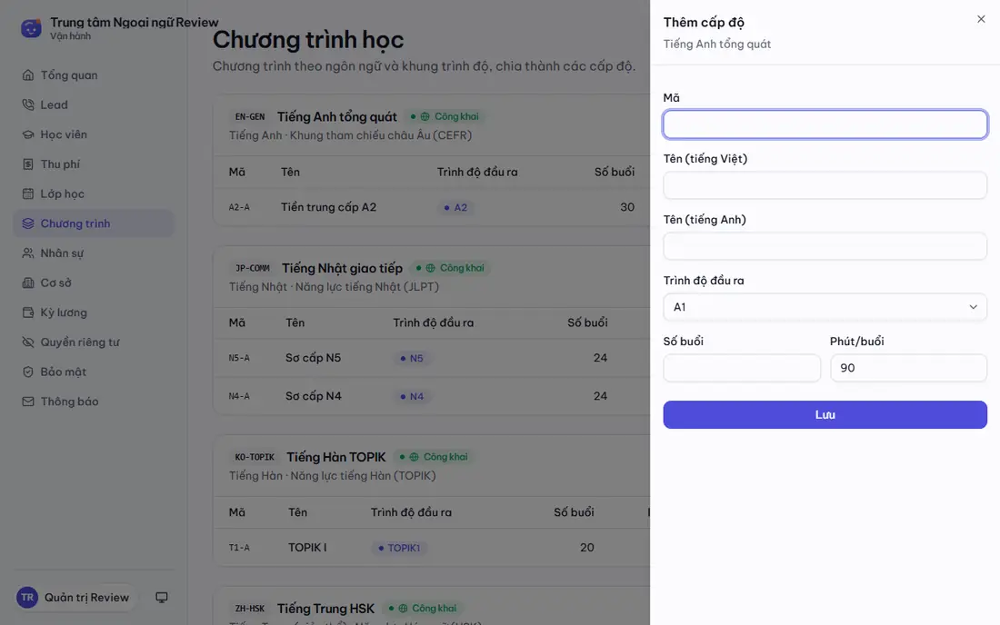 |

> Chưa có: bài học / giáo trình theo buổi, tài liệu, bài tập, bài kiểm tra.

## Quy tắc đặt buổi

Mục **Học bù** → khung **Quy tắc đặt buổi** → **Sửa quy tắc**. Áp dụng cho cả trung tâm, từ lúc lưu.

| Ô | Mặc định | Nghĩa |
| --- | --- | --- |
| **Hạn xin nghỉ (giờ trước buổi học)** | 12 | Học viên xin nghỉ hoặc huỷ buổi đã đặt trước giờ học ít nhất chừng này giờ |
| **Số lần xin nghỉ tối đa mỗi khoá** | 3 | Tính trên một ghi danh |
| **Hạn dùng quyền học bù (ngày)** | 30 | Tính từ lúc xin nghỉ |
| **Hạn đổi hình thức (giờ trước buổi học)** | 2 | Lớp kết hợp: đổi online / tại cơ sở |
| **Chỗ học bù mỗi buổi** | 2 | Chỗ dành cho học viên lớp khác đến học bù, cộng thêm vào sĩ số; áp cho các buổi xếp lịch sau khi đổi |
| **Giữ chỗ cho người trong hàng chờ (giờ)** | 2 | Thời gian chỗ trống được giữ cho người đầu hàng chờ |

## Bảo mật

Mở **Bảo mật** (chỉ quản trị). Tài khoản nhân sự quản lý ở trang **Nhân sự**; trang này dành cho **tài khoản học viên và phụ huynh** và **nhật ký bảo mật** của cả trung tâm.

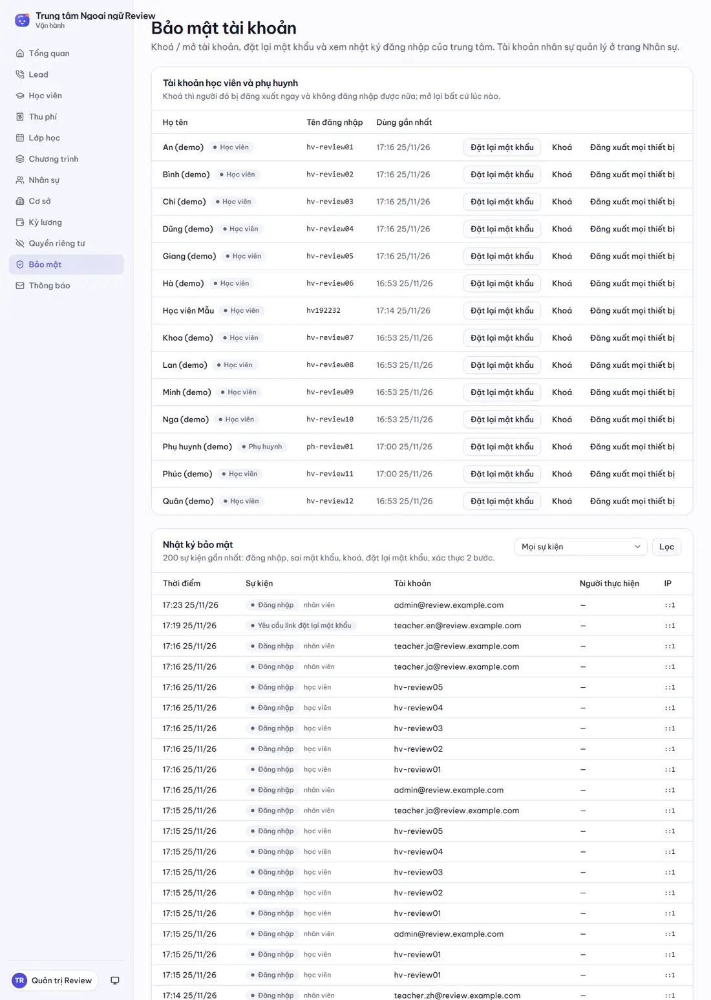

**Tài khoản học viên và phụ huynh**: họ tên, vai trò, **Tên đăng nhập**, **Dùng gần nhất**, nhãn **Đã khoá**, **Tạm khoá do nhập sai**, **Mật khẩu tạm**.

- **Đặt lại mật khẩu**: tạo mật khẩu tạm mới (chỉ hiện một lần) cho người quên mật khẩu; họ phải đổi khi đăng nhập, mọi thiết bị đang đăng nhập bị đăng xuất.
- **Khoá** / **Mở khoá**: khoá thì người đó bị đăng xuất ngay và không đăng nhập được cho tới khi mở lại.
- **Đăng xuất mọi thiết bị**.

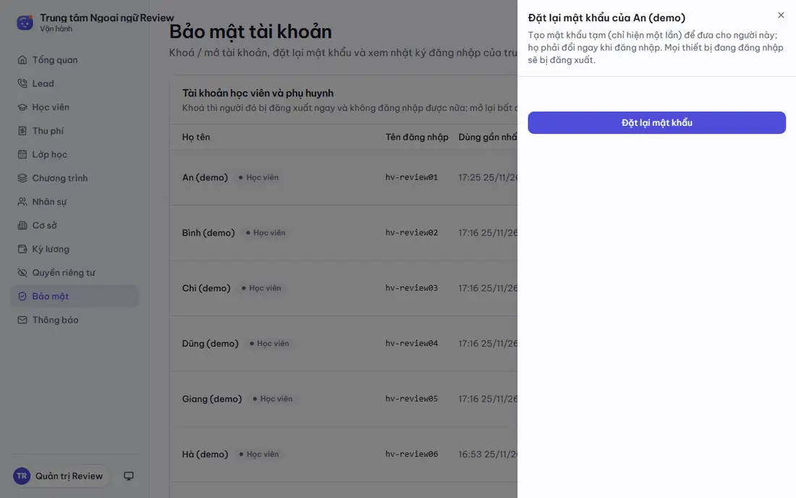

**Nhật ký bảo mật**: 200 sự kiện gần nhất: đăng nhập, đăng nhập thất bại (kèm lý do như sai mật khẩu, tài khoản không tồn tại, sai mã xác thực), tạm khoá do nhập sai, khoá / mở khoá, đổi và đặt lại mật khẩu, yêu cầu link đặt lại, bật / tắt / gỡ 2FA, dùng mã khôi phục, đăng xuất. Mỗi dòng có **Thời điểm**, **Sự kiện**, **Tài khoản**, **Người thực hiện** (khi là quản trị), **IP**. Lọc theo loại sự kiện ở góc trên.

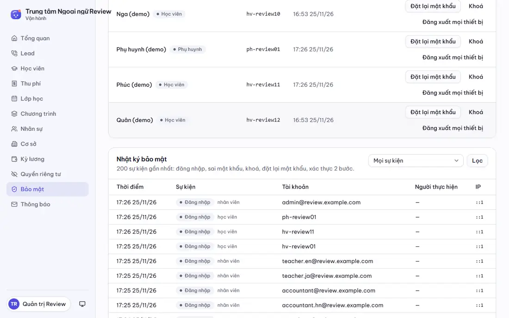

Nên xem nhật ký hằng tuần: nhiều lần **Đăng nhập thất bại** liên tiếp vào một tài khoản, hoặc đăng nhập từ IP lạ, là dấu hiệu cần đổi mật khẩu / khoá tài khoản.

## Quyền riêng tư

Mở **Quyền riêng tư** (chỉ quản trị). Hai thẻ: **Yêu cầu** và **Nhật ký truy cập**. Quy trình đầy đủ: [Yêu cầu xem, sửa, xoá dữ liệu cá nhân](quy-trinh.md#7-yêu-cầu-xem-sửa-xoá-dữ-liệu-cá-nhân).

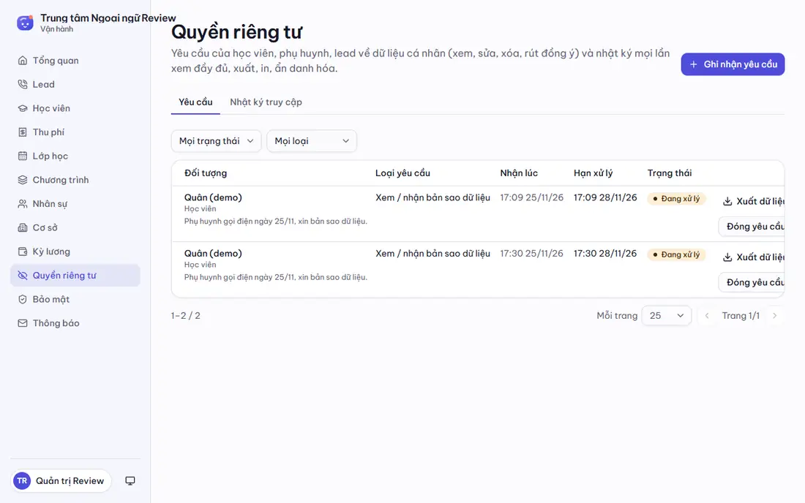

**Yêu cầu**: học viên, phụ huynh hay khách xin xem, sửa, xoá dữ liệu hoặc rút đồng ý.

- **Ghi nhận yêu cầu** ngay khi nhận: **Đối tượng là** (Học viên / Lead), gõ tên hoặc SĐT để chọn **Đối tượng**, **Loại yêu cầu** (Xem / nhận bản sao dữ liệu, Sửa dữ liệu, Xóa dữ liệu, Rút lại đồng ý), **Ghi chú** (kênh nhận, nội dung; không cần ghi lại SĐT hay email). Hạn xử lý là **72 giờ** từ lúc ghi; quá hạn hiện chữ đỏ **Quá hạn**.
- Trên mỗi yêu cầu đang mở:
    - **Xuất dữ liệu**: tải file JSON gồm mọi thông tin trung tâm giữ về người đó (hồ sơ, tài khoản, lớp, điểm danh, đơn hàng, thanh toán, số buổi). Gửi cho người yêu cầu qua kênh an toàn.
    - **Ẩn danh hóa** (yêu cầu xoá hoặc rút đồng ý): xoá vĩnh viễn họ tên, năm sinh, phụ huynh, SĐT, email; khoá tài khoản học viên. Đơn hàng, thanh toán, sổ buổi học, điểm danh giữ nguyên để đối soát nhưng không còn tên. Học viên còn đang học phải **Ngừng dùng** trước. **Không hoàn tác được.**
    - **Đóng yêu cầu**: **Đã xong** (ghi đã làm gì) hoặc **Từ chối** (bắt buộc ghi lý do).

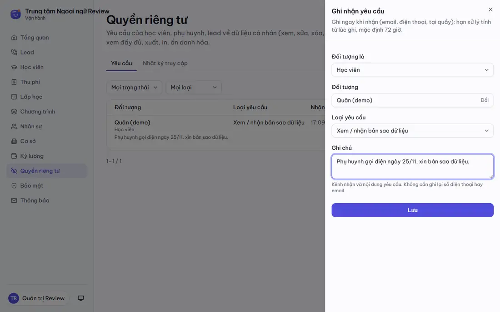

**Nhật ký truy cập**: mọi lần **Xem đầy đủ** liên hệ, **Xuất CSV**, **In**, **Xuất dữ liệu cá nhân**, **Ẩn danh hóa**, kể cả **Ẩn danh hóa tự động** (lead quá 24 tháng). Lọc theo hành động và ngày. Dùng để rà soát định kỳ, ví dụ một người xem hoặc xuất danh sách nhiều bất thường.

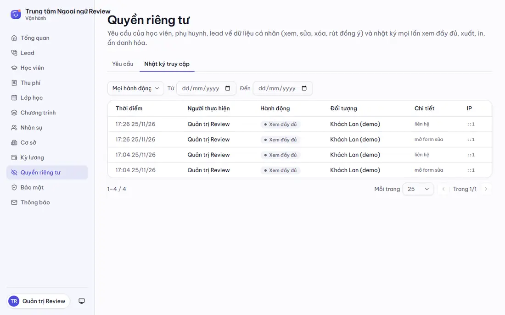

Quy định chi tiết (Nghị định 13/2023): [Xử lý dữ liệu cá nhân](../xu-ly-du-lieu-ca-nhan.md).

## Thông báo

Mở **Thông báo** (chỉ quản trị): **Nhật ký thông báo** liệt kê email hệ thống đã gửi, đang chờ và lỗi: **Thời gian**, **Người nhận**, **Nội dung** (loại email và tiêu đề, kênh · ngôn ngữ), **Trạng thái**. Lọc **Tất cả** / **Lỗi** / **Đang chờ** / **Đã gửi**.

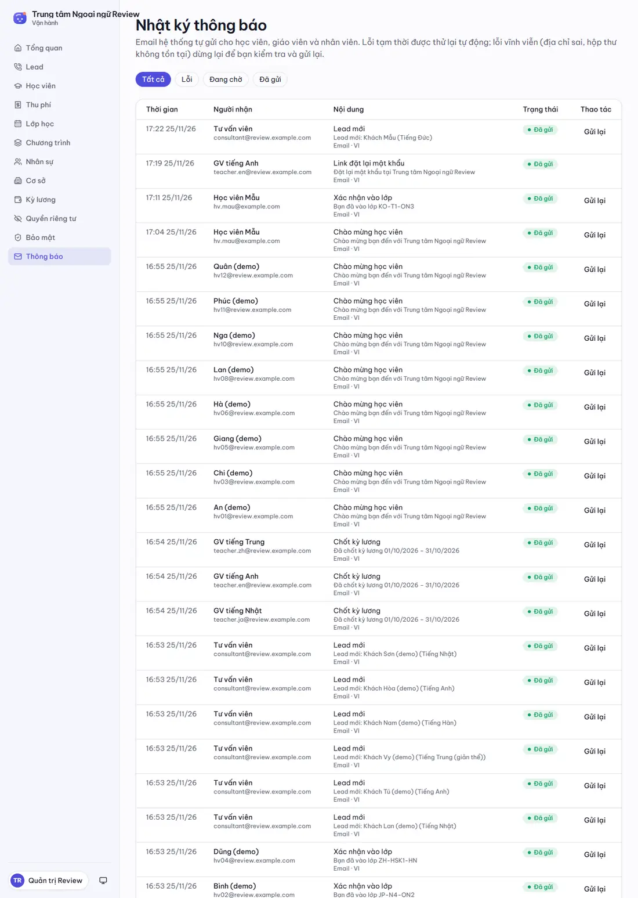

- Lỗi tạm thời (máy chủ thư bận) được thử lại tự động; dòng ghi số lần gửi.
- Lỗi vĩnh viễn (địa chỉ sai, hộp thư không tồn tại) dừng lại và hiện lý do. Sửa email trong hồ sơ người nhận nếu sai, rồi để các email sau gửi đúng.
- **Gửi lại**: gửi lần nữa tới **đúng địa chỉ cũ** (dùng khi lỗi đã được khắc phục, ví dụ người nhận đã mở lại hộp thư). Email chứa dữ liệu bảo mật (link đặt lại mật khẩu) đã gửi thì không gửi lại được.

Danh sách email tự động và ai nhận: [Quy tắc → Email tự động](quy-tac-nghiep-vu.md#email-tự-động).

## Kiểm tra định kỳ

| Tần suất | Việc |
| --- | --- |
| Hằng ngày | **Tổng quan**: lead đang mở, đơn chờ thanh toán |
| Hằng tuần | **Thông báo** → lọc **Lỗi**; **Bảo mật** → nhật ký; **Quyền riêng tư** → yêu cầu sắp / quá hạn |
| Hằng tháng | Kỳ lương được chốt; **Nhân sự** → khoá tài khoản người đã nghỉ; rà nhật ký truy cập |
