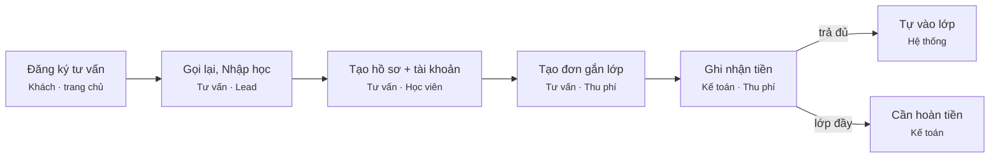
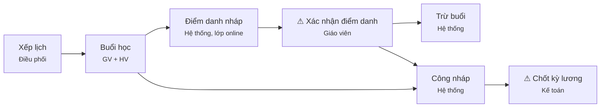

# Quy trình nghiệp vụ trọn vẹn

[← Mục lục](README.md)

Mỗi quy trình ghi ai làm bước nào, ở màn hình nào. Bước có ⚠ là bước **không hoàn tác được**.

## 1. Khách đăng ký → học viên vào lớp

| # | Ai | Làm gì | Ở đâu |
| --- | --- | --- | --- |
| 1 | Khách | Điền form, bấm **Gửi đăng ký** | Trang công khai → **Đăng ký tư vấn** ([hướng dẫn](phu-huynh-va-khach.md#đăng-ký-tư-vấn)) |
| 2 | Hệ thống | Tạo lead, giao tư vấn viên ít việc nhất, đặt hạn gọi lại 15 phút, email "Lead mới" | |
| 3 | Tư vấn | **Hiện** số điện thoại, gọi; bấm **Đã gọi**. Khách đồng ý thì **Nhập học** | **Lead** ([hướng dẫn](tu-van.md#lead)) |
| 4 | Tư vấn | **Thêm học viên**, **Cấp tài khoản đăng nhập**, gửi tên đăng nhập + mật khẩu tạm | **Học viên** ([hướng dẫn](van-hanh-chung.md#thêm-học-viên)) |
| 5 | Tư vấn | **Tạo đơn hàng**: học viên, gói học, lớp | **Thu phí** |
| 6 | Kế toán | Học viên đóng tiền: **Ghi nhận** (số tiền, hình thức, mã giao dịch); in **phiếu thu** | **Thu phí** ([hướng dẫn](ke-toan.md#ghi-nhận-thanh-toán)) |
| 7 | Hệ thống | Đơn trả đủ: cộng buổi, ghi danh vào lớp (vài giây), email "Xác nhận vào lớp" | |
| 8 | Học viên | Đăng nhập, đổi mật khẩu, thấy lịch học và nút **Vào lớp** | `/learn` ([hướng dẫn](hoc-vien.md)) |

Lớp đã đầy khi đơn được trả đủ: đơn chuyển sang **Cần hoàn tiền**, học viên không vào lớp. Kế toán hoặc **hoàn tiền** (quy trình 3), hoặc tư vấn tạo đơn mới cho lớp khác rồi hoàn đơn cũ.

Khách chưa có lớp phù hợp: tạo đơn **Chưa xếp lớp**; khi có lớp, sửa lớp trong **Chi tiết** đơn (chỉ được khi đơn còn **Chờ thanh toán**).

## 2. Buổi học → điểm danh → trừ buổi → công → lương

| # | Ai | Làm gì | Ở đâu |
| --- | --- | --- | --- |
| 1 | Điều phối | Mở lớp, **Xếp lịch** với giáo viên | **Lớp học** ([hướng dẫn](dieu-phoi.md#xếp-lịch-lần-đầu)) |
| 2 | Hệ thống | Tạo phòng học cho buổi online; email nhắc 24 giờ trước | |
| 3 | Giáo viên, học viên | Bấm **Vào lớp**, học. Giáo viên bấm **Kết thúc buổi học** khi hết giờ | [Phòng học trực tuyến](phong-hoc-truc-tuyen.md) |
| 4 | Hệ thống | Lớp online: tạo điểm danh nháp từ thời gian có mặt; ghi công nháp cho giáo viên | |
| 5 | Giáo viên | Mở **Điểm danh**, kiểm tra, ⚠ **Xác nhận điểm danh** | `/teach` ([hướng dẫn](giao-vien.md#điểm-danh)) |
| 6 | Hệ thống | Trừ 1 buổi mỗi học viên (trừ Vắng có phép), trả phí trước, tặng sau; lớp tại cơ sở: ghi công cho giáo viên | |
| 7 | Kế toán | Cuối tháng: **Tạo kỳ lương**, kiểm tra **Thiếu đơn giá**, ⚠ **Chốt kỳ** | **Kỳ lương** ([hướng dẫn](ke-toan.md#kỳ-lương)) |
| 8 | Hệ thống | Đóng băng số tiền, email "Chốt kỳ lương" cho giáo viên | |

Học viên xem số buổi giảm ở `/learn`; giáo viên xem công ở **Công tháng này**. Quy tắc chi tiết: [Điểm danh và trừ buổi](quy-tac-nghiep-vu.md#điểm-danh-và-trừ-buổi), [Công và lương](quy-tac-nghiep-vu.md#công-và-lương-giáo-viên).

Xác nhận điểm danh nhầm: kế toán **Điều chỉnh buổi** trong sổ buổi học của học viên (cộng lại buổi bị trừ sai, ghi lý do). Trạng thái điểm danh không sửa được trên giao diện.

## 3. Hoàn tiền

**a) Lớp đầy** (đơn **Cần hoàn tiền**):

1. Kế toán: **Thu phí** → lọc **Chờ hoàn** → **Hoàn tiền** trên đơn.
2. Ngăn kéo ghi **Lớp không nhận được học viên**, đề xuất hoàn toàn bộ số đã thu.
3. Chọn hình thức, nhập mã giao dịch, **Lý do** → ⚠ **Xác nhận hoàn tiền**.
4. Chuyển tiền cho học viên ngoài hệ thống (chuyển khoản / tiền mặt), in **phiếu chi** `PC-…` để ký nhận.

**b) Học viên nghỉ giữa khoá** (đơn **Đã thanh toán**):

1. Tư vấn / giáo vụ xác nhận học viên nghỉ, báo kế toán.
2. Kế toán: **Hoàn tiền** trên đơn. Ngăn kéo ghi **Nghỉ giữa khoá**: số buổi trả phí chưa dùng, buổi tặng (không hoàn), đơn giá một buổi, số tiền đề xuất.
3. Sửa **Số tiền hoàn** nếu trung tâm giữ phí; ghi **Lý do** (ví dụ "Nghỉ do chuyển công tác, giữ phí 10% theo quy định").
4. ⚠ **Xác nhận hoàn tiền**: số buổi còn lại về 0, học viên được cho nghỉ lớp, chỗ được nhả.
5. Trả tiền, in phiếu chi.
6. Nếu học viên nghỉ hẳn: **Học viên** → **Ngừng dùng** hồ sơ.

**c) Nghỉ khi chưa trả đủ** (đơn **Chờ thanh toán** đã thu một phần): **Hoàn tiền** đề xuất số đã thu; làm như trên. Đơn chưa thu đồng nào thì không cần hoàn: **Huỷ đơn** trong **Chi tiết**.

Quy tắc: [Hoàn tiền](quy-tac-nghiep-vu.md#hoàn-tiền).

## 4. Đổi lịch, đổi giáo viên

| Tình huống | Làm được trên giao diện? | Cách làm |
| --- | --- | --- |
| Cả lớp đổi ngày / giờ học từ một ngày | Có | **Lớp học** → chi tiết lớp → **Sửa lịch tuần**: chọn ngày, giờ mới, **Áp dụng từ** → **Xếp lại lịch** ([hướng dẫn](dieu-phoi.md#sửa-lịch-tuần-đổi-giờ-đổi-ngày-đổi-giáo-viên-đổi-phòng)) |
| Đổi giáo viên dài hạn (giáo viên nghỉ việc, đổi người dạy) | Có | **Sửa lịch tuần**: giữ ngày giờ, chọn **Giáo viên** mới, **Áp dụng từ** |
| Đổi phòng từ một ngày | Có | **Sửa lịch tuần**: chọn **Phòng** mới |
| Lớp chuyển online ↔ tại cơ sở | Có | **Sửa** lớp → **Hình thức** (áp cho buổi chưa diễn ra) |
| Đổi giờ / dạy thay / huỷ **một buổi lẻ** | **Chưa có** | Báo học viên và giáo viên bằng kênh khác. Buổi không diễn ra: giáo viên điểm danh **Vắng có phép** cả lớp để không trừ buổi. Dạy thay một buổi: **Sửa lịch tuần** chọn giáo viên dạy thay, **Áp dụng từ** ngày dạy thay; sau buổi đó **Sửa lịch tuần** lần nữa, chọn lại giáo viên cũ, áp dụng từ hôm sau (phòng học online chỉ nhận giáo viên của buổi) |
| Thêm buổi học bù | **Chưa có** | |

Sau khi sửa lịch tuần, học viên và giáo viên của các buổi bị đổi nhận email "Đổi giờ buổi học". Nếu giáo viên / phòng mới bị trùng lịch, không buổi nào bị đổi.

## 5. Bảo lưu và nghỉ học

| Tình huống | Làm được trên giao diện? | Cách làm |
| --- | --- | --- |
| Học viên nghỉ hẳn, hoàn tiền | Có | [Quy trình 3b](#3-hoàn-tiền), rồi **Ngừng dùng** hồ sơ |
| Học viên nghỉ hẳn, không hoàn tiền | Một phần | **Ngừng dùng** hồ sơ (không mua / vào lớp mới được). Học viên vẫn nằm trong danh sách lớp; giáo viên điểm danh **Vắng có phép** để không trừ buổi, hoặc kế toán **Điều chỉnh buổi** trừ số buổi còn lại (ghi lý do) |
| Bảo lưu (tạm nghỉ, giữ buổi) | **Chưa có** | Giáo viên điểm danh **Vắng có phép** cho học viên trong thời gian nghỉ (không trừ buổi). Khi học viên học lại ở lớp khác: kế toán **Điều chỉnh buổi** trừ ở đơn cũ, tạo đơn mới cho lớp mới và cộng lại bằng điều chỉnh (ghi rõ lý do ở cả hai) |
| Chuyển lớp | **Chưa có** | Như trên |
| Nghỉ một buổi có báo trước | Có | Giáo viên chọn **Vắng có phép** cho học viên khi điểm danh |

Hệ thống đã có trạng thái **Bảo lưu** trong danh sách lớp (học viên bảo lưu tự được ghi **Vắng có phép**), nhưng chưa có nút đặt bảo lưu trên giao diện.

## 6. Quên mật khẩu, khoá tài khoản, xác thực 2 bước

| Tình huống | Ai xử lý | Cách làm |
| --- | --- | --- |
| Nhân viên / giáo viên quên mật khẩu | Tự làm | **Quên mật khẩu? Nhận link đặt lại qua email** ([hướng dẫn](dang-nhap-va-bao-mat.md#quên-mật-khẩu)) |
| … không nhận được email | Quản trị | **Nhân sự** → **Đặt lại mật khẩu** → gửi mật khẩu tạm cho người đó |
| Học viên / phụ huynh quên mật khẩu | Quản trị | **Bảo mật** → **Đặt lại mật khẩu** trên dòng học viên → gửi mật khẩu tạm |
| "Tài khoản tạm khóa do nhập sai nhiều lần" | Tự hết | Chờ 15 phút |
| Nhân viên nghỉ việc | Quản trị | **Nhân sự** → **Ngừng dùng** (đăng xuất ngay mọi thiết bị) |
| Học viên vi phạm / cần chặn truy cập | Quản trị | **Bảo mật** → **Khoá**; mở lại bằng **Mở khoá** |
| Nghi lộ mật khẩu | Người dùng + quản trị | Người dùng đổi mật khẩu; quản trị **Đăng xuất mọi thiết bị** của tài khoản đó; xem **Nhật ký bảo mật** |
| Mất điện thoại có ứng dụng xác thực | Người dùng | Đăng nhập bằng một **mã khôi phục**, rồi bật lại 2FA với điện thoại mới |
| … hết mã khôi phục | Quản trị | **Nhân sự** → **Đặt lại mật khẩu** → **Gỡ xác thực 2 bước**; người đó đăng nhập bằng mật khẩu và bật lại |
| Nhân viên làm cho nhiều trung tâm | Người đó | Quản trị không đặt lại được (mật khẩu dùng chung giữa các trung tâm); người đó dùng **Quên mật khẩu** |
| Quản trị duy nhất mất quyền truy cập | Konnyaku | Liên hệ Konnyaku: người vận hành nền tảng **Thêm quản trị viên** cho trung tâm |

## 7. Yêu cầu xem, sửa, xoá dữ liệu cá nhân

Theo Nghị định 13/2023, trung tâm phải xử lý yêu cầu của học viên, phụ huynh, khách về dữ liệu của họ. Chỉ **quản trị** làm.

1. **Nhận yêu cầu** (email, điện thoại, tại quầy). Xác minh đúng người (hỏi thông tin chỉ người đó biết, hoặc yêu cầu từ email / SĐT đã đăng ký).
2. **Quyền riêng tư** → **Ghi nhận yêu cầu** ngay: chọn đối tượng (học viên hoặc lead), **Loại yêu cầu**, **Ghi chú** (kênh nhận). Hạn 72 giờ tính từ lúc ghi.
3. Xử lý theo loại:

    | Loại yêu cầu | Làm gì |
    | --- | --- |
    | **Xem / nhận bản sao dữ liệu** | **Xuất dữ liệu** → gửi file JSON cho người yêu cầu qua kênh an toàn (email đã đăng ký, có mật khẩu file nếu được) |
    | **Sửa dữ liệu** | Sửa hồ sơ ở **Học viên** hoặc **Lead** (**Sửa**) |
    | **Xóa dữ liệu** / **Rút lại đồng ý** | Học viên đang học: **Ngừng dùng** hồ sơ trước (và hoàn tiền nếu cần). Rồi ⚠ **Ẩn danh hóa**: xoá vĩnh viễn họ tên, năm sinh, phụ huynh, SĐT, email; khoá tài khoản. Sổ buổi học, đơn hàng, thanh toán, điểm danh giữ lại để đối soát nhưng không còn tên |

4. **Đóng yêu cầu**: **Đã xong** (ghi đã làm gì) hoặc **Từ chối** (bắt buộc ghi lý do, ví dụ không xác minh được người yêu cầu).
5. Báo kết quả cho người yêu cầu.

Chi tiết: [Quản trị trung tâm → Quyền riêng tư](quan-tri-trung-tam.md#quyền-riêng-tư), [Xử lý dữ liệu cá nhân](../xu-ly-du-lieu-ca-nhan.md).

## 8. Nhân viên mới, nhân viên nghỉ việc

**Nhân viên mới**: quản trị **Nhân sự** → **Thêm nhân sự** (vai trò; giới hạn cơ sở bằng **Sửa** nếu cần) → gửi email + mật khẩu ban đầu. Giáo viên: **Đặt đơn giá**. Quản trị / kế toán: hướng dẫn bật 2FA ở lần đăng nhập đầu.

**Nhân viên nghỉ việc**:

1. Giáo viên: **Sửa lịch tuần** các lớp người đó dạy, chọn giáo viên mới, **Áp dụng từ** ngày nghỉ việc.
2. Tư vấn: **Lead** → lọc theo tư vấn viên đó → **Sửa** từng lead, giao cho người khác.
3. Kế toán: chốt kỳ lương có công của người đó.
4. **Nhân sự** → **Ngừng dùng** tài khoản. Lịch sử và phân công cũ giữ nguyên.
