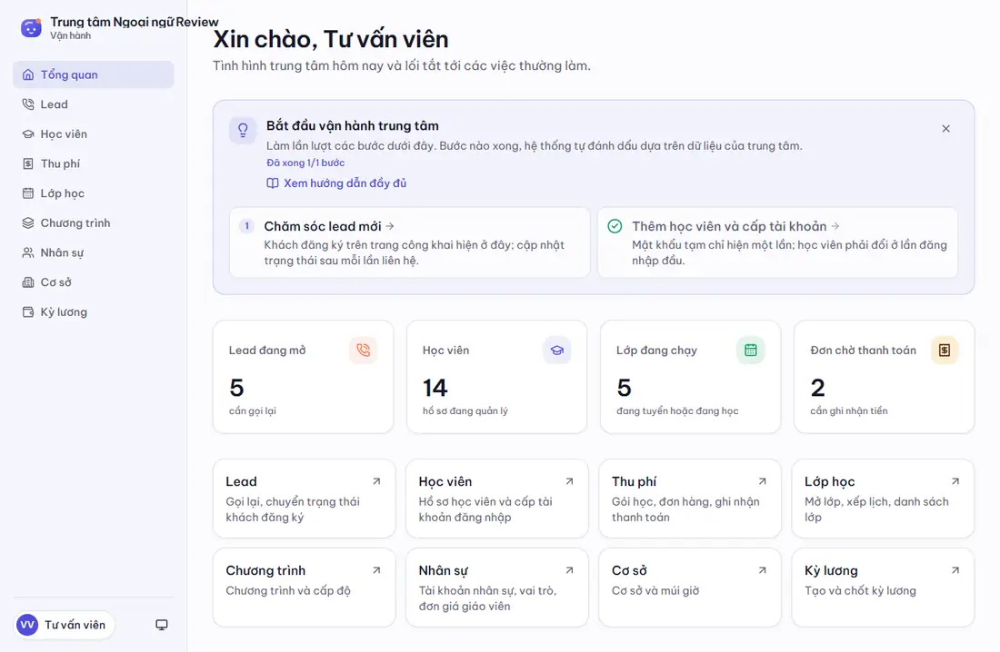
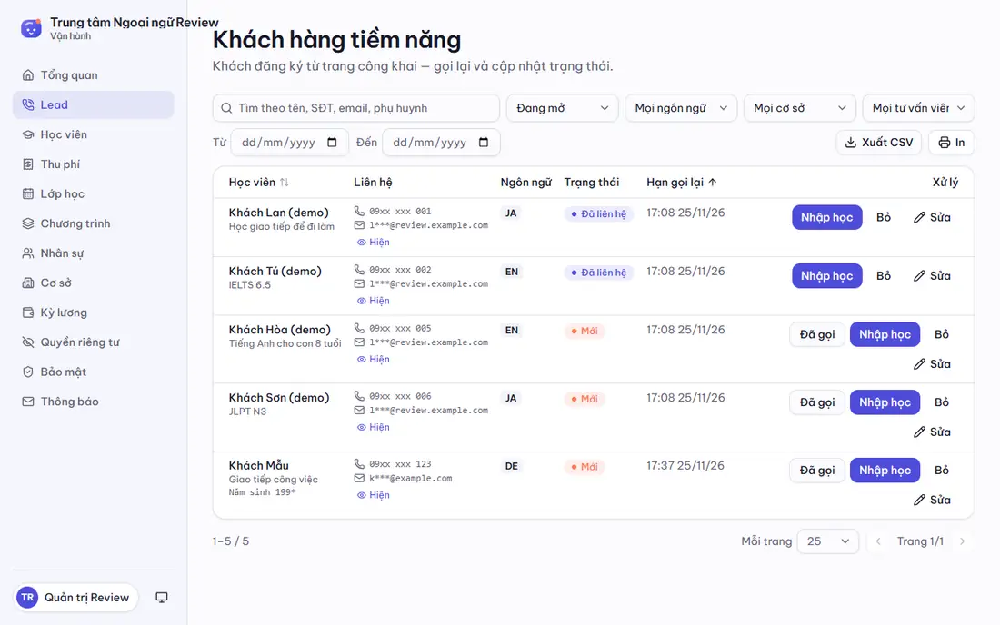
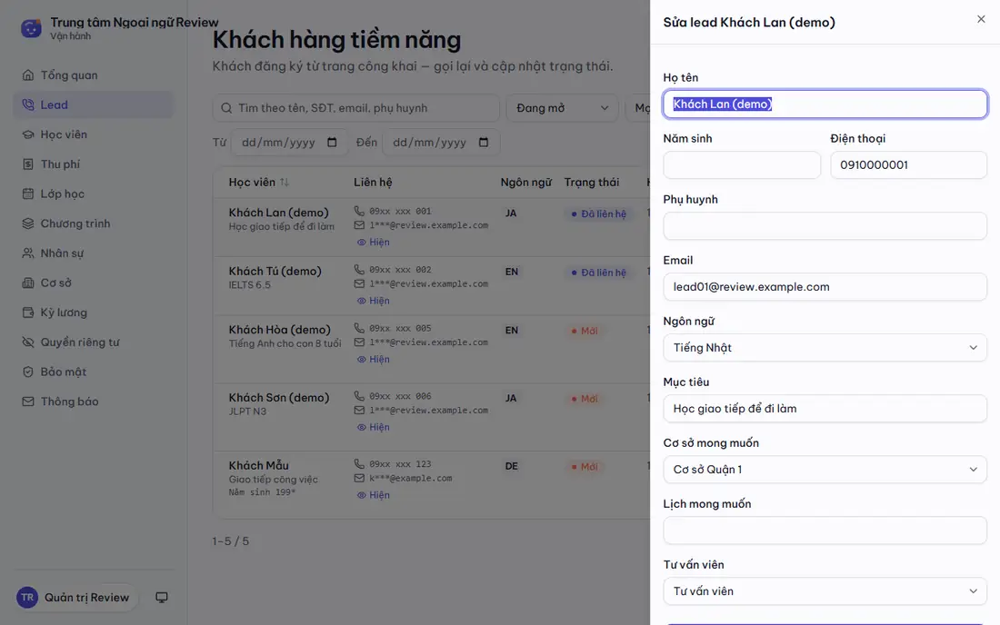
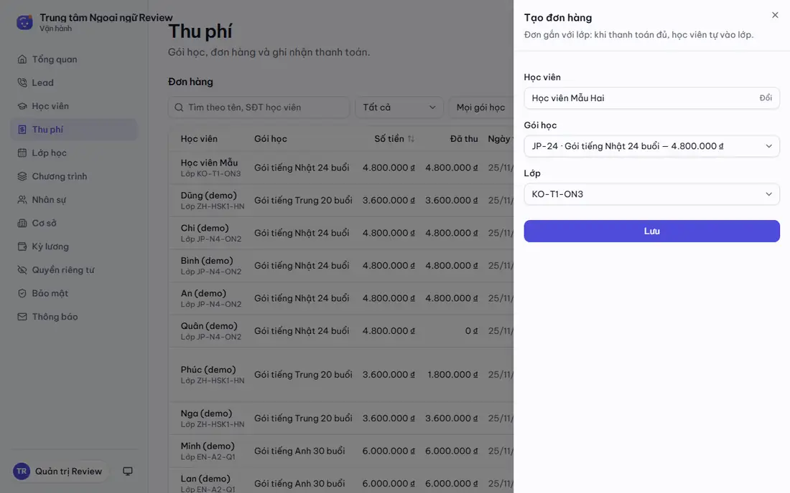

# Hướng dẫn cho tư vấn viên

[← Mục lục](README.md) · Đọc trước: [Khu vực Vận hành: thao tác chung](van-hanh-chung.md)

Vai trò **Tư vấn** chăm sóc khách đăng ký (lead), tạo hồ sơ học viên và tạo đơn hàng. Tư vấn viên **không** ghi nhận tiền (việc của kế toán), không mở lớp hay xếp lịch.

| Được làm | Chỉ xem | Không có |
| --- | --- | --- |
| Lead: gọi lại, đổi trạng thái, sửa, giao cho tư vấn viên khác. Học viên: thêm, sửa, ngừng dùng, cấp tài khoản. Thu phí: **Tạo đơn hàng**, xem đơn | Lớp học, chương trình | Ghi nhận thanh toán, hoàn tiền, xuất CSV / in, nhân sự, kỳ lương, bảo mật |

Trang **Tổng quan** của tư vấn viên có thẻ hướng dẫn với bước **Chăm sóc lead mới** và số **Lead đang mở**.

## Lead

Lead là khách để lại thông tin trên form **Đăng ký tư vấn** của trang công khai (xem [Phụ huynh và khách](phu-huynh-va-khach.md#đăng-ký-tư-vấn)). Lead mới được giao tự động cho tư vấn viên đang có ít lead mở nhất; người được giao nhận email "Lead mới" (trung tâm chưa có tư vấn viên thì các quản trị nhận). **Hạn gọi lại** là 15 phút sau lúc khách gửi form, đúng lời hứa "gọi lại trong 15 phút" trên trang công khai. Khách gửi form lần nữa trong khi lead cũ còn mở (trùng số điện thoại hoặc email) thì lead cũ được cập nhật, không tạo lead trùng.

Mở **Lead** ở thanh bên trái. Danh sách mặc định chỉ hiện lead **Đang mở** (Mới và Đã liên hệ). Mỗi dòng có họ tên, mục tiêu, liên hệ (đã che), ngôn ngữ muốn học, trạng thái và **Hạn gọi lại**.

### Gọi lại và cập nhật trạng thái

1. Bấm **Hiện** dưới liên hệ để thấy số điện thoại / email đầy đủ (lần xem được ghi nhật ký).
2. Gọi cho khách. Xong, bấm nút ở cột **Xử lý**:

| Nút | Trạng thái mới | Khi nào |
| --- | --- | --- |
| **Đã gọi** | Đã liên hệ | Đã nói chuyện, khách còn cân nhắc |
| **Nhập học** | Đã nhập học | Khách đồng ý học; sau đó tạo hồ sơ học viên và đơn hàng (bên dưới) |
| **Bỏ** | Không theo | Khách không học nữa, số sai… |

Lead **Đã nhập học** hoặc **Không theo** là lead đã đóng: không đổi trạng thái hay sửa được nữa. Muốn xem lại, chọn trạng thái ở bộ lọc (hoặc **Mọi trạng thái**).

### Sửa lead

Bấm **Sửa** trên lead đang mở để chỉnh **Họ tên**, **Năm sinh**, **Điện thoại**, **Phụ huynh**, **Email**, **Ngôn ngữ**, **Mục tiêu**, **Cơ sở mong muốn**, **Lịch mong muốn**, hoặc giao cho **Tư vấn viên** khác. Mở form sửa hiện đầy đủ liên hệ và được ghi vào nhật ký truy cập.

> Chưa có: ghi chú cuộc gọi, lịch hẹn gọi lại do người dùng đặt, đặt lịch kiểm tra đầu vào / học thử, chuyển lead thành học viên bằng một nút. Ghi chú tạm vào ô **Mục tiêu** hoặc **Lịch mong muốn** nếu cần.

## Chuyển lead thành học viên

Khi khách đồng ý học:

1. Ở lead, bấm **Nhập học**.
2. **Học viên** → **Thêm học viên**, nhập lại họ tên, năm sinh, liên hệ, phụ huynh, cơ sở; đánh dấu **Cấp tài khoản đăng nhập** nếu học online hoặc cần xem lịch. Bấm **Lưu**, sao chép **Tên đăng nhập** và **Mật khẩu tạm** gửi cho học viên. Chi tiết: [Thêm học viên](van-hanh-chung.md#thêm-học-viên).
3. **Thu phí** → **Tạo đơn hàng**: gõ tên hoặc SĐT để chọn học viên, chọn **Gói học** và **Lớp**. Bấm **Lưu**. Chọn đúng lớp là quan trọng: khi đơn được trả đủ, học viên tự vào lớp đó.
4. Báo kế toán thu tiền (hoặc hướng dẫn khách chuyển khoản). Kế toán bấm **Ghi nhận**; trả đủ thì học viên vào lớp và nhận email "Xác nhận vào lớp".

Chưa chọn được lớp (chờ đủ học viên mới mở lớp): chọn **Chưa xếp lớp**. Khi đơn còn **Chờ thanh toán**, kế toán hoặc quản trị đổi được lớp trong **Chi tiết** đơn.

Toàn bộ luồng: [Quy trình: khách đăng ký → học viên vào lớp](quy-trinh.md#1-khách-đăng-ký--học-viên-vào-lớp).
