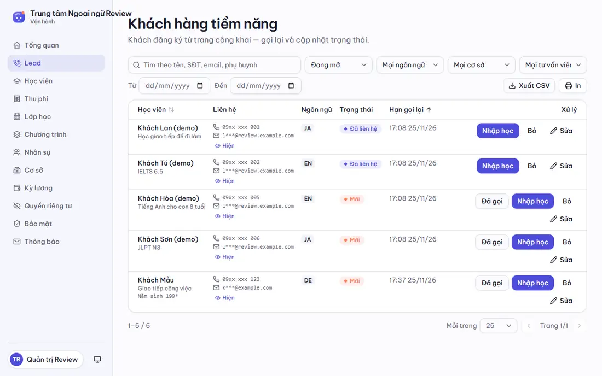
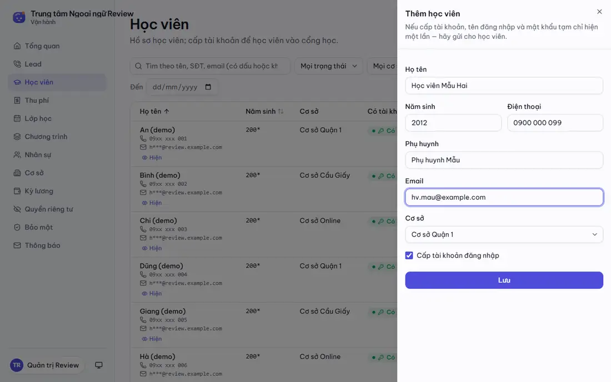
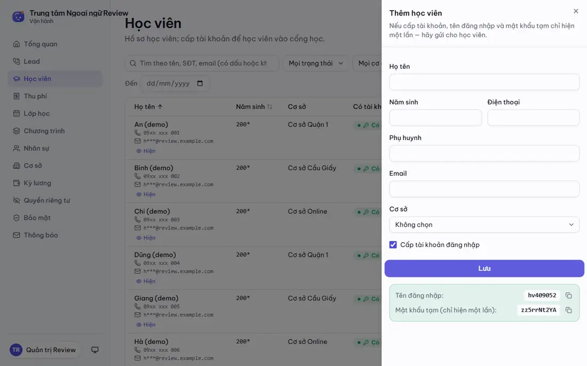
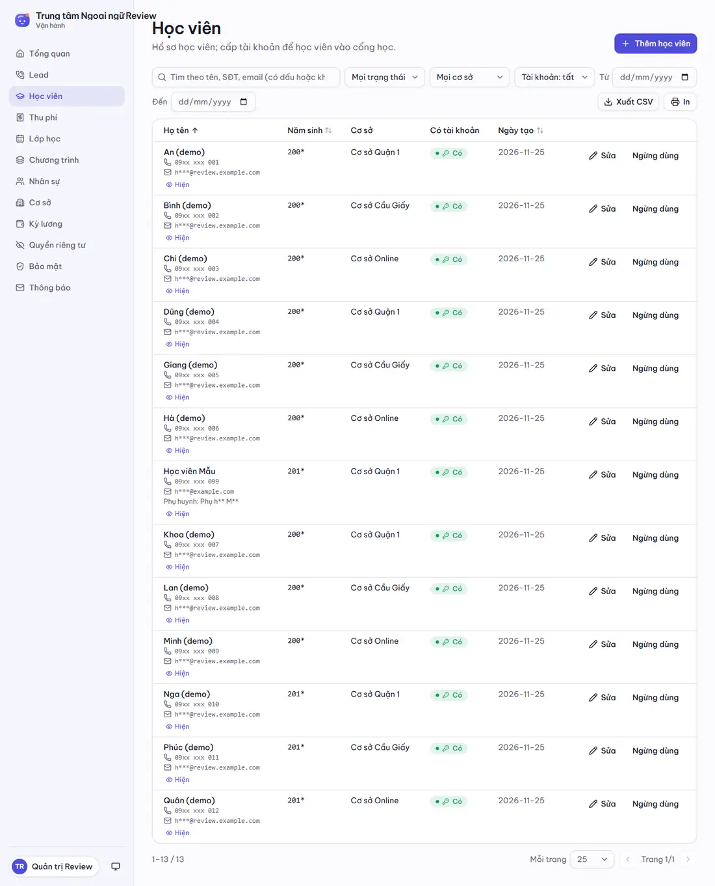

# Khu vực Vận hành: thao tác chung

[← Mục lục](README.md)

Phần dùng chung cho mọi nhân viên làm việc trong khu vực **Vận hành** (`/ops`): quản trị, quản lý cơ sở, điều phối, tư vấn, kế toán. Việc riêng của từng vai trò nằm ở trang vai trò đó.

## Bố cục

- **Thanh bên trái**: Tổng quan, Lead, Học viên, Thu phí, Lớp học, Chương trình, Nhân sự, Cơ sở, Kỳ lương. Quản trị có thêm **Quyền riêng tư**, **Bảo mật**, **Thông báo**. Cuối thanh là tên bạn (bấm để mở **Tài khoản & bảo mật** hoặc **Đăng xuất**) và nút đổi giao diện sáng / tối.
- **Tổng quan**: thẻ hướng dẫn nhanh theo vai trò (các bước bạn phụ trách, tự đánh dấu khi xong), 4 số **Lead đang mở**, **Học viên**, **Lớp đang chạy**, **Đơn chờ thanh toán**, và lối tắt tới từng mục.
- **Ngăn kéo bên phải**: mọi form thêm mới và sửa mở trong ngăn kéo. Điền, bấm **Lưu** (hoặc nút chính của form, như **Ghi nhận**, **Xếp lịch**); ngăn kéo tự đóng và bảng cập nhật. Lỗi (trùng mã, thiếu thông tin, thiếu quyền…) hiện ngay trong ngăn kéo. Bấm **×** hoặc phím Esc để đóng mà không lưu.

> Thanh bên hiện cùng một danh sách mục cho mọi vai trò. Mục nào bạn không có quyền thì trang mở ra trống, chỉ xem, hoặc báo "Bạn không có quyền thực hiện thao tác này". Xem [vai trò nào làm được gì](quy-tac-nghiep-vu.md#phân-quyền-theo-vai-trò-và-cơ-sở).

## Tìm, lọc, sắp xếp, phân trang

Các danh sách **Lead**, **Học viên**, **Đơn hàng** (trong Thu phí), **Lớp học**, **Nhân sự** có ô tìm kiếm và bộ lọc phía trên bảng.

- Ô tìm kiếm **không phân biệt dấu và hoa thường**: gõ "an" hay "Ân" đều ra Ân, An, Anh, Văn… Số điện thoại gõ có dấu cách, dấu chấm hay `+84` đều tìm được.
    - Lead, học viên: theo tên, số điện thoại, email, tên phụ huynh.
    - Đơn hàng: theo tên hoặc số điện thoại học viên.
    - Lớp: theo mã lớp. Nhân sự: theo tên, email.
- Bộ lọc: trạng thái, cơ sở, ngôn ngữ, hình thức, tư vấn viên, gói học, vai trò, khoảng ngày tạo / ngày khai giảng (tuỳ danh sách). **Bỏ lọc** đưa về mặc định.
- Bấm tiêu đề cột có mũi tên để sắp xếp, bấm lần nữa để đảo chiều.
- Mỗi trang 25 dòng; đổi 50 / 100 ở **Mỗi trang** cuối bảng, chuyển trang bằng **Trang trước** / **Trang sau**.
- Tìm kiếm, bộ lọc và trang đang xem nằm trên địa chỉ trang: sao chép link gửi đồng nghiệp là họ thấy đúng danh sách đã lọc (trong phạm vi quyền của họ).

## Dữ liệu cá nhân được che

Trong danh sách, số điện thoại, email, năm sinh và tên phụ huynh hiện dạng che: `09xx xxx 567`, `a***@example.com`, `201*`.

- Người giữ hồ sơ (quản trị, quản lý cơ sở, điều phối, tư vấn) bấm **Hiện** dưới liên hệ để xem đầy đủ **một người**, bấm **Ẩn** để che lại. Mở form **Sửa** cũng hiện đầy đủ.
- Mỗi lần hiện đều được ghi vào **nhật ký truy cập** (ai, lúc nào, hồ sơ nào). Chỉ hiện khi cần gọi hoặc sửa.
- Kế toán và giáo viên chỉ thấy dạng che, không có nút **Hiện**.
- Lịch sử thay đổi chỉ ghi giá trị đã che.

## Xuất CSV và In

Chỉ **quản trị** và **quản lý cơ sở**, ở trang **Học viên** và **Lead**.

- **Xuất CSV** tải file của đúng danh sách đang lọc; **In** mở bản in (liên hệ vẫn che, chân trang có dòng "In bởi … lúc … · Dữ liệu cá nhân: chỉ dùng cho công việc, không chia sẻ").
- Mỗi lần tối đa **2.000 dòng** (nhiều hơn thì lọc bớt) và tối đa **20 lần xuất + in mỗi người trong 24 giờ**.
- Mọi lần xuất / in đều vào nhật ký truy cập. File chứa dữ liệu cá nhân: chỉ dùng cho công việc, xoá khi xong, không gửi qua kênh công khai.

## Sửa, ngừng dùng, lịch sử thay đổi

- Mọi bản ghi đều sửa được bằng nút **Sửa** (biểu tượng bút) trên dòng hoặc thẻ của nó, nếu bạn có quyền.
- Bản ghi đã được dùng ở nơi khác (lớp, phòng, gói học, học viên, nhân sự, chương trình, cấp độ, cơ sở) **không xoá được** mà **Ngừng dùng**: giữ nguyên lịch sử, chỉ không chọn được cho việc mới. Bấm **Dùng lại** để mở lại. Riêng **ngày nghỉ** và **đơn giá** nhập nhầm thì **Xoá** được.
- Ngăn kéo sửa có mục **Lịch sử thay đổi**: ai sửa (hoặc **Hệ thống**), lúc nào, trường nào, giá trị cũ → mới. Trang chi tiết lớp và chi tiết cơ sở hiện lịch sử ở cuối trang.

## Học viên

Ai làm: quản trị, quản lý cơ sở, điều phối, tư vấn (thêm, sửa, ngừng dùng). Kế toán chỉ xem danh sách.

### Thêm học viên

1. **Học viên** → **Thêm học viên**.
2. Điền **Họ tên** (bắt buộc), **Năm sinh**, **Điện thoại**, **Phụ huynh**, **Email**, **Cơ sở** (cơ sở chính của học viên).
3. Đánh dấu **Cấp tài khoản đăng nhập** nếu học viên cần vào cổng học viên.
4. Bấm **Lưu**. Nếu có cấp tài khoản, ngăn kéo hiện **Tên đăng nhập** và **Mật khẩu tạm (chỉ hiện một lần)**: bấm **Sao chép**, gửi cho học viên (hoặc phụ huynh) trước khi đóng. Học viên phải đổi mật khẩu ở lần đăng nhập đầu.

| Form thêm học viên | Sau khi lưu |
| --- | --- |
|  |  |

Lỡ đóng ngăn kéo trước khi chép mật khẩu: quản trị vào **Bảo mật** → **Đặt lại mật khẩu** cho học viên đó để có mật khẩu tạm mới.

Học viên có email nhận email "Chào mừng" kèm tên đăng nhập (không kèm mật khẩu).

### Danh sách, sửa, ngừng dùng

- Bộ lọc: trạng thái (Đang dùng / Ngừng dùng), cơ sở, **Tài khoản** (Có tài khoản / Chưa có tài khoản), ngày tạo.
- **Sửa**: họ tên, năm sinh, liên hệ, phụ huynh, cơ sở, **Ngôn ngữ liên lạc** (Tiếng Việt / Tiếng Anh, quyết định ngôn ngữ email gửi cho học viên).
- **Ngừng dùng** khi học viên nghỉ hẳn: không tạo được đơn hay vào lớp mới; lớp và đơn cũ giữ nguyên. Ngừng dùng hồ sơ **không** tự rút học viên khỏi lớp hay hoàn tiền: dùng [Hoàn tiền](ke-toan.md#hoàn-tiền) cho việc đó.

Học viên **không** được thêm tay vào lớp: học viên vào lớp khi đơn hàng gắn lớp được trả đủ (xem [Quy trình: khách đăng ký → vào lớp](quy-trinh.md#1-khách-đăng-ký--học-viên-vào-lớp)).
